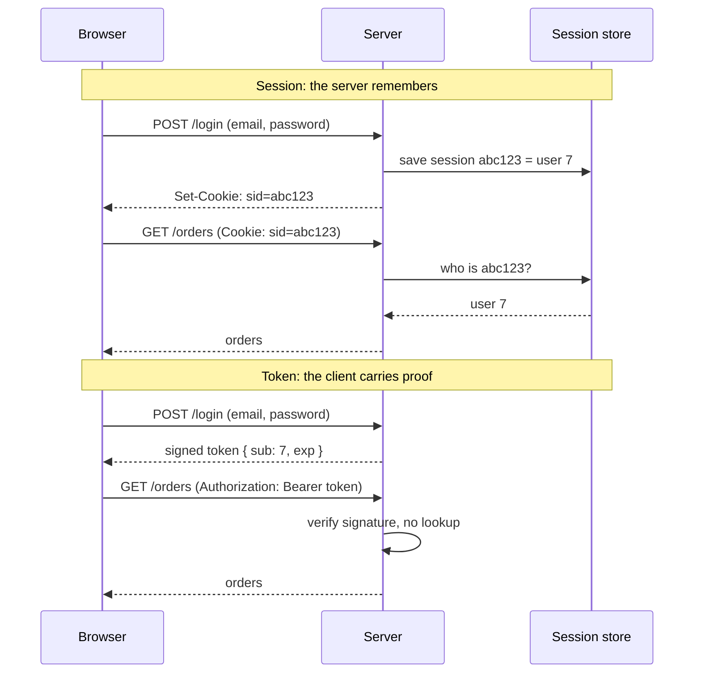

## The problem this solves

HTTP is stateless ([[rest-api]]): the server sees each request as coming from a stranger. Three separate problems follow.

1. **Authentication**: is this really Asha? (checked once, at login)
2. **Staying logged in**: how do later requests prove it without resending the password?
3. **Authorization**: is Asha allowed to do *this*?

## Part 1: storing passwords

Never store the password. Store something that can **verify** a password but cannot be turned back into one.

| Approach | What an attacker with the database gets |
| --- | --- |
| plain text | every password, instantly |
| fast hash (SHA-256) | billions of guesses per second on a GPU; identical passwords have identical hashes |
| fast hash + per-user salt | no shared lookup tables, but each password is still cheap to guess |
| **slow salted hash (bcrypt, scrypt, argon2)** | each guess costs tens of milliseconds by design |

```js run
const bcrypt = require('bcryptjs');

(async () => {
  const hash1 = await bcrypt.hash('correct horse', 10);
  const hash2 = await bcrypt.hash('correct horse', 10);
  console.log('same password, different hashes:', hash1 !== hash2);
  console.log('format:', hash1.slice(0, 7) + '<22-char salt><31-char hash>', 'length', hash1.length);
  console.log('right password:', await bcrypt.compare('correct horse', hash1));
  console.log('wrong password:', await bcrypt.compare('correct horsf', hash1));
})();
```

- A **salt** is random data mixed in before hashing, stored with the hash. It makes equal passwords hash differently and defeats precomputed tables.
- The **cost factor** (10 here) means 2^10 rounds. Raising it by one doubles the work, so the hash can be kept slow as hardware gets faster.
- Hashing is CPU work. Use the async API so it does not block the event loop ([[node-runtime]]).

## Part 2: staying logged in, sessions vs tokens



| | Session id | JWT |
| --- | --- | --- |
| State lives | on the server (Redis or a database) | inside the token, held by the client |
| Each request costs | one store lookup | one signature check |
| Log out or ban a user now | delete the session | hard: the token stays valid until it expires |
| Many servers or services | all need the shared store | any service with the key can verify |
| Size sent per request | small id | larger, grows with claims |

Neither is "more secure". Sessions give control, tokens give independence.

## Part 3: what a JWT is

A JSON Web Token is three base64url strings joined by dots: `header.payload.signature`.

```js run
const jwt = require('jsonwebtoken');
const SECRET = 'demo-secret-use-a-long-random-value-from-env';

const token = jwt.sign({ sub: 'user_7', role: 'editor' }, SECRET, { expiresIn: '15m' });
const [header, payload, signature] = token.split('.');
const decode = part => JSON.parse(Buffer.from(part, 'base64url').toString());

console.log('header   :', decode(header));
console.log('payload  :', { ...decode(payload), iat: '<issued-at>', exp: '<issued-at + 900s>' });
console.log('signature:', signature.length, 'chars = HMAC-SHA256(header.payload, secret)');
```

The payload is **encoded, not encrypted**. Anyone holding the token can read it. Never put secrets in it. What the signature gives is **integrity**: nobody can change the payload without the server noticing.

```js run
const jwt = require('jsonwebtoken');
const SECRET = 'demo-secret-use-a-long-random-value-from-env';
const attempt = (label, token, secret = SECRET) => {
  try { console.log(label.padEnd(18), 'accepted, role =', jwt.verify(token, secret).role); }
  catch (e) { console.log(label.padEnd(18), 'rejected:', e.name + ',', e.message); }
};

const token = jwt.sign({ sub: 'user_7', role: 'editor' }, SECRET, { expiresIn: '15m' });
attempt('genuine token', token);

const [h, p, s] = token.split('.');
const forged = Buffer.from(JSON.stringify({ ...JSON.parse(Buffer.from(p, 'base64url')), role: 'admin' })).toString('base64url');
attempt('payload edited', [h, forged, s].join('.'));
attempt('wrong secret', token, 'guess');
attempt('expired token', jwt.sign({ sub: 'user_7', role: 'editor', exp: Math.floor(Date.now() / 1000) - 60 }, SECRET));
```

**Why it works:** the signature is a keyed hash of `header.payload`. Change one character of the payload and the recomputed signature no longer matches; producing a matching one requires the secret, which only the server has.

## Part 4: the full flow in Express

```js run
const express = require('express'), jwt = require('jsonwebtoken'), bcrypt = require('bcryptjs');
const SECRET = 'demo-secret-use-a-long-random-value-from-env';
const app = express();
app.use(express.json());

const users = [{ id: 'user_7', email: 'asha@example.com', role: 'editor', passwordHash: bcrypt.hashSync('correct horse', 8) }];

app.post('/login', async (req, res) => {
  const user = users.find(u => u.email === req.body.email);
  const ok = user && await bcrypt.compare(req.body.password, user.passwordHash);
  if (!ok) return res.status(401).json({ error: 'invalid email or password' });
  res.json({ accessToken: jwt.sign({ sub: user.id, role: user.role }, SECRET, { expiresIn: '15m' }) });
});

const requireAuth = (req, res, next) => {
  const [scheme, token] = (req.get('authorization') || '').split(' ');
  if (scheme !== 'Bearer' || !token) return res.status(401).json({ error: 'missing token' });
  try { req.user = jwt.verify(token, SECRET); next(); }
  catch { res.status(401).json({ error: 'invalid or expired token' }); }
};
const requireRole = (...roles) => (req, res, next) =>
  roles.includes(req.user.role) ? next() : res.status(403).json({ error: 'forbidden' });

app.get('/me', requireAuth, (req, res) => res.json({ id: req.user.sub, role: req.user.role }));
app.delete('/posts/1', requireAuth, requireRole('admin'), (req, res) => res.status(204).end());

const server = app.listen(0, async () => {
  const base = `http://localhost:${server.address().port}`;
  const call = async (label, path, opts = {}) => {
    const r = await fetch(base + path, opts);
    const body = r.status === 204 ? '' : await r.json();
    console.log(label.padEnd(26), r.status, body.accessToken ? '{ accessToken: <jwt> }' : JSON.stringify(body));
    return body;
  };
  const json = { 'content-type': 'application/json' };
  await call('login, wrong password', '/login', { method: 'POST', headers: json, body: JSON.stringify({ email: 'asha@example.com', password: 'nope' }) });
  const { accessToken } = await call('login, right password', '/login', { method: 'POST', headers: json, body: JSON.stringify({ email: 'asha@example.com', password: 'correct horse' }) });
  await call('GET /me without token', '/me');
  await call('GET /me with token', '/me', { headers: { authorization: 'Bearer ' + accessToken } });
  await call('DELETE as editor', '/posts/1', { method: 'DELETE', headers: { authorization: 'Bearer ' + accessToken } });
  server.close(); server.closeAllConnections();
});
```

Read the middleware chain from [[express-middleware]]: `requireAuth` answers *who are you* (401 on failure), `requireRole` answers *may you* (403 on failure). `requireRole` is the closure factory from [[js-closures]]. The login error is the same for a wrong email and a wrong password, so it does not reveal which emails exist.

## Part 5: access and refresh tokens

The JWT weakness is revocation. The standard answer is two tokens:

| | Access token | Refresh token |
| --- | --- | --- |
| Lifetime | short, 5 to 15 minutes | long, days to weeks |
| Sent | on every API request | only to `/auth/refresh` |
| Checked by | signature only, no database | looked up in the database, so it can be revoked |
| Stored (browser) | in memory | `HttpOnly`, `Secure`, `SameSite` cookie |

When the access token expires, the client silently exchanges the refresh token for a new pair. On each use the refresh token is replaced (**rotation**); if an old one ever shows up again, it was stolen, so the whole family is revoked. Logging out deletes the refresh token, and the access token dies within minutes.

### Where to keep tokens in the browser

| Storage | XSS (injected script) | CSRF (forged cross-site request) |
| --- | --- | --- |
| `localStorage` | script can read and steal the token | not affected, nothing is sent automatically |
| `HttpOnly` cookie | script cannot read it | sent automatically, so needs `SameSite` and/or a CSRF token |

## The rule, stated precisely

`signature = HMAC(secret, base64url(header) + "." + base64url(payload))`. A token is accepted only if the signature recomputes exactly, `exp` is in the future, and the algorithm is the one the server expects. Authentication establishes identity; authorization is a separate check on every protected action.

!!! key
- Hashing (one-way, for passwords) vs encryption (reversible with a key) vs encoding (no secret at all, base64).
- JWT payloads are readable by anyone. Signed is not secret.
- 401 means not authenticated, 403 means not permitted.
- Know the trade-off sentence: "JWTs remove the session lookup but make immediate revocation hard, so I keep access tokens short and refresh tokens revocable."
- HS256 uses one shared secret (sign and verify). RS256 uses a private key to sign and a public key to verify, so other services can verify without being able to issue tokens.
- Always behind HTTPS; a token in plain HTTP is a password in plain HTTP ([[cn-http]]).
!!!

!!! trap
- Putting passwords, card data or anything private in the payload.
- Long-lived access tokens "for convenience".
- Accepting whatever algorithm the token header claims. Pin the algorithm on verify (the old `alg: none` attack).
- Checking roles only in the React UI. The UI hides buttons; only the server enforces.
- Trusting a role stored in the token after the user's role has changed. The token is a snapshot from login time.
!!!

!!! twist What changes if...
- **...you must log a user out everywhere immediately?** Keep a `tokenVersion` on the user and embed it in tokens; bump it to invalidate all of them. This reintroduces a lookup, which is the honest cost.
- **...the connection is a WebSocket?** There are no per-message headers. Authenticate once during the handshake, then trust the socket ([[websockets]]). The collab editor does this.
- **...services need to verify but must not issue tokens?** Switch to RS256 and publish the public key.
- **...login is "Sign in with Google"?** That is OAuth 2.0 / OpenID Connect: the provider authenticates the user and gives your server an identity token; you then issue your own session or JWT.
!!!

!!! model
bcrypt answers "is this the right password" without knowing the password. A JWT is a tamper-evident note the server writes to its future self: readable by all, forgeable by none.
!!!

## Practice

?? Walk through what happens from clicking "Log in" to seeing a protected page.
1. Browser POSTs email and password over HTTPS. 2. Server finds the user and runs `bcrypt.compare`. 3. Server signs an access token and creates a refresh token, stored hashed in the database. 4. Client keeps the access token in memory; the refresh token arrives in an `HttpOnly` cookie. 5. Each API call sends `Authorization: Bearer <access>`. 6. Middleware verifies signature and expiry, sets `req.user`. 7. On 401 for expiry, the client calls `/auth/refresh`, gets a new pair, and retries.
??

?? Why bcrypt and not SHA-256 for passwords?
SHA-256 is designed to be fast, so an attacker with the hashes can test billions of guesses per second. bcrypt is deliberately slow and tunable, and salts every hash, so each guess for each user costs real time.
??

?? If the payload is readable, what stops a user from changing `"role": "editor"` to `"admin"`?
The signature. It was computed over the original payload with the server's secret. An edited payload fails verification, as the second run above shows.
??

?? How do you revoke a JWT before it expires?
Pure JWTs cannot be revoked. Options, each adding server state: short expiry plus revocable refresh tokens; a denylist of token ids (`jti`) in Redis until they expire; or a per-user token version checked on each request.
??

?? XSS vs CSRF, one line each, and how token storage relates.
XSS: an attacker's script runs in your page and can do anything the page can, including reading `localStorage`. CSRF: another site makes the user's browser send a request to yours, and cookies ride along automatically. `HttpOnly` cookies resist token theft by XSS; `SameSite` cookies and CSRF tokens resist CSRF.
??

?? Authentication vs authorization with an example of each failing.
Authentication fails when the server cannot establish identity: no token, bad signature, expired, so 401. Authorization fails when identity is known but the action is not allowed: an editor calling an admin-only delete, so 403.
??
