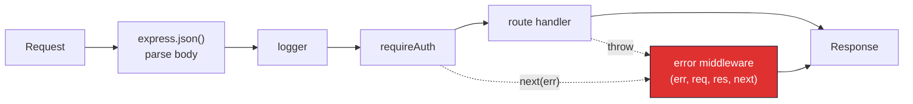

## The problem this solves

Every request needs the same chores before the real work: parse the body, log it, check who the user is, validate input. Afterwards, every failure must become a proper error response. Writing those chores inside each route duplicates them everywhere. We want to write each chore once and **compose** them.

## Intuition

A **middleware** is a function `(req, res, next)`. For each request Express walks its list of middleware in the order they were registered. Each one must do exactly one of three things:

1. **End the request** by sending a response (`res.json`, `res.send`).
2. **Pass control on** by calling `next()`.
3. **Report an error** by calling `next(err)` or throwing, which skips ahead to error-handling middleware.

`req` and `res` are the same two objects for the whole trip, so an early middleware can attach data (`req.user`) for later ones to read.



## Build it step by step

### Example 1: order is everything

```js run
const express = require('express');
const app = express();
const trail = [];

app.use((req, res, next) => { trail.push('A'); next(); });
app.use((req, res, next) => { req.startedAt = 'attached by B'; trail.push('B'); next(); });
app.get('/hello', (req, res) => { trail.push('handler'); res.json({ msg: 'hi', note: req.startedAt }); });
app.use((req, res, next) => { trail.push('never reached for /hello'); next(); });

const server = app.listen(0, async () => {
  const res = await fetch(`http://localhost:${server.address().port}/hello`);
  console.log(res.status, await res.json());
  console.log(trail.join(' -> '));
  server.close(); server.closeAllConnections();
});
```

The handler sent a response and did not call `next`, so the chain stopped there.

### Example 2: a middleware factory (closures at work)

```js run
const express = require('express');
const app = express();

const requireRole = role => (req, res, next) => {
  const user = { name: 'asha', role: req.get('x-role') };
  if (user.role !== role) return res.status(403).json({ error: 'forbidden: needs ' + role });
  req.user = user;
  next();
};

app.get('/admin/stats', requireRole('admin'), (req, res) => res.json({ visitors: 42, by: req.user.name }));

const server = app.listen(0, async () => {
  const url = `http://localhost:${server.address().port}/admin/stats`;
  for (const role of ['viewer', 'admin']) {
    const res = await fetch(url, { headers: { 'x-role': role } });
    console.log(role.padEnd(6), res.status, await res.json());
  }
  server.close(); server.closeAllConnections();
});
```

`requireRole('admin')` returns a middleware that remembers `role`, the factory pattern from [[js-closures]]. Middleware can be global (`app.use`), mounted on a path (`app.use('/api', fn)`) or attached to one route as here. The real version reads the user from a verified token; that is [[auth-jwt]].

### Example 3: routers, params, query, body

```js run
const express = require('express');
const app = express();
app.use(express.json());

const todos = express.Router();
const db = [{ id: 1, title: 'learn middleware', done: false }];
todos.get('/', (req, res) => res.json(db.filter(t => req.query.done === undefined || String(t.done) === req.query.done)));
todos.get('/:id', (req, res) => {
  const todo = db.find(t => t.id === Number(req.params.id));
  todo ? res.json(todo) : res.status(404).json({ error: 'todo not found' });
});
todos.post('/', (req, res) => {
  const todo = { id: db.length + 1, title: req.body.title, done: false };
  db.push(todo);
  res.status(201).json(todo);
});
app.use('/api/todos', todos);

const server = app.listen(0, async () => {
  const base = `http://localhost:${server.address().port}/api/todos`;
  let r = await fetch(base, { method: 'POST', headers: { 'content-type': 'application/json' }, body: JSON.stringify({ title: 'write a router' }) });
  console.log('POST /        ', r.status, await r.json());
  r = await fetch(base + '/2');            console.log('GET /2        ', r.status, await r.json());
  r = await fetch(base + '/99');           console.log('GET /99       ', r.status, await r.json());
  r = await fetch(base + '?done=false');   console.log('GET ?done=false', r.status, (await r.json()).length, 'items');
  server.close(); server.closeAllConnections();
});
```

| Where the data is | Read it from | Example |
| --- | --- | --- |
| part of the path | `req.params` | `/todos/:id` |
| after the `?` | `req.query` | `?done=false&page=2` |
| request body | `req.body` (needs `express.json()` first) | JSON payload of a POST |
| headers | `req.get('authorization')` | tokens, content type |

Without `express.json()` registered **before** the routes, `req.body` is `undefined`. A `Router` is a mini-app: its own middleware and routes, mounted under a prefix. How to name these routes and choose status codes is [[rest-api]].

### Example 4: centralized error handling

```js run
const express = require('express');
const app = express();

class HttpError extends Error { constructor(status, message) { super(message); this.status = status; } }

app.get('/sync', (req, res) => { throw new HttpError(400, 'bad input'); });
app.get('/async', async (req, res) => { await Promise.reject(new HttpError(503, 'database down')); });
app.use((req, res) => res.status(404).json({ error: 'route not found' }));
app.use((err, req, res, next) => {
  res.status(err.status || 500).json({ error: err.status ? err.message : 'internal error' });
});

const server = app.listen(0, async () => {
  for (const path of ['/sync', '/async', '/nope']) {
    const r = await fetch(`http://localhost:${server.address().port}${path}`);
    console.log(path.padEnd(7), r.status, await r.json());
  }
  server.close(); server.closeAllConnections();
});
```

Error middleware is recognized by having **four parameters**. It goes last. Throw anywhere, format the response in one place, and never leak internal messages or stack traces for unexpected errors.

## The rule, stated precisely

Express keeps one ordered stack of layers. For a request it runs the first layer whose path and method match; `next()` moves to the next matching layer; `next(err)` jumps to the next layer with four parameters. If a layer neither responds nor calls `next`, the request hangs until the client times out.

!!! key
- Order of registration is order of execution: parsers, then auth, then routes, then the 404 handler, then the error handler.
- **Express 4 vs 5**: in Express 5 (used for the runs above) a rejected promise from an async handler is forwarded to the error middleware automatically. In Express 4 it is not; you must `try/catch` and call `next(err)` or wrap handlers in an `asyncHandler`. Interviewers still ask this.
- Common middleware to name: `express.json`, `cors`, `helmet` (security headers), `morgan` (logging), `express-rate-limit`, `cookie-parser`.
- Typical layering in a project: **route → controller → service → model**. Routes map URLs, controllers handle HTTP, services hold business rules, models talk to the database ([[mongo-modeling]]).
!!!

!!! trap
- Sending two responses: forgetting `return` after `res.status(403).json(...)` and falling through to `next()` gives "Cannot set headers after they are sent".
- Registering `express.json()` or auth after the routes that need them.
- Error middleware with three parameters. Express treats it as normal middleware and never calls it for errors.
- Trusting `req.body`. Validate shape and types at the edge before using it.
!!!

!!! twist What changes if...
- **...you need to run code after the response?** Listen for `res.on('finish', ...)` in a middleware. That is how request loggers measure duration.
- **...a middleware should apply to every route except login?** Mount it on a router that holds the protected routes, and register the public routes outside that router.
- **...the browser sends an OPTIONS request first?** That is a CORS preflight for cross-origin requests with custom headers or non-simple methods. The `cors` middleware answers it.
!!!

!!! model
A conveyor belt. Each station inspects or stamps the package (`req`), then passes it on, ships it (`res`), or pulls the alarm (`next(err)`).
!!!

## Practice

?? Write an `asyncHandler` wrapper for Express 4.
It converts a rejected promise into `next(err)`.

```js run
const asyncHandler = fn => (req, res, next) => Promise.resolve(fn(req, res, next)).catch(next);

const route = asyncHandler(async () => { throw new Error('db timeout'); });
route({}, {}, err => console.log('forwarded to error middleware:', err.message));
```
??

?? Write a request logger that prints method, path, status and duration.
```js run
const express = require('express');
const app = express();
app.use((req, res, next) => {
  const t = process.hrtime.bigint();
  res.on('finish', () => console.log(req.method, req.originalUrl, res.statusCode, Number(process.hrtime.bigint() - t) < 1e9 ? 'under 1s' : 'slow'));
  next();
});
app.get('/ping', (req, res) => res.send('pong'));
const server = app.listen(0, async () => {
  await fetch(`http://localhost:${server.address().port}/ping`);
  server.close(); server.closeAllConnections();
});
```
??

?? What is the difference between `app.use` and `app.get`?
`app.use(path, fn)` matches any HTTP method and any path that *starts with* `path`. `app.get(path, fn)` matches only GET and the full path pattern. `use` is for middleware and mounting routers; `get`/`post`/... are for endpoints.
??

?? What is CORS and who enforces it?
The browser's same-origin policy blocks a page from reading responses from a different origin (scheme + host + port) unless the server opts in with `Access-Control-Allow-Origin` headers. The browser enforces it, not the server; tools like curl are unaffected. It protects users, it is not an authentication mechanism.
??

?? A request hangs forever. What are the likely causes in middleware?
A middleware that neither responds nor calls `next()`; an early `return` in one branch without a response; an awaited promise that never settles (for example a database call with no timeout); or in Express 4, an async error that was never passed to `next`.
??

?? Why keep controllers thin and put logic in services?
HTTP details (status codes, headers, `req`/`res`) stay in one layer, so business rules can be unit-tested without a server and reused from other entry points such as a queue worker or a WebSocket handler. All three projects follow this split.
??
