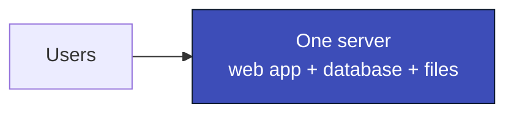
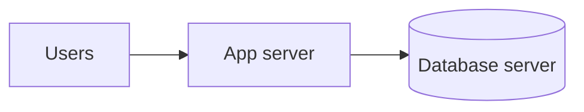
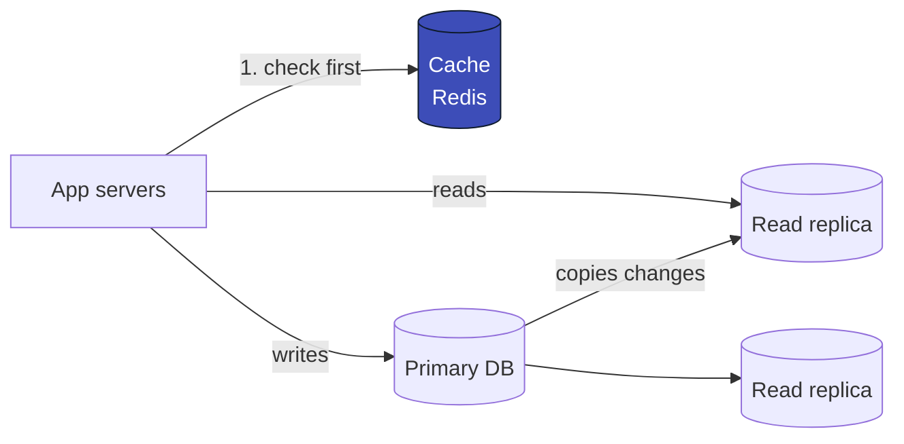
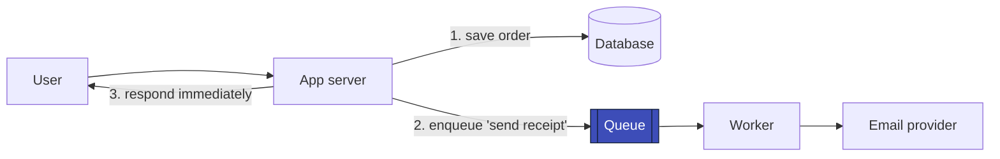
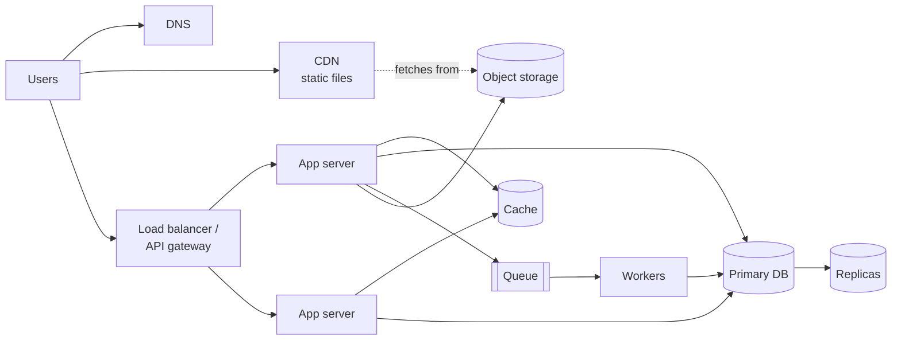

## The problem this solves

System design diagrams are full of boxes: load balancer, cache, queue, CDN, replica. Beginners memorize the boxes and then cannot say why any of them is there. This station builds the standard picture **one problem at a time**, so each box arrives with its reason. Every later HLD station goes deep on one of these boxes.

High-level design (HLD) is about **which machines and services exist and how data moves between them**. Which classes live inside one service is low-level design ([[lld-uml]]).

## Stage 0: one machine



Your Express app ([[express-first-app]]) and MongoDB ([[mongo-crud]]) on a single computer. For a class project or a product with a few hundred users this is correct, and saying so in an interview is a strength. It has three weaknesses, and everything else in system design exists to fix them:

| Weakness | Meaning |
| --- | --- |
| **Single point of failure** | the machine dies, the product is down |
| **Limited capacity** | one machine can only do so much work |
| **Everything competes** | a heavy database query slows the web app on the same CPU |

## Stage 1: how users find you, DNS

People type `shop.example.com`; computers connect to IP addresses like `203.0.113.10`. The **Domain Name System** is the phone book that translates.

```js run
const cache = new Map();
const authoritative = { 'shop.example.com': { ip: '203.0.113.10', ttl: 300 } };
let lookups = 0;

function resolve(name, now) {
  const hit = cache.get(name);
  if (hit && hit.expires > now) return `${hit.ip} (from cache)`;
  lookups++;
  const record = authoritative[name];
  if (!record) return 'NXDOMAIN: no such name';
  cache.set(name, { ip: record.ip, expires: now + record.ttl * 1000 });
  return `${record.ip} (asked the DNS servers)`;
}
console.log('t=0s   ', resolve('shop.example.com', 0));
console.log('t=10s  ', resolve('shop.example.com', 10_000));
authoritative['shop.example.com'].ip = '198.51.100.7';
console.log('t=60s  ', resolve('shop.example.com', 60_000), ' <- server moved, but the old answer is still cached');
console.log('t=301s ', resolve('shop.example.com', 301_000));
console.log('real lookups:', lookups, 'of 4');
```

Two ideas to carry forward. DNS answers are **cached** for a time to live (TTL), which makes lookups fast and means changes take a while to spread. And DNS is the first place traffic can be **directed**: one name can map to several addresses, or to different regions for different users. The details are in [[cn-dns-ip]].

## Stage 2: separate the database



Move the database to its own machine. The two no longer fight over CPU and memory, and each can be sized for its job: the app needs CPU, the database needs memory and fast disks. This is the first use of a rule you will apply constantly: **separate things that scale differently.**

## Stage 3: more app servers and a load balancer

One app server is still a single point of failure and a capacity ceiling. Run several identical copies and put a **load balancer** in front to spread requests among them.

```js run
const servers = [{ name: 'app-1', healthy: true }, { name: 'app-2', healthy: true }, { name: 'app-3', healthy: true }];
let next = 0;
function route() {
  for (let tries = 0; tries < servers.length; tries++) {
    const server = servers[next++ % servers.length];
    if (server.healthy) return server.name;
  }
  return '503 no healthy servers';
}
console.log('all healthy :', Array.from({ length: 6 }, route).join(' '));
servers[1].healthy = false;
console.log('app-2 down  :', Array.from({ length: 6 }, route).join(' '), ' <- users notice nothing');
```

The load balancer checks each server's health and skips dead ones, so losing a server costs capacity, not availability. This only works if the servers are **stateless**: any server must be able to handle any request, so nothing a user needs may live in one server's memory. Algorithms, statelessness and availability maths are in [[hld-scaling]].

### Forward proxy, reverse proxy, API gateway

Three terms for "a machine in the middle".

| | Sits in front of | Hides | Used for |
| --- | --- | --- | --- |
| **Forward proxy** | clients | the clients from the internet | company or school networks, VPNs |
| **Reverse proxy** | servers | the servers from the internet | TLS termination, caching, compression, load balancing (nginx) |
| **API gateway** | many backend services | which service handles what | one entry point: routing, authentication, rate limiting |

A load balancer is a reverse proxy whose main job is distribution. Products blur these lines; name the job you need done.

## Stage 4: the database is now the bottleneck

All those app servers talk to one database. Three tools, used in this order:



| Tool | Idea | Gives | Costs | Station |
| --- | --- | --- | --- | --- |
| **Cache** | keep popular results in memory | reads in microseconds; fewer database queries | data can be stale | [[hld-caching]] |
| **Replication** | copies of the database; writes go to one primary, reads spread over replicas | read capacity; survive a database failure | replicas lag slightly behind | [[hld-data]] |
| **Sharding** | split the data across machines by a key | write capacity and storage | cross-shard queries become hard | [[hld-data]] |

```js run
const db = { queries: 0, get(id) { this.queries++; return { id, name: 'product ' + id }; } };
const cache = new Map();
const getProduct = id => cache.get(id) ?? (cache.set(id, db.get(id)), cache.get(id));

const traffic = Array.from({ length: 1000 }, (_, i) => (i % 10 < 8 ? 1 + (i % 5) : 100 + i));
traffic.forEach(getProduct);
console.log(`1000 requests -> ${db.queries} database queries (${100 - db.queries / 10}% served from cache)`);
```

Most requests ask for a few popular items, which is why a small cache removes most of the load.

## Stage 5: static files and a CDN

Images, CSS, JavaScript and video do not change per user. Serving them from your app servers wastes capacity, and a user far from your data center waits for every byte to cross the world.

- **Object storage** (such as S3): a service for storing files of any size cheaply and durably. The app stores a file there and keeps only its URL in the database.
- **CDN** (content delivery network): copies of your static files on servers in many cities. A user is served from the nearest one.

```js run
const latencyMs = { 'Mumbai->Mumbai edge': 12, 'Mumbai->Virginia origin': 220, 'London->London edge': 9, 'London->Virginia origin': 85 };
for (const city of ['Mumbai', 'London']) {
  const origin = latencyMs[`${city}->Virginia origin`], edge = latencyMs[`${city}->${city} edge`];
  console.log(`${city.padEnd(7)} 30 files from origin: ${origin * 30} ms | from CDN edge: ${edge * 30} ms`);
}
```

Illustrative round-trip numbers, but the proportion is real: distance is latency, and a page needs dozens of files.

## Stage 6: slow work goes to a queue

Some work should not make the user wait: sending email, resizing an image, generating a report, charging a card through a slow provider. The app puts a **message** on a **queue** and responds at once; separate **worker** processes take messages and do the work.



A queue also absorbs spikes (work piles up and is processed steadily) and survives failures (a message stays until a worker finishes it). Delivery guarantees and patterns are in [[hld-messaging]]; the Node implementation is in [[node-scaling]].

## The standard picture



| Block | The problem it answers |
| --- | --- |
| DNS | how do users find the system? |
| CDN + object storage | static files are large, global and identical for everyone |
| Load balancer | one server is a ceiling and a single point of failure |
| Stateless app servers | so that servers can be added and removed freely |
| Cache | the same data is read far more often than it changes |
| Replicas | reads exceed one database; the database must survive failure |
| Sharding | data or writes exceed one machine |
| Queue + workers | slow or bursty work must not block the user |

**You do not start with this picture.** You start at stage 0 and add a block when a requirement or a number demands it. That discipline, and how to run the interview around it, is [[hld-framework]].

## Two words used in every design discussion

| | Meaning | Measured as |
| --- | --- | --- |
| **Latency** | how long one request takes | milliseconds; usually the 95th or 99th percentile |
| **Throughput** | how many requests are handled per unit of time | requests per second (RPS or QPS) |
| **Availability** | the fraction of time the system works | "three nines" = 99.9% ≈ 8.8 hours down per year |
| **Scalability** | can it handle more load by adding resources? | vertical (bigger machine) vs horizontal (more machines) |
| **Consistency** | does every reader see the latest write? | strong vs eventual ([[hld-data]]) |

!!! key
- Start with one server; add each block for a named reason.
- Stateless app servers behind a load balancer; state lives in shared stores.
- Scale the database with a cache, then replicas, then sharding, in that order.
- Static content: object storage plus CDN.
- Slow or bursty work: queue plus workers.
- Reverse proxy vs forward proxy vs API gateway.
- Latency, throughput, availability, scalability, consistency.
!!!

!!! trap
- Drawing every box for a system with a thousand users.
- "Add a cache" or "add Kafka" with no stated problem.
- Forgetting that the load balancer, the cache and the queue are themselves machines that can fail and must be redundant.
- Storing uploaded files or sessions on an app server's own disk or memory once there are several servers.
- Treating replication as a way to scale writes. It scales reads; writes still go to one primary.
!!!

!!! twist What changes if...
- **...the system must push updates to users (chat, live scores)?** Add long-lived WebSocket connections, which make some servers stateful ([[websockets]]).
- **...the team and codebase grow large?** Split the app into independently deployed services ([[hld-microservices]]).
- **...a dependency fails or slows down?** Timeouts, retries and circuit breakers keep the failure from spreading ([[hld-reliability]]).
- **...users are on several continents?** Run the whole picture in several regions and decide where writes go ([[hld-data]]).
!!!

!!! model
One box that does everything, then split wherever two concerns need to grow, fail or change separately. Each split buys capacity or resilience and costs a network hop and a consistency question.
!!!

## Practice

?? Your single-server app is slow. Before adding any component, what do you check?
Where the time goes: CPU, memory, disk and the slowest database queries. A missing index ([[mongo-indexes]]) or one blocking call ([[node-runtime]]) is far more common than a real capacity limit, and adding servers would not fix either.
??

?? Why must app servers be stateless before you put them behind a load balancer?
The balancer may send a user's next request to a different server. If login state or a cart lived in the first server's memory, the second would not know the user. With state in a shared store or in a token, every server gives the same answer.
??

?? What is the difference between a cache and a read replica?
A cache holds selected results in memory, is very fast, may be stale and can be lost without harm. A replica is a full copy of the database on disk that answers any query, lags slightly and also provides failover. Caches cut repeated work; replicas add query capacity.
??

?? Draw (describe) the design for a photo-sharing app with 50,000 users, and justify each block.
Load balancer and two or three stateless app servers (availability). One database with a replica (failover, and reads dominate). Photos in object storage behind a CDN (large static files, served near users). A queue with workers to create thumbnails after upload (slow work off the request path). A cache for hot profile and feed data if measurements show the database is strained. Nothing more at this scale.
??

?? Is a load balancer a reverse proxy?
Yes: it sits in front of servers and forwards client requests to them. "Reverse proxy" is the general role; "load balancer" names the specific job of distributing across several backends. One product (nginx, a cloud balancer) often does both along with TLS termination.
??
