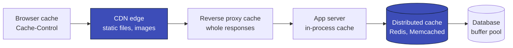

## The problem this solves

Most systems read far more than they write, and the same few items are read again and again (a popular product, a celebrity's profile). Recomputing or re-fetching the same answer from a database every time wastes the slowest resource in the system. From the latency table in [[hld-framework]]: memory is about 100 ns, a database query with network is milliseconds. A cache trades **memory and freshness** for **speed and reduced load**.

## Intuition: caches exist at every layer



A request is answered by the first layer that has the data; the further left, the cheaper. The two you will draw in interviews are the **CDN** and the **distributed cache**.

## Decision 1: how the cache is read and written

| Pattern | Read path | Write path | Trade-off |
| --- | --- | --- | --- |
| **Cache-aside** (lazy loading) | app checks cache; on a miss reads DB and fills cache | app writes DB, then deletes the cache key | most common; first read is slow; brief staleness possible |
| **Read-through** | app asks the cache; the cache loads from DB on a miss | same as above | same behaviour, loading logic lives in the cache layer |
| **Write-through** | from cache | app writes cache, cache writes DB synchronously | cache always fresh; every write pays for both |
| **Write-behind** (write-back) | from cache | app writes cache; DB updated asynchronously in batches | very fast writes; data lost if the cache dies before flushing |

Cache-aside with a TTL was built and run in [[node-scaling]]. Use it unless you can say why another fits better.

## Decision 2: what to evict when memory is full

### Example 1: an LRU cache in O(1)

**Least recently used**: when full, drop the item that has gone unused the longest. The interview version needs O(1) `get` and `put`: a hash map for lookup plus a doubly linked list for recency order. A JavaScript `Map` remembers insertion order, so it provides both.

```js run
class LRUCache {
  constructor(capacity) { this.capacity = capacity; this.map = new Map(); }
  get(key) {
    if (!this.map.has(key)) return -1;
    const value = this.map.get(key);
    this.map.delete(key); this.map.set(key, value);
    return value;
  }
  put(key, value) {
    this.map.delete(key);
    this.map.set(key, value);
    if (this.map.size > this.capacity) this.map.delete(this.map.keys().next().value);
  }
}
const cache = new LRUCache(2);
cache.put('a', 1); cache.put('b', 2);
console.log('get a ->', cache.get('a'), '  (a is now most recent)');
cache.put('c', 3);
console.log('after put c: keys =', [...cache.map.keys()].join(','), '  b was evicted');
console.log('get b ->', cache.get('b'));
```

Deleting and re-inserting moves a key to the "most recent" end; the first key in the map is always the least recent. In a language without an ordered map you write the linked list yourself; the idea is identical.

| Policy | Evicts | Fits |
| --- | --- | --- |
| LRU | least recently used | general purpose; recent access predicts future access |
| LFU | least frequently used | stable popularity (a few items always hot) |
| FIFO | oldest inserted | simple, ignores usage |
| TTL | anything past its expiry | data with a known freshness window |

## Decision 3: what goes wrong

### Example 2: a cache stampede and the fix

A hot key expires. A hundred concurrent requests all miss and all query the database for the same thing at once.

```js run
let dbCalls = 0;
const db = async key => { dbCalls++; await new Promise(r => setTimeout(r, 30)); return 'value-of-' + key; };

const cache = new Map(), inFlight = new Map();
async function getNaive(key) { return cache.get(key) ?? db(key).then(v => (cache.set(key, v), v)); }
async function getCoalesced(key) {
  if (cache.has(key)) return cache.get(key);
  if (!inFlight.has(key)) inFlight.set(key, db(key).then(v => { cache.set(key, v); inFlight.delete(key); return v; }));
  return inFlight.get(key);
}

(async () => {
  await Promise.all(Array.from({ length: 100 }, () => getNaive('hot')));
  console.log('naive: 100 concurrent misses ->', dbCalls, 'database queries');
  cache.clear(); dbCalls = 0;
  await Promise.all(Array.from({ length: 100 }, () => getCoalesced('hot')));
  console.log('coalesced: 100 concurrent misses ->', dbCalls, 'database query');
})();
```

The first request stores its **promise**; everyone else awaits the same promise ([[js-promises]]). Across several servers the equivalent is a short lock in Redis so only one server recomputes.

| Problem | What happens | Fix |
| --- | --- | --- |
| **Stampede** (thundering herd) | a hot key expires, many requests recompute it at once | request coalescing or a lock; refresh shortly before expiry |
| **Avalanche** | many keys expire at the same moment, or the cache restarts empty | add random jitter to TTLs; warm the cache; replicate it |
| **Penetration** | requests for keys that do not exist always miss and hit the DB (often an attack) | cache the "not found" result briefly; a Bloom filter in front |
| **Stale data** | DB updated, cache still has the old value | delete on write, short TTL, or version the key |
| **Hot key** | one key gets so much traffic that one cache node is overloaded | replicate that key, or keep a tiny in-process copy |

### Example 3: a Bloom filter

A Bloom filter answers "is this key possibly in the set?" using a few bits per item. It can say **definitely not** or **maybe**, never a false "no".

```js run
class BloomFilter {
  constructor(bits = 256, hashes = 3) { this.bits = new Uint8Array(bits); this.k = hashes; }
  positions(key) {
    return Array.from({ length: this.k }, (_, seed) =>
      [...key].reduce((h, c) => (h * (31 + seed * 6) + c.charCodeAt(0)) >>> 0, 7 + seed) % this.bits.length);
  }
  add(key) { this.positions(key).forEach(p => (this.bits[p] = 1)); }
  mightContain(key) { return this.positions(key).every(p => this.bits[p] === 1); }
}
const existing = new BloomFilter();
['aZ3k9Q', 'Qm81xL', 'p0Tt2e', ...Array.from({ length: 37 }, (_, i) => 'code' + i)].forEach(code => existing.add(code));
console.log('aZ3k9Q (exists)  :', existing.mightContain('aZ3k9Q'));
console.log('zzzzzz (missing) :', existing.mightContain('zzzzzz'), '-> skip the database entirely');
const falsePositives = Array.from({ length: 1000 }, (_, i) => 'miss' + i).filter(k => existing.mightContain(k)).length;
console.log('40 keys stored in 256 bits. False positives in 1000 missing keys:', falsePositives);
```

Each key sets k bit positions. A lookup checks those positions: any zero means the key was never added. All ones means "probably", because other keys may have set those bits. Used in front of databases and caches to reject lookups for keys that cannot exist.

## Decision 4: the CDN

A **content delivery network** is a cache spread over hundreds of locations near users. A user in Jaipur fetches an image from an edge in India instead of an origin server on another continent: about 10 ms instead of 150.

| | Pull CDN | Push CDN |
| --- | --- | --- |
| How content arrives | edge fetches from origin on the first request, then caches | you upload to the CDN ahead of time |
| First request | slow (a miss) | fast |
| Fits | most websites; content changes often | large files released on a schedule (video, installers) |

What the browser and CDN may cache is controlled by HTTP headers ([[cn-http]]):

| Header | Meaning |
| --- | --- |
| `Cache-Control: public, max-age=31536000, immutable` | anyone may cache for a year; used with fingerprinted file names like `app.3f9a.js` |
| `Cache-Control: private, no-cache` | only the browser may store it, and must revalidate each time |
| `Cache-Control: no-store` | never store (banking pages) |
| `ETag` + `If-None-Match` | "has it changed?" The server answers `304 Not Modified` with no body if not |

To update a cached file you cannot wait a year: change the file name (content hash in the name) so it is a new URL. That is **cache busting**.

## The rule, stated precisely

A cache is correct only with respect to a stated freshness bound. Every cached item needs: a key that fully determines the value, a rule for when it stops being valid (TTL or explicit invalidation), and a plan for the miss path under concurrency.

!!! key
- Say what you cache, where, the key, the TTL and how it is invalidated. "Add Redis" alone is not an answer.
- Cache-aside is the default; know the other three by name and trade-off.
- LRU in O(1): hash map plus doubly linked list. It is also a frequent coding question.
- The three failure names: stampede, avalanche, penetration.
- Redis vs Memcached: both in-memory key-value. Redis adds data structures (lists, sets, sorted sets), persistence, pub/sub, replication and scripting. Memcached is simpler and multithreaded.
- Never cache per-user data under a shared key, and never trust a cache for money or stock at the moment of purchase.
!!!

!!! trap
- "There are only two hard things in computer science: cache invalidation and naming things." Designs that never mention invalidation fail the follow-up.
- Updating the cache then the database (or the reverse) without thinking about concurrent writers: two writers can leave the cache holding the older value. **Delete** the key on write and let the next read refill it.
- Caching everything. A low hit rate means you pay memory and complexity for nothing.
- An in-process cache on each of 10 servers: 10 different versions of the truth.
!!!

!!! twist What changes if...
- **...the cache cluster needs more nodes?** With `hash(key) % N`, changing N remaps almost every key and the cache is effectively empty. Consistent hashing moves only about 1/N of keys ([[hld-data]]).
- **...the data must never be stale (account balance)?** Do not cache it, or use write-through with the database as the source of truth and very short TTLs.
- **...a leaderboard must be fast?** Use a Redis sorted set: scores are kept ordered, so top-N and rank queries are logarithmic. The online judge does this.
!!!

!!! model
A cache is a bet that the past predicts the future. Decide what you are betting on, for how long, and what happens when the bet is wrong.
!!!

## Practice

?? Design the caching for a product page: 1 million products, 95% of traffic on 1% of them.
Cache-aside in Redis keyed by `product:{id}`, TTL around 10 minutes with jitter, LRU eviction sized for the hot 1% plus headroom. Invalidate (delete) on product update. Images and static files on a CDN with long `max-age` and hashed file names. Price and stock shown on the page may be slightly stale; they are re-read from the database inside the order transaction ([[mongo-transactions]]).
??

?? Two requests update the same row at nearly the same time and both then write the cache. How can the cache end up wrong?
Writer A updates the DB to 1, writer B updates it to 2, B writes the cache (2), then A, delayed, writes the cache (1). The DB says 2 and the cache says 1 until the TTL. Deleting the key instead of setting it removes most of this window; a version number on the value closes it.
??

?? Why is LRU usually preferred to LFU?
LFU needs counters and reacts slowly: an item that was popular last week keeps a high count and squats in the cache, while a newly popular item struggles to enter. LRU adapts immediately to changing access patterns and is simple to implement in O(1). LFU wins when popularity is stable.
??

?? What should happen when Redis goes down?
The app must treat cache errors as misses and fall back to the database, with timeouts so a slow cache does not stall requests, and with rate limits or load shedding so the database is not crushed by the full uncached load. Run the cache with replicas so this is rare.
??

?? What is the difference between a CDN and a cache like Redis?
A CDN caches whole HTTP responses (mostly static files) at edge locations near users, keyed by URL, controlled by HTTP headers. Redis is an application-level key-value store inside your data center holding whatever your code puts in it: query results, sessions, counters. They solve latency at different layers and are used together.
??
