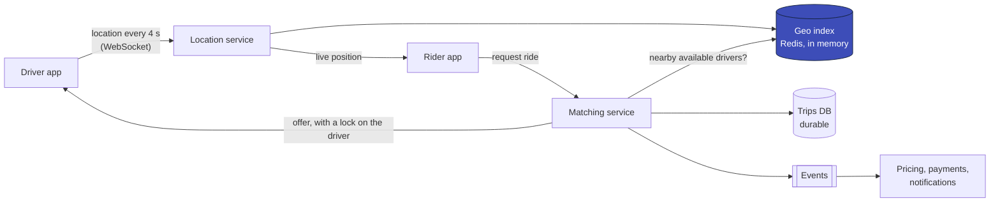
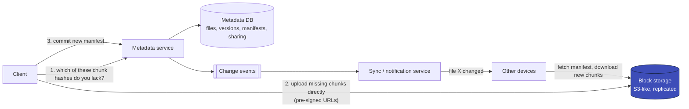
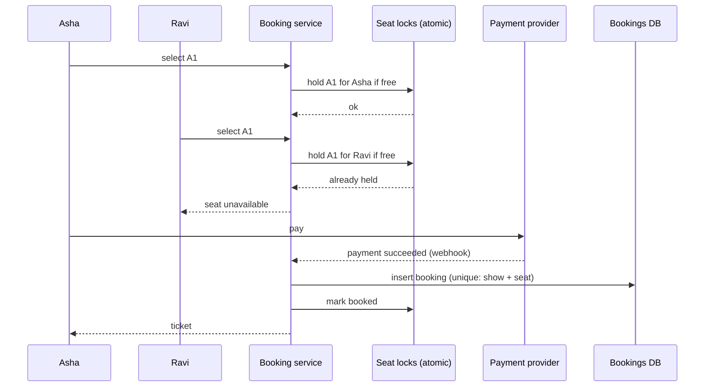

## How to use this station

Same method as [[hld-case-studies]]: requirements, estimates, API, data, diagram, deep dive, trade-offs ([[hld-framework]]). Find the one requirement that makes the system hard and spend your time there.

| Case | The hard part | Key idea |
| --- | --- | --- |
| Ride hailing (Uber) | "which drivers are near this rider?" among millions of moving points | a geospatial index |
| File storage (Dropbox) | uploading and syncing large files over unreliable networks | chunking and content hashing |
| Ticket booking (BookMyShow) | two people must never get the same seat | a short-lived hold, then an atomic confirm |

## Case 1: ride hailing

**Requirements.** A rider requests a ride from A to B; the system finds nearby available drivers and matches one; both see each other's live location; the trip is priced and paid. Non-functional: a match within a few seconds; location updates are frequent and may be lost occasionally; a driver must never be assigned two rides at once.

**Estimates.** One million active drivers sending a location every 4 seconds is 250,000 writes per second. That number shapes the design: location data is high-volume, short-lived and does not belong in the main database.

### Deep dive: finding nearby drivers

The naive way computes the distance from the rider to every driver.

```js run
const drivers = Array.from({ length: 200000 }, (_, i) => ({ id: i, lat: 26.5 + ((i * 7919) % 10000) / 10000, lng: 75.5 + ((i * 104729) % 10000) / 10000 }));
const rider = { lat: 26.9124, lng: 75.7873 };
const dist2 = (a, b) => (a.lat - b.lat) ** 2 + (a.lng - b.lng) ** 2;
const RADIUS = 0.01;

let t = performance.now();
const naive = drivers.filter(d => dist2(d, rider) <= RADIUS ** 2);
const naiveMs = performance.now() - t;

const CELL = 0.01, cellOf = p => `${Math.floor(p.lat / CELL)}:${Math.floor(p.lng / CELL)}`;
const grid = new Map();
for (const d of drivers) { const k = cellOf(d); (grid.get(k) ?? grid.set(k, []).get(k)).push(d); }

t = performance.now();
const [cy, cx] = cellOf(rider).split(':').map(Number);
let examined = 0; const nearby = [];
for (let dy = -1; dy <= 1; dy++) for (let dx = -1; dx <= 1; dx++)
  for (const d of grid.get(`${cy + dy}:${cx + dx}`) ?? []) { examined++; if (dist2(d, rider) <= RADIUS ** 2) nearby.push(d); }
const gridMs = performance.now() - t;

console.log(`naive scan : examined ${drivers.length} drivers, found ${naive.length}`);
console.log(`grid index : examined ${examined} drivers in 9 cells, found ${nearby.length}`);
console.log(`same answer: ${naive.length === nearby.length} | grid was faster: ${gridMs < naiveMs}`);
```

**The idea.** Divide the map into cells. Keep, for each cell, the list of drivers currently in it. To find nearby drivers, look only in the rider's cell and its eight neighbours. The work depends on local density, not on the total number of drivers.

Real systems use a refined version of the same idea:

| Technique | How it divides space |
| --- | --- |
| **Geohash** | encodes a latitude/longitude into a string; nearby points share a prefix, so "nearby" becomes a prefix lookup |
| **Quadtree** | recursively splits a square into four where it is crowded, so dense cities get small cells and deserts large ones |
| **S2 / H3** | hierarchical cells on a sphere (squares or hexagons); used by Google and Uber |

Redis has geospatial commands (`GEOADD`, `GEOSEARCH`) built on geohashes, which suits this data: in memory, constantly overwritten, fine to lose.



**Other decisions to state.**

- **Two kinds of data.** Locations: huge volume, ephemeral, in memory. Trips and payments: low volume, must never be lost, in a transactional database ([[hld-data]]).
- **No double assignment.** When offering a ride, atomically mark the driver as reserved with an expiry (a conditional update or Redis `SET NX EX`); only one match can succeed ([[mongo-transactions]]).
- **Live updates** go over WebSockets ([[websockets]]); a lost location update does not matter because the next one arrives in seconds.
- **Partition by city or region**, since a rider in Jaipur never needs drivers in Mumbai ([[hld-data]]).

## Case 2: file storage and sync

**Requirements.** Upload and download files up to many gigabytes; sync changes across a user's devices; share files; keep versions. Non-functional: never lose a file (durability matters more than anything); uploads survive a dropped connection; do not waste bandwidth or storage.

### Deep dive: chunking

Uploading a 4 GB file as one request fails at 95% and starts over. Changing one paragraph re-uploads the whole document.

```js run
const crypto = require('crypto');
const hash = buf => crypto.createHash('sha256').update(buf).digest('hex').slice(0, 8);
const chunk = (text, size) => text.match(new RegExp(`.{1,${size}}`, 'gs'));

const v1 = 'AAAAAAAA' + 'BBBBBBBB' + 'CCCCCCCC' + 'DDDDDDDD';
const v2 = 'AAAAAAAA' + 'BBBBXBBB' + 'CCCCCCCC' + 'DDDDDDDD' + 'EEEEEEEE';

const store = new Map();
function upload(name, content) {
  const hashes = chunk(content, 8).map(c => { const h = hash(c); const isNew = !store.has(h); if (isNew) store.set(h, c); return { h, isNew }; });
  console.log(`${name}: ${hashes.length} chunks, uploaded ${hashes.filter(x => x.isNew).length} new ->`, hashes.map(x => x.h + (x.isNew ? '*' : '')).join(' '));
  return hashes.map(x => x.h);
}
const manifest1 = upload('report v1      ', v1);
const manifest2 = upload('report v2      ', v2);
upload('copy by a friend', v1);
console.log('chunks stored in total:', store.size, '| v2 rebuilt correctly:', manifest2.map(h => store.get(h)).join('') === v2);
```

Split each file into **chunks** (a few megabytes each in practice) and identify every chunk by the **hash of its content**.

| Benefit | Why |
| --- | --- |
| Resumable uploads | a failed chunk is retried; finished chunks are not resent ([[hld-reliability]]) |
| Delta sync | version 2 uploaded only the chunks that changed (marked `*`) |
| Deduplication | identical content has the same hash, so the friend's copy uploaded nothing |
| Integrity | re-hash a chunk on download to detect corruption |
| Parallelism | upload and download several chunks at once |

A file is then a **manifest**: an ordered list of chunk hashes plus metadata. Versions are just older manifests pointing at mostly the same chunks.



**Decisions to state.**

- **Metadata and bytes are separated.** Metadata is small, relational and needs transactions; chunk data is enormous and goes to object storage that replicates it across machines and data centers for durability.
- **Clients upload straight to storage** using short-lived pre-signed URLs, so file bytes never pass through your app servers.
- **Sync** works from a per-user change log: a device asks "what changed since version N?" Conflicting edits on two devices are kept as two versions (a "conflicted copy") instead of silently overwriting.
- **Downloads** are served through a CDN ([[hld-caching]]).

## Case 3: ticket booking

**Requirements.** Browse shows and see a seat map; select seats; pay; receive tickets. Non-functional: **a seat is never sold twice** (strong consistency for booking); browsing is fast and read-heavy; a popular release brings a huge spike.

### Deep dive: the hold

Payment takes a minute or more. You cannot lock a seat in a database transaction for that long, and you cannot let two people pay for it.

```js run
class SeatMap {
  constructor(seats) { this.seats = new Map(seats.map(s => [s, { status: 'available' }])); }
  hold(seat, user, now, ttlMs = 300_000) {
    const s = this.seats.get(seat);
    const expired = s.status === 'held' && s.expiresAt <= now;
    if (s.status === 'available' || expired) { this.seats.set(seat, { status: 'held', user, expiresAt: now + ttlMs }); return `${user} holds ${seat} for 5 minutes`; }
    return `${user} cannot hold ${seat}: ${s.status} by ${s.user}`;
  }
  confirm(seat, user, now) {
    const s = this.seats.get(seat);
    if (s.status === 'held' && s.user === user && s.expiresAt > now) { this.seats.set(seat, { status: 'booked', user }); return `${user} booked ${seat}`; }
    return `${user} cannot confirm ${seat}: hold missing or expired`;
  }
}
const MIN = 60_000, show = new SeatMap(['A1', 'A2']);
console.log(show.hold('A1', 'asha', 0));
console.log(show.hold('A1', 'ravi', 1 * MIN));
console.log(show.confirm('A1', 'asha', 2 * MIN));
console.log(show.hold('A1', 'ravi', 3 * MIN));
console.log(show.hold('A2', 'meera', 0));
console.log(show.confirm('A2', 'meera', 6 * MIN));
console.log(show.hold('A2', 'ravi', 6 * MIN));
```

A seat moves through three states: **available → held → booked**. Selecting a seat creates a **hold with an expiry**. Payment success converts the hold into a booking. If the user abandons, the hold simply expires and the seat becomes available again, with no cleanup job needed for correctness.

**The check and the change must be one atomic operation.** In this single-threaded demo that is automatic. In a real system two requests arrive at different servers at the same instant, so the "is it free? then take it" step is done by the database or cache:

| Mechanism | How |
| --- | --- |
| Conditional update | `UPDATE seats SET status='held', user_id=?, expires_at=? WHERE id=? AND (status='available' OR expires_at < now())` and check that one row changed ([[mongo-transactions]]) |
| Redis | `SET seat:{show}:{seat} userId NX EX 300`: succeeds only if the key does not exist, and expires by itself |
| Unique constraint | a `bookings` table with a unique index on `(show_id, seat_id)`; the second insert fails ([[mongo-indexes]]) |



**Decisions to state.**

- **Two different workloads.** Browsing and the seat map are read-heavy and slightly stale is fine: cache them ([[hld-caching]]). Hold and confirm must be strictly consistent: one authoritative store. Choosing CP for booking and AP for browsing is the CAP trade-off applied per operation ([[hld-data]]).
- **Payment is external**, so use an idempotency key and treat the provider's webhook as the source of truth ([[rest-api]]). If payment succeeds after the hold expired and the seat is gone, refund automatically.
- **Spikes** (a blockbuster release): a **virtual waiting room** queue admits users at a rate the booking path can handle, instead of letting everyone hit it at once ([[hld-reliability]] load shedding, [[hld-messaging]]).
- The final unique constraint in the bookings database is the safety net even if a lock misbehaves.

## The rule, stated precisely

Each system separates a high-volume, loss-tolerant path (locations, file bytes, browsing) from a low-volume path that must be exactly right (trips, metadata, bookings), and uses a different storage and consistency choice for each.

!!! key
- Ride hailing: a spatial index (grid, geohash, quadtree) turns "nearby" into a small lookup; ephemeral location data lives in memory.
- File storage: chunk, hash, upload only what is missing; metadata apart from bytes; direct-to-storage uploads.
- Ticket booking: hold with expiry, atomic check-and-set, confirm on payment, unique constraint as backstop.
- In all three: identify which data can be lost or stale and which cannot.
!!!

!!! trap
- Scanning all drivers, or storing every location update in the main database.
- Uploading whole files through the app servers.
- Holding a database transaction or lock open while the user pays.
- "Check if the seat is free, then book it" as two separate steps.
- Caching the seat map and then trusting the cache when booking.
!!!

!!! twist What changes if...
- **...demand exceeds supply in an area (surge pricing)?** Count requests and available drivers per cell in a time window; the price multiplier is a function of the ratio. The same grid cells are reused.
- **...two devices edit the same file offline?** Detect by comparing base versions; keep both as versions or merge by type. Real-time co-editing is a different problem, solved in the [[collab-editor]] project.
- **...a group wants five adjacent seats?** Hold all five in one atomic operation (a transaction or a Lua script) so partial holds do not block each other.
- **...you are asked for a hotel or flight booking system?** The same hold-and-confirm pattern, with inventory as counts per date instead of named seats.
!!!

!!! model
Split the system by how much each piece of data matters: keep the noisy, replaceable data fast and cheap, and guard the irreplaceable data with atomic operations and constraints.
!!!

## Practice

?? Why not store driver locations in the same database as trips?
Volume and value differ by orders of magnitude. Locations are hundreds of thousands of writes per second, overwritten every few seconds, and losing some is harmless; an in-memory geo index is the right fit. Trips are few, permanent and financial; they need a durable transactional store. One database tuned for either would be wrong for the other.
??

?? A user uploads a 2 GB video and the connection drops at 80%. What happens in a chunked design?
The client knows which chunks were acknowledged. On reconnect it asks the server which chunk hashes are still missing and uploads only those. Nothing already stored is sent again.
??

?? Two users click "Book" on the same seat within a millisecond of each other, on different servers. Trace why only one succeeds.
Both servers issue the same atomic operation to the shared store (for example Redis `SET ... NX EX`, or a conditional `UPDATE`). The store executes them one after the other. The first finds the seat free and takes it; the second finds it held and is refused. No application-level check is involved, so server concurrency does not matter.
??

?? How does deduplication by content hash save storage, and what is one risk?
Identical chunks, whether in two versions of a file or in files of different users, are stored once and referenced many times. Risks: a hash collision would mix contents (negligible with SHA-256), and cross-user deduplication can leak whether some content already exists on the service, so many systems deduplicate only within one account.
??

?? What would you cache in the ticket system and what must you never cache?
Cache show listings, venue layouts and even an approximate seat map for display, with short lifetimes. Never use a cache to decide whether a seat can be held or booked; that decision goes to the authoritative store with an atomic operation.
??
