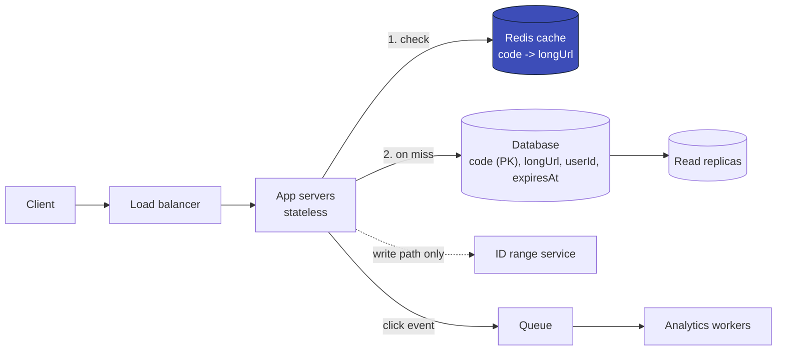
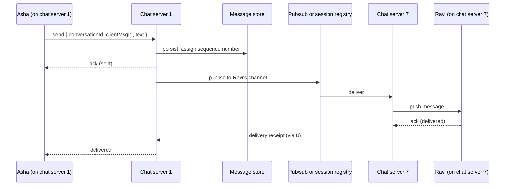
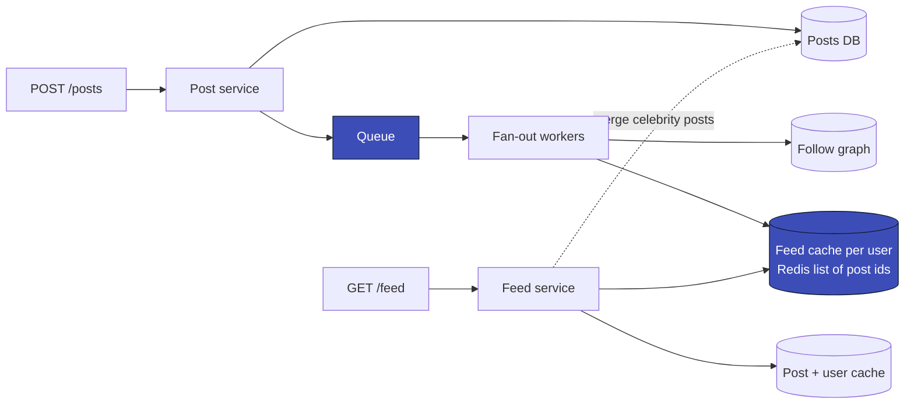

## How to use this station

Each case follows [[hld-framework]]: requirements, estimates, API, data, diagram, deep dive, trade-offs. The value is in seeing *which* requirement forces *which* component. Try each yourself for ten minutes before reading.

| Case | The hard part | Main stations it uses |
| --- | --- | --- |
| URL shortener | generating unique short codes; a read path at 100:1 | [[hld-caching]], [[mongo-indexes]] |
| Chat | delivering messages in real time to users on other servers, and when offline | [[websockets]], [[hld-messaging]] |
| News feed | assembling a feed from thousands of followees fast | [[hld-messaging]], [[hld-data]] |

## Case 1: URL shortener

**Requirements.** Functional: create a short link for a long URL; visiting the short link redirects. Optional: custom alias, expiry, click counts. Non-functional: redirects are fast (under 50 ms) and highly available; a created link never breaks; codes are not guessable in sequence.

**Estimates** (from [[hld-framework]]): 1 million new links a day is about 12 writes/s; at 100:1, about 1,200 redirects/s average. 500 bytes per record for 5 years is under 1 TB. Conclusion: tiny write load, read-heavy, fits one replicated database. The design problem is the code and the read path, not scale.

**API.**

```http
POST /v1/urls   { "longUrl": "...", "alias": "optional" }   -> 201 { "code": "aZ3k9Q" }
GET  /{code}                                                -> 302 Location: <longUrl>
```

**How long must the code be?** Base62 (`a-z A-Z 0-9`) gives 62^n combinations.

```js run
const ALPHABET = '0123456789abcdefghijklmnopqrstuvwxyzABCDEFGHIJKLMNOPQRSTUVWXYZ';
function toBase62(n) { let s = ''; do { s = ALPHABET[n % 62] + s; n = Math.floor(n / 62); } while (n > 0); return s; }
function fromBase62(s) { return [...s].reduce((n, c) => n * 62 + ALPHABET.indexOf(c), 0); }

for (const len of [6, 7]) console.log(`${len} chars: ${(62 ** len).toExponential(2)} codes, enough for ${Math.round(62 ** len / 1e6 / 365)} years at 1M/day`);
for (const id of [1, 125, 1000000, 56800235583]) console.log(String(id).padStart(12), '->', toBase62(id).padStart(6), '->', fromBase62(toBase62(id)));
```

Seven characters cover thousands of years of growth.

**Deep dive: generating the code.**

| Approach | How | Problem |
| --- | --- | --- |
| Hash the URL (MD5), take 7 chars | deterministic | collisions; must check and retry; same URL always same code |
| Random 7 chars | generate, insert, retry on duplicate | a database round trip to check; rare retries |
| **Counter, encoded in base62** | unique integer id, then `toBase62(id)` | codes are sequential and guessable; the counter must not be a bottleneck |

The counter approach guarantees no collisions. To avoid a central bottleneck, each app server asks a coordinator for a **range** (say 1 to 1,000,000) and hands out ids from memory. To hide the sequence, shuffle the id's bits with a fixed reversible function before encoding. A unique index on `code` is the final safety net.



**Read path.** Cache-aside in Redis keyed by code; hot links are served from memory. A Bloom filter of existing codes rejects random probes before they reach the database ([[hld-caching]]). Click counting is published to a queue so the redirect never waits on analytics ([[hld-messaging]]).

**Trade-offs to say.** 301 (permanent) lets browsers cache the redirect, which reduces load but hides repeat clicks from analytics; 302 (temporary) keeps every click visible at higher load. Any key-value or relational store works; the access pattern is a single lookup by primary key.

## Case 2: chat system

**Requirements.** Functional: one-to-one and group messages, delivered in real time; online presence; history; delivery when the recipient was offline. Non-functional: low latency (under 500 ms), messages never lost, ordered within a conversation, works across many servers.

**Estimates.** 50 million daily users, 40 messages each: about 23,000 messages/s average and many millions of open connections. The write path and connection handling are the problem.

**Deep dive 1: the connection.** Use WebSockets ([[websockets]]): a persistent two-way connection per online user, held by **chat servers**. These servers are stateful (they hold sockets), unlike the stateless REST API servers used for login, profiles and history.

**Deep dive 2: Asha is on server 1, Ravi is on server 7.**



- **Persist first, then deliver.** A message is acknowledged to the sender only after it is durably stored, so a crash cannot lose it.
- **Routing.** A registry (Redis) maps `userId` to the chat server holding their socket, or each server subscribes to a pub/sub channel per connected user. Server 1 publishes; server 7 receives and pushes.
- **Offline recipient.** No registry entry: the message stays in the store, and a push notification is sent through a queue. On reconnect the client sends the last sequence number it has and fetches everything after it.
- **Ordering and duplicates.** Each conversation has a sequence number assigned at persist time; clients order by it. The client's `clientMsgId` makes a retried send idempotent ([[rest-api]]).

**Data.** Messages are append-heavy, read by conversation in time order, and enormous in volume: partition by `conversationId` with `sequence` as the sort key in a wide-column or document store ([[hld-data]]). Users and conversations metadata can live in a relational database.

**Groups.** For small groups, fan out to each member on send. For very large groups, members pull recent messages from the conversation log instead, because pushing to 100,000 sockets per message is too costly.

**Presence.** Clients send a heartbeat every few seconds; the server keeps `lastSeen` with a TTL in Redis. No heartbeat for 30 seconds means offline. Broadcast presence changes only to people who have that user's chat open.

## Case 3: news feed

**Requirements.** Functional: post; follow; see a feed of recent posts from people you follow. Non-functional: feed loads in under 200 ms; a few seconds of staleness is fine (so AP, [[hld-data]]); read-heavy.

**The core decision: when is the feed assembled?**

```js run
const follows = { asha: ['ravi', 'meera', 'star'], ravi: ['star'] };
const followers = { ravi: ['asha'], meera: ['asha'], star: ['asha', 'ravi'] };
const posts = { ravi: [{ t: 3, text: 'ravi post' }], meera: [{ t: 1, text: 'meera post' }], star: [{ t: 5, text: 'star post' }] };

let readWork = 0;
function feedOnRead(user) {
  return follows[user].flatMap(f => { readWork++; return posts[f]; }).sort((a, b) => b.t - a.t).map(p => p.text);
}

const feedCache = { asha: [], ravi: [] }; let writeWork = 0;
function fanOutOnWrite(author, post) { for (const f of followers[author]) { writeWork++; feedCache[f].unshift(post.text); } }
[['meera', posts.meera[0]], ['ravi', posts.ravi[0]], ['star', posts.star[0]]].forEach(([a, p]) => fanOutOnWrite(a, p));

console.log('fan-out on read  :', feedOnRead('asha'), '| queries at read time:', readWork);
console.log('fan-out on write :', feedCache.asha, '| queries at read time: 1 | writes done at post time:', writeWork);
```

| | Fan-out on read (pull) | Fan-out on write (push) |
| --- | --- | --- |
| At post time | store the post once | copy the post id into every follower's feed list |
| At read time | query all followees and merge | read one precomputed list |
| Read cost | high, grows with followees | very low |
| Write cost | low | grows with followers |
| Breaks for | users following thousands | celebrities with millions of followers |

**The hybrid answer.** Push for ordinary users (their follower counts are small, and reads vastly outnumber writes). For celebrities, do **not** fan out; at read time merge the precomputed feed with recent posts pulled from the few celebrities the user follows.



Fan-out happens **asynchronously through a queue** ([[hld-messaging]]), so posting returns immediately. The feed cache stores only post ids (a capped list of the most recent few hundred); the feed service hydrates them from a post cache. Pagination uses a cursor, not an offset ([[rest-api]]). Images and video go to object storage behind a CDN ([[hld-caching]]).

## The rule, stated precisely

In each case one requirement dominated: uniqueness without coordination (shortener), real-time delivery across stateful servers (chat), and read latency under a fan-in of many sources (feed). Identify the dominating requirement early and spend the deep dive there.

!!! key
- Shortener: base62 of a unique id; cache the read path; 301 vs 302.
- Chat: WebSockets on stateful servers; persist before delivering; a registry or pub/sub to reach the recipient's server; sequence numbers for order and catch-up.
- Feed: push vs pull, and the hybrid for celebrities; asynchronous fan-out; feed cache of ids.
- For any other system (ride hailing, file storage, ticket booking) ask the same question: which single requirement makes this hard?
!!!

!!! trap
- Designing sharding for a URL shortener whose numbers fit one machine.
- Delivering a chat message before persisting it.
- Fan-out on write for every user, then being asked "what about an account with 50 million followers?"
- Forgetting the offline or failure path: recipient offline, worker crash mid fan-out, cache empty after restart.
!!!

!!! twist What changes if...
- **...the shortener must support custom aliases?** Insert with the alias as the code and rely on the unique index; return 409 if taken ([[mongo-indexes]]).
- **...chat needs end-to-end encryption?** The server stores and routes ciphertext only; keys live on devices; server-side search and multi-device sync get much harder.
- **...the feed should be ranked, not chronological?** Fan-out produces candidates; a ranking service scores them at read time using features such as recency and affinity. The pipeline shape stays the same.
- **...you are asked to design the online judge or the collab editor?** Apply the same steps; the [[collab-editor]] blueprint is this framework applied to your own project.
!!!

!!! model
Find the one requirement that makes the system hard, design that path first, and let everything else be the boring default: stateless servers, a cache, a replicated database, a queue.
!!!

## Practice

?? In the URL shortener, why not just use the database's auto-increment id directly as the code?
It works for uniqueness but exposes the total count and lets anyone enumerate every link by counting. It also ties you to one database instance generating ids. Encoding in base62 shortens it; a reversible shuffle or handing out id ranges per server fixes the other two.
??

?? How does a chat client that was offline for an hour catch up without missing or duplicating messages?
It stores the highest sequence number it has per conversation. On reconnect it asks for messages with a greater sequence, paginated. Because the server assigns sequences at persist time and the client de-duplicates by message id, a retry or an overlap with live pushes causes no duplicates.
??

?? A user with 30 million followers posts. Walk through what happens in the hybrid feed.
The post is stored once. No fan-out job is created for this author. When any follower opens their feed, the feed service reads their precomputed list and also fetches recent posts from the celebrities they follow (a short list, served from cache), merges by time or rank, and returns the page.
??

?? Where would you put rate limiting in each of these three systems?
Shortener: on link creation per user or IP, to stop spam. Chat: on messages per user per second, at the chat server. Feed: on post creation and on follow actions. All implemented at the gateway or app tier with counters in Redis ([[node-scaling]]).
??

?? Design a ticket booking system in three sentences: what is the hard part?
The hard part is that two users must never get the same seat. Hold a seat with a conditional update or a short-lived lock with expiry while the user pays ([[mongo-transactions]]), and confirm inside a transaction. Everything else, browsing shows and listing seats, is a cached read path.
??
