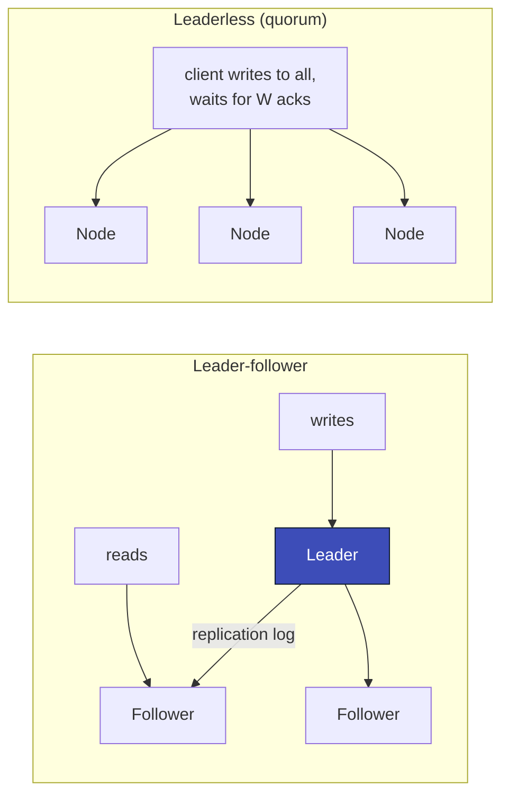
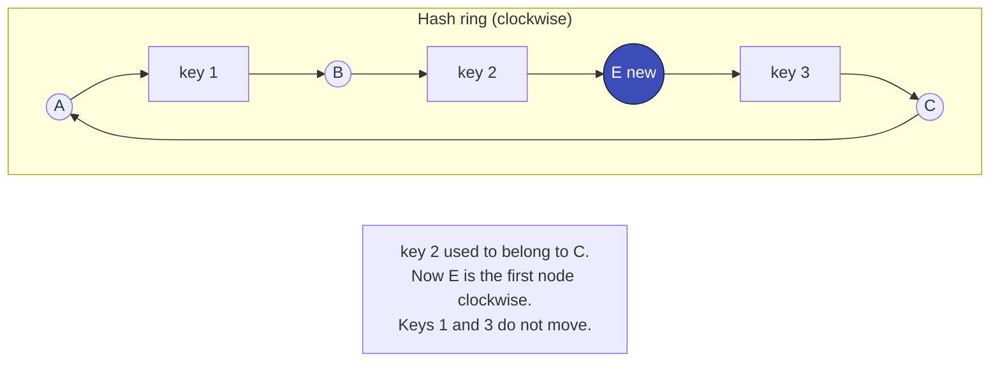

## The problem this solves

From [[hld-scaling]]: app servers scale because they hold no state. All the state was pushed into the database, which is now the bottleneck and the single point of failure. Two separate limits:

| Limit | Tool | What it gives | What it costs |
| --- | --- | --- | --- |
| The server can die; reads exceed one machine | **Replication**: same data on several machines | availability, read capacity | replicas can lag, so readers may see old data |
| Data or writes exceed one machine | **Partitioning (sharding)**: different data on different machines | storage and write capacity | cross-shard queries and transactions get hard |

They are combined: each shard is itself replicated. MongoDB's version of both is in [[mongo-transactions]].

## Part 1: replication



| Model | Writes go to | Strength | Weakness | Examples |
| --- | --- | --- | --- | --- |
| Leader-follower | one leader | simple, no write conflicts | leader is a write bottleneck; failover needed | PostgreSQL, MySQL, MongoDB |
| Multi-leader | several leaders | writes in several regions | concurrent writes conflict and must be resolved | multi-region setups |
| Leaderless | any node, to a quorum | no failover, always writable | client-side complexity, conflict resolution | Cassandra, DynamoDB |

**Synchronous** replication waits for followers before acknowledging: no data loss, slower writes, a slow follower stalls everything. **Asynchronous** acknowledges at once: fast, but a leader crash can lose the last writes, and followers lag (**replication lag**).

### Example 1: quorums

With N replicas, a write waits for W acknowledgements and a read asks R replicas. If **R + W > N**, every read set overlaps every write set in at least one node, so a read always sees the latest write.

```js run
function quorum(N, W, R) {
  const consistent = R + W > N;
  const tolerates = Math.min(N - W, N - R);
  return `N=${N} W=${W} R=${R}  R+W>N: ${String(consistent).padEnd(5)}  survives ${tolerates} node failure(s)  -> ${consistent ? 'reads see latest write' : 'reads may be stale'}`;
}
console.log(quorum(3, 2, 2));
console.log(quorum(3, 1, 1));
console.log(quorum(3, 3, 1));
console.log(quorum(5, 3, 3));
```

`W=3, R=1` gives fast consistent reads but a single down node blocks all writes. `W=1, R=1` is fastest and always available but only eventually consistent. Tuning W and R is choosing a point between consistency and availability.

## Part 2: partitioning

| Strategy | Rule | Good | Bad |
| --- | --- | --- | --- |
| Range | keys A-F on shard 1, G-M on shard 2... | range scans stay on one shard | hot spots: sequential keys (timestamps) all land on the last shard |
| Hash | `hash(key) % N` | even spread | range queries hit every shard; changing N moves almost every key |
| Consistent hashing | keys and nodes on a ring | adding or removing a node moves only about 1/N of keys | more complex; needs virtual nodes for balance |
| Directory | a lookup table says where each key lives | fully flexible | the directory is a dependency and a bottleneck |

### Example 2: why `hash % N` breaks, and consistent hashing

```js run
function hash(s) {
  let h = 2166136261;
  for (const c of s) { h ^= c.charCodeAt(0); h = Math.imul(h, 16777619); }
  h ^= h >>> 16; h = Math.imul(h, 0x85ebca6b); h ^= h >>> 13; h = Math.imul(h, 0xc2b2ae35); h ^= h >>> 16;
  return h >>> 0;
}
const keys = Array.from({ length: 10000 }, (_, i) => 'user:' + i);

const modulo = n => k => hash(k) % n;
const movedMod = keys.filter(k => modulo(4)(k) !== modulo(5)(k)).length;

function ring(nodes, vnodes = 200) {
  const points = nodes.flatMap(n => Array.from({ length: vnodes }, (_, i) => [hash(n + '#' + i), n])).sort((a, b) => a[0] - b[0]);
  return k => { const h = hash(k); return (points.find(p => p[0] >= h) ?? points[0])[1]; };
}
const before = ring(['A', 'B', 'C', 'D']), after = ring(['A', 'B', 'C', 'D', 'E']);
const movedRing = keys.filter(k => before(k) !== after(k)).length;
const share = {}; keys.forEach(k => (share[after(k)] = (share[after(k)] || 0) + 1));

console.log(`hash % N,   4 -> 5 nodes: ${(movedMod / 100).toFixed(0)}% of keys move`);
console.log(`consistent, 4 -> 5 nodes: ${(movedRing / 100).toFixed(0)}% of keys move (ideal is 20%)`);
console.log('keys per node after:', JSON.stringify(share));
```

How the ring works: hash each node to a position on a circle; hash each key; the key belongs to the **first node clockwise** from it. Adding node E takes over only the arc just before E, from one neighbour. **Virtual nodes** (each physical node placed at 200 positions) smooth out the arcs so load is even and a new node takes a little from everyone.



Choosing the partition key follows the same three rules as a MongoDB shard key: many distinct values, even distribution, and present in most queries so a request goes to one shard.

## Part 3: the CAP theorem

A network **partition** is when nodes cannot reach each other. During one, a node that receives a request has two choices:

- answer with the data it has, which may be out of date: stays **Available**, gives up **Consistency**;
- refuse or wait until it can confirm with the others: stays **Consistent**, gives up **Availability**.

It cannot do both. Since partitions will happen in any distributed system, **P is not optional**; the real choice is C or A *during a partition*.

| | CP | AP |
| --- | --- | --- |
| During a partition | minority side rejects writes (and maybe reads) | every side keeps answering; data diverges and is reconciled later |
| Choose for | money, inventory, locks, anything where a wrong answer is worse than no answer | feeds, likes, carts, presence, anything where a slightly old answer is fine |
| Examples | MongoDB with majority writes, ZooKeeper, etcd | Cassandra, DynamoDB (default settings) |

**PACELC** extends it: if **P**artition, choose **A** or **C**; **E**lse (normal operation), choose **L**atency or **C**onsistency. Even with a healthy network, waiting for replicas costs latency.

### Consistency models, strongest to weakest

| Model | Guarantee |
| --- | --- |
| Strong (linearizable) | every read sees the most recent acknowledged write, as if there were one copy |
| Read-your-writes | you always see your own writes; others may lag |
| Monotonic reads | you never see data go backwards in time |
| Eventual | if writes stop, all replicas converge; no promise about when |

## Part 4: SQL or NoSQL

| | Relational (PostgreSQL, MySQL) | Document (MongoDB) | Key-value (Redis, DynamoDB) | Wide-column (Cassandra) |
| --- | --- | --- | --- | --- |
| Model | tables, joins, fixed schema | nested documents | key to opaque value | rows with flexible columns, partitioned |
| Strength | ACID transactions, ad hoc queries ([[dbms-transactions]]) | flexible schema, data shaped like the app ([[mongo-modeling]]) | fastest lookups | huge write volume, linear scale |
| Weakness | horizontal scaling takes work | cross-document joins | no queries beyond the key | queries must be designed up front |
| Pick for | payments, orders, anything relational | catalogs, content, user profiles | caches, sessions, counters | time series, messages, event logs |

## The rule, stated precisely

Strong consistency under replication requires overlapping quorums (R + W > N). Under a network partition a system cannot be both consistent and available. Partitioning by a key makes queries containing that key cheap and all others expensive.

!!! key
- Replication vs sharding: copies vs slices. Different problems, used together.
- CAP is about behaviour **during a partition**, and the choice is per operation, not per company: the same product can use CP for payments and AP for the feed.
- "SQL vs NoSQL" should be answered from access patterns and consistency needs, never from "NoSQL scales".
- Scale a database in this order: indexes and query fixes, a cache, read replicas, vertical scaling, then sharding last.
- Consistent hashing: know the ring, the clockwise rule and why virtual nodes exist.
!!!

!!! trap
- "CA system". Without partition tolerance it is a single node.
- Reading from a follower right after writing to the leader and showing the user stale data.
- Sharding by a key with skew (country, or a celebrity's user id): one shard melts while others idle.
- Assuming joins and transactions still work across shards. They need scatter-gather queries, or sagas and two-phase commit ([[hld-messaging]]).
!!!

!!! twist What changes if...
- **...one user is a million times more active than others (a hot partition)?** Split that key further (add a suffix or time bucket to the partition key), or handle it specially with caching.
- **...you need a globally unique, sortable id without a central counter?** A Snowflake-style id: timestamp bits, machine id bits, per-machine sequence bits. Or a UUID if order does not matter.
- **...two leaders accept conflicting writes?** Resolve by last-write-wins (simple, loses data), by version vectors with application merge, or with CRDTs, the same idea the collab editor discussion touches on.
!!!

!!! model
Copy data to survive failures and serve reads; slice data to grow. Copies can disagree for a while, and when the network splits you must choose between a possibly old answer and no answer.
!!!

## Practice

?? A read-heavy app (100:1) is slowing down on one PostgreSQL server. What do you do, in order?
Check slow queries and add indexes. Cache hot reads ([[hld-caching]]). Add read replicas and route reads to them, keeping read-your-writes paths on the leader. Scale the leader vertically. Only if writes or data size still exceed one machine, shard.
??

?? Is a banking ledger CP or AP? Is a "likes" counter?
The ledger is CP: showing or accepting a transaction on stale balances is worse than a brief error. The likes counter is AP: a count that is a few seconds behind is harmless and the feature should never be unavailable.
??

?? With N=3, what W and R give strong consistency while tolerating one node failure for both reads and writes?
W=2, R=2. R + W = 4 > 3, so reads overlap the latest write, and either operation still succeeds with one node down.
??

?? Why do consistent hashing implementations use virtual nodes?
With one position per node the arcs are uneven, so some nodes own much more of the ring, and when a node leaves its entire load falls on a single neighbour. Many virtual positions per node average the arcs out and spread a departing node's keys across all the others. They also let a bigger machine take more positions.
??

?? You shard `orders` by `user_id`. Which queries are now cheap and which are expensive?
Cheap: anything for one user (their orders, their latest order), since it goes to a single shard. Expensive: "all orders placed today", "top-selling product", lookups by `order_id` alone. Those hit every shard, so they need a secondary index service, a separate analytics store fed by events, or an id that embeds the shard.
??

?? What is replication lag and name two user-visible bugs it causes.
The delay between a write on the leader and its arrival on a follower. Bugs: a user posts a comment, the page reloads from a follower and the comment is missing; or a user sees a newer state, refreshes, hits a more lagged follower and sees an older state. Fixes: read your own writes from the leader, and pin a user to one replica for monotonic reads.
??
