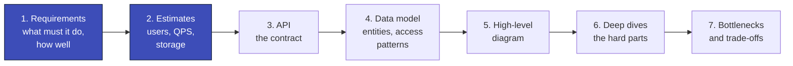
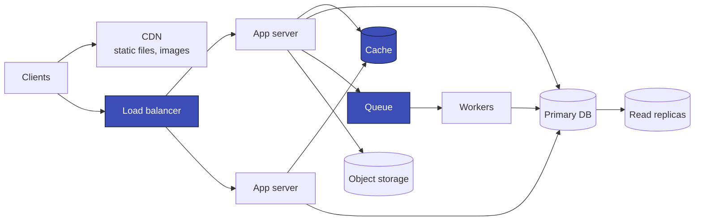

## The problem this solves

"Design Instagram" has no boundary. A candidate who starts drawing boxes immediately ends up defending a design for requirements nobody stated. The interviewer is watching for one thing: can you turn a vague request into a concrete system by asking the right questions in the right order, and justify each choice with a number or a trade-off?

## Intuition

Every choice in a design is forced by a requirement or a number. So collect requirements and numbers **first**, and let them choose the components.



A 45-minute interview splits roughly: 5 minutes on steps 1 and 2, 5 on 3 and 4, 10 on 5, 20 on 6, 5 on 7.

## Build it step by step

### Step 1: requirements

Two lists, written on the board.

| Type | Question it answers | Examples |
| --- | --- | --- |
| **Functional** | what can a user do? | post a photo, follow a user, see a feed |
| **Non-functional** | how well must it do it? | 99.9% available, feed loads under 200 ms, a posted photo is never lost |

Then say what is **out of scope**. Three to four functional requirements is enough. The non-functional ones drive the architecture, so always ask:

- Read-heavy or write-heavy? (decides caching and replication, [[hld-caching]], [[hld-data]])
- Is stale data acceptable? (decides consistency model)
- What must never be lost or duplicated? (decides transactions and queues, [[hld-messaging]])
- How many users, growing how fast? (decides whether to partition)

### Step 2: estimates

You need orders of magnitude, not precision. Three numbers: requests per second, storage, bandwidth.

```js run
const DAY = 86400;
function estimate(name, { dau, readsPerUser, writesPerUser, bytesPerWrite, years = 5 }) {
  const readQps = dau * readsPerUser / DAY, writeQps = dau * writesPerUser / DAY;
  const storageTB = dau * writesPerUser * bytesPerWrite * 365 * years / 1e12;
  console.log(`${name.padEnd(14)} reads ${Math.round(readQps).toLocaleString()}/s  writes ${Math.round(writeQps).toLocaleString()}/s  ` +
    `peak reads ~${Math.round(readQps * 3).toLocaleString()}/s  read:write ${Math.round(readQps / writeQps)}:1  storage in ${years}y ~${storageTB.toFixed(1)} TB`);
}
estimate('URL shortener', { dau: 10e6, readsPerUser: 10, writesPerUser: 0.1, bytesPerWrite: 500 });
estimate('Chat app', { dau: 50e6, readsPerUser: 40, writesPerUser: 40, bytesPerWrite: 200 });
estimate('Photo feed', { dau: 100e6, readsPerUser: 50, writesPerUser: 0.5, bytesPerWrite: 2e6 });
```

Read what the numbers say:

- **URL shortener**: 100 reads per write and under 1 TB. One database with replicas and a cache is plenty. Sharding would be over-engineering.
- **Chat**: reads and writes are equal and high. The write path is the design problem.
- **Photo feed**: about 100 TB of new images every day, which adds up to well over 100,000 TB (100+ petabytes) in five years. Images go to object storage behind a CDN, not into the database.

Shortcuts: a day has about 100,000 seconds (86,400), so **1 million requests per day is about 12 per second**. Peak is usually 2 to 5 times the average.

| Operation | Rough time | Lesson |
| --- | --- | --- |
| Read from memory | 100 ns | caches are fast because of this line |
| Read 1 MB sequentially from SSD | about 1 ms | |
| Round trip inside one data center | about 0.5 ms | service calls are cheap but not free |
| Disk seek (spinning disk) | about 10 ms | why indexes and sequential logs matter |
| Round trip between continents | about 150 ms | why CDNs and regional replicas exist |

### Step 3: the API

Write the handful of endpoints that implement the functional requirements. This fixes what the system promises before you design how. Conventions are in [[rest-api]].

```http
POST /v1/urls            { "longUrl": "https://..." }   -> 201 { "shortCode": "aZ3k9Q" }
GET  /{shortCode}                                       -> 301 Location: https://...
```

### Step 4: the data model

List the entities, their key fields and, most important, **how each will be queried**. The access pattern picks the database and the indexes ([[mongo-modeling]], [[dbms-er-relational]], [[mongo-indexes]]).

### Step 5: the high-level diagram

Start with the simplest thing that satisfies the functional requirements: client, load balancer, stateless app servers, database. Then add a component **only when a requirement or number demands it**, and say which one.



| Component | Add it when | Station |
| --- | --- | --- |
| Load balancer, more app servers | one server cannot handle peak QPS, or you need no single point of failure | [[hld-scaling]] |
| Cache | reads dominate and data is read more often than it changes | [[hld-caching]] |
| Read replicas | reads exceed one database's capacity; some staleness is fine | [[hld-data]] |
| Sharding | data or writes exceed one machine | [[hld-data]] |
| Queue and workers | work is slow, bursty, or must survive failures | [[hld-messaging]] |
| CDN, object storage | large static content, global users | [[hld-caching]] |

### Step 6: deep dives

Pick the one or two parts that are actually hard for *this* system and go deep: how feed generation works, how to guarantee a message is delivered once, how short codes stay unique. The interviewer will usually steer. Worked examples are in [[hld-case-studies]].

### Step 7: bottlenecks and trade-offs

Walk the diagram and ask of each box: what if it dies, what if traffic grows ten times, what is the slowest step? State each trade-off as "I chose X over Y because of requirement Z, at the cost of W."

## The rule, stated precisely

Requirements determine estimates; estimates determine which components are justified; every component is added to satisfy a named requirement and brings a named cost. A design is a set of trade-offs, and a good answer makes each one explicit.

!!! key
- Never draw before clarifying. Asking questions is not weakness; it is the first thing graded.
- Put numbers on the board. "100:1 read-heavy, so cache and replicas" is a justified decision; "let's add Redis" is not.
- Start simple, then evolve. A single server that works is a better first diagram than twelve boxes.
- Say trade-offs out loud. There is no best design, only a best fit for the stated requirements.
- Functional requirements become APIs; non-functional requirements become architecture.
!!!

!!! trap
- Jumping to a technology ("Kafka, Cassandra, Kubernetes") before stating the problem it solves.
- Designing for a billion users when the stated scale is a million.
- Ignoring the write path or the failure path and only drawing the happy read path.
- Silent thinking. The interviewer can only grade what you say.
- Spending 20 minutes on estimation arithmetic. Round aggressively and move on.
!!!

!!! twist What changes if...
- **...the interviewer says "now it is 100 times bigger"?** Re-run step 2. Find the first component that breaks (usually the database write path) and partition or queue there.
- **...they say "it must work across regions"?** Latency and consistency become the topic: regional replicas, a CDN, and a decision about where writes go ([[hld-data]]).
- **...they ask for LLD instead ("design the classes for a parking lot")?** That is a different exercise with its own steps: [[lld-case-studies]].
!!!

!!! model
Requirements, numbers, contract, data, boxes, hard parts, breaking points. Each step gives the reason for the next.
!!!

## Practice

?? You are asked to design a notification service. What do you ask first?
Which channels (push, SMS, email)? What volume per day and what peak (a marketing blast to everyone)? Is delivery at-least-once acceptable, and are duplicates tolerable? How fast must a notification arrive: seconds, or minutes? Do users have preferences and quiet hours? Is ordering required? The answers decide queues per channel, retry policy, deduplication and rate limiting per provider.
??

?? 500 million daily active users each send 20 messages a day. Average and peak writes per second?
500e6 × 20 = 10 billion per day. Divided by 86,400, about 115,000 per second on average. With a 3× peak factor, around 350,000 per second. That is far beyond one database node, so the message store must be partitioned from the start.
??

?? Why state non-functional requirements before drawing?
Because they choose the architecture. "Feed may be a few seconds stale" permits caching and asynchronous fan-out. "A payment must never be applied twice" forces idempotency keys and transactions. The same functional requirement produces different systems under different non-functional ones.
??

?? What does "99.9% availability" allow in downtime per year?
0.1% of 365 days is about 8.8 hours a year, or about 43 minutes a month. Each extra nine divides it by ten: 99.99% is about 53 minutes a year. The math for combining components is in [[hld-scaling]].
??

?? The interviewer asks "why not just use one big server?" How do you answer?
For small scale, that is a fair design and I would say so. It fails on two counts as requirements grow: it is a single point of failure, so availability is limited to that machine's; and vertical scaling has a ceiling and a steep price curve. Horizontal scaling removes both at the cost of needing stateless servers and shared stores.
??
