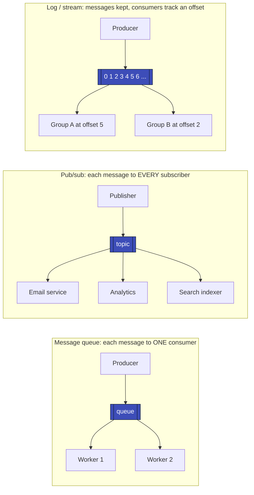
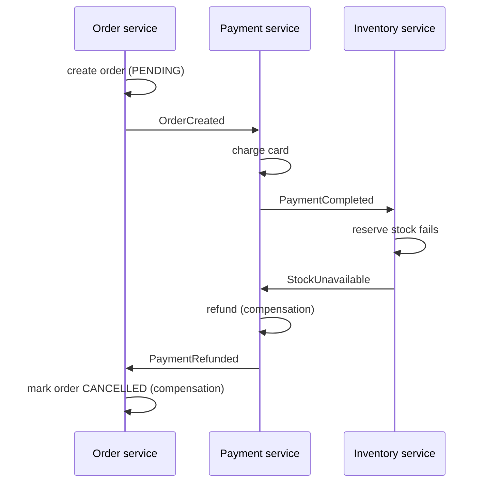

## The problem this solves

Service A calls service B directly and waits. Three things go wrong:

1. **B is slow**: A's request is slow, and A's threads or connections pile up waiting.
2. **B is down**: A fails too. Failures cascade through every caller.
3. **A spike hits**: A forwards 10 times the normal load to B instantly, and B falls over.

Put a durable buffer between them. A writes a message and moves on; B reads when it can. The basic version of this (a job queue with retries) was built in [[node-scaling]]. This station covers the designs around it.

## Intuition: three shapes



| | Message queue | Pub/sub | Log / event stream |
| --- | --- | --- | --- |
| Delivery | one consumer per message; workers compete | a copy to every subscriber | each consumer group reads the whole log at its own pace |
| After consumption | message deleted | gone once delivered | **retained**; can be replayed |
| Use for | background jobs, task distribution | notify several independent services of an event | event sourcing, analytics pipelines, high-throughput ingest |
| Examples | RabbitMQ, SQS, BullMQ | Redis pub/sub, SNS, Google Pub/Sub | Kafka, Kinesis, Redis Streams |

## Build it step by step

### Question 1: can a message be lost or duplicated?

| Guarantee | Meaning | How | Cost |
| --- | --- | --- | --- |
| At-most-once | may be lost, never duplicated | acknowledge before processing | loses work on a crash |
| **At-least-once** | never lost, may be duplicated | acknowledge after processing; redeliver on timeout | consumer must tolerate duplicates |
| Exactly-once | neither | at-least-once delivery plus an idempotent consumer | bookkeeping |

A broker cannot know whether a consumer that went silent finished the job or died first, so it must redeliver. True exactly-once *delivery* is impossible in general; what systems achieve is exactly-once **effect**, by making processing idempotent.

### Example 1: an idempotent consumer

```js run
const balances = { asha: 1000 }, processed = new Set();

function naive(msg) { balances[msg.user] += msg.amount; }
function idempotent(msg) {
  if (processed.has(msg.id)) return 'duplicate ignored';
  balances[msg.user] += msg.amount;
  processed.add(msg.id);
  return 'applied';
}

const refund = { id: 'evt_81', user: 'asha', amount: 500 };
naive(refund); naive(refund);
console.log('naive consumer, message delivered twice     :', balances.asha);

balances.asha = 1000;
console.log('idempotent consumer, message delivered twice:', idempotent(refund) + ',', idempotent(refund), '->', balances.asha);
```

Each message carries a unique id; the consumer records processed ids and skips repeats. In a real system "apply the change" and "record the id" must commit together in **one database transaction**, or with a unique index on the id ([[mongo-indexes]]). This is the same idea as the idempotency key in [[rest-api]], applied to messages.

### Question 2: do messages arrive in order?

A single queue with one consumer preserves order. The moment several consumers work in parallel, message 2 can finish before message 1. Streams solve this with **partitions**.

### Example 2: partitioning by key preserves per-key order

```js run
const hash = s => [...s].reduce((h, c) => (h * 31 + c.charCodeAt(0)) >>> 0, 7);
const events = [
  ['order-1', 'created'], ['order-2', 'created'], ['order-1', 'paid'], ['order-3', 'created'],
  ['order-2', 'cancelled'], ['order-1', 'shipped'], ['order-3', 'paid'],
];
const partitions = [[], [], []];
for (const [key, type] of events) partitions[hash(key) % 3].push(`${key}:${type}`);
partitions.forEach((p, i) => console.log(`partition ${i}:`, p.join('  ')));
```

A topic is split into partitions; each is an ordered, append-only log read by exactly one consumer in a group. The producer picks the partition from a **key**. All events for `order-1` land in the same partition, so they are consumed in order, while different orders are processed in parallel. Order is guaranteed **within a partition, not across the topic**. The collab editor's operation log relies on the same per-document ordering idea.

### Question 3: what if the consumer cannot keep up, or keeps failing?

| Situation | Mechanism |
| --- | --- |
| Consumers slower than producers | the queue grows; scale consumers on **queue depth** (autoscaling, [[hld-scaling]]); apply backpressure or shed load if it keeps growing |
| A message fails every time (a "poison" message) | retry with exponential backoff, then move it to a **dead-letter queue** for inspection so it stops blocking others |
| A consumer dies mid-message | visibility timeout expires and the broker redelivers (hence at-least-once) |
| A burst of traffic | the queue absorbs it; consumers work through at their own steady rate (**load levelling**) |

### Example 3: the dual-write problem and the outbox pattern

An order service must save the order **and** publish `OrderPlaced`. These are two different systems, so one can succeed and the other fail.

```js run
function placeOrderDualWrite(db, broker, failBrokerOnce) {
  db.orders.push({ id: 1, status: 'placed' });
  if (failBrokerOnce) throw new Error('broker unreachable');
  broker.push('OrderPlaced:1');
}
function placeOrderOutbox(db) {
  const tx = { orders: [...db.orders, { id: 1, status: 'placed' }], outbox: [...db.outbox, { event: 'OrderPlaced:1', sent: false }] };
  Object.assign(db, tx);
}
function relay(db, broker) {
  for (const row of db.outbox.filter(r => !r.sent)) { broker.push(row.event); row.sent = true; }
}

let db = { orders: [], outbox: [] }, broker = [];
try { placeOrderDualWrite(db, broker, true); } catch (e) { /* request fails after the DB write */ }
console.log('dual write, broker down : orders =', db.orders.length, ' events =', broker.length, ' <- order exists, nobody was told');

db = { orders: [], outbox: [] }; broker = [];
placeOrderOutbox(db);
console.log('outbox, before relay    : orders =', db.orders.length, ' outbox rows =', db.outbox.length, ' events =', broker.length);
relay(db, broker);
console.log('outbox, after relay     : events =', broker.length, broker[0]);
```

**Outbox pattern**: write the business row and an "event to send" row in the **same database transaction**, so they succeed or fail together. A separate relay process reads unsent outbox rows and publishes them, retrying until acknowledged. The event may be published twice after a crash, which is fine because consumers are idempotent.

### Distributed transactions: the saga

When one business operation spans services (order, payment, inventory), there is no shared transaction. A **saga** is a sequence of local transactions, each publishing an event that triggers the next; if a step fails, **compensating actions** undo the earlier steps.



| | Two-phase commit (2PC) | Saga |
| --- | --- | --- |
| Idea | a coordinator asks all to prepare, then all to commit | chain of local commits with compensations |
| Consistency | atomic | eventual; intermediate states are visible |
| Weakness | blocks if the coordinator dies; slow; needs all participants up | must design a compensation for every step |
| Used | inside one database system, rarely across services | microservices |

## The rule, stated precisely

With at-least-once delivery, correctness requires idempotent consumers. Ordering is guaranteed only among messages sharing a partition (or a single consumer). A state change and its event are published atomically only if both are recorded in one transaction.

!!! key
- Why a queue: decoupling, load levelling, retries, independent scaling, resilience. Name the one that applies.
- Queue vs pub/sub vs stream, with one use each.
- "At-least-once plus idempotent consumer" is the standard answer to "what about duplicates?"
- Kafka in one line: a partitioned, replicated, append-only log; consumers in a group split the partitions and track offsets; data is retained, so it can be replayed.
- Synchronous (request/response) when the caller needs the answer now. Asynchronous (events) when it only needs the work to happen.
- Costs to mention: eventual consistency, harder debugging and tracing, one more system to operate.
!!!

!!! trap
- A queue between two services that actually need a synchronous answer. It adds latency and complexity for nothing.
- Assuming global ordering in Kafka. It is per partition.
- Writing to the database and the broker separately (the dual write).
- Unbounded retries without a dead-letter queue: one bad message blocks or loops forever.
- Using Redis pub/sub for messages that must not be lost. It does not store messages; a subscriber that is offline misses them.
!!!

!!! twist What changes if...
- **...a consumer needs to rebuild its state from scratch?** With a retained log, start a new consumer group at offset 0 and replay. With a classic queue the messages are gone.
- **...one key produces most of the traffic?** Its partition becomes hot and its single consumer falls behind. Choose a finer key, or split that tenant out.
- **...you need a delayed job (send a reminder in 24 hours)?** Use the broker's delay feature or a scheduled-jobs table polled by a worker; do not hold a timer in a process that can restart.
!!!

!!! model
A queue turns "do this now, and I will wait" into "do this eventually, and I trust you will". In exchange you must make every handler safe to run twice.
!!!

## Practice

?? Design the flow after "user places an order" so that email, inventory and analytics all react, and adding a fourth reaction later needs no change to the order service.
The order service writes the order and an outbox row in one transaction; a relay publishes `OrderPlaced` to a topic. Email, inventory and analytics each subscribe with their own queue or consumer group. A new service just adds a subscription. Each consumer is idempotent on the event id.
??

?? Your worker processes a payment message, then crashes before acknowledging. What happens and how do you prevent a double charge?
The broker redelivers the message after the visibility timeout. Prevent the double effect by checking a processed-ids record (or passing the message id as the idempotency key to the payment provider) inside the same transaction as the charge record.
??

?? When would you choose Kafka over RabbitMQ or SQS?
Kafka when you need very high throughput, retention and replay, several independent consumer groups reading the same events, or ordered per-key streams, as in event sourcing and data pipelines. RabbitMQ or SQS when you need a work queue with per-message acknowledgement, routing, delays and dead-lettering, and messages are done once processed.
??

?? How do you keep strict ordering for one user's events while still processing in parallel?
Use the user id as the partition key. Each user's events go to one partition and are consumed sequentially by one consumer; different users map to different partitions and are processed in parallel.
??

?? What is backpressure?
A signal from a slow consumer telling the producer to slow down, so buffers do not grow without limit. Forms: bounded queues that block or reject when full, stream `drain` events ([[node-runtime]]), HTTP 429 with `Retry-After`, or consumers pulling at their own rate instead of being pushed to.
??

?? Explain a saga with a failing step.
Order created (pending), payment charged, stock reservation fails. The inventory service emits a failure event; payment runs its compensation (refund); the order service runs its compensation (mark cancelled). Each step was a committed local transaction, so "rollback" means running explicit undo actions, and the system is consistent only at the end.
??
