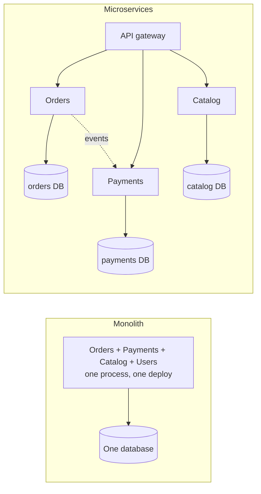
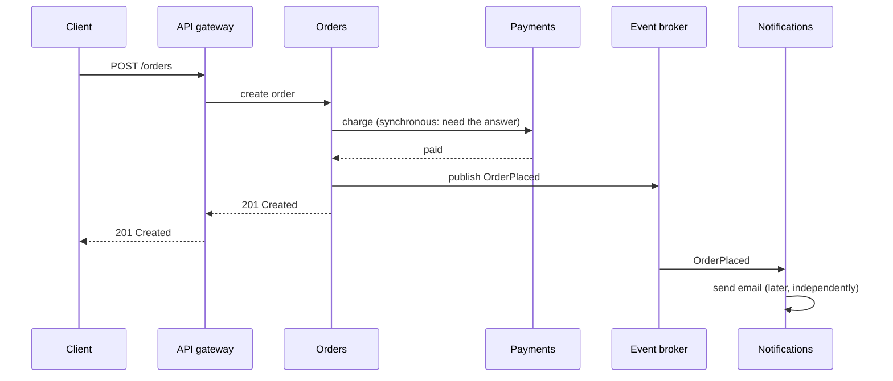

## The problem this solves

A **monolith** is one application: one codebase, one build, one deployment, usually one database. It is the right way to start. As the company grows, specific pains appear:

| Pain | In a large monolith |
| --- | --- |
| Deploys | every change redeploys everything; fifty engineers queue behind one release |
| Scaling | search needs 20 servers and billing needs 2, but you can only scale the whole thing |
| Blast radius | a memory leak in the reports module takes down checkout |
| Technology | one language and framework for every problem |
| Understanding | nobody can hold the whole codebase in their head; changes break distant features |

**Microservices** split the application into small services, each owning one business capability (orders, payments, catalog), each with **its own data**, deployed and scaled independently, talking over the network.



## The honest comparison

| | Monolith | Microservices |
| --- | --- | --- |
| Calling another module | a function call: fast, cannot fail on its own | a network call: slow, can time out or fail |
| Data consistency | one transaction across tables ([[dbms-transactions]]) | each service has its own database; consistency across them is eventual ([[hld-messaging]] sagas) |
| Deployment | one unit | many units; needs automation, containers, orchestration ([[node-production]]) |
| Debugging | one stack trace, one log | a request crosses services; needs distributed tracing |
| Scaling | all together | each service by its own load |
| Team autonomy | shared codebase, coordinated releases | each team owns and ships its service |
| Right when | small team, new product, unclear boundaries | many teams, clear boundaries, parts with very different load |

The costs on the right are real and permanent. **Microservices solve an organizational problem (many teams stepping on each other) more than a technical one.** A startup with five engineers gains almost nothing and pays everything.

## Step 1: the function call becomes a network call

```js run
const inProcess = { getPrice: sku => ({ kb: 2499, ms: 699 }[sku]) };

function networkCall(fn, { latencyMs = 20, failureRate = 0 } = {}) {
  return (...args) => new Promise((resolve, reject) =>
    setTimeout(() => Math.random() < failureRate ? reject(new Error('503 catalog unavailable')) : resolve(fn(...args)), latencyMs));
}
const catalogService = { getPrice: networkCall(inProcess.getPrice) };

(async () => {
  let t = performance.now();
  const local = ['kb', 'ms', 'kb', 'ms', 'kb'].map(inProcess.getPrice).reduce((a, b) => a + b);
  console.log(`monolith: 5 lookups, total ${local}, took under 1 ms: ${performance.now() - t < 1}`);

  t = performance.now();
  let remote = 0;
  for (const sku of ['kb', 'ms', 'kb', 'ms', 'kb']) remote += await catalogService.getPrice(sku);
  console.log(`services, one call at a time: total ${remote}, about ${Math.round((performance.now() - t) / 50) * 50} ms`);

  t = performance.now();
  const batch = await Promise.all(['kb', 'ms', 'kb', 'ms', 'kb'].map(sku => catalogService.getPrice(sku)));
  console.log(`services, calls in parallel : total ${batch.reduce((a, b) => a + b)}, about ${Math.round((performance.now() - t) / 10) * 10} ms`);
})();
```

The same five lookups went from instant to a hundred milliseconds when made one after another over a network. Lessons: call in parallel ([[js-promises]]), offer batch endpoints ("prices for these 5 SKUs"), and never loop over network calls. And every one of those calls can now fail, which is the subject of [[hld-reliability]].

## Step 2: how services talk

| | Synchronous (request/response) | Asynchronous (events) |
| --- | --- | --- |
| How | REST or gRPC call; the caller waits | publish an event to a broker; subscribers react later |
| Coupling | caller needs the callee **up right now** | publisher does not know or wait for subscribers |
| Failure | the callee's outage becomes the caller's outage | events wait in the queue until the consumer recovers |
| Use for | queries that need an answer now ("is this card valid?") | things that must happen but not this instant ("order placed, so send email, update stock") |



A good design uses both: synchronous where the answer is required to proceed, events for everything else. **REST** is the conventions from [[rest-api]] over JSON. **gRPC** uses a compact binary format with a strict schema and is common for internal service-to-service calls because it is faster and typed.

## Step 3: the API gateway

Without a gateway, a mobile app would need to know the address of every service and authenticate with each.

```js run
const routes = [
  { prefix: '/api/orders', service: 'orders:3001', auth: true },
  { prefix: '/api/products', service: 'catalog:3002', auth: false },
  { prefix: '/api/payments', service: 'payments:3003', auth: true },
];
const limits = new Map();
function gateway(req) {
  const route = routes.find(r => req.path.startsWith(r.prefix));
  if (!route) return '404 no such route';
  if (route.auth && !req.token) return '401 missing token';
  const used = (limits.get(req.ip) ?? 0) + 1;
  limits.set(req.ip, used);
  if (used > 3) return '429 rate limit exceeded';
  return `forward to ${route.service}` + (req.token ? ` with header x-user-id: ${req.token.userId}` : '');
}
console.log(gateway({ path: '/api/products/7', ip: 'a' }));
console.log(gateway({ path: '/api/orders', ip: 'a' }));
console.log(gateway({ path: '/api/orders', ip: 'a', token: { userId: 42 } }));
console.log(gateway({ path: '/api/reviews', ip: 'a' }));
console.log(gateway({ path: '/api/products/8', ip: 'a' }), '(4th request from this client)');
```

One front door that handles the concerns every service would otherwise repeat: routing, authentication ([[auth-jwt]]), rate limiting ([[node-scaling]]), TLS, logging. Services behind it trust the identity header the gateway sets. It is the Facade and Proxy patterns at system scale ([[lld-structural]]). The gateway must be redundant, or it becomes the single point of failure.

## Step 4: service discovery

Services run as many instances whose addresses change every time one is restarted or scaled. A caller cannot have addresses hard-coded.

```js run
class Registry {
  #instances = new Map();
  register(service, address, now) { this.#instances.set(address, { service, lastHeartbeat: now }); }
  heartbeat(address, now) { this.#instances.get(address).lastHeartbeat = now; }
  lookup(service, now, ttlMs = 10_000) {
    return [...this.#instances].filter(([, i]) => i.service === service && now - i.lastHeartbeat <= ttlMs).map(([address]) => address);
  }
}
const registry = new Registry();
registry.register('payments', '10.0.1.5:3003', 0);
registry.register('payments', '10.0.1.9:3003', 0);
registry.register('orders', '10.0.2.4:3001', 0);
console.log('t=0s  payments ->', registry.lookup('payments', 0));
registry.heartbeat('10.0.1.5:3003', 9_000);
console.log('t=15s payments ->', registry.lookup('payments', 15_000), ' <- 10.0.1.9 stopped sending heartbeats and was dropped');
```

Each instance **registers** itself and sends heartbeats; callers **look up** the service by name and get the live instances. In practice the platform does this: Kubernetes gives every service a stable DNS name and load-balances across its healthy instances, using the health checks from [[node-production]].

## Step 5: data, the hardest part

**Each service owns its data. No other service touches its database.** If two services share tables, a schema change in one breaks the other and they can no longer deploy independently; you have a "distributed monolith", with the costs of both styles.

The consequences:

| Need | In a monolith | With microservices |
| --- | --- | --- |
| Order with customer name | a SQL join | call the users service, or keep a copy of the name in the orders service updated by events |
| Create order and reduce stock together | one transaction | a saga with compensating actions ([[hld-messaging]]) |
| A report across everything | one query | events feed a separate analytics store |

Splitting data means accepting **eventual consistency** between services ([[hld-data]]).

## Step 6: how to split, and when

**Where to draw boundaries.** Around business capabilities (orders, payments, shipping, catalog), not technical layers ("the database service"). A good boundary has high cohesion inside and few, stable calls across it. If two services must always change and deploy together, they are one service.

**The path most successful systems take:**

1. Start with a **modular monolith**: one deployable, but with strict internal modules that only talk through defined interfaces and do not reach into each other's tables.
2. When one module has a real, measured reason (very different load, a separate team, a different release cadence), extract **that one** into a service.
3. Repeat only as needed.

Clean module boundaries are an LLD skill ([[oop-solid]], [[lld-structural]]); a monolith with good boundaries is easy to split later and a tangled one is not.

!!! key
- Monolith first. Microservices are a response to team and scale pain, with heavy operational cost.
- One service = one business capability + its own database + independent deploy.
- Synchronous calls when the answer is needed now; events for the rest.
- API gateway: one entry point for routing, auth and rate limits.
- Service discovery replaces hard-coded addresses.
- No shared database. Cross-service consistency is eventual, via sagas and events.
- Needs: CI/CD per service, containers, centralized logs, tracing with a request id, health checks ([[node-production]]).
!!!

!!! trap
- Microservices for a small team or an unproven product.
- A distributed monolith: services that share a database or must deploy together.
- Long synchronous chains (A calls B calls C calls D): latency adds up and availability multiplies down ([[hld-scaling]]).
- Services too small ("nanoservices"), where every feature touches six of them.
- No tracing, so nobody can tell which service made a request slow.
!!!

!!! twist What changes if...
- **...different clients need different shapes of data (mobile vs web)?** A "backend for frontend": one thin gateway per client type that aggregates calls for it.
- **...you must change a service's API?** Version it and keep the old version working until all callers have moved; services deploy at different times.
- **...one service is down?** Callers need timeouts, fallbacks and circuit breakers so the failure does not cascade ([[hld-reliability]]).
- **...you are asked about "serverless"?** Functions that the platform runs per request and scales to zero; good for spiky, event-driven work, with cold starts and no long-lived connections as the trade-offs.
!!!

!!! model
A monolith is one kitchen: easy to coordinate, crowded when the staff grows. Microservices are separate kitchens: each runs itself, and now you need waiters, order tickets and a plan for when one kitchen closes.
!!!

## Practice

?? A five-person startup asks whether to build their new product as microservices. What do you advise and why?
A modular monolith. The team is small enough to coordinate in one codebase, the domain boundaries are not yet known, and microservices would add deployment, networking, tracing and consistency work with no benefit. Keep modules cleanly separated so a service can be extracted later if a real need appears.
??

?? Orders needs the customer's name for the order page. The users service owns it. What are the options?
Call the users service at read time (simple, always fresh, but adds latency and couples availability); or store a copy of the name in the order when it is placed and update it from `UserRenamed` events (fast and resilient, eventually consistent); or let the gateway or frontend fetch both and combine them. For an order page, the snapshot at purchase time is often what you want anyway.
??

?? Why is a shared database between services considered an anti-pattern?
It couples them at the schema: neither can change its tables or deploy without coordinating with the other, a slow query from one harms both, and ownership of the data becomes unclear. The services are no longer independent, which was the whole point.
??

?? Service A calls B, which calls C. Each is 99.9% available. What is the availability of a request to A, and how do you improve it?
About 99.7% (0.999 cubed), assuming all are required. Improve by removing synchronous hops (use events or cached data), adding redundancy inside each service, and degrading gracefully: if C is down, B returns a default or cached answer instead of failing.
??

?? What does an API gateway do, and what should it not do?
It routes requests to services, terminates TLS, authenticates, rate-limits, and logs. It should not contain business logic; once it knows how orders are priced, it has become a monolith in front of your services.
??
