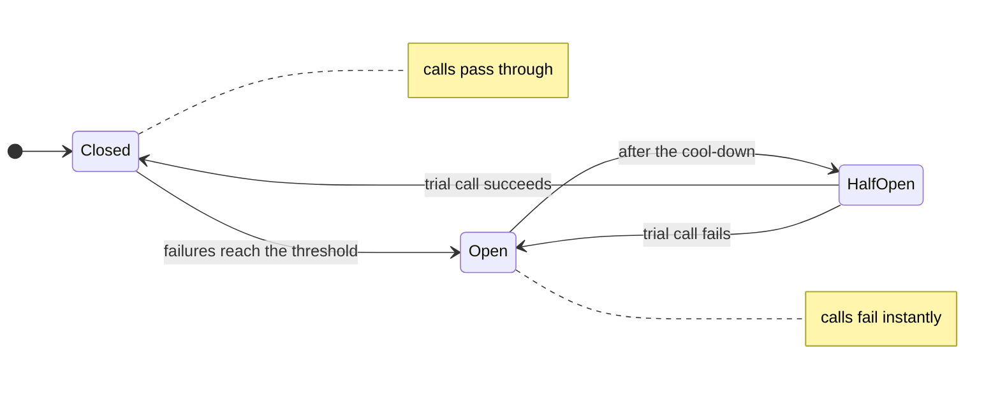
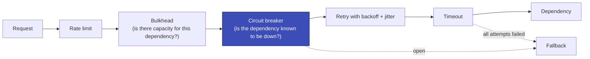

## The problem this solves

A single machine fails rarely. A system of 200 machines, each with a 0.1% chance of a problem on a given day, has **something** wrong most days. Networks drop packets, disks fill, a deploy has a bug, a provider slows down. You cannot prevent failure; you design so that **one failing part does not take the rest with it**.

The worst pattern is the **cascading failure**: service C slows down, so B's requests to C pile up and B runs out of threads or connections, so A's requests to B pile up, and the whole product is down because of one slow dependency.

## Tool 1: timeouts

A request with no timeout waits forever. Every waiting request holds memory and a connection.

```js run
const slowService = () => new Promise(resolve => setTimeout(() => resolve('data'), 500));

function withTimeout(promise, ms) {
  return Promise.race([promise, new Promise((_, reject) => setTimeout(() => reject(new Error(`timed out after ${ms} ms`)), ms).unref())]);
}

(async () => {
  let waiting = 0, peak = 0;
  const handle = async useTimeout => {
    waiting++; peak = Math.max(peak, waiting);
    try { return await (useTimeout ? withTimeout(slowService(), 50) : slowService()); }
    catch (e) { return 'fallback'; }
    finally { waiting--; }
  };
  for (const useTimeout of [false, true]) {
    peak = 0; waiting = 0;
    const started = Date.now();
    const results = [];
    for (let i = 0; i < 20; i++) { results.push(handle(useTimeout)); await new Promise(r => setTimeout(r, 10)); }
    await Promise.all(results);
    console.log(`${useTimeout ? 'with 50 ms timeout' : 'no timeout        '}: requests stuck waiting at once: ${String(peak).padStart(2)}, all done after about ${Math.round((Date.now() - started) / 100) * 100} ms`);
  }
})();
```

Without a timeout, every incoming request piled up behind the slow dependency. With one, each gives up quickly, frees its resources and returns a fallback. **Every network call needs a timeout**, set a little above the dependency's normal slow case, and shorter than your caller's timeout to you.

## Tool 2: retries, done carefully

Many failures are transient: a dropped packet, a server restarting. Trying again often works. Done naively, retries make outages worse.

```js run
function backoffDelay(attempt, { baseMs = 100, maxMs = 5000, jitter = true } = {}, rand = Math.random) {
  const exponential = Math.min(maxMs, baseMs * 2 ** (attempt - 1));
  return Math.round(jitter ? rand() * exponential : exponential);
}
console.log('exponential, no jitter :', [1, 2, 3, 4, 5, 6, 7].map(a => backoffDelay(a, { jitter: false })).join(', '), 'ms');
let seed = 42; const rand = () => (seed = (seed * 16807) % 2147483647) / 2147483647;
console.log('with full jitter       :', [1, 2, 3, 4, 5, 6, 7].map(a => backoffDelay(a, {}, rand)).join(', '), 'ms');

async function retry(fn, { attempts = 4, isRetryable = () => true } = {}) {
  for (let attempt = 1; ; attempt++) {
    try { return await fn(attempt); }
    catch (err) {
      if (attempt === attempts || !isRetryable(err)) throw err;
      await new Promise(r => setTimeout(r, backoffDelay(attempt, { baseMs: 5 })));
    }
  }
}
(async () => {
  let calls = 0;
  console.log(await retry(async () => { calls++; if (calls < 3) throw Object.assign(new Error('503'), { status: 503 }); return `succeeded on call ${calls}`; }));
  calls = 0;
  await retry(async () => { calls++; throw Object.assign(new Error('400 bad request'), { status: 400 }); }, { isRetryable: e => e.status >= 500 })
    .catch(e => console.log(`"${e.message}" not retried, calls made: ${calls}`));
})();
```

| Rule | Why |
| --- | --- |
| **Exponential backoff**: wait 100, 200, 400 ms... | gives a struggling service time to recover instead of hammering it |
| **Jitter**: randomize each wait | without it, a thousand clients that failed together all retry at the same instant (a **thundering herd**) |
| **Limit attempts** | a failing call must eventually fail |
| **Retry only what can succeed** | 503 and timeouts, yes; 400 and 404, never |
| **Retry only idempotent operations** | retrying "charge the card" may charge twice, unless an idempotency key makes it safe ([[rest-api]]) |
| **Retry at one layer** | if three layers each retry 3 times, one failure becomes 27 calls (a **retry storm**) |

## Tool 3: the circuit breaker

Retries help with brief failures. When a dependency is **down**, every request still waits for a timeout and then retries, wasting resources and keeping pressure on the broken service. A circuit breaker notices repeated failure and **stops calling for a while**.



```js run
class CircuitBreaker {
  constructor(fn, { failureThreshold = 3, cooldownMs = 100 } = {}) {
    Object.assign(this, { fn, failureThreshold, cooldownMs, state: 'CLOSED', failures: 0, openedAt: 0 });
  }
  async call(now = Date.now()) {
    if (this.state === 'OPEN') {
      if (now - this.openedAt < this.cooldownMs) return 'rejected instantly (circuit open)';
      this.state = 'HALF_OPEN';
    }
    try {
      const result = await this.fn();
      this.state = 'CLOSED'; this.failures = 0;
      return result;
    } catch (err) {
      this.failures++;
      if (this.state === 'HALF_OPEN' || this.failures >= this.failureThreshold) { this.state = 'OPEN'; this.openedAt = now; }
      return 'failed: ' + err.message;
    }
  }
}

(async () => {
  let healthy = false, realCalls = 0;
  const breaker = new CircuitBreaker(async () => { realCalls++; if (!healthy) throw new Error('payments down'); return 'ok'; });
  const step = async (label, now) => console.log(label.padEnd(26), (await breaker.call(now)).padEnd(34), `state=${breaker.state.padEnd(9)} real calls so far: ${realCalls}`);
  await step('call 1', 0); await step('call 2', 1); await step('call 3', 2);
  await step('call 4', 3); await step('call 5', 4);
  await step('after cool-down, still down', 150);
  healthy = true;
  await step('call during new cool-down', 160);
  await step('after cool-down, recovered', 300);
  await step('normal again', 301);
})();
```

Follow the "real calls" column. After three failures the breaker **opened**: calls 4 and 5 were rejected instantly without touching the dependency. After the cool-down it let **one trial call** through (half-open); that failed, so it opened again. Later a trial succeeded and it **closed**. The caller fails fast instead of waiting, and the broken service gets room to recover. It is the State pattern from [[lld-behavioral]].

## Tool 4: bulkheads

A ship's hull is divided into sealed compartments so one leak cannot sink it. In software: **give each dependency its own limited pool of resources**.

```js run
class Bulkhead {
  constructor(limit) { this.limit = limit; this.active = 0; this.rejected = 0; }
  async run(task) {
    if (this.active >= this.limit) { this.rejected++; return 'rejected'; }
    this.active++;
    try { return await task(); } finally { this.active--; }
  }
}
const sleep = ms => new Promise(r => setTimeout(r, ms));
(async () => {
  const shared = new Bulkhead(10);
  const slowReports = Array.from({ length: 10 }, () => shared.run(() => sleep(100)));
  const checkoutShared = await shared.run(async () => 'checkout ok');
  await Promise.all(slowReports);

  const reportsPool = new Bulkhead(5), checkoutPool = new Bulkhead(5);
  const reports = Array.from({ length: 10 }, () => reportsPool.run(() => sleep(100)));
  const checkoutIsolated = await checkoutPool.run(async () => 'checkout ok');
  await Promise.all(reports);
  console.log('one shared pool of 10   : checkout ->', checkoutShared, '(slow reports took every slot)');
  console.log('separate pools of 5 + 5 : checkout ->', checkoutIsolated, '| reports rejected:', reportsPool.rejected);
})();
```

With one shared pool, a flood of slow report requests consumed every slot and checkout was refused. With separate pools, reports can only exhaust their own, and checkout keeps working. The same idea at larger scale: separate connection pools per dependency, separate services for critical and non-critical work, separate queues per priority.

## Tool 5: degrade gracefully and shed load

A page is rarely all-or-nothing.

| Technique | Example |
| --- | --- |
| **Fallback** | recommendations service is down, so show bestsellers from cache |
| **Partial response** | product page loads without reviews instead of failing entirely |
| **Stale data** | serve the last cached price list while the pricing service recovers |
| **Load shedding** | at 100% capacity, reject excess requests quickly with 503 so the accepted ones still succeed |
| **Rate limiting** | no single client can consume the whole system ([[node-scaling]]) |
| **Feature flags** | switch off an expensive, non-essential feature during an incident |

Decide in advance which features are **critical** (checkout) and which are **optional** (recommendations), and make sure optional ones can fail without hurting critical ones.

## Putting them in order



Each layer handles what the one inside it cannot. Libraries (`opossum`, `cockatiel` for Node; Resilience4j for Java) and service meshes provide all of these.

## Measuring reliability

| Term | Meaning | Example |
| --- | --- | --- |
| **SLI** (indicator) | a measured number | 99.95% of requests succeeded in under 300 ms this month |
| **SLO** (objective) | the internal target | 99.9% |
| **SLA** (agreement) | a promise to customers, with a penalty | 99.5% or a refund |
| **Error budget** | what the SLO allows to fail | 0.1% of requests; when it is spent, slow down releases |
| **MTTR** | mean time to recover | how fast you fix an outage; often matters more than how rarely you fail |

100% is not a sensible goal: each extra nine costs roughly ten times more, and users cannot tell the difference beyond what their own network provides. Availability arithmetic is in [[hld-scaling]]; what to log and alert on is in [[node-production]].

!!! key
- Assume everything fails; contain the failure.
- Timeout on every network call.
- Retries: exponential backoff, jitter, a limit, only for retryable errors and idempotent operations.
- Circuit breaker: closed, open, half-open. Fail fast and let the dependency recover.
- Bulkhead: isolate resource pools so one dependency cannot starve the others.
- Fallbacks and load shedding keep the core working.
- SLI, SLO, SLA and error budget.
!!!

!!! trap
- No timeout, or a caller's timeout shorter than the sum of its downstream retries.
- Retrying non-idempotent writes.
- Retries at every layer multiplying load during an outage.
- A circuit breaker with no fallback: failing fast is better than failing slowly, but the user still sees an error.
- Health checks that pass while the service cannot actually serve (they test the process, not the dependencies it needs).
- Treating a rare, silent data loss as acceptable because availability numbers look good. Durability is a separate promise.
!!!

!!! twist What changes if...
- **...a whole data center goes down?** Run in several availability zones with data replicated across them ([[hld-data]]); the load balancer routes around the dead zone.
- **...you want to know the system survives failures before they happen?** Chaos engineering: deliberately kill instances or add latency in a controlled way and watch.
- **...a deploy is the cause (it usually is)?** Canary releases and fast rollback limit the damage ([[node-production]]).
- **...the dependency is a queue consumer, not a request?** Retries become redelivery, with a dead-letter queue for messages that keep failing ([[hld-messaging]]).
!!!

!!! model
Give every call a deadline, a limited number of second chances, a fuse that trips when the other side is clearly down, its own budget of resources, and a plan B.
!!!

## Practice

?? Your service calls a payment provider that normally answers in 200 ms. What timeout, retry and breaker settings would you start with?
Timeout around 1 to 2 seconds (above its slow-normal range). At most 2 retries with exponential backoff and jitter, only on timeouts and 5xx, and only with an idempotency key so a retry cannot double-charge. A circuit breaker that opens after a run of failures (for example over 50% of the last 20 calls) with a cool-down of some seconds, and a fallback that tells the user payment is temporarily unavailable and keeps the order pending.
??

?? Why add random jitter to backoff delays?
If many clients fail at the same moment and all wait exactly 100 ms, then 200 ms, they retry in synchronized waves that hit the recovering service all at once. Randomizing spreads the retries over time so the load is smooth.
??

?? Explain the three states of a circuit breaker.
Closed: calls pass through and failures are counted. Open: after too many failures, calls are rejected immediately without contacting the dependency, for a cool-down period. Half-open: after the cool-down, a limited number of trial calls are allowed; success closes the circuit, failure reopens it.
??

?? A product page calls catalog, pricing, inventory, reviews and recommendations. Recommendations becomes slow. How do you keep the page fast?
Call the services in parallel with individual timeouts. Treat reviews and recommendations as optional: on timeout or open circuit, render the page without them or with cached content. Isolate their connection pools so their slowness cannot use up resources needed for catalog and pricing.
??

?? What is an error budget and how does it change behaviour?
It is the amount of failure the SLO permits, for example 0.1% of requests per month for a 99.9% target. While budget remains, the team can release quickly and take risks. When it is used up, the priority shifts to stability work. It turns "how reliable should we be" into a number both product and engineering agree on.
??
