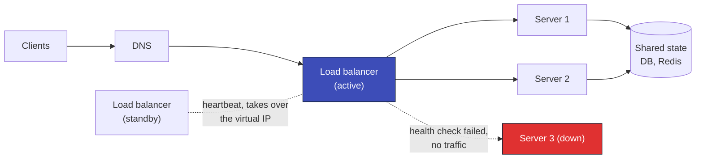

## The problem this solves

A single server fails in two ways as a product grows. **Capacity**: it can only serve so many requests per second. **Availability**: when it goes down, everything goes down. We need more capacity than one machine has and no single machine whose failure is fatal.

## Intuition

| | Vertical scaling (scale up) | Horizontal scaling (scale out) |
| --- | --- | --- |
| How | bigger machine: more CPU, RAM | more machines of the same kind |
| Limit | the largest machine you can buy | practically none |
| Cost curve | grows faster than capacity | roughly linear |
| Failure | still one machine | one of many can die |
| Requires | nothing; no code change | a load balancer and **stateless** servers |

Scale up first because it is simple. Scale out when you hit the ceiling or need redundancy.

A **load balancer** is a server whose only job is to receive every request and forward it to one of several backends. Clients see one address; behind it, backends can be added, removed or replaced.



## Build it step by step

### Example 1: load balancing algorithms

```js run
const servers = ['A', 'B', 'C'];
const requests = Array.from({ length: 9 }, (_, i) => 'user' + (i % 3 + 1));

let rr = 0;
const roundRobin = () => servers[rr++ % servers.length];

const weights = { A: 3, B: 1, C: 1 }, pool = Object.entries(weights).flatMap(([s, w]) => Array(w).fill(s));
let wr = 0;
const weighted = () => pool[wr++ % pool.length];

const active = { A: 5, B: 1, C: 3 };
const leastConnections = () => { const s = Object.keys(active).sort((x, y) => active[x] - active[y])[0]; active[s]++; return s; };

const hash = str => [...str].reduce((h, c) => (h * 31 + c.charCodeAt(0)) >>> 0, 7);
const ipHash = key => servers[hash(key) % servers.length];

console.log('round robin       :', requests.map(roundRobin).join(' '));
console.log('weighted (3:1:1)  :', requests.map(weighted).join(' '));
console.log('least connections :', requests.map(leastConnections).join(' '), '(started with A=5 B=1 C=3)');
console.log('hash of user id   :', requests.map(r => `${r}->${ipHash(r)}`).slice(0, 6).join(' '));
```

| Algorithm | Picks | Good when | Weakness |
| --- | --- | --- | --- |
| Round robin | next server in turn | servers identical, requests similar | ignores load and slow requests |
| Weighted round robin | in proportion to capacity | mixed machine sizes | weights are static |
| Least connections | server with fewest open connections | long-lived or uneven requests (WebSockets) | needs live connection counts |
| Hash (IP or key) | same key always to the same server | sticky sessions, cache locality | adding a server remaps most keys, unless consistent hashing is used ([[hld-data]]) |

### Example 2: statelessness is the precondition

```js run
function makeServer(name, sharedStore) {
  const localSessions = new Map();
  return {
    loginLocal: user => { localSessions.set(user, { cart: ['book'] }); return name; },
    cartLocal: user => localSessions.get(user)?.cart ?? 'NOT LOGGED IN',
    loginShared: user => { sharedStore.set(user, { cart: ['book'] }); return name; },
    cartShared: user => sharedStore.get(user)?.cart ?? 'NOT LOGGED IN',
  };
}
const redis = new Map();
const [s1, s2] = [makeServer('S1', redis), makeServer('S2', redis)];

s1.loginLocal('asha');
console.log('in-memory session, next request lands on S2:', s2.cartLocal('asha'));
s1.loginShared('asha');
console.log('shared store,     next request lands on S2:', s2.cartShared('asha'));
```

If a server remembers anything about a user in its own memory, the next request, routed to a different server, finds nothing. Two fixes:

- **Stateless servers** (preferred): move session state to a shared store such as Redis, or into a signed token the client carries ([[auth-jwt]]). Any server can then handle any request, and servers can be added or killed freely. This is the same conclusion reached from the Node side in [[node-scaling]].
- **Sticky sessions**: the load balancer pins each client to one server. Simple, but load becomes uneven and a server's death loses its sessions. Sometimes unavoidable for WebSockets ([[websockets]]).

### Example 3: availability arithmetic

```js run
const pct = x => (x * 100).toFixed(4) + '%';
const downtime = a => { const m = (1 - a) * 365 * 24 * 60; return m > 120 ? (m / 60).toFixed(1) + ' h/yr' : m.toFixed(1) + ' min/yr'; };
const series = (...xs) => xs.reduce((a, b) => a * b, 1);
const parallel = (a, n) => 1 - Math.pow(1 - a, n);

console.log('one server at 99%          :', pct(0.99), downtime(0.99));
console.log('LB -> app -> DB in series  :', pct(series(0.999, 0.99, 0.999)), downtime(series(0.999, 0.99, 0.999)));
console.log('two app servers in parallel:', pct(parallel(0.99, 2)), downtime(parallel(0.99, 2)));
console.log('three in parallel          :', pct(parallel(0.99, 3)), downtime(parallel(0.99, 3)));
console.log('redundant at every layer   :', pct(series(parallel(0.999, 2), parallel(0.99, 3), parallel(0.999, 2))));
```

- Components **in series** (all must work): multiply availabilities. A chain is weaker than its weakest link.
- Components **in parallel** (any one suffices): multiply the *failure* probabilities. Two 99% servers give 99.99%.

That is the mathematical reason for redundancy at every layer, and for removing every **single point of failure** (SPOF), including the load balancer itself, which runs as an active and standby pair.

### Layer 4 vs layer 7 load balancers

| | Layer 4 (transport) | Layer 7 (application) |
| --- | --- | --- |
| Sees | IP addresses and ports ([[cn-tcp-udp]]) | full HTTP request: path, headers, cookies ([[cn-http]]) |
| Can route by | connection only | URL path, host, header, cookie |
| Extras | very fast, any TCP/UDP protocol | TLS termination, compression, caching, rate limiting, auth |
| Examples | AWS NLB, HAProxy (TCP mode) | nginx, AWS ALB, Envoy |

A layer 7 balancer that also handles TLS, routing by path to different services, rate limiting and authentication is usually called a **reverse proxy** or **API gateway**.

## The rule, stated precisely

Horizontal scaling requires that any instance can serve any request, which requires that instances keep no request-spanning state locally. Availability of a chain is the product of its parts; availability of N redundant replicas is 1 − (1 − a)^N.

!!! key
- Scale up until it hurts, then scale out. Say both and say why you move.
- "Stateless app tier behind a load balancer, state in shared stores" is the base of almost every design.
- The load balancer needs **health checks** (stop routing to dead servers) and must itself be redundant.
- **Autoscaling**: add or remove instances from a metric such as CPU or queue length. Only possible because servers are stateless and interchangeable.
- The stateless tier is the easy part to scale. The database is the hard part: [[hld-data]].
!!!

!!! trap
- Adding app servers when the database is the bottleneck. Measure first.
- Forgetting the load balancer is a SPOF.
- Local file uploads, in-memory caches or cron jobs on app servers: each breaks when there are several servers. Use object storage, a shared cache, and a scheduler that runs a job once.
- Sticky sessions as a substitute for fixing state.
!!!

!!! twist What changes if...
- **...users are worldwide?** Put load-balanced clusters in several regions, route users to the nearest with DNS or anycast, and serve static content from a CDN ([[hld-caching]]). Now data replication across regions is the hard question.
- **...one request type is far heavier than the rest (video upload)?** Split it into its own service and scale that tier separately; route by path at layer 7.
- **...a deploy must not drop requests?** Rolling deploy: take one server out of rotation, let in-flight requests finish (connection draining), update, health-check, return it. Blue-green and canary releases are variations.
!!!

!!! model
Many identical, forgettable workers behind one front desk. If any worker can be swapped without anyone noticing, you can have as many as you like.
!!!

## Practice

?? Your app has 4 servers behind a round-robin load balancer, and some users are randomly logged out. Why?
Sessions are stored in each server's memory. A user who logged in on server 1 is routed to server 2, which has no session for them. Move sessions to a shared store or use signed tokens; sticky sessions would hide the problem until a server restarts.
??

?? Which algorithm would you pick for a chat service holding long-lived WebSocket connections, and why not round robin?
Least connections. Connections live for hours, so after a deploy or a restart round robin sends the same number of *new* connections to a server that already holds thousands and to one that holds none. Least connections evens out the actual load.
??

?? What happens when the load balancer dies?
With one balancer, everything is unreachable: it is a single point of failure. In practice two run as active and passive sharing a virtual IP, with a heartbeat; the passive takes the IP over within seconds. Managed cloud balancers do this for you across availability zones.
??

?? A system needs 99.99% availability and each app server is 99.9% available. How many do you need behind the balancer (ignoring other layers)?
Two: 1 − (0.001)² = 99.9999%, which exceeds the target. In practice run at least three so that losing one during a deploy or failure still leaves redundancy and enough capacity.
??

?? What is the difference between a load balancer, a reverse proxy and an API gateway?
They overlap. A load balancer distributes traffic across identical backends. A reverse proxy sits in front of servers and can also terminate TLS, cache and compress, even for a single backend. An API gateway is a reverse proxy specialized for APIs: routing to different services, authentication, rate limiting, request transformation.
??
