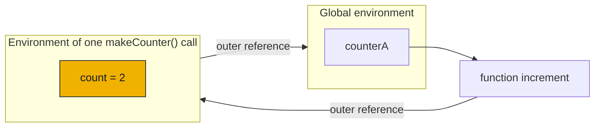

## The problem this solves

A function's local variables are created when it is called and should be gone when it returns. So how can a counter keep its count between calls without a global variable? How does a click handler created inside a loop know which item it belongs to? Both need a function that **carries data with it**.

## Intuition

From [[js-execution-context]]: every context stores an **outer reference** to the environment where the function was *defined*. Two facts follow.

1. **Lookup is lexical.** When a name is not found locally, the engine follows the outer reference, then that one's outer reference, up to global. This chain is the **scope chain**. It is fixed by where the code is written, not by who calls it.
2. **Environments live as long as something points to them.** If an inner function is still reachable after the outer function returns, the inner function's outer reference keeps the outer function's variables alive.

A **closure** is that pair: a function plus the environment it was defined in.



`makeCounter` has returned and its context is off the call stack, but its environment (yellow) survives because `increment` still points to it.

## Build it step by step

### Example 1: lexical scope, not caller scope

```js run
const name = 'global';
function show() { return name; }
function caller() {
  const name = 'caller';
  return show();
}
console.log(caller());
```

`show` was defined at the top level, so its outer reference is the global environment. Being *called* from inside `caller` changes nothing.

### Example 2: private state that survives between calls

```js run
function makeCounter() {
  let count = 0;
  return {
    increment: () => ++count,
    current: () => count,
  };
}
const a = makeCounter();
const b = makeCounter();
a.increment(); a.increment();
b.increment();
console.log(a.current(), b.current());
console.log(a.count);
```

Each call to `makeCounter` creates a new environment, so `a` and `b` have independent counts. `count` cannot be reached from outside (`a.count` is `undefined`); only the two functions can touch it. This is the **module pattern**: data privacy without classes.

### Example 3: the loop question every interviewer asks

```js run
const withVar = [];
for (var i = 0; i < 3; i++) withVar.push(() => i);
console.log('var:', withVar.map(f => f()).join(' '));

const withLet = [];
for (let j = 0; j < 3; j++) withLet.push(() => j);
console.log('let:', withLet.map(f => f()).join(' '));

const withIIFE = [];
for (var k = 0; k < 3; k++) (function (copy) { withIIFE.push(() => copy); })(k);
console.log('iife:', withIIFE.map(f => f()).join(' '));
```

The key insight: **a closure captures the variable, not its value at that moment.**

- `var i` is one variable for the whole loop. All three functions share it and read it after the loop ended, when it is `3`.
- `let j` creates a new binding for every iteration, so each function closes over its own `j`.
- The IIFE (immediately invoked function expression) is the pre-2015 fix: calling a function per iteration creates a fresh environment with its own `copy`.

### Example 4: closures in real code, a function factory

```js run
function requireRole(role) {
  return function check(user) {
    return user.roles.includes(role) ? 'allowed' : 'forbidden';
  };
}
const adminOnly = requireRole('admin');
console.log(adminOnly({ roles: ['admin', 'editor'] }));
console.log(adminOnly({ roles: ['viewer'] }));
```

`requireRole('admin')` returns a function that remembers `role`. This exact shape is how configurable Express middleware works in [[express-middleware]] and how role checks are built in [[auth-jwt]].

## The rule, stated precisely

A closure is created **every time a function is created**: the function object stores a reference to the current environment. When the function later runs, its new context's outer reference is set to that stored environment. Variables are resolved by walking this chain at the time of *use*, so closures see the latest value.

!!! why
Garbage collection in JavaScript is by reachability. A returned inner function is reachable, it references its defining environment, so that environment is reachable too. Nothing special is "saved"; the environment simply is never freed.
!!!

!!! key
- Definition to say out loud: "a closure is a function together with the lexical environment it was created in, which lets it access outer variables after the outer function has returned."
- Captures variables **by reference**, not by value.
- Uses you should be able to name: data privacy, function factories, callbacks and event handlers, memoization, `debounce`/`throttle` ([[js-functional]]), React hooks ([[react-state]]).
- Cost: a closure keeps its whole environment alive. Long-lived closures over large data are a classic memory leak.
!!!

!!! trap
- Saying closures are "functions inside functions". Nesting is how you usually get one, but the defining feature is the retained environment.
- The stale closure: a callback created earlier keeps seeing the variable it closed over. If that variable was a `const` from an old render or an old call, the callback is stuck with the old value. This is the root of the most common React bug, covered in [[react-effects]].
- Assuming the `var` loop prints `0 1 2`.
!!!

!!! twist What changes if...
- **...you want the `var` loop fixed without `let`?** Use an IIFE, or `setTimeout(fn, 0, i)` which passes the value as an argument, or `.bind(null, i)`.
- **...two closures come from the same call?** They share one environment (like `increment` and `current`). A write through one is visible through the other.
- **...you set the returned function to `null`?** The environment becomes unreachable and can be collected. This is how you release closure memory.
!!!

!!! model
A function carries a backpack: a link to the variables that were in scope where it was written. It reads the backpack's current contents each time it runs.
!!!

## Practice

?? Implement `once(fn)`: the returned function runs `fn` only the first time and returns the first result afterwards.
The closure holds two variables: whether it has run, and the saved result.

```js run
function once(fn) {
  let called = false, result;
  return function (...args) {
    if (!called) { called = true; result = fn.apply(this, args); }
    return result;
  };
}
const init = once(() => { console.log('connecting'); return 'connection#1'; });
console.log(init(), init());
```
??

?? Implement `memoize(fn)` for a single-argument function.
The cache lives in the closure, so it is private to each memoized function.

```js run
function memoize(fn) {
  const cache = new Map();
  return n => {
    if (!cache.has(n)) cache.set(n, fn(n));
    return cache.get(n);
  };
}
let calls = 0;
const square = memoize(n => { calls++; return n * n; });
console.log(square(9), square(9), 'computed', calls, 'time');
```
??

?? What does this print? `for (var i = 0; i < 3; i++) setTimeout(() => console.log(i), 0);`
`3 3 3`. One shared `i`; the timers run after the loop finished (why they run later is [[js-event-loop]]). With `let` it prints `0 1 2`.
??

?? How can closures cause a memory leak? Give a concrete case.
An event listener or timer that closes over a large object keeps it alive for as long as the listener is registered. Example: a `setInterval` callback inside a component that references the component's data and is never cleared. Fix: remove the listener or clear the timer when done.
??

?? `function f() { let a = 1; return () => a++; }` then `const g = f(); g(); g(); const h = f();`. What does `h()` return?
`1`. `h` comes from a second call to `f`, which created a brand-new environment with its own `a`. `g`'s environment has `a = 3` by now but they are unrelated.
??

?? Do arrow functions create closures differently from normal functions?
No. Scope capture is identical. Arrow functions differ only in also taking `this` and `arguments` from the enclosing scope, which is covered in [[js-this]].
??
