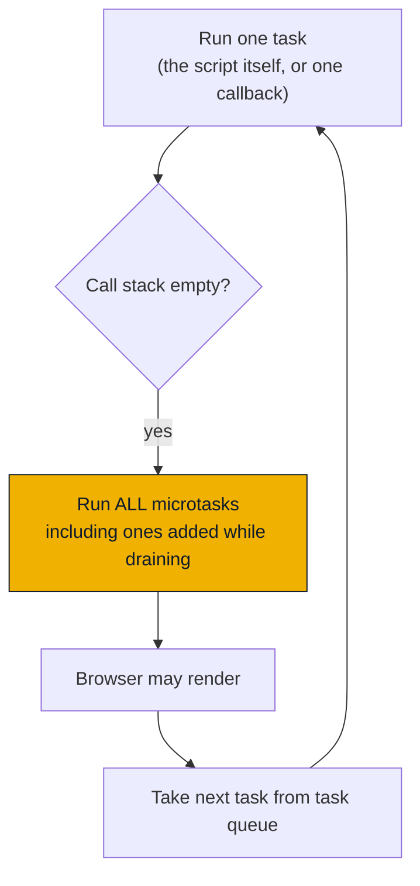

## The problem this solves

From [[js-execution-context]]: there is one call stack, so only one piece of JavaScript runs at a time. If a network request took 2 seconds and the stack waited for it, nothing else could run for 2 seconds: no clicks, no rendering, no other requests. We need a way to **start slow work, keep going, and come back when it finishes**.

## Intuition

Split the work between two parties.

- **The JavaScript engine** runs your code on the single call stack.
- **The host** (the browser, or Node via libuv, see [[node-runtime]]) does the waiting: timers, network, disk. It runs outside your stack.

When the host finishes something, it cannot interrupt running code. It puts your callback in a **queue**. The **event loop** is a loop that asks one question: *is the call stack empty?* If yes, it takes the next callback from a queue and pushes it onto the stack.

There are two queues with different priority:

| Queue | Who puts callbacks here | When it is drained |
| --- | --- | --- |
| **Microtask queue** | promise reactions (`then`/`catch`/`finally`), code after `await`, `queueMicrotask`, `MutationObserver` | completely, right after the current task finishes, before anything else |
| **Task queue** (also called macrotask queue) | `setTimeout`, `setInterval`, I/O callbacks, UI events | one task per loop turn |



One turn of the loop: **one task, then every microtask, then (in browsers) a chance to render**.

## Build it step by step

### Example 1: the ordering question

```js run
console.log('1 sync');
setTimeout(() => console.log('4 timeout (task)'), 0);
Promise.resolve().then(() => console.log('3 promise (microtask)'));
console.log('2 sync');
```

Trace it:

1. The script is itself a task. `1 sync` prints.
2. `setTimeout` hands the callback to the host with a 0 ms timer. It lands in the **task queue**.
3. The resolved promise schedules its `then` callback in the **microtask queue**.
4. `2 sync` prints. The script ends, the stack is empty.
5. Microtasks drain: `3 promise`.
6. Next task: `4 timeout`.

`setTimeout(fn, 0)` never means "now". It means "after the current task and all microtasks".

### Example 2: microtasks added during draining run in the same drain

```js run
setTimeout(() => console.log('timeout'), 0);

Promise.resolve()
  .then(() => { console.log('micro 1'); queueMicrotask(() => console.log('micro 1a (queued by micro 1)')); })
  .then(() => console.log('micro 2'));

console.log('sync end');
```

The loop does not move on to the timeout until the microtask queue is completely empty, including microtasks that were added while it was draining. Notice `micro 1a` runs before `micro 2`: the second `then` is only queued once the first `then` callback has finished and its promise has settled.

### Example 3: async/await is promise scheduling

```js run
async function load() {
  console.log('2 load starts synchronously');
  await null;
  console.log('4 after await (microtask)');
}
console.log('1 start');
load();
console.log('3 end');
```

An `async` function runs synchronously up to the first `await`. Everything after the `await` is scheduled as a microtask, exactly like a `then` callback. [[js-promises]] builds on this.

### Example 4: blocking the loop blocks everything

```js run
const start = Date.now();
setTimeout(() => console.log('timer asked for 10 ms, fired after about', Math.round((Date.now() - start) / 50) * 50, 'ms'), 10);
while (Date.now() - start < 200) {}
console.log('long synchronous work done');
```

The timer was ready at 10 ms, but its callback could not run until the stack emptied at 200 ms. A timer delay is a **minimum**, not a guarantee. In a browser this is a frozen page; in a Node server it is every other user waiting.

## The rule, stated precisely

Repeat forever:

1. Take the oldest task from the task queue and run it to completion.
2. Run all microtasks until the microtask queue is empty.
3. (Browser) Render if needed.

"Run to completion" matters: a callback is never interrupted by another callback. This is why JavaScript has no data races on ordinary variables.

!!! why
Microtasks get priority so that promise-based code observes a consistent state: everything that depends on a finished operation runs before any unrelated event (a click, a timer) can sneak in between.
!!!

!!! key
- Order to memorize: **synchronous code, then all microtasks, then one task**.
- JavaScript is single-threaded; the *runtime* is not. Timers, network and disk run in the host.
- Node adds detail: its loop has phases (timers, poll, check, close) and `process.nextTick` runs before promise microtasks. That is in [[node-runtime]].
- The same loop is why WebSocket messages arrive as events ([[websockets]]) and why a CPU-heavy route handler stalls a whole server ([[node-scaling]]).
!!!

!!! trap
- Saying `setTimeout(fn, 0)` runs immediately, or that `setTimeout(fn, 1000)` runs at exactly 1000 ms.
- Treating `await` as blocking. It pauses only that async function; the stack is free.
- An endless chain of microtasks (a promise callback that keeps scheduling another) starves the task queue: timers and I/O never run.
- Saying "promises run on another thread". The waiting may happen elsewhere; your callbacks always run on the main thread.
!!!

!!! twist What changes if...
- **...there are two timeouts with 0 ms?** They run in the order they were scheduled, each as its own task, with a microtask drain between them.
- **...a `then` callback is attached to an already-resolved promise?** It still runs asynchronously, as a microtask. A promise callback never runs synchronously.
- **...you need to break up heavy work?** Split it into chunks and yield between them with `setTimeout`/`setImmediate` so other tasks can run, or move it to a worker.
!!!

!!! model
One worker (the stack), a VIP line (microtasks) that must be emptied after every job, and a regular line (tasks) served one job at a time.
!!!

## Practice

?? Predict the output.
```js
console.log('A');
setTimeout(() => console.log('B'), 0);
Promise.resolve().then(() => { console.log('C'); setTimeout(() => console.log('D'), 0); });
Promise.resolve().then(() => console.log('E'));
console.log('F');
```
Answer below, verified by running it.

```js run
console.log('A');
setTimeout(() => console.log('B'), 0);
Promise.resolve().then(() => { console.log('C'); setTimeout(() => console.log('D'), 0); });
Promise.resolve().then(() => console.log('E'));
console.log('F');
```

Sync: A, F. Microtasks: C (which schedules D as a later task), E. Tasks in scheduling order: B, then D.
??

?? Predict the output with async functions.
```js run
async function a() { console.log('a1'); await b(); console.log('a2'); }
async function b() { console.log('b1'); }
console.log('start');
a();
Promise.resolve().then(() => console.log('then'));
console.log('end');
```

`a` runs synchronously through `a1`, calls `b` (prints `b1`), then hits `await` and suspends; `a2` is queued as a microtask. `then` is queued after it. So after `end`, the microtasks run in order: `a2`, `then`.
??

?? Is JavaScript single-threaded? Then how does it do things concurrently?
The language executes on one thread with one call stack. Concurrency comes from the host: it performs I/O and timers outside that thread and queues callbacks. JavaScript gives concurrency (many operations in progress) without parallelism (two pieces of your code running at the same instant), unless you use Web Workers or worker threads.
??

?? Why does a `while (true) {}` freeze a browser tab completely?
The loop never returns, so the current task never completes. The event loop cannot reach the microtask drain, the render step or the next task, so clicks queue up and the screen does not repaint.
??

?? What is starvation in this context, and which queue can cause it?
The microtask queue. Because it must be fully drained before the loop continues, a microtask that always schedules another microtask keeps the loop from ever reaching the task queue. Recursive `setTimeout` does not starve anything, because each call is a separate task.
??

?? Difference between `setTimeout(fn, 0)`, `setImmediate(fn)` and `process.nextTick(fn)` in Node?
`nextTick` runs right after the current operation, before promise microtasks. Promise microtasks run next. `setTimeout(fn, 0)` runs in the timers phase and `setImmediate` in the check phase of the loop; inside an I/O callback `setImmediate` always fires first. Details in [[node-runtime]].
??
