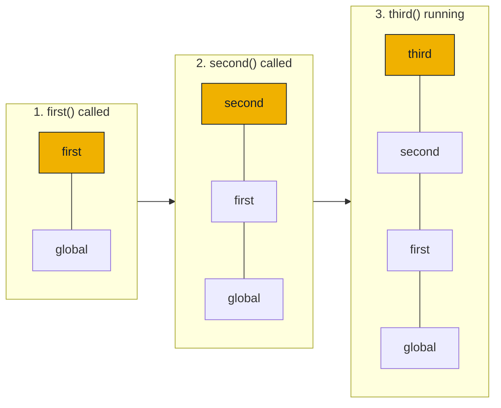

## The problem this solves

You call a function three lines before it is defined and it works. You read a `var` before its assignment and get `undefined`, not an error. You do the same with `let` and the program crashes. These look like three unrelated quirks. They are one mechanism: **how the engine prepares a scope before running it**.

## Intuition

The engine handles every scope (the whole file, or one function call) in two passes.

1. **Creation pass.** Scan the scope for declarations and reserve a slot in memory for each name. Nothing executes.
2. **Execution pass.** Run the code line by line, filling in and reading those slots.

The record that holds those slots, plus a pointer to the outer scope and the value of `this`, is called an **execution context**. One is created for the global code, and a new one for every function *call*.

What differs between `var`, `let`, `const` and `function` is only what the creation pass puts in the slot:

| Declaration | Slot after the creation pass | Reading it before its line |
| --- | --- | --- |
| `function f() {}` | the whole function | works |
| `var x` | `undefined` | gives `undefined` |
| `let x` / `const x` / `class X` | reserved but uninitialized | throws `ReferenceError` |

"Hoisting" is just the name for this: declarations are known before execution starts. Nothing physically moves.

## Build it step by step

### Example 1: the three behaviours side by side

```js run
console.log(typeof greet, greet());
console.log(a);
try { console.log(b); } catch (e) { console.log(e.name + ': ' + e.message); }

function greet() { return 'hello'; }
var a = 1;
let b = 2;
```

Creation pass: `greet` gets the function, `a` gets `undefined`, `b` is reserved but uninitialized. Execution pass then runs line 1, and every result follows from the slot contents.

### Example 2: function expressions hoist like their variable

```js run
try { sayHi(); } catch (e) { console.log(e.name + ': ' + e.message); }
try { sayBye(); } catch (e) { console.log(e.name + ': ' + e.message); }

var sayHi = function () { return 'hi'; };
const sayBye = () => 'bye';
```

`sayHi` is a `var`, so its slot holds `undefined`, and calling `undefined` is a `TypeError`. `sayBye` is a `const`, so its slot is uninitialized and even reading the name is a `ReferenceError`. Only **function declarations** are hoisted with their body.

### Example 3: the temporal dead zone is about time, not position

```js run
function readLater() { return value; }
let value = 42;
console.log(readLater());

{
  try { console.log(shadow); } catch (e) { console.log(e.name); }
  let shadow = 'inner';
}
```

`readLater` mentions `value` above the `let` line, yet it works, because by the time it is *called* the `let` has executed. The **temporal dead zone (TDZ)** is the span of time between entering a scope and executing the `let`/`const` line. Where the reading code sits in the file does not matter; when it runs does.

### Example 4: every call gets a fresh context on the call stack

```js run
function third() { console.log(new Error().stack.split('\n').slice(1, 4).map(l => l.trim().split(' ')[1]).join(' <- ')); }
function second() { third(); }
function first() { second(); }
first();

function countdown(n) { return n === 0 ? 'done' : countdown(n - 1); }
console.log(countdown(3));
try { (function forever() { forever(); })(); } catch (e) { console.log(e.name + ': ' + e.message); }
```

Calling a function pushes its execution context on the **call stack**; returning pops it. The stack has a size limit, which is what unbounded recursion hits.



Read each column bottom to top. The yellow box is the context currently running; only the top of the stack ever executes.

## The rule, stated precisely

An execution context has three parts:

1. **Variable environment**: the slots for every declaration in that scope.
2. **Outer reference**: a link to the environment where the function was *defined* (this is what [[js-closures]] builds on).
3. **`this` binding**: decided by how the function was called (see [[js-this]]).

Creation pass rules, in order: function declarations are stored whole; `var` names are created as `undefined` (if a function already has that name, the function stays); `let`, `const` and `class` names are created uninitialized.

!!! why
The two-pass design lets functions call each other regardless of order in the file (mutual recursion needs this). The TDZ exists because `undefined` leaking out of `var` hid real bugs, so `let`/`const` turn "used before initialized" into a loud error.
!!!

!!! key
- Hoisting is a result of the creation pass. Say that, not "declarations move to the top".
- `let` and `const` **are** hoisted. The proof is example 3's inner block: if `shadow` were not hoisted, the lookup would have continued outward and failed with a different message or found an outer variable.
- `var` is function-scoped, `let`/`const` are block-scoped.
- One execution context per call, not per function. Recursion creates many contexts for one function.
- JavaScript has one call stack, which is why it runs one thing at a time. [[js-event-loop]] explains what happens to everything else.
!!!

!!! trap
- "`let` is not hoisted." Wrong, and interviewers ask this to check depth.
- Expecting `var` inside an `if` or `for` block to stay inside the block. It belongs to the enclosing function.
- Forgetting that a function declaration and a `var` with the same name do not conflict: the function wins during creation, then an assignment can overwrite it during execution.
!!!

!!! twist What changes if...
- **...the `var` is inside a function?** It is hoisted only to the top of that function, not to global.
- **...you assign without declaring (`x = 5`) in sloppy mode?** It creates a global property at execution time, so it is not hoisted at all. In strict mode it throws.
- **...the function declaration is inside a block?** Behaviour differs between strict and sloppy mode. Avoid it and say so.
!!!

!!! model
Two passes per scope: first reserve names, then run. `function` slots are full, `var` slots hold `undefined`, `let`/`const` slots are locked until their line runs.
!!!

## Practice

?? What does this print, and why? `var x = 1; function f() { console.log(x); var x = 2; } f();`
`undefined`. Inside `f`, the creation pass sees `var x` and creates a local `x` holding `undefined`. That local shadows the global `x` for the whole function, including the line above the assignment.
??

?? Same code but with `let x = 2` inside `f`. What changes?
It throws `ReferenceError: Cannot access 'x' before initialization`. The local `x` still shadows the global (it is hoisted), but its slot is uninitialized until the `let` line runs.
??

?? What does this print? `console.log(typeof foo); var foo = 'text'; function foo() {}`
`function`. During creation the function declaration fills the slot, and the `var foo` declaration is ignored because the name already exists. The string assignment only happens during execution, after the `console.log`.
??

?? Is `typeof someUndeclaredName` safe? What about `typeof` on a name in its TDZ?
On a name that was never declared, `typeof` returns `"undefined"` without throwing. On a `let`/`const` name inside its TDZ, `typeof` throws a `ReferenceError`. The engine knows the name exists, so it refuses the access.
??

?? Why does deep recursion crash but a long `for` loop does not?
Every call adds an execution context to the call stack and the stack has a fixed budget. A loop reuses one context. To fix deep recursion, convert to iteration, or keep your own stack in an array on the heap.
??

?? Explain hoisting to an interviewer in three sentences.
Before running a scope, the engine scans it and registers every declaration. Function declarations are stored completely, `var` names start as `undefined`, and `let`/`const`/`class` names are registered but stay unreadable until their line executes. So "hoisting" is simply declarations being known early, and the TDZ is the window where a `let`/`const` name is known but not yet usable.
??
