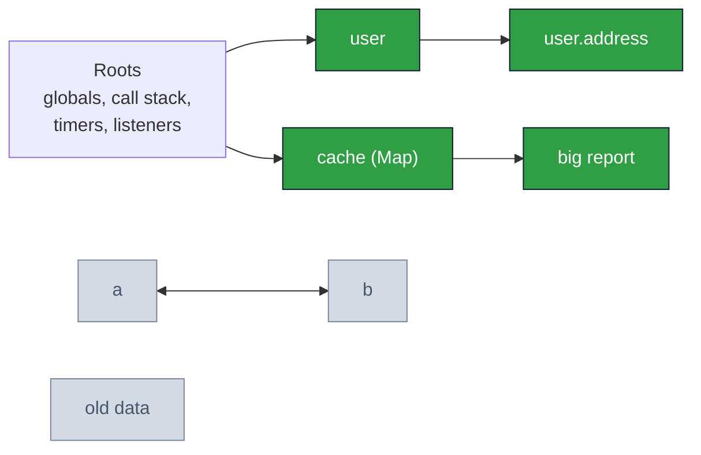

## The problem this solves

A Node server starts at 80 MB and three days later is using 1.5 GB and crashes. A single-page app gets slower the longer the tab stays open. Nobody wrote "allocate and never free". In a garbage-collected language a leak always has the same cause: **something still holds a reference to data that is no longer needed**. To find it you need to know the rule the collector uses.

## Step 1: where values live

| | Stack | Heap |
| --- | --- | --- |
| Holds | the call stack frames: local variables holding primitives and references ([[js-execution-context]]) | objects, arrays, functions, closures' environments |
| Size | small, fixed | large, grows |
| Freed | automatically when the function returns | by the **garbage collector**, some time after nothing refers to the object |

A variable holding an object really holds a **reference** to something on the heap ([[js-values]]). The question for memory is never "is this variable gone?" but "can this heap object still be reached?"

## Step 2: reachability, the one rule

The collector starts from the **roots** (global variables, the current call stack, pending timers and listeners) and follows every reference. Whatever it can reach is alive. Everything else is garbage. This algorithm is called **mark and sweep**.



Green objects are reachable from a root. Grey ones are not, so they are collected, **including `a` and `b`, which refer to each other**. Only reachability from a root counts, so cycles are not a problem.

### Seeing it happen

```js run
const mb = () => Math.round(process.memoryUsage().heapUsed / 1024 / 1024);
const hasGc = typeof global.gc === 'function';
const collect = () => hasGc && global.gc();

collect();
const before = mb();
let big = Array.from({ length: 2e6 }, (_, i) => ({ i }));
const during = mb();
big = null;
collect();
const after = mb();
console.log(`heap grew by about ${Math.round((during - before) / 10) * 10} MB while the array was referenced`);
console.log(hasGc ? `after dropping the reference and collecting, growth is ${after - before <= 5 ? 'back to about 0' : after - before} MB`
                  : 'run with node --expose-gc to force a collection and watch it drop');
```

(These examples were run with `node --expose-gc`, which adds a `gc()` function for forcing a collection. Normally the engine decides when to collect.)

Setting `big = null` did not free anything by itself. It removed the last reference, which made two million objects unreachable; the collector freed them when it next ran. You never free memory in JavaScript; you **stop referring to it**.

**How V8 makes this fast.** Most objects die young, so V8 keeps two areas. New objects go to a small **young generation** that is collected often and cheaply (a *scavenge*). Objects that survive a couple of rounds are promoted to the **old generation**, collected less often with mark-sweep and compaction. Collection pauses your code briefly, which is why creating enormous numbers of short-lived objects in a hot loop costs performance.

## Step 3: the five classic leaks

Each is a reference you forgot you were holding.

### Leak 1: a collection that only grows

```js run
const cache = new Map();
function getReport(userId) {
  if (!cache.has(userId)) cache.set(userId, { userId, data: 'x'.repeat(10000) });
  return cache.get(userId);
}
for (let id = 0; id < 5000; id++) getReport(id);
console.log('entries held forever:', cache.size);

class BoundedCache {
  constructor(max) { this.max = max; this.map = new Map(); }
  get(k) { if (!this.map.has(k)) return; const v = this.map.get(k); this.map.delete(k); this.map.set(k, v); return v; }
  set(k, v) { this.map.delete(k); this.map.set(k, v); if (this.map.size > this.max) this.map.delete(this.map.keys().next().value); }
}
const bounded = new BoundedCache(100);
for (let id = 0; id < 5000; id++) bounded.set(id, { id });
console.log('entries with a size limit:', bounded.map.size);
```

A module-level `Map` or array is reachable from a root for the life of the process. Every cache needs a limit: a maximum size with eviction (this is the LRU cache from [[hld-caching]]) or a time to live.

### Leak 2: timers and listeners never removed

```js run
const { EventEmitter } = require('events');
const bus = new EventEmitter();

function openWidget(id) {
  const heavy = new Array(1000).fill(id);
  const onTick = () => heavy.length;
  bus.on('tick', onTick);
  return { close: () => bus.off('tick', onTick) };
}

const leaky = Array.from({ length: 50 }, (_, i) => openWidget(i));
console.log('after opening 50 widgets, listeners:', bus.listenerCount('tick'));
leaky.forEach(w => w.close());
console.log('after closing them properly      :', bus.listenerCount('tick'));
```

The emitter holds each listener, and each listener's closure holds `heavy` ([[js-closures]]). Until `off` is called, a "closed" widget's data stays reachable. Same for `setInterval` without `clearInterval` and DOM `addEventListener` without `removeEventListener`. In React, this is exactly what an effect's cleanup function is for ([[react-effects]]).

### Leaks 3 to 5, in short

| Leak | How it happens | Fix |
| --- | --- | --- |
| Closures holding more than they need | a small long-lived callback closes over a scope containing a huge object | keep only the needed fields; null out large variables when done |
| Detached DOM nodes | an element is removed from the page but a JavaScript variable or map still references it | drop the reference when removing the node |
| Accidental globals | assigning to an undeclared name in sloppy mode creates a global | strict mode or modules ([[js-modules]]), which make it an error |

## Step 4: WeakMap and WeakSet

Sometimes you want to attach data to an object **without keeping that object alive**.

```js run
const collect = () => typeof global.gc === 'function' && global.gc();
const metadata = new WeakMap();

let session = { user: 'asha' };
metadata.set(session, { loginAt: 'today', visits: 3 });
console.log('lookup while the object is alive:', metadata.get(session));

const registry = new FinalizationRegistry(label => console.log(`  collector reports: ${label} was freed`));
registry.register(session, 'session object');

session = null;
collect();
setTimeout(() => console.log(typeof global.gc === 'function' ? 'the WeakMap entry went with it' : 'run with --expose-gc to see the collection'), 50);
```

A `WeakMap` holds its **keys weakly**: an entry does not count as a reference to the key. When the key object becomes otherwise unreachable, the key and its value are both collected.

| | `Map` | `WeakMap` |
| --- | --- | --- |
| Keys | anything | objects only |
| Keeps keys alive | yes | no |
| Can list keys, has `size` | yes | no (contents depend on the collector) |
| Use for | caches and lookups you manage | private data or cached results tied to an object's lifetime |

## Step 5: finding a leak

1. **Confirm it.** Watch memory over time under steady load. A healthy process rises and falls in a sawtooth and stays level overall; a leak climbs steadily.
2. **Take two heap snapshots** some time apart (Chrome DevTools Memory tab; for Node, `node --inspect` and the same tool, or `v8.writeHeapSnapshot()`).
3. **Compare them.** Look for object types whose count keeps growing.
4. **Follow the retainers.** The tool shows the chain of references keeping an object alive, back to a root. That chain names the culprit: usually a Map, an array, a listener list or a timer.

!!! key
- Memory is freed when an object is **unreachable from the roots**, not when a variable goes out of scope.
- Mark-and-sweep handles circular references.
- Generational collection: most objects die young; survivors are promoted.
- A leak is an unintended reference: unbounded caches, forgotten listeners and timers, closures, detached DOM nodes, globals.
- `WeakMap`/`WeakSet` hold keys weakly; use them to associate data with objects you do not own.
- Stack overflow (too-deep recursion) and out-of-memory (heap exhausted) are different failures.
!!!

!!! trap
- "Set it to `null` to free it." That only helps if it was the last reference.
- An in-memory cache keyed by user or request id with no eviction.
- Storing per-request data in a module-level variable on a server: it leaks, and it also mixes users' data.
- Relying on `FinalizationRegistry` for program logic. The collector decides when, or whether, it runs.
- Raising `--max-old-space-size` to "fix" a leak. It only delays the crash.
!!!

!!! twist What changes if...
- **...the data is big binary content (images, files)?** `Buffer`s live outside the V8 heap; watch `rss` and `external` in `process.memoryUsage()`, and stream instead of loading whole files ([[node-runtime]]).
- **...you must hold a huge list?** Process it in chunks or lazily with a generator ([[js-iterators]]) so only part is alive at once.
- **...several server processes each have their own cache?** Memory multiplies by the process count; move the cache to Redis ([[node-scaling]]).
!!!

!!! model
The collector walks every path out from the roots and keeps what it touches. To free something, cut every path to it. A leak is a path you forgot was there.
!!!

## Practice

?? Does this leak? `function setup() { const data = loadHuge(); return () => data.length; } const getSize = setup();`
`data` stays in memory for as long as `getSize` is reachable, because the returned closure refers to it. That is correct behaviour, and a leak only if `getSize` lives forever while only the length is needed. Fix: `const size = loadHuge().length; return () => size;`.
??

?? Two objects reference each other and nothing else references either. Are they collected?
Yes. Mark-and-sweep starts from the roots; neither object is reachable, so both are swept. Old reference-counting collectors could not free such cycles, which is why the question is asked.
??

?? Why are `WeakMap` keys restricted to objects, and why can't you iterate a `WeakMap`?
Primitives have no identity or lifetime for the collector to track. Iteration is disallowed because the set of live entries depends on when the collector last ran; exposing it would make program behaviour depend on garbage-collection timing.
??

?? Your Node API's memory grows by 50 MB an hour. Describe how you would find the cause.
Reproduce under load in a test environment. Take a heap snapshot, apply load for some minutes, take another, and compare. Sort by growth in retained size, open the growing constructor and read its retainer chain to find what holds it: typically a cache without eviction, listeners added per request, or closures captured in a long-lived array. Fix, then re-run and confirm the sawtooth is level.
??

?? Give a real use for `WeakMap`.
Caching a computed result per object without preventing its collection: `const sizes = new WeakMap(); function measure(el) { if (!sizes.has(el)) sizes.set(el, expensive(el)); return sizes.get(el); }`. When the element is discarded, its cache entry disappears too. It was also the standard way to give class instances private data before `#private` fields.
??
