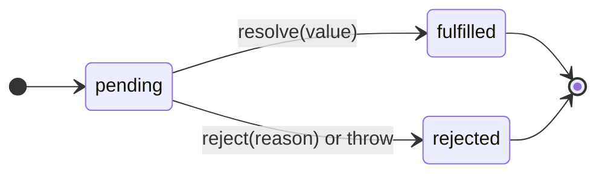

## The problem this solves

[[js-event-loop]] showed that slow work finishes later and reports back through a callback. With plain callbacks, three sequential steps become three levels of nesting, every level needs its own error check, and you hand your callback to someone else's code and hope it is called exactly once. We want async results to behave like **values**: something you can return, store, combine and attach error handling to.

## Intuition

A promise is a box with a state:



- It starts **pending**.
- It settles **once**, to **fulfilled** (with a value) or **rejected** (with a reason). After that it never changes.
- `then` registers what to do with the result. Registered callbacks always run as **microtasks**, never synchronously.

## Build it step by step

### Example 1: creating and consuming

```js run
const wait = (ms, value) => new Promise(resolve => setTimeout(() => resolve(value), ms));

const p = new Promise((resolve, reject) => {
  console.log('1 executor runs synchronously');
  resolve('first');
  resolve('ignored');
  reject(new Error('also ignored'));
});
p.then(v => console.log('3 fulfilled with', v));
console.log('2 after creating');
wait(20, 'later').then(v => console.log('4', v));
```

The function passed to `new Promise` (the executor) runs immediately. Only the first `resolve`/`reject` counts.

### Example 2: chaining, the rule that makes it work

```js run
Promise.resolve(2)
  .then(n => n * 10)
  .then(n => new Promise(res => setTimeout(() => res(n + 1), 10)))
  .then(n => { console.log('got', n); throw new Error('boom'); })
  .then(() => console.log('skipped'))
  .catch(e => { console.log('caught', e.message); return 'recovered'; })
  .then(v => console.log('continues with', v))
  .finally(() => console.log('finally runs either way'));
```

**`then` always returns a new promise.** What the callback does decides that new promise's fate:

| The callback... | The promise returned by `then`... |
| --- | --- |
| returns a plain value | fulfills with that value |
| returns a promise | waits for it and adopts its result (this is what flattens the chain) |
| throws | rejects with the thrown error |

A rejection skips every `then` until it finds a `catch`. A `catch` that returns normally puts the chain back on the success path.

### Example 3: async/await is the same thing with better syntax

```js run
const wait = (ms, value, fail) => new Promise((res, rej) => setTimeout(() => fail ? rej(new Error(value)) : res(value), ms));

async function getProfile() {
  try {
    const user = await wait(10, { id: 7 });
    const posts = await wait(10, ['p1', 'p2']);
    await wait(10, 'payment service down', true);
    return { user, posts };
  } catch (e) {
    return { error: e.message };
  } finally {
    console.log('cleanup');
  }
}
const result = getProfile();
console.log(result instanceof Promise);
result.then(r => console.log(r));
```

An `async` function always returns a promise. `await` unwraps a fulfilled promise into a value and turns a rejection into a thrown error, so ordinary `try/catch` works.

### Example 4: sequential vs parallel, the performance question

```js run
const wait = (ms, v) => new Promise(r => setTimeout(() => r(v), ms));
const round = ms => Math.round(ms / 50) * 50;

(async () => {
  let t = Date.now();
  const a = await wait(100, 'A');
  const b = await wait(100, 'B');
  console.log('sequential:', a, b, 'about', round(Date.now() - t), 'ms');

  t = Date.now();
  const [c, d] = await Promise.all([wait(100, 'C'), wait(100, 'D')]);
  console.log('parallel  :', c, d, 'about', round(Date.now() - t), 'ms');
})();
```

`await` in sequence makes each operation wait for the previous one. If they do not depend on each other, start them all first and await them together.

### Example 5: the four combinators

```js run
const ok = (v, ms) => new Promise(r => setTimeout(() => r(v), ms));
const bad = (m, ms) => new Promise((_, r) => setTimeout(() => r(new Error(m)), ms));
const show = (name, p) => p.then(v => console.log(name, '->', JSON.stringify(v)), e => console.log(name, '-> rejected:', e.constructor.name, e.message));

show('all       ', Promise.all([ok('a', 10), bad('x', 20), ok('c', 30)]));
show('allSettled', Promise.allSettled([ok('a', 10), bad('x', 20)]));
show('race      ', Promise.race([ok('slow', 30), bad('fast failure', 5)]));
show('any       ', Promise.any([bad('x', 5), ok('first success', 30)]));
```

| Combinator | Fulfills when | Rejects when | Use it for |
| --- | --- | --- | --- |
| `Promise.all` | all fulfill (array of values, input order) | any one rejects (fails fast) | all results are required |
| `Promise.allSettled` | all have settled | never | independent work, report each outcome |
| `Promise.race` | the first to settle fulfills | the first to settle rejects | timeouts |
| `Promise.any` | the first fulfills | all reject (`AggregateError`) | fastest of several mirrors |

## The rule, stated precisely

1. A promise settles at most once.
2. `then(onFulfilled, onRejected)` returns a new promise resolved by the callback's return value or rejected by its throw.
3. Handlers always run asynchronously on the microtask queue.
4. `async function f` returns a promise; `await x` suspends `f`, and resumes it in a microtask with `x`'s result.

!!! key
- Promises do not make code asynchronous or parallel. They **represent** the result of work the host is already doing.
- `Promise.all` does not *run* promises. The work started the moment each promise was created; `all` only waits.
- Unhandled rejections crash modern Node processes. Every chain needs a `catch` or an awaiting `try/catch`.
- In Express, async route errors must reach the error middleware ([[express-middleware]]). In React, async work belongs in effects or event handlers ([[react-effects]]).
!!!

!!! trap
- Forgetting `return` inside `then`: the next `then` receives `undefined` and does not wait.
- `array.forEach(async item => { await work(item); })` does not wait. `forEach` ignores the returned promises. Use `for...of` (sequential) or `Promise.all(array.map(...))` (parallel).
- `return fetchData()` inside `try` without `await`: the rejection happens after the function has left the `try`, so the `catch` never sees it. Write `return await fetchData()` when you want to catch.
- Wrapping a promise in `new Promise` for no reason (the "explicit construction anti-pattern").
!!!

!!! twist What changes if...
- **...you need at most N requests running at once?** `Promise.all` has no limit. Use a small pool of workers pulling from a shared queue (practice question below). The online judge project uses the same idea for its worker queue ([[node-scaling]]).
- **...one failure should not cancel the rest?** Use `allSettled`, or give each promise its own `.catch`.
- **...you need to cancel?** Promises cannot be cancelled. Pass an `AbortSignal` to the underlying operation (`fetch` supports it).
!!!

!!! model
A promise is a receipt for a result. `then` says what to do when the order is ready, and always gives you a new receipt for the next step.
!!!

## Practice

?? Implement `withTimeout(promise, ms)` that rejects if the promise takes too long.
Race the real work against a timer that rejects.

```js run
const withTimeout = (p, ms) => Promise.race([p, new Promise((_, rej) => setTimeout(() => rej(new Error('timed out after ' + ms + ' ms')), ms))]);
const slow = new Promise(r => setTimeout(() => r('data'), 100));
withTimeout(slow, 20).catch(e => console.log(e.message));
```
??

?? Implement `retry(fn, attempts)` for an async function.
```js run
async function retry(fn, attempts) {
  for (let i = 1; i <= attempts; i++) {
    try { return await fn(i); }
    catch (e) { console.log('attempt', i, 'failed:', e.message); if (i === attempts) throw e; }
  }
}
retry(async n => { if (n < 3) throw new Error('flaky'); return 'ok on attempt ' + n; }, 5).then(console.log);
```

In production add a delay that grows between attempts (exponential backoff) and only retry operations that are safe to repeat (idempotent, see [[rest-api]]).
??

?? Implement your own `Promise.all`.
Count completions, keep results in input order, reject on the first failure.

```js run
function all(promises) {
  return new Promise((resolve, reject) => {
    const results = []; let done = 0;
    if (promises.length === 0) return resolve(results);
    promises.forEach((p, i) => Promise.resolve(p).then(v => {
      results[i] = v;
      if (++done === promises.length) resolve(results);
    }, reject));
  });
}
all([Promise.resolve(1), 2, new Promise(r => setTimeout(() => r(3), 10))]).then(v => console.log(v));
```
??

?? Run async tasks with a concurrency limit of 2.
Start `limit` workers; each takes the next index until none are left.

```js run
async function pool(tasks, limit) {
  const results = []; let next = 0, running = 0, peak = 0;
  async function worker() {
    while (next < tasks.length) {
      const i = next++;
      peak = Math.max(peak, ++running);
      results[i] = await tasks[i]();
      running--;
    }
  }
  await Promise.all(Array.from({ length: limit }, worker));
  return { results, peak };
}
const task = v => () => new Promise(r => setTimeout(() => r(v), 20));
pool([task('a'), task('b'), task('c'), task('d'), task('e')], 2).then(r => console.log(r));
```
??

?? What prints? `Promise.reject(new Error('x')).catch(() => 'a').then(v => console.log(v));`
`a`. `catch` handled the error and returned a value, so the promise it returns is fulfilled with `'a'`.
??

?? Callbacks vs promises vs async/await: what actually improved at each step?
Callbacks: you give control of your continuation to other code (it may call it twice or never) and errors must be passed manually. Promises: the result is a value you hold, settled once, with errors propagating down the chain automatically. Async/await: the same promises, written in the shape of synchronous code so loops and `try/catch` work naturally.
??
