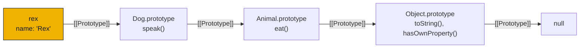

## The problem this solves

If a thousand user objects each stored their own copy of every method, memory would be wasted and fixing a method would mean touching every object. We need objects to **share behaviour**. Class-based languages copy a blueprint. JavaScript does something simpler: each object holds a hidden link to another object and **delegates** to it.

## Intuition

Every object has an internal link called `[[Prototype]]`. Property lookup is one loop:

1. Look on the object itself.
2. Not found? Follow the link and look there.
3. Repeat until found, or until the link is `null` (then the answer is `undefined`).

That path is the **prototype chain**.



`rex.eat()` is not on `rex`, not on `Dog.prototype`, found on `Animal.prototype`. The method runs with `this = rex` because of the call site ([[js-this]]).

## Build it step by step

### Example 1: delegation with plain objects

```js run
const animal = { eat() { return this.name + ' eats'; } };
const rex = Object.create(animal);
rex.name = 'Rex';

console.log(rex.eat());
console.log(Object.keys(rex), 'eat' in rex, rex.hasOwnProperty('eat'));
console.log(Object.getPrototypeOf(rex) === animal);
```

`Object.create(animal)` makes a new object whose prototype link points at `animal`. `rex` owns only `name`; `eat` is found through the chain.

### Example 2: constructor functions, what `new` wires up

```js run
function Dog(name) { this.name = name; }
Dog.prototype.speak = function () { return this.name + ' barks'; };

const a = new Dog('Ace'), b = new Dog('Bo');
console.log(a.speak(), '|', b.speak());
console.log(a.speak === b.speak);
console.log(Object.getPrototypeOf(a) === Dog.prototype, a.constructor === Dog);
```

Two different things have confusingly similar names:

| Name | What it is | Who has it |
| --- | --- | --- |
| `Fn.prototype` | an ordinary object that will become the prototype of instances made by `new Fn()` | functions only |
| `[[Prototype]]` (read with `Object.getPrototypeOf(obj)`, legacy `obj.__proto__`) | the actual link used for lookup | every object |

`new Dog()` sets the instance's `[[Prototype]]` to `Dog.prototype`. One `speak` function is shared by all dogs.

### Example 3: classes are the same machinery

```js run
class Animal {
  constructor(name) { this.name = name; }
  eat() { return this.name + ' eats'; }
  static create(name) { return new this(name); }
}
class Dog extends Animal {
  constructor(name) { super(name); this.tricks = 0; }
  eat() { return super.eat() + ' loudly'; }
}
const d = Dog.create('Rex');
console.log(d.eat());
console.log(typeof Animal, Object.getPrototypeOf(Dog.prototype) === Animal.prototype);
console.log(d instanceof Dog, d instanceof Animal, Object.getOwnPropertyNames(d));
```

`class` is a function. Methods go on `Animal.prototype`. `extends` links `Dog.prototype` to `Animal.prototype` (for instances) and `Dog` to `Animal` (so static methods inherit, which is why `Dog.create` works). `super.eat()` starts the lookup one step up the chain.

### Example 4: writing shadows, reading delegates

```js run
const defaults = { theme: 'light', tags: [] };
const settings = Object.create(defaults);

settings.theme = 'dark';
settings.tags.push('beta');

console.log(settings.theme, defaults.theme);
console.log(defaults.tags);
```

Assignment (`settings.theme = ...`) always creates an **own** property and never changes the prototype. But `settings.tags.push(...)` is a *read* of `tags` (found on the prototype) followed by a mutation of that shared array. This is why shared mutable state should not live on a prototype.

## The rule, stated precisely

- Lookup (`obj.x`): walk the chain until found.
- Assignment (`obj.x = v`): create or update an own property on `obj` (unless a setter is found on the chain).
- `a instanceof B`: true if `B.prototype` appears anywhere on `a`'s chain.
- `class A extends B`: sets `A.prototype.[[Prototype]] = B.prototype` and `A.[[Prototype]] = B`.

!!! why
Delegation means one copy of each method no matter how many instances exist, and changing the prototype updates behaviour for every object linked to it at once.
!!!

!!! key
- "Classes are syntactic sugar over prototypes" is correct but incomplete. Real differences: classes are not hoisted like functions (TDZ applies, see [[js-execution-context]]), class bodies are strict mode, calling a class without `new` throws, methods are non-enumerable, and `#private` fields are truly private.
- Know `prototype` vs `[[Prototype]]` cold.
- `Object.create(null)` gives an object with no prototype at all, useful as a clean dictionary.
- This is the JavaScript side of the OOP ideas in [[oop-pillars]]: inheritance here is delegation between objects, not copying.
!!!

!!! trap
- Arrow functions as prototype methods: `this` will not be the instance ([[js-this]]).
- Forgetting `super()` before using `this` in a derived constructor. It throws a `ReferenceError`.
- `for...in` iterates inherited enumerable properties too. Use `Object.keys` or `hasOwnProperty`/`Object.hasOwn` for own properties.
- Extending built-in prototypes (`Array.prototype.myThing = ...`) in application code. It can collide with future language features and other libraries.
!!!

!!! twist What changes if...
- **...you replace `Dog.prototype = {...}` after creating instances?** Old instances keep the old prototype object; only new ones get the new one.
- **...a method is defined as a class field (`speak = () => {}`)?** It becomes an own property of every instance (one copy each) instead of living on the prototype. Handy for `this`, more memory.
- **...the chain is very long?** Lookups of missing properties walk the whole chain. Engines cache this, but deep hierarchies are a design smell anyway; prefer composition ([[oop-composition]]).
!!!

!!! model
An object is a bag of own properties plus one arrow pointing to a fallback object. Reads follow the arrows. Writes stay in the bag.
!!!

## Practice

?? Implement inheritance without `class`: `Dog` should inherit from `Animal`.
Two links are needed: call the parent constructor for own properties, and chain the prototypes for methods.

```js run
function Animal(name) { this.name = name; }
Animal.prototype.eat = function () { return this.name + ' eats'; };
function Dog(name) { Animal.call(this, name); }
Dog.prototype = Object.create(Animal.prototype);
Dog.prototype.constructor = Dog;
console.log(new Dog('Rex').eat(), new Dog('Rex') instanceof Animal);
```
??

?? Write `myInstanceOf(obj, Ctor)`.
Walk the chain and compare each link with `Ctor.prototype`.

```js run
function myInstanceOf(obj, Ctor) {
  let p = Object.getPrototypeOf(obj);
  while (p) { if (p === Ctor.prototype) return true; p = Object.getPrototypeOf(p); }
  return false;
}
console.log(myInstanceOf([], Array), myInstanceOf([], Object), myInstanceOf({}, Array));
```
??

?? What is at the top of every prototype chain?
`Object.prototype`, whose own prototype is `null`. For a function `f` the chain is `f → Function.prototype → Object.prototype → null`. For an array, `arr → Array.prototype → Object.prototype → null`.
??

?? What is the difference between `Object.create(proto)` and `new Fn()`?
`Object.create` only sets the prototype link and runs no code. `new Fn()` sets the link to `Fn.prototype` and then runs `Fn` as an initializer with `this` bound to the new object.
??

?? Static method vs instance method: where does each live?
An instance method lives on `Class.prototype` and is called on instances. A static method is an own property of the class function itself and is called as `Class.method()`. Instances cannot see static methods because the constructor is not on their prototype chain.
??
