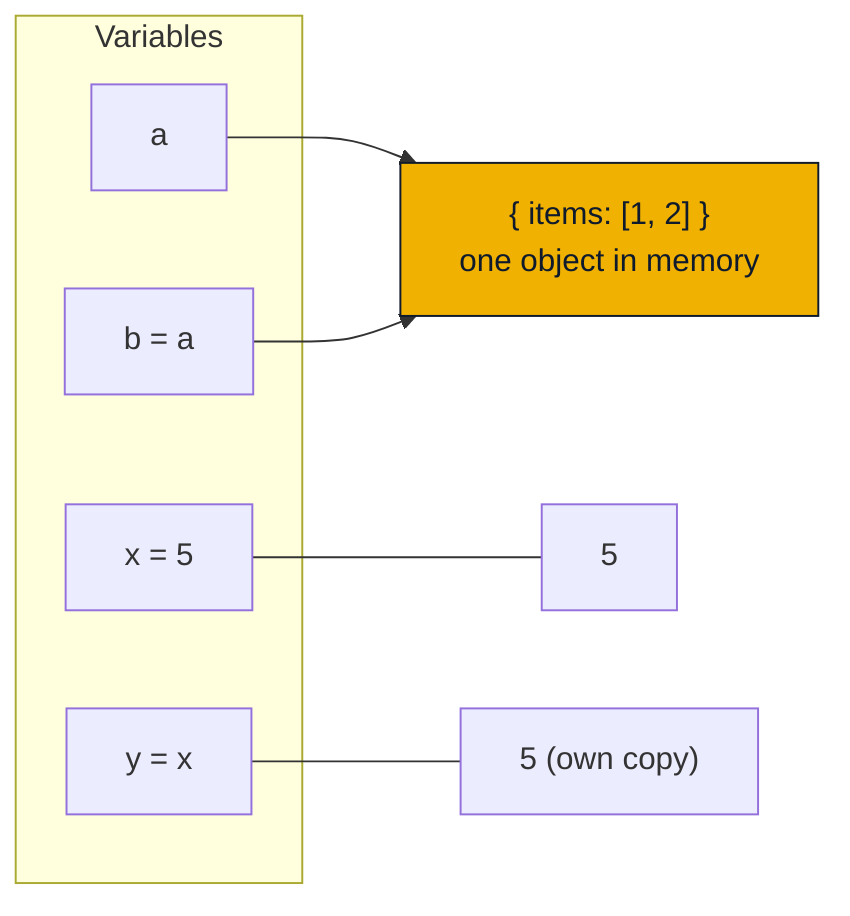

## The problem this solves

You copy an object into a new variable, change the copy and the original changes too. You compare two identical-looking arrays and get `false`. You update React state and the screen does not change. All three come from not knowing **what a variable actually holds**.

## Intuition

There are two kinds of values.

| | Primitives | Objects |
| --- | --- | --- |
| Which types | `string`, `number`, `boolean`, `null`, `undefined`, `bigint`, `symbol` | objects, arrays, functions, dates, maps, sets |
| A variable holds | the value itself | a **reference** (an address) to the object |
| Assigning or passing | copies the value | copies the reference; both names point at one object |
| `===` compares | the values | the references (same object or not) |
| Mutable? | no | yes |



## Build it step by step

### Example 1: copy vs share

```js run
let x = 5, y = x;
y++;
console.log(x, y);

const a = { items: [1, 2] }, b = a;
b.items.push(3);
console.log(a.items, a === b);
console.log([1, 2] === [1, 2], { id: 1 } === { id: 1 });
```

### Example 2: "pass by value" where the value is a reference

```js run
function mutate(obj) { obj.changed = true; }
function reassign(obj) { obj = { replaced: true }; }

const data = {};
mutate(data);
reassign(data);
console.log(data);
```

JavaScript always passes arguments by value. For an object, the value passed is the reference. So the function can **mutate** the caller's object through it, but **reassigning** the parameter only changes the local variable.

### Example 3: shallow copy vs deep copy

```js run
const original = { name: 'cart', owner: { id: 1 }, items: [{ sku: 'A', qty: 1 }] };

const shallow = { ...original };
shallow.name = 'copy';
shallow.items[0].qty = 99;
console.log(original.name, original.items[0].qty);

const deep = structuredClone(original);
deep.items[0].qty = 5;
console.log(original.items[0].qty, deep.items[0].qty);
```

A **shallow copy** (`{...obj}`, `Object.assign`, `arr.slice()`, `[...arr]`) creates a new top-level container but its nested objects are still shared. A **deep copy** duplicates every level.

| Deep copy method | Limitation |
| --- | --- |
| `structuredClone(obj)` | cannot clone functions or DOM nodes; handles dates, maps, sets, cycles |
| `JSON.parse(JSON.stringify(obj))` | drops `undefined` and functions, turns dates into strings, fails on cycles |
| a recursive function you write | you must handle arrays, dates, cycles yourself (practice below) |

### Example 4: immutable updates, the React and Redux way

```js run
const state = { user: { name: 'Asha', address: { city: 'Jaipur' } }, theme: 'dark' };

const next = { ...state, user: { ...state.user, address: { ...state.user.address, city: 'Pune' } } };

console.log(state.user.address.city, next.user.address.city);
console.log(next === state, next.user === state.user, next.theme === state.theme);
```

Copy every object **along the path to the change**, and reuse everything else. Now "did anything change?" is one cheap `===` check, which is exactly how [[react-state]] and [[react-performance]] decide whether to re-render.

### Example 5: equality and coercion

```js run
console.log(1 == '1', 1 === '1');
console.log(null == undefined, null === undefined, null == 0);
console.log(NaN === NaN, Number.isNaN(NaN), Object.is(-0, 0));
console.log('5' + 1, '5' - 1, [] + [], [] == false);
console.log(typeof null, typeof [], Array.isArray([]), typeof (() => {}));
```

`===` compares without converting types. `==` converts first, by rules that are hard to remember: use `===`, with the one accepted idiom `x == null` to test for `null` or `undefined` together. `+` with a string concatenates; the other arithmetic operators convert to numbers.

The falsy values are exactly: `false`, `0`, `-0`, `0n`, `''`, `null`, `undefined`, `NaN`. Everything else is truthy, including `[]`, `{}` and `'0'`.

## The rule, stated precisely

Assignment, argument passing and `===` operate on what the variable holds. For primitives that is the value; for objects it is a reference. `const` makes the *binding* constant, not the object it points to.

!!! key
- `const arr = []; arr.push(1)` is legal. `const` prevents reassignment only.
- Shallow vs deep copy, with one method for each and the JSON limitations.
- Immutability is not about performance loss; it buys cheap change detection by reference.
- `typeof null === 'object'` is a historic bug. Check arrays with `Array.isArray`.
- `Object.freeze` is shallow too.
!!!

!!! trap
- Mutating React state in place (`state.items.push(x); setItems(state.items)`): same reference, so React sees no change. See [[react-state]].
- `Array(3).fill([])` or `fill({})`: three slots sharing one object.
- Default sort is by string: `[10, 9, 1].sort()` gives `[1, 10, 9]`. Pass a comparator. And `sort`, `reverse`, `splice` mutate; `toSorted`, `toReversed`, `slice`, `map`, `filter` do not.
- Comparing objects with `===` expecting a content comparison.
!!!

!!! twist What changes if...
- **...you need to compare contents?** Write a deep-equal (practice below), or compare a stable key. `JSON.stringify` comparison breaks on key order.
- **...a nested field is optional?** Read with `a?.b?.c` and default with `??`, which only falls back on `null`/`undefined` (unlike `||`, which also replaces `0` and `''`).
- **...the data is huge?** Copying the path is still cheap because untouched branches are shared. This is called structural sharing.
!!!

!!! model
Primitives live in the variable. Objects live elsewhere and the variable holds a pointer. Copying a pointer does not copy the thing.
!!!

## Practice

?? Write `deepClone(value)` that handles nested objects, arrays, dates and circular references.
Keep a map from originals to copies so a cycle returns the already-made copy.

```js run
function deepClone(value, seen = new Map()) {
  if (value === null || typeof value !== 'object') return value;
  if (value instanceof Date) return new Date(value);
  if (seen.has(value)) return seen.get(value);
  const copy = Array.isArray(value) ? [] : {};
  seen.set(value, copy);
  for (const key of Object.keys(value)) copy[key] = deepClone(value[key], seen);
  return copy;
}
const a = { list: [1, { n: 2 }], when: new Date(0) }; a.self = a;
const b = deepClone(a);
console.log(b.list[1] !== a.list[1], b.self === b, b.when.getTime());
```
??

?? Write `deepEqual(a, b)`.
```js run
function deepEqual(a, b) {
  if (Object.is(a, b)) return true;
  if (typeof a !== 'object' || typeof b !== 'object' || a === null || b === null) return false;
  if (Array.isArray(a) !== Array.isArray(b)) return false;
  const ka = Object.keys(a), kb = Object.keys(b);
  return ka.length === kb.length && ka.every(k => deepEqual(a[k], b[k]));
}
console.log(deepEqual({ a: [1, { b: 2 }] }, { a: [1, { b: 2 }] }), deepEqual({ a: 1 }, { a: 1, b: undefined }));
```
??

?? What prints? `const a = [1, 2, 3]; const b = a; b = [4];`
A `TypeError: Assignment to constant variable`. If `b` were declared with `let`, `a` would still be `[1, 2, 3]`, because reassigning `b` points it at a new array and leaves the old one alone.
??

?? `0.1 + 0.2 === 0.3` is `false`. Why, and how do you handle money?
Numbers are 64-bit binary floating point, and 0.1 has no exact binary representation, so the sum is `0.30000000000000004`. For money, store integer minor units (paise, cents) and only format for display. The e-commerce project stores every amount this way.
??

?? Difference between `null` and `undefined`?
`undefined` means "no value was ever assigned": missing property, missing argument, function with no `return`. `null` is an explicit "intentionally empty" that a programmer sets. `JSON.stringify` keeps `null` and drops `undefined` properties.
??

?? Difference between `||` and `??`?
`a || b` returns `b` when `a` is any falsy value. `a ?? b` returns `b` only when `a` is `null` or `undefined`. For a quantity that may legitimately be `0`, `qty ?? 1` is correct and `qty || 1` is a bug.
??
