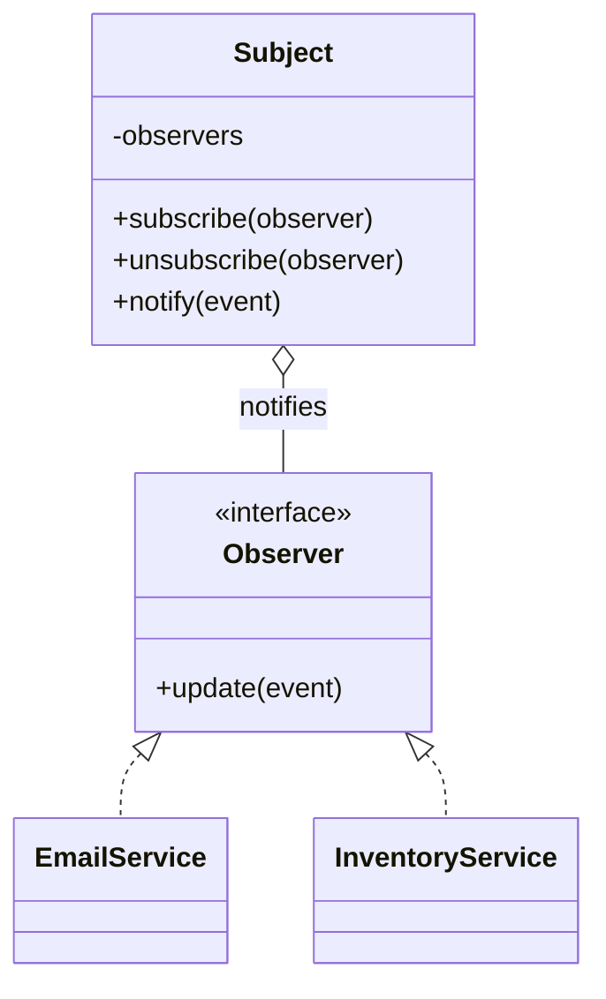

## The problem this solves

The symptom these patterns cure is the same in each case: a method full of `if (type === ...)` or `switch (state)` branches that grows every time a requirement is added, or objects that call each other directly until everything depends on everything. Each pattern moves a varying piece of behaviour **into its own object** behind an interface.

| Pattern | What varies | Who chooses | Telltale requirement |
| --- | --- | --- | --- |
| **Strategy** | an algorithm | the client, from outside | "support several ways to do X" (pricing, sorting, routing) |
| **Observer** | who reacts to an event | subscribers register themselves | "when X happens, notify..." |
| **State** | behaviour per lifecycle stage | the object itself, as it transitions | "depending on its status, it should..." |
| **Command** | the request | a queue or history decides when | "undo", "schedule", "retry", "log every action" |
| **Chain of Responsibility** | who handles a request | each handler passes or stops | "a series of checks or handlers" |

## Strategy

**Problem.** Shipping cost depends on the plan, and more plans are coming.

```js run
const strategies = {
  standard: order => 4000 + order.weightKg * 1000,
  express: order => 12000 + order.weightKg * 2500,
  free: () => 0,
};
class ShippingCalculator {
  constructor(strategy) { this.strategy = strategy; }
  setStrategy(strategy) { this.strategy = strategy; }
  cost(order) { return this.strategy(order); }
}
const order = { weightKg: 2 };
const calc = new ShippingCalculator(strategies.standard);
console.log('standard:', calc.cost(order));
calc.setStrategy(strategies.express);
console.log('express :', calc.cost(order));
strategies.sameDay = o => 30000 + o.weightKg * 4000;
calc.setStrategy(strategies.sameDay);
console.log('same-day:', calc.cost(order), ' <- new algorithm, calculator unchanged');
```

The context (`ShippingCalculator`) holds a strategy and delegates to it. Adding an algorithm adds one function or class and edits nothing. In a class-based language each strategy is a class implementing a `ShippingStrategy` interface; in JavaScript a function is enough because functions are values ([[js-functional]]). `Array.prototype.sort(compareFn)` is the Strategy pattern: you pass the comparison algorithm.

## Observer

**Problem.** When an order is placed, email, inventory and analytics must react. If the order code calls each directly, it must change for every new reaction.

```js run
class EventBus {
  #listeners = new Map();
  on(event, fn) {
    if (!this.#listeners.has(event)) this.#listeners.set(event, new Set());
    this.#listeners.get(event).add(fn);
    return () => this.#listeners.get(event).delete(fn);
  }
  emit(event, payload) { for (const fn of this.#listeners.get(event) ?? []) fn(payload); }
}
const bus = new EventBus();
bus.on('order.placed', o => console.log('email     : confirmation sent for', o.id));
bus.on('order.placed', o => console.log('inventory : stock reduced for', o.sku));
const stopAnalytics = bus.on('order.placed', o => console.log('analytics : recorded', o.id));

bus.emit('order.placed', { id: 'ord_1', sku: 'keyboard' });
stopAnalytics();
console.log('--- analytics unsubscribed ---');
bus.emit('order.placed', { id: 'ord_2', sku: 'mouse' });
```

The **subject** keeps a list of observers and notifies them; it does not know who they are. `on` returns an unsubscribe function, which matters: forgetting to unsubscribe is a memory leak (the same cleanup duty as in [[react-effects]]).

This idea is everywhere: DOM `addEventListener`, Node's `EventEmitter`, Redux subscriptions ([[react-app-state]]), and, between services over a network, publish/subscribe messaging ([[hld-messaging]]).



## State

**Problem.** A vending machine reacts to "insert coin" and "press button" differently depending on whether it is idle, has money, or is out of stock. One class with a `switch` in every method becomes unmanageable.

```js run
class Idle {
  insertCoin(m) { m.balance += 10; m.setState(new HasMoney()); return 'coin accepted'; }
  select() { return 'insert a coin first'; }
}
class HasMoney {
  insertCoin(m) { m.balance += 10; return 'balance is ' + m.balance; }
  select(m) {
    if (m.balance < m.price) return `need ${m.price - m.balance} more`;
    m.balance -= m.price; m.stock--;
    m.setState(m.stock === 0 ? new SoldOut() : new Idle());
    return 'item dispensed' + (m.balance ? `, change ${m.balance}` : '');
  }
}
class SoldOut {
  insertCoin() { return 'sold out, coin returned'; }
  select() { return 'sold out'; }
}
class VendingMachine {
  constructor(stock, price) { Object.assign(this, { stock, price, balance: 0, state: new Idle() }); }
  setState(s) { this.state = s; }
  insertCoin() { return this.state.insertCoin(this); }
  select() { return this.state.select(this); }
}
const vm = new VendingMachine(1, 20);
for (const action of ['select', 'insertCoin', 'select', 'insertCoin', 'select', 'insertCoin'])
  console.log(action.padEnd(10), '->', vm[action](), ` [${vm.state.constructor.name}]`);
```

Each state is a class that knows how to respond to every event **and which state comes next**. The machine just forwards. This is the state diagram from [[lld-uml]] turned into classes.

**State vs Strategy**: the structure is the same (context delegates to an interchangeable object). In Strategy the **client** picks the algorithm and strategies do not know each other. In State the **object changes its own state** as events happen, and states know their successors.

## Command

**Problem.** You need undo and redo in an editor, or to queue operations and run them later, or to log every action.

```js run
class Editor { text = ''; }
class InsertCommand {
  constructor(editor, text) { this.editor = editor; this.text = text; }
  execute() { this.editor.text += this.text; }
  undo() { this.editor.text = this.editor.text.slice(0, -this.text.length); }
}
class History {
  done = []; undone = [];
  run(cmd) { cmd.execute(); this.done.push(cmd); this.undone = []; }
  undo() { const c = this.done.pop(); if (c) { c.undo(); this.undone.push(c); } }
  redo() { const c = this.undone.pop(); if (c) { c.execute(); this.done.push(c); } }
}
const editor = new Editor(), history = new History();
history.run(new InsertCommand(editor, 'Hello'));
history.run(new InsertCommand(editor, ', world'));
console.log(JSON.stringify(editor.text));
history.undo(); console.log('undo ->', JSON.stringify(editor.text));
history.redo(); console.log('redo ->', JSON.stringify(editor.text));
```

A command object packages **what to do, on what, with which arguments**, plus how to reverse it. Because a request is now data, it can be stored, queued, retried, sent over a network or undone. A job in a queue ([[node-scaling]]), a Redux action ([[react-app-state]]) and an operation in the collab editor ([[collab-editor]]) are all commands.

## Chain of Responsibility

**Problem.** A request must pass a series of checks, any of which may reject it, and the list of checks changes.

```js run
const authenticate = (req, next) => req.user ? next() : { status: 401, error: 'log in first' };
const authorize = role => (req, next) => req.user.role === role ? next() : { status: 403, error: 'needs ' + role };
const validate = (req, next) => req.body?.title ? next() : { status: 422, error: 'title is required' };
const handler = req => ({ status: 201, created: req.body.title });

const chain = (...steps) => req => {
  const run = i => i === steps.length - 1 ? steps[i](req) : steps[i](req, () => run(i + 1));
  return run(0);
};
const createPost = chain(authenticate, authorize('editor'), validate, handler);

console.log(createPost({}));
console.log(createPost({ user: { role: 'viewer' } }));
console.log(createPost({ user: { role: 'editor' }, body: {} }));
console.log(createPost({ user: { role: 'editor' }, body: { title: 'Patterns' } }));
```

Each handler either deals with the request or passes it to the next. Sender and handlers are decoupled, and handlers can be added, removed or reordered. This is exactly the Express middleware chain with `next()` from [[express-middleware]]. Other uses: support escalation levels, approval workflows, event bubbling in the DOM.

## Two more to recognize

| Pattern | Idea | Example |
| --- | --- | --- |
| **Template Method** | a base class fixes the steps of an algorithm; subclasses fill in specific steps | a `DataExporter` with `fetch → transform → write`, where CSV and PDF exporters override `write` |
| **Iterator** | traverse a collection without exposing how it is stored | JavaScript iterables and `for...of`; database cursors |

## The rule, stated precisely

Each behavioural pattern replaces a conditional or a direct call with delegation to an object behind an interface: the algorithm (Strategy), the listeners (Observer), the current mode (State), the request itself (Command), or the next handler (Chain of Responsibility).

!!! key
- Recognize by the requirement sentence in the table at the top. Interviewers describe a requirement and watch whether you name the pattern.
- Strategy vs State; Observer vs pub/sub (pub/sub adds a broker so publisher and subscriber do not even hold references to each other); Command as the basis for undo, queues and audit logs.
- Each removes an `if/switch` that would otherwise violate the open/closed principle ([[oop-solid]]).
- Do not force patterns. Two branches that will never grow are fine as an `if`.
!!!

!!! trap
- Observers that never unsubscribe: memory leaks and callbacks firing on dead objects.
- Observers triggering each other in cycles, or relying on notification order.
- A Strategy interface so broad that each strategy implements methods it does not need ([[oop-solid]], interface segregation).
- State classes that each `new` the next state when states hold no data; share instances instead.
- Commands whose `undo` assumes nothing else changed in between.
!!!

!!! twist What changes if...
- **...notifications must survive a crash or reach other services?** Move from an in-process Observer to a message broker with durable delivery ([[hld-messaging]]).
- **...undo history must not grow forever?** Cap it, or collapse old commands into a snapshot: the Memento pattern stores state snapshots instead of reversible commands.
- **...the strategy must be chosen from data (a rule engine)?** Combine with a factory or registry ([[lld-creational]]) that maps a key to a strategy.
!!!

!!! model
Find the thing that varies, give it an interface, and let the main object hold "one of those" instead of knowing all of them.
!!!

## Practice

?? A ride-hailing app must support surge pricing, a flat airport fare and a subscription discount, with more to come. Which pattern, and what are the classes?
Strategy. `FareStrategy` interface with `calculate(trip)`; `SurgeFare`, `AirportFlatFare`, `SubscriberFare` implement it; `FareCalculator` holds a strategy, chosen by a factory from trip and rider data. Discounts that stack on top of a base fare would be decorators around a strategy.
??

?? Design a stock price alert feature: users are notified when a price crosses their threshold.
Observer. `Stock` is the subject with `subscribe(alert)`; each `PriceAlert` observer holds a user, a threshold and a direction and decides in `update(price)` whether to fire, then unsubscribes itself if it is one-shot. At scale the subject publishes price ticks to a stream and alert evaluation runs in consumers.
??

?? When would you choose State over a simple enum and switch?
When behaviour, not just a label, differs per state across several methods, and states and transitions are expected to grow. With two or three states and one method, a transition table or a switch is simpler and easier to read.
??

?? How does Command enable both undo and a job queue?
In both, a request is an object holding everything needed to run it. For undo, the object also knows the inverse operation and a history stack keeps executed commands. For a queue, the object is serialized and stored, and a worker calls `execute` later, possibly on another machine, with retries.
??

?? Map each to its pattern: Express `app.use`, `button.addEventListener`, `arr.sort((a, b) => a - b)`, a text editor's Ctrl+Z, an order whose allowed actions depend on its status.
Chain of Responsibility; Observer; Strategy; Command; State.
??
