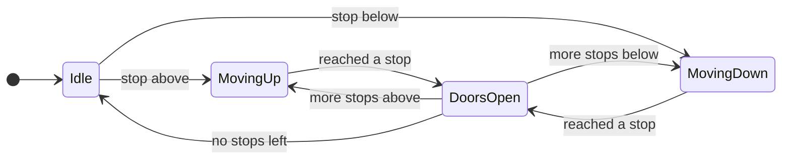
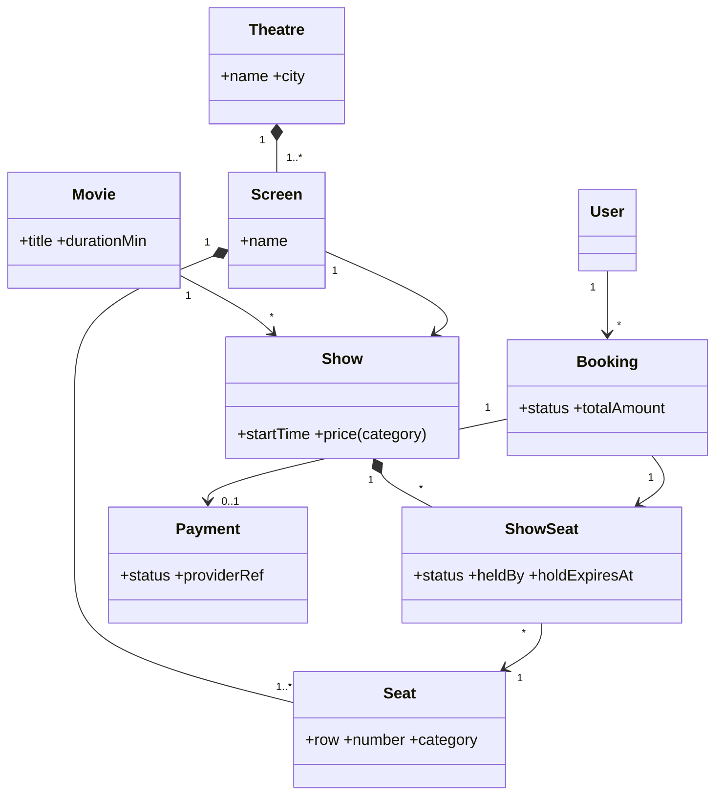

## How to use this station

Each case follows the six steps from [[lld-case-studies]]: clarify, find entities, draw relationships, place behaviour, apply patterns where something varies, then stress it. Try ten minutes on your own first. Code is JavaScript so the output is real; the class structure is what an interviewer grades, in any language.

| Case | What it tests | Patterns that appear |
| --- | --- | --- |
| Elevator | modelling state and a scheduling policy | State, Strategy |
| Movie booking | concurrency on a shared resource | atomic hold, State |
| Logger | composing several small patterns | Singleton, Chain of Responsibility, Observer, Strategy |
| Tic-tac-toe | separating rules, state and players | Strategy, clean entities |

## Case 1: elevator

**Clarified requirements.** One building, N floors, one or more elevators; people press up/down on a floor and a floor button inside the car; a car serves requests efficiently; the scheduling policy may change.

**Entities.** `Elevator` (current floor, direction, set of stops), `Request`, `Controller`, `SchedulingStrategy`.



**The key decision: in what order does a car serve its stops?** First-come-first-served makes a car zigzag. The standard answer is **SCAN** (also called the elevator algorithm): keep moving in the current direction while there are stops ahead, then reverse. The same algorithm schedules disk heads ([[os-files-io]]).

```js run
class Elevator {
  constructor(id, floor = 0) { Object.assign(this, { id, floor, direction: 'idle', stops: new Set(), log: [] }); }
  addStop(floor) { if (floor !== this.floor) this.stops.add(floor); }
  #hasStops(dir) { return [...this.stops].some(s => dir === 'up' ? s > this.floor : s < this.floor); }
  step() {
    if (this.stops.size === 0) { this.direction = 'idle'; return; }
    if (this.direction === 'idle' || !this.#hasStops(this.direction)) this.direction = this.#hasStops('up') ? 'up' : 'down';
    this.floor += this.direction === 'up' ? 1 : -1;
    if (this.stops.delete(this.floor)) this.log.push(this.floor);
  }
  run() { while (this.stops.size) this.step(); this.direction = 'idle'; return this.log; }
}

const requests = [7, 2, 9, 4, 1];
const scan = new Elevator('A', 5);
requests.forEach(f => scan.addStop(f));
const scanOrder = scan.run();

const travelled = (start, order) => order.reduce((acc, f) => ({ pos: f, dist: acc.dist + Math.abs(f - acc.pos) }), { pos: start, dist: 0 }).dist;
console.log('requests arrived as  :', requests.join(', '), '| car starts at floor 5');
console.log('first-come order     :', requests.join(' -> '), '| floors travelled:', travelled(5, requests));
console.log('SCAN order           :', scanOrder.join(' -> '), '| floors travelled:', travelled(5, scanOrder));
```

Same five requests, far less travel, and nobody waits while the car passes their floor twice.

**Several elevators: which car takes a hall call?** That is a second policy, so it goes behind a strategy.

```js run
const nearestCar = (cars, floor) => cars.reduce((best, c) => Math.abs(c.floor - floor) < Math.abs(best.floor - floor) ? c : best);
const cost = (car, floor, wants) => {
  const ahead = (car.direction === 'up' && floor >= car.floor) || (car.direction === 'down' && floor <= car.floor);
  if (car.direction === 'idle') return Math.abs(car.floor - floor);
  return ahead && car.direction === wants ? Math.abs(car.floor - floor) : Math.abs(car.floor - floor) + 20;
};
const directionAware = (cars, floor, wants) => cars.reduce((best, c) => cost(c, floor, wants) < cost(best, floor, wants) ? c : best);

const cars = [{ id: 'A', floor: 6, direction: 'up' }, { id: 'B', floor: 1, direction: 'up' }, { id: 'C', floor: 9, direction: 'idle' }];
console.log('call at floor 5 going up');
console.log('  nearest car      ->', nearestCar(cars, 5).id, '(it is at 6 but moving up, away from the caller)');
console.log('  direction-aware  ->', directionAware(cars, 5, 'up').id, '(below the caller and already heading up)');
```

| Design point | Decision |
| --- | --- |
| Car movement | a state machine; the car owns its stops and decides its next floor |
| Stop ordering | SCAN inside `Elevator` |
| Car selection | `SchedulingStrategy` injected into the `Controller` (open/closed, [[oop-solid]]) |
| Buttons and displays | Observers of the car's state ([[lld-behavioral]]) |
| Follow-ups | capacity limit, a maintenance state, express cars serving only some floors, fire mode: each is a new state or a new strategy |

## Case 2: movie ticket booking

**Clarified requirements.** Cities have theatres with screens; a show is a movie on a screen at a time; users pick seats on a seat map, pay, get a booking; seats differ in price by category; two users must never book the same seat.



**The insight that makes the model work: `Seat` and `ShowSeat` are different things.** A `Seat` is a physical chair (row C, number 4, premium) that exists as long as the screen does. A `ShowSeat` is that chair **for one particular show**, and it is what carries the status. Without it you could not sell the same chair for the 6 pm and 9 pm shows.

```js run
class ShowSeat {
  constructor(id, category) { Object.assign(this, { id, category, status: 'AVAILABLE', heldBy: null, holdExpiresAt: 0 }); }
  isFree(now) { return this.status === 'AVAILABLE' || (this.status === 'HELD' && this.holdExpiresAt <= now); }
}
class Show {
  constructor(prices, seatIds) { this.prices = prices; this.seats = new Map(seatIds.map(([id, cat]) => [id, new ShowSeat(id, cat)])); }
  holdSeats(user, seatIds, now, ttlMs = 5 * 60_000) {
    const seats = seatIds.map(id => this.seats.get(id));
    const taken = seats.filter(s => !s.isFree(now)).map(s => s.id);
    if (taken.length) return { ok: false, reason: `unavailable: ${taken.join(', ')}` };
    seats.forEach(s => Object.assign(s, { status: 'HELD', heldBy: user, holdExpiresAt: now + ttlMs }));
    return { ok: true, total: seats.reduce((sum, s) => sum + this.prices[s.category], 0) };
  }
  confirm(user, seatIds, now) {
    const seats = seatIds.map(id => this.seats.get(id));
    if (!seats.every(s => s.status === 'HELD' && s.heldBy === user && s.holdExpiresAt > now)) return { ok: false, reason: 'hold expired, refund the payment' };
    seats.forEach(s => Object.assign(s, { status: 'BOOKED' }));
    return { ok: true, booking: `${user}: ${seatIds.join(', ')}` };
  }
}
const show = new Show({ gold: 400, silver: 250 }, [['A1', 'gold'], ['A2', 'gold'], ['B1', 'silver']]);
console.log('asha holds A1, A2 ->', show.holdSeats('asha', ['A1', 'A2'], 0));
console.log('ravi holds A2, B1 ->', show.holdSeats('ravi', ['A2', 'B1'], 1000), ' <- all or nothing: B1 was not taken either');
console.log('ravi holds B1     ->', show.holdSeats('ravi', ['B1'], 2000));
console.log('asha pays in time ->', show.confirm('asha', ['A1', 'A2'], 60_000));
console.log('ravi pays late    ->', show.confirm('ravi', ['B1'], 6 * 60_000));
console.log('meera holds B1    ->', show.holdSeats('meera', ['B1'], 6 * 60_000 + 1));
```

Three rules visible in the run:

- **All or nothing.** A request for several seats holds every seat or none, so two groups cannot each grab half of what the other wants.
- **Hold, then confirm.** The seat is reserved for a few minutes while the user pays; the hold expires by itself.
- **Confirm checks the hold again.** A payment that arrives after expiry is refunded.

In this single-threaded demo `holdSeats` cannot be interrupted. On a real server with several instances, "check all free, then mark all held" must be one atomic operation: a database transaction with a conditional update per seat, or a Redis script. That mechanism, the waiting room for big releases and the caching of seat maps are the system-level half of this problem, in [[hld-case-studies-2]].

**Other points to say.** Pricing by category, show time or day is a `PricingStrategy`. A `Booking` has states (`PENDING`, `CONFIRMED`, `CANCELLED`, `EXPIRED`). Notifications on confirmation are observers.

## Case 3: a logging framework

**Clarified requirements.** Log messages at levels (debug, info, warn, error); a configurable minimum level; several destinations at once (console, file, a remote service); a configurable format; usable from anywhere in the app; cheap when a message is filtered out.

**What varies:** the destination (**sink**) and the **format**. So each is an interface. The logger itself should be one shared instance.

```js run
const LEVELS = { debug: 10, info: 20, warn: 30, error: 40 };

const plainFormatter = e => `[${e.level.toUpperCase()}] ${e.message}`;
const jsonFormatter = e => JSON.stringify({ level: e.level, msg: e.message, ...e.context });

class MemorySink {
  constructor(name, formatter, minLevel = 'debug') { Object.assign(this, { name, formatter, minLevel, lines: [] }); }
  write(entry) { if (LEVELS[entry.level] >= LEVELS[this.minLevel]) this.lines.push(this.formatter(entry)); }
}

class Logger {
  static #instance;
  static get() { return (Logger.#instance ??= new Logger()); }
  #sinks = []; #minLevel = 'info'; #context = {};
  setLevel(level) { this.#minLevel = level; return this; }
  addSink(sink) { this.#sinks.push(sink); return this; }
  child(context) { const c = new Logger(); c.#sinks = this.#sinks; c.#minLevel = this.#minLevel; c.#context = { ...this.#context, ...context }; return c; }
  #log(level, message, context) {
    if (LEVELS[level] < LEVELS[this.#minLevel]) return;
    const entry = { level, message, context: { ...this.#context, ...context } };
    for (const sink of this.#sinks) sink.write(entry);
  }
  debug(m, c) { this.#log('debug', m, c); } info(m, c) { this.#log('info', m, c); }
  warn(m, c) { this.#log('warn', m, c); }   error(m, c) { this.#log('error', m, c); }
}

const consoleSink = new MemorySink('console', plainFormatter);
const alertSink = new MemorySink('alerts', jsonFormatter, 'error');
Logger.get().setLevel('info').addSink(consoleSink).addSink(alertSink);

const log = Logger.get();
log.debug('cache warmed');
log.info('server started');
const requestLog = log.child({ requestId: 'req_42' });
requestLog.warn('slow query');
requestLog.error('payment failed', { orderId: 7 });

console.log('same instance everywhere:', Logger.get() === log);
console.log('console sink:', consoleSink.lines);
console.log('alerts sink :', alertSink.lines);
```

| Pattern | Where | Why |
| --- | --- | --- |
| Singleton | `Logger.get()` | one configuration shared by the whole app ([[lld-creational]]) |
| Observer | the logger notifies every registered sink | add destinations without touching the logger ([[lld-behavioral]]) |
| Strategy | the formatter passed to each sink | plain text for humans, JSON for machines |
| Filtering by level (a small chain) | the logger's minimum, then each sink's own minimum | the debug message was dropped early; only the error reached the alerts sink |

`child` returns a logger that adds context (a request id) to every line, which is what makes production logs searchable ([[node-production]]).

**Follow-ups.** Writing to a file or network must not block the caller: buffer entries and flush asynchronously, or hand them to a queue. In Java, make the singleton and the sinks thread-safe ([[os-sync]]). Rotate files by size or date.

## Case 4: tic-tac-toe

**Clarified requirements.** Two players alternate on a 3x3 board; first to complete a row, column or diagonal wins; full board is a draw. Likely extensions: N x N board, a computer player, undo.

**Entities and the rule for splitting them.** `Board` knows the grid and can say whether a line is complete. `Game` knows whose turn it is and the status. A `Player` only chooses a move. Keeping these apart is single responsibility ([[oop-solid]]) and is what makes the extensions cheap.

```js run
class Board {
  constructor(size = 3) { this.size = size; this.cells = Array.from({ length: size }, () => Array(size).fill(null)); this.filled = 0; }
  place(row, col, mark) {
    if (row < 0 || col < 0 || row >= this.size || col >= this.size) throw new RangeError('outside the board');
    if (this.cells[row][col]) throw new Error('cell already taken');
    this.cells[row][col] = mark; this.filled++;
  }
  isFull() { return this.filled === this.size ** 2; }
  winsWith(row, col, mark) {
    const n = this.size, line = fn => Array.from({ length: n }, (_, i) => fn(i)).every(c => c === mark);
    return line(i => this.cells[row][i]) || line(i => this.cells[i][col])
      || (row === col && line(i => this.cells[i][i])) || (row + col === n - 1 && line(i => this.cells[i][n - 1 - i]));
  }
  emptyCells() { return this.cells.flatMap((r, i) => r.map((c, j) => c ? null : [i, j])).filter(Boolean); }
  toString() { return this.cells.map(r => r.map(c => c ?? '.').join(' ')).join('\n'); }
}
class Game {
  constructor(players, size = 3) { this.board = new Board(size); this.players = players; this.turn = 0; this.status = 'IN_PROGRESS'; }
  play() {
    while (this.status === 'IN_PROGRESS') {
      const player = this.players[this.turn % this.players.length];
      const [row, col] = player.chooseMove(this.board);
      this.board.place(row, col, player.mark);
      if (this.board.winsWith(row, col, player.mark)) this.status = `${player.name} (${player.mark}) wins`;
      else if (this.board.isFull()) this.status = 'DRAW';
      this.turn++;
    }
    return this.status;
  }
}
const scripted = (name, mark, moves) => ({ name, mark, chooseMove: () => moves.shift() });
const firstEmpty = (name, mark) => ({ name, mark, chooseMove: board => board.emptyCells()[0] });

const g1 = new Game([scripted('Asha', 'X', [[0, 0], [1, 1], [2, 2]]), scripted('Ravi', 'O', [[0, 1], [0, 2]])]);
console.log(g1.play(), `in ${g1.turn} moves`); console.log(g1.board.toString());
const g2 = new Game([firstEmpty('Bot A', 'X'), firstEmpty('Bot B', 'O')], 4);
console.log('4x4 with two simple bots:', g2.play());
try { new Board().place(0, 0, 'X'), g1.board.place(0, 0, 'O'); } catch (e) { console.log('illegal move rejected:', e.message); }
```

**Why check only the last move?** A win can only be created by the mark just placed, so only its row, its column and (if it sits on one) the diagonals need checking: O(N) per move instead of scanning the whole board. For very large boards, keep running counts per row, column and diagonal for each player and check in O(1).

| Extension | Change needed |
| --- | --- |
| N x N board | already a constructor argument |
| Computer player | another object with `chooseMove(board)`; `Game` does not know the difference (polymorphism, [[oop-pillars]]) |
| Smarter computer | a different `chooseMove` strategy (minimax) |
| Undo | store each move as a command and reverse it ([[lld-behavioral]]) |
| Three players, or "connect K in a row" | the players array and a win-rule strategy |
| Chess, snakes and ladders | the same skeleton: `Board`, `Piece` or `Cell`, `Player`, `Game` loop, a `Rules` object |

## The rule, stated precisely

In each design, identify the entity that owns each piece of state, give behaviour to the owner of the data it needs, and place an interface at every point where the requirements said "may change". Shared mutable state (a seat, a car's stop list) is the place to state how updates are made atomic.

!!! key
- Elevator: state machine per car, SCAN for stop order, a strategy for choosing the car.
- Movie booking: `Seat` vs `ShowSeat`; atomic all-or-nothing hold with expiry; confirm rechecks.
- Logger: singleton facade, sinks as observers, formatter as a strategy, level filtering.
- Tic-tac-toe: `Board`, `Game`, `Player` with separate responsibilities; check only the last move.
- Say which requirement each pattern serves.
!!!

!!! trap
- A single `ElevatorSystem` or `BookingManager` class with every method.
- Putting seat status on the physical `Seat`.
- Checking the whole board after each move, or letting `Board` know whose turn it is.
- A logger that formats the message before checking the level, wasting work on filtered lines.
- Skipping concurrency in the booking problem.
!!!

!!! twist What changes if...
- **...the elevator system must handle 50 floors with express cars?** Zones: each car serves a subset of floors; the selection strategy filters cars by zone first.
- **...the logger must not lose messages on a crash?** Flush synchronously for `error`, buffer the rest, and flush in the shutdown handler ([[node-production]]).
- **...the interviewer asks for a vending machine, ATM or traffic light?** A state machine with one class per state ([[lld-behavioral]]).
- **...they ask for a cache, a rate limiter or a splitter?** See [[hld-caching]] for LRU and [[lld-case-studies]] for the other two.
!!!

!!! model
Who owns the data? Give them the behaviour. What will vary? Put an interface there. What is shared? Say how it is protected.
!!!

## Practice

?? In the elevator design, a car going up at floor 3 has stops at 5 and 8. A passenger at floor 4 presses "down". Should the car stop? Why?
Under SCAN it should not pick them up on the way up: they want to go the other way, and stopping would make them ride to 8 before coming down. The call is served when the car reverses, or assigned to another car heading down. A hall call therefore needs both a floor and a direction.
??

?? Why is `ShowSeat` a separate class from `Seat`?
A seat is permanent and physical; its availability belongs to one show. Putting status on `Seat` would let it be booked only once ever. `ShowSeat` is the association between a show and a seat, and it carries the data that belongs to that association: status, holder, expiry, price paid.
??

?? Design a snakes and ladders game: entities and the main loop.
`Board` (size, a map from cell to destination for snakes and ladders), `Dice` (a strategy, so it can be faked in tests), `Player` (name, position), `Game` (queue of players, status). Loop: take the next player, roll, move, apply a snake or ladder if the cell has one, check for reaching the last cell, rotate the queue. Injecting the dice makes the game deterministic under test ([[node-testing]]).
??

?? How would you make the logger safe when thousands of requests log at once?
Keep `#log` cheap: check the level first, build the entry, and push it to an in-memory buffer. A background flusher writes batches to each sink, so request handlers never wait on disk or network. Bound the buffer and drop or sample low-priority entries when it is full, so logging cannot exhaust memory. In a multi-threaded language, protect the buffer with a lock or use a concurrent queue.
??

?? Add undo to tic-tac-toe. What do you store and what does undo do?
Keep a stack of moves, each `{ row, col, mark }`. Undo pops the last move, clears that cell, decrements the filled count, steps the turn counter back and sets the status to in progress. This is the Command pattern: a move knows how to apply and how to reverse itself.
??
