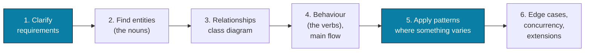
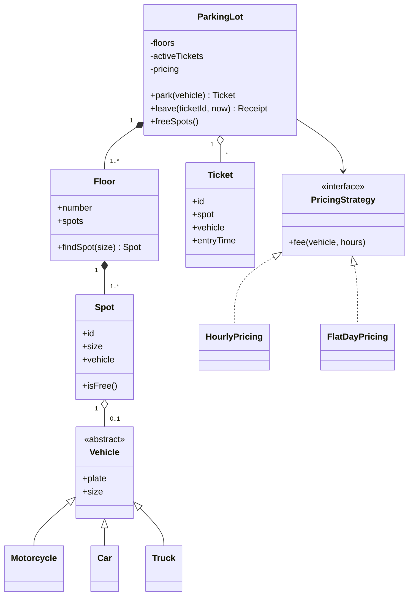

## The problem this solves

"Design a parking lot" in 40 minutes. The interviewer wants working object-oriented code or a clear class design, and then changes a requirement to see whether your design bends or breaks. Candidates fail by coding immediately, by building one giant class, or by naming patterns that solve no stated problem.

## The six steps for any LLD question



1. **Clarify.** Ask until the scope is 4 to 6 concrete requirements. Write them down.
2. **Entities.** Underline the nouns in the requirements. Those are candidate classes; drop the ones that are just attributes.
3. **Relationships.** Is-a, has-a, uses ([[lld-uml]]). Draw the class diagram.
4. **Behaviour.** Put each verb on the class that owns the data it needs. Walk the main use case as a sequence.
5. **Patterns.** Look for what will vary (pricing, vehicle types, algorithms) and put it behind an interface ([[lld-creational]], [[lld-structural]], [[lld-behavioral]]).
6. **Harden.** What if two requests collide? What is the next likely requirement, and does it need a new class or an edit?

High-level design asks "which machines and data stores"; low-level design asks "which classes and methods". The HLD counterpart of this station is [[hld-case-studies]].

## Case 1: parking lot

**Clarified requirements.** Multiple floors; spots of sizes small, medium, large; motorcycles, cars and trucks, each needing at least its own size; a ticket on entry; fee by duration on exit, with pricing that may change; show free spots.

**Entities.** ParkingLot, Floor, Spot, Vehicle (Motorcycle, Car, Truck), Ticket, pricing.



Why each relationship: floors and spots are **composition** (they do not exist without the lot). A spot **aggregates** a vehicle (the vehicle exists independently and leaves). Pricing is a **Strategy** because the requirements said it changes.

```js run
const SIZE = { small: 1, medium: 2, large: 3 };
class Vehicle { constructor(plate, size) { this.plate = plate; this.size = size; } }
class Motorcycle extends Vehicle { constructor(p) { super(p, SIZE.small); } }
class Car extends Vehicle { constructor(p) { super(p, SIZE.medium); } }
class Truck extends Vehicle { constructor(p) { super(p, SIZE.large); } }

class Spot {
  constructor(id, size) { this.id = id; this.size = size; this.vehicle = null; }
  fits(v) { return !this.vehicle && this.size >= v.size; }
}
class Floor {
  constructor(n, layout) { this.spots = layout.map((size, i) => new Spot(`F${n}-${i + 1}`, SIZE[size])); }
  findSpot(v) { return this.spots.filter(s => s.fits(v)).sort((a, b) => a.size - b.size)[0]; }
}
const hourlyPricing = { fee: (v, hours) => Math.ceil(hours) * [0, 2000, 4000, 10000][v.size] };

class ParkingLot {
  #tickets = new Map(); #nextId = 1;
  constructor(floors, pricing) { this.floors = floors; this.pricing = pricing; }
  park(vehicle, now) {
    for (const floor of this.floors) {
      const spot = floor.findSpot(vehicle);
      if (spot) {
        spot.vehicle = vehicle;
        const ticket = { id: this.#nextId++, spot, vehicle, entry: now };
        this.#tickets.set(ticket.id, ticket);
        return ticket;
      }
    }
    throw new Error(`no spot for ${vehicle.plate}`);
  }
  leave(ticketId, now) {
    const t = this.#tickets.get(ticketId);
    if (!t) throw new Error('unknown or already used ticket');
    this.#tickets.delete(ticketId);
    t.spot.vehicle = null;
    return { plate: t.vehicle.plate, spot: t.spot.id, fee: this.pricing.fee(t.vehicle, (now - t.entry) / 3600000) };
  }
  freeSpots() { return this.floors.flatMap(f => f.spots).filter(s => !s.vehicle).length; }
}

const H = 3600000;
const lot = new ParkingLot([new Floor(1, ['small', 'medium', 'large']), new Floor(2, ['medium'])], hourlyPricing);
const t1 = lot.park(new Motorcycle('RJ14-BIKE'), 0), t2 = lot.park(new Car('RJ14-CAR1'), 0), t3 = lot.park(new Car('RJ14-CAR2'), 0);
console.log('spots given:', t1.spot.id, t2.spot.id, t3.spot.id, '| free:', lot.freeSpots());
try { lot.park(new Truck('RJ14-TRK1'), 0); } catch (e) { console.log(e.message, '(the large spot went to a car)'); }
console.log(lot.leave(t2.id, 2.5 * H));
try { lot.leave(t2.id, 3 * H); } catch (e) { console.log(e.message); }
```

Notice what the run exposes: the second car took the large spot because it was the smallest **free** fitting one on floor 1, so the truck was turned away while a medium spot sat free on floor 2. `findSpot` picks best fit per floor, not across the lot. That is exactly the kind of flaw an interviewer pushes on, and the fix is a **spot allocation strategy** searched across all floors.

**Follow-ups and where they land.**

| New requirement | Change |
| --- | --- |
| Electric vehicles need charging spots | a `features` set on `Spot`, a requirement on `Vehicle`, checked in `fits` |
| Weekend flat rate | a new `PricingStrategy`; nothing else changes |
| Nearest spot to the entrance | a `SpotAllocationStrategy` interface; `ParkingLot` delegates |
| Two entry gates at once | `park` must be atomic: a lock per lot or floor, or a conditional update in the database ([[mongo-transactions]], [[os-sync]]) |
| Display boards update live | `ParkingLot` publishes events; boards are Observers |

## Case 2: rate limiter

**Clarified requirements.** Limit each client to N requests per window; several algorithms should be pluggable; different limits per API; return allowed or rejected with a retry time.

**What varies:** the algorithm. So `RateLimiter` holds a **Strategy**, created per client key by a **factory**.

```js run
class FixedWindow {
  constructor(limit, windowMs) { Object.assign(this, { limit, windowMs, windowStart: 0, count: 0 }); }
  allow(now) {
    if (now - this.windowStart >= this.windowMs) { this.windowStart = now - (now % this.windowMs); this.count = 0; }
    return ++this.count <= this.limit;
  }
}
class SlidingWindowLog {
  constructor(limit, windowMs) { Object.assign(this, { limit, windowMs, log: [] }); }
  allow(now) {
    while (this.log.length && this.log[0] <= now - this.windowMs) this.log.shift();
    if (this.log.length >= this.limit) return false;
    this.log.push(now);
    return true;
  }
}
class RateLimiter {
  #buckets = new Map();
  constructor(createStrategy) { this.createStrategy = createStrategy; }
  allow(clientId, now) {
    if (!this.#buckets.has(clientId)) this.#buckets.set(clientId, this.createStrategy());
    return this.#buckets.get(clientId).allow(now);
  }
}

const burst = [900, 950, 990, 1010, 1050, 1090];
for (const [name, make] of [['fixed window  ', () => new FixedWindow(3, 1000)], ['sliding window', () => new SlidingWindowLog(3, 1000)]]) {
  const limiter = new RateLimiter(make);
  console.log(name, '(3 per second):', burst.map(t => `${t}ms ${limiter.allow('asha', t) ? 'ok' : 'NO'}`).join(' | '));
}
```

Six requests within 190 ms. The fixed window allows all six, because three fall at the end of one window and three at the start of the next: the boundary weakness. The sliding window log correctly allows only three. The token bucket variant and the Redis-backed distributed version are in [[node-scaling]]; the system-level placement is in [[hld-scaling]].

| Design point | Decision |
| --- | --- |
| Algorithm | Strategy interface `allow(now)`; Fixed, Sliding, TokenBucket implement it |
| One limiter per client | a map from key to strategy instance, created by a factory function |
| Rules per API | a `RuleProvider` returning `{limit, window}` for `(clientTier, endpoint)` |
| Memory growth | evict idle clients (TTL or LRU, [[hld-caching]]) |
| Concurrency | check-and-increment must be atomic; in Redis use `INCR` with expiry or a Lua script |

## Case 3: expense splitter (Splitwise)

**Clarified requirements.** Users add expenses paid by one person and split among several, equally, by exact amounts, or by percentages; show who owes whom; minimize the number of payments to settle.

**What varies:** how an expense is split. So `SplitStrategy`. The balance sheet is one number per user: positive means they are owed money.

```js run
const splitEqually = (paise, people) => {
  const base = Math.floor(paise / people.length), extra = paise - base * people.length;
  return Object.fromEntries(people.map((p, i) => [p, base + (i < extra ? 1 : 0)]));
};
const splitByPercent = percents => paise => Object.fromEntries(Object.entries(percents).map(([p, pc]) => [p, Math.round(paise * pc / 100)]));

class Group {
  balance = {};
  addExpense(paidBy, paise, shares) {
    this.balance[paidBy] = (this.balance[paidBy] ?? 0) + paise;
    for (const [person, share] of Object.entries(shares)) this.balance[person] = (this.balance[person] ?? 0) - share;
  }
  settle() {
    const creditors = [], debtors = [];
    for (const [p, b] of Object.entries(this.balance)) (b > 0 ? creditors : debtors).push({ p, amt: Math.abs(b) });
    const byAmount = (a, b) => b.amt - a.amt, payments = [];
    while (creditors.length && debtors.length) {
      creditors.sort(byAmount); debtors.sort(byAmount);
      const c = creditors[0], d = debtors[0], pay = Math.min(c.amt, d.amt);
      if (pay > 0) payments.push(`${d.p} pays ${c.p} ${pay / 100}`);
      c.amt -= pay; d.amt -= pay;
      if (!c.amt) creditors.shift();
      if (!d.amt) debtors.shift();
    }
    return payments;
  }
}

const trip = new Group();
trip.addExpense('asha', 90000, splitEqually(90000, ['asha', 'ravi', 'meera']));
trip.addExpense('ravi', 30000, splitEqually(30000, ['asha', 'ravi', 'meera']));
trip.addExpense('meera', 20000, splitByPercent({ asha: 50, ravi: 50 })(20000));
console.log('equal split of 100 paise among 3:', splitEqually(100, ['a', 'b', 'c']));
console.log('net balances (rupees):', Object.fromEntries(Object.entries(trip.balance).map(([p, b]) => [p, b / 100])));
console.log('settle with:', trip.settle());
```

Three ideas to state:

- **Money in integer paise**, and the equal split hands the leftover paise to the first few people so shares always add up to the total ([[js-values]] explains why floats fail).
- **Net balances, not a debt graph.** Only each person's net position matters; who originally paid whom is irrelevant for settlement.
- **Greedy settlement**: repeatedly match the largest creditor with the largest debtor. It needs at most n − 1 payments. (Finding the true minimum number of payments is NP-hard in general; say so and offer greedy as the practical answer.)

**Classes:** `User`, `Group`, `Expense` (payer, amount, `SplitStrategy`, participants), `EqualSplit` / `ExactSplit` / `PercentSplit`, `BalanceSheet`, `SettlementService`. Validation belongs in each strategy: exact amounts must sum to the total, percentages to 100.

## The rule, stated precisely

A good LLD answer has small classes with one reason to change, relationships that match real ownership, behaviour placed with the data it needs, and an interface at every point the requirements say will vary. It is validated by walking the main use case through the classes and by absorbing a new requirement with additions instead of edits.

!!! key
- Follow the six steps out loud. Requirements first, always.
- Nouns become classes, verbs become methods, "may change" becomes an interface.
- Mention concurrency for any shared resource: spot allocation, seat booking, counters.
- Use the principles as your vocabulary when defending choices: single responsibility, open/closed, dependency inversion ([[oop-solid]]).
- Other classic questions and their central idea: elevator (State + scheduling Strategy), library management (entities and relationships), BookMyShow (seat locking), Snake and Ladder or chess (entities + rules + turn loop), LRU cache (hash map + linked list, [[hld-caching]]), logger (Singleton + Chain of Responsibility), vending machine (State, [[lld-behavioral]]).
!!!

!!! trap
- Coding before agreeing the requirements.
- A manager class that does everything while the entity classes are bags of fields.
- Inheritance for things that are really attributes (`RedCar extends Car`).
- Patterns with no varying requirement behind them.
- Ignoring identity and lifecycle: who creates a ticket, when does it stop being valid?
!!!

!!! twist What changes if...
- **...the interviewer asks for the database schema too?** Map classes to tables or collections: entities become tables, composition becomes a foreign key with cascade, many-to-many becomes a join table ([[dbms-er-relational]], [[mongo-modeling]]).
- **...it must run on several servers?** In-memory maps become shared stores, and "atomic" means a database or Redis operation, not a language lock. That is the bridge to HLD.
- **...you run out of time?** Finish the class diagram and the main flow; state the remaining pieces and their patterns in one sentence each. A complete design explained beats half of a perfect implementation.
!!!

!!! model
Requirements, nouns, arrows, verbs, variation points, then stress it. The pattern is whatever interface you needed at a variation point.
!!!

## Practice

?? Design an elevator system for one building. Give entities, the state machine and the one strategy.
Entities: `Building`, `Elevator`, `Floor`, `Request` (floor, direction), `ElevatorController`. State of an elevator: Idle, MovingUp, MovingDown, DoorsOpen, with transitions on arrive, timeout and new request. Strategy: `SchedulingStrategy` choosing which elevator serves a request (nearest car, or SCAN, which keeps moving in one direction while requests remain, like disk scheduling in [[os-files-io]]). Buttons and displays observe the elevator.
??

?? In the parking lot, two cars arrive at two gates at the same instant and both are assigned the last spot. Fix it.
Make find-and-assign one atomic step. In a single process: a mutex around allocation (per floor to reduce contention). With a database: a conditional update, `UPDATE spots SET vehicle = ? WHERE id = ? AND vehicle IS NULL`, and check that one row changed; the loser retries with another spot.
??

?? How would you design BookMyShow's seat selection so a seat is held while the user pays?
A `SeatLock` with a user, a seat and an expiry (for example 8 minutes). Selecting a seat creates the lock only if none is active (atomic check, a unique constraint or Redis `SET NX EX`). Payment success converts the lock into a booking in a transaction; expiry or failure releases it. Show state per seat: Available, Locked, Booked.
??

?? Add "split by shares" (Asha 2 shares, Ravi 1) to the expense splitter. What changes?
One new strategy that divides the amount in proportion to the shares and assigns leftover paise deterministically. `Group`, `Expense` and settlement are untouched, which is the point of having put the split behind an interface.
??

?? Why is a sliding window log accurate but costly, and what is the compromise?
It stores a timestamp per request, so memory grows with the limit and traffic. The sliding window **counter** keeps only two counters (current and previous window) and estimates the rolling count as `current + previous × overlap fraction`, which is close to exact with constant memory. Token bucket is the other constant-memory option and also allows controlled bursts.
??
