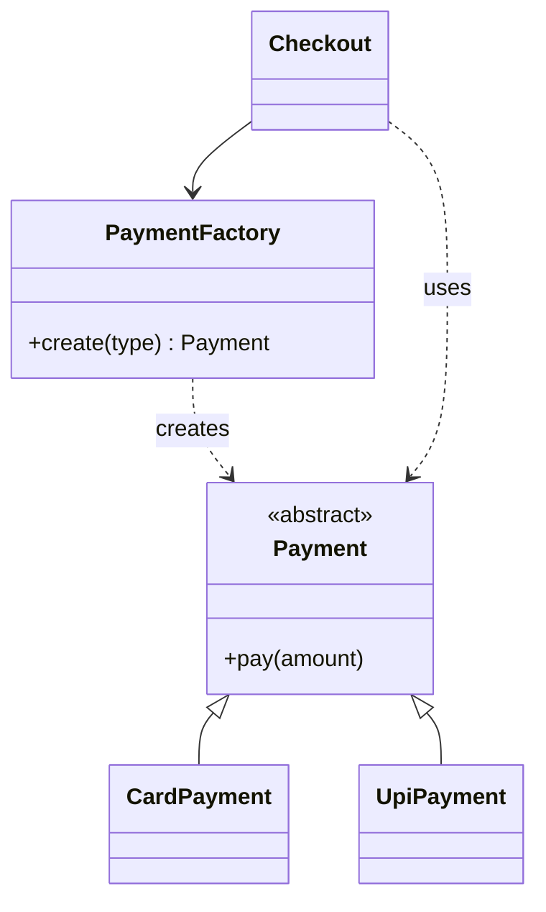

## The problem this solves

`new ConcreteThing(a, b, c)` looks innocent, but it welds the calling code to one concrete class and to the exact steps of construction. When the kind of object varies (card or UPI payment), when construction is complicated (twelve optional settings), or when there must be exactly one instance (a connection pool), scattering `new` everywhere means every change touches many files.

A **design pattern** is a named, reusable solution to a problem that keeps recurring. The name is the point: saying "use a factory here" communicates a whole structure in three words.

| Pattern | The problem it removes | One-line idea |
| --- | --- | --- |
| Singleton | several instances of something that must be one | the class controls its only instance |
| Factory Method | caller must know which concrete class to create | ask a creator; it picks the class |
| Abstract Factory | families of related objects must match | one factory per family |
| Builder | constructors with many parameters, many optional | build step by step, then `build()` |
| Prototype | creating an object is expensive or its class is unknown | copy an existing one |

Patterns shown in JavaScript so the output is real; the structure is identical in Java or C++.

## Singleton

**Problem.** A database connection pool, a configuration object or a logger should exist once. Two pools would double the connections.

```js run
class ConnectionPool {
  static #instance = null;
  #created = Date.now();
  connections = 0;
  constructor() {
    if (ConnectionPool.#instance) throw new Error('use ConnectionPool.getInstance()');
  }
  static getInstance() {
    if (!ConnectionPool.#instance) ConnectionPool.#instance = new ConnectionPool();
    return ConnectionPool.#instance;
  }
  acquire() { return ++this.connections; }
}
const a = ConnectionPool.getInstance(), b = ConnectionPool.getInstance();
a.acquire(); b.acquire();
console.log('same object:', a === b, '| connections seen by both:', a.connections);
try { new ConnectionPool(); } catch (e) { console.log('direct construction blocked:', e.message); }
```

The class holds its one instance in a private static field and exposes it through `getInstance()`. Creating it on first use is **lazy initialization**.

| Follow-up | Answer |
| --- | --- |
| Is it thread-safe? | in Java or C++ two threads can both see `null` and create two instances. Fixes: eager initialization, a synchronized accessor, double-checked locking with `volatile`, or an enum (Java). In C++11 a function-local `static` is initialized safely. JavaScript runs one thread per realm ([[js-event-loop]]), so the check is safe. |
| Why is it criticized? | it is global state: hidden dependencies, hard to replace in tests, shared across tests. |
| Better alternative? | create one instance at startup and **pass it in** (dependency injection). In Node, a module's exported object is cached, so a module already behaves as a singleton. |

## Factory Method

**Problem.** Checkout must create a payment processor, but which one depends on the user's choice. `if/else` with `new` in every caller means adding a method edits all of them.

```js run
class Payment { pay(amount) { throw new Error('not implemented'); } }
class CardPayment extends Payment { pay(amount) { return `charged ${amount} to card`; } }
class UpiPayment extends Payment { pay(amount) { return `collected ${amount} via UPI`; } }
class WalletPayment extends Payment { pay(amount) { return `debited ${amount} from wallet`; } }

class PaymentFactory {
  static #registry = new Map([['card', CardPayment], ['upi', UpiPayment]]);
  static register(type, cls) { this.#registry.set(type, cls); }
  static create(type) {
    const cls = this.#registry.get(type);
    if (!cls) throw new Error('unsupported payment type: ' + type);
    return new cls();
  }
}
const checkout = (type, amount) => PaymentFactory.create(type).pay(amount);

console.log(checkout('card', 499));
console.log(checkout('upi', 499));
PaymentFactory.register('wallet', WalletPayment);
console.log(checkout('wallet', 499), ' <- added without touching checkout');
```

`checkout` depends only on the `Payment` abstraction and the factory. A new method is a new class plus one registration: existing code is **closed for modification, open for extension** ([[oop-solid]]). The call `PaymentFactory.create(type).pay(amount)` works for any subclass because of polymorphism ([[oop-pillars]]).



The classic "Factory Method" from the Gang of Four book puts `create()` as an overridable method on a creator class and lets subclasses decide; the static version above is usually called a **Simple Factory**. Interviewers accept either if you can say which you mean.

## Abstract Factory

**Problem.** Objects come in families that must be used together: a dark-theme button with a dark-theme dialog, or a MongoDB user repository with a MongoDB order repository. Mixing families is a bug.

```js run
const lightFactory = {
  createButton: () => ({ render: () => 'white button' }),
  createDialog: () => ({ render: () => 'white dialog' }),
};
const darkFactory = {
  createButton: () => ({ render: () => 'black button' }),
  createDialog: () => ({ render: () => 'black dialog' }),
};
function buildScreen(factory) {
  return [factory.createButton(), factory.createDialog()].map(w => w.render()).join(' + ');
}
console.log(buildScreen(lightFactory));
console.log(buildScreen(darkFactory));
```

One factory object creates every member of a family. Client code receives a factory and never names a concrete class, so it cannot mix families. Factory Method creates **one product**; Abstract Factory creates **a set of related products**.

## Builder

**Problem.** An object with many fields, most optional. A constructor with ten positional parameters is unreadable (`new Request(url, null, null, true, 3, null)`) and easy to get wrong.

```js run
class HttpRequest {
  constructor(builder) { Object.assign(this, builder.fields); Object.freeze(this); }
}
class HttpRequestBuilder {
  fields = { method: 'GET', headers: {}, timeoutMs: 5000, retries: 0, body: null };
  constructor(url) { this.fields.url = url; }
  method(m) { this.fields.method = m; return this; }
  header(k, v) { this.fields.headers[k] = v; return this; }
  body(b) { this.fields.body = b; return this; }
  timeout(ms) { this.fields.timeoutMs = ms; return this; }
  retries(n) { this.fields.retries = n; return this; }
  build() {
    if (this.fields.body && this.fields.method === 'GET') throw new Error('GET cannot have a body');
    return new HttpRequest(this);
  }
}
const req = new HttpRequestBuilder('https://api.example.com/orders')
  .method('POST').header('content-type', 'application/json').body('{"sku":"kb"}').retries(3).build();
console.log(req);
try { new HttpRequestBuilder('https://x').body('data').build(); } catch (e) { console.log('validation at build():', e.message); }
```

Each setter returns `this`, so calls chain. `build()` validates the whole combination once and returns an immutable object, so a half-configured object can never escape. Mongoose queries (`find().sort().limit()`) and many SQL query builders have this shape.

## Prototype

**Problem.** Creating an object from scratch is expensive (it was loaded and configured through many steps), or you hold an object through an interface and do not know its concrete class, but need another one like it.

```js run
class Shape {
  constructor(props) { Object.assign(this, props); }
  clone() { return new this.constructor(structuredClone({ ...this })); }
}
class Circle extends Shape { area() { return +(Math.PI * this.radius ** 2).toFixed(1); } }

const template = new Circle({ radius: 10, style: { color: 'teal', border: 2 } });
const copy = template.clone();
copy.radius = 20; copy.style.color = 'red';

console.log(copy instanceof Circle, copy.area(), copy.style.color);
console.log('original untouched:', template.radius, template.style.color);
```

The object knows how to copy itself. The key detail is **deep vs shallow copy** ([[js-values]]): a shallow clone would share `style` between the two shapes. JavaScript's own inheritance model is prototype-based in a related sense ([[js-prototypes]]).

## The rule, stated precisely

A creational pattern moves the decision of *which class* or *how to assemble* out of client code and behind an interface, so clients depend on abstractions and construction can change without changing its users.

!!! key
- For each pattern be ready with: the problem, the structure, one real example, one drawback.
- Singleton: lazy vs eager, thread safety, why it hurts testing, dependency injection as the alternative.
- Factory vs Abstract Factory: one product vs a family of products.
- Builder vs Factory: Builder assembles **one complex object step by step**; Factory **chooses which class** in one call.
- Real sightings: `mongoose.connect` connection (singleton), `React.createElement` and `document.createElement` (factory), query builders (builder), `Object.create` / `structuredClone` (prototype).
!!!

!!! trap
- Singleton for everything "global". Most things only need a single instance created at startup and passed around.
- A factory that is one `switch` you must edit for every new type. Use a registry so adding a type does not modify the factory.
- Builders for objects with two fields.
- Shallow copy in Prototype when the object has nested mutable state.
- Naming a pattern without stating the problem it solves in this design. Patterns are answers, not decorations.
!!!

!!! twist What changes if...
- **...the singleton needs configuration?** Initialize it explicitly once at startup (`init(config)`), then `getInstance()`; or inject the configured instance instead.
- **...object creation is expensive and objects are reusable?** That is an **Object Pool** (connection pools, thread pools): borrow, use, return.
- **...the type to create comes from a config file or a plugin?** A registry-based factory lets new types register themselves without the factory knowing about them.
!!!

!!! model
Do not let the code that *uses* an object decide *how it is made*. Hand that decision to a creator and depend only on what the object can do.
!!!

## Practice

?? Implement a thread-safe singleton in Java or C++ (describe it) and say why the naive version breaks.
Naive lazy version: two threads both evaluate `instance == null` as true before either assigns, so two objects are created. Java fixes: `enum Singleton { INSTANCE }`, or a static holder class, or double-checked locking with a `volatile` field. C++11: `static Singleton& get() { static Singleton s; return s; }`, since the language guarantees a function-local static is initialized once even under concurrency.
??

?? You are designing a notification system with Email, SMS and Push. Which creational pattern and why?
A factory keyed by channel that returns a `Notifier`. The sending code calls `notifier.send(message)` without knowing the channel. Adding WhatsApp is a new class and a registration. If each channel also needed a matching template renderer and rate limiter, an abstract factory per channel would keep those families consistent.
??

?? Why does Builder return an immutable object, and what does that buy?
The built object has no setters, so it cannot be changed after validation in `build()`. That makes it safe to share between threads or components, and guarantees every instance in the system satisfied the invariants at creation.
??

?? Factory Method vs Abstract Factory vs Builder in one sentence each.
Factory Method: one method decides which subclass of a product to instantiate. Abstract Factory: an object with several creation methods that produce a consistent family of products. Builder: an object that accumulates configuration over several calls and then constructs one complex product.
??

?? What is wrong with a Singleton from a testing point of view?
Code that calls `Singleton.getInstance()` internally hides that dependency, so a test cannot substitute a fake; and the instance carries state from one test to the next, making tests order-dependent. Passing the dependency in through the constructor fixes both.
??
