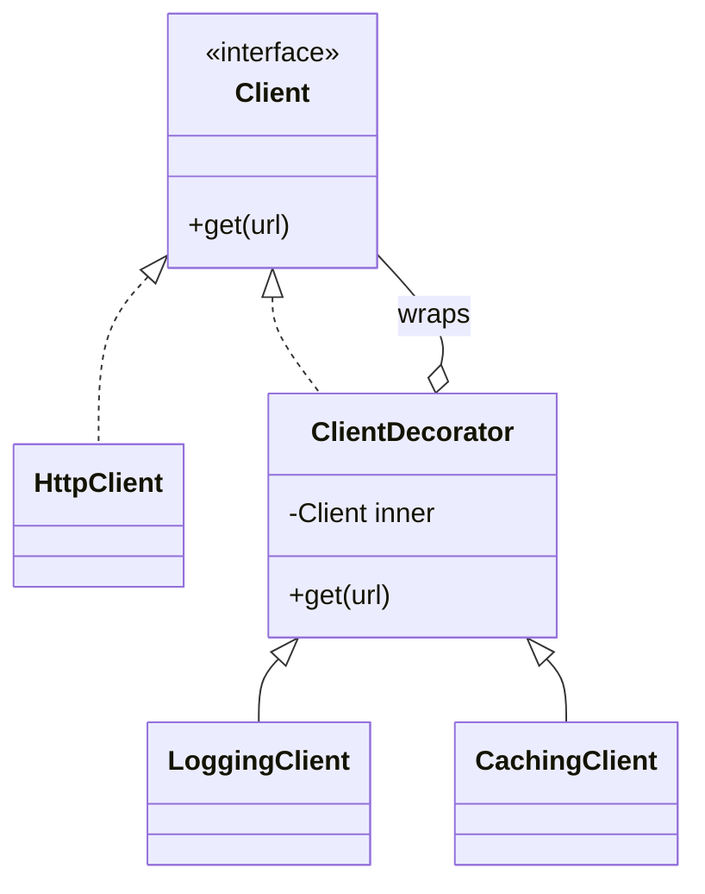

## The problem this solves

You rarely get to design every class. A third-party SDK has the wrong method names. A class does almost what you need, plus you want logging around it. A subsystem has twelve classes and callers only need one operation. Editing those classes is either impossible (not your code) or unwise (it breaks other users). Structural patterns change how objects are **composed**, without changing the objects themselves.

| Pattern | Wraps | Interface seen by the client | Intent |
| --- | --- | --- | --- |
| **Adapter** | one object with the wrong interface | a *different* one, the one the client expects | make incompatible things work together |
| **Decorator** | one object | the *same* one | add responsibilities, stackable |
| **Proxy** | one object | the *same* one | control access: lazy load, cache, check permissions |
| **Facade** | a whole subsystem | a *new, simpler* one | hide complexity |
| **Composite** | children of the same type | the *same* one for leaf and group | treat part and whole uniformly |

## Adapter

**Problem.** Your code calls `gateway.pay(amountInPaise)`. A provider's SDK offers `makeCharge({ amount_in_rupees, ccy })`. You cannot change the SDK, and you do not want provider details in checkout.

```js run
class LegacyStripeSdk { makeCharge({ amount_in_rupees, ccy }) { return { ok: true, ref: 'st_1', charged: `${amount_in_rupees} ${ccy}` }; } }
class RazorSdk { createPayment(paise, cb) { cb(null, { id: 'rz_9', amount: paise }); } }

class StripeAdapter {
  constructor(sdk) { this.sdk = sdk; }
  async pay(paise) { const r = this.sdk.makeCharge({ amount_in_rupees: paise / 100, ccy: 'INR' }); return { id: r.ref, paise }; }
}
class RazorAdapter {
  constructor(sdk) { this.sdk = sdk; }
  pay(paise) { return new Promise((res, rej) => this.sdk.createPayment(paise, (err, r) => err ? rej(err) : res({ id: r.id, paise: r.amount }))); }
}

async function checkout(gateway, paise) { const receipt = await gateway.pay(paise); return `paid ${receipt.paise} paise, ref ${receipt.id}`; }
(async () => {
  console.log(await checkout(new StripeAdapter(new LegacyStripeSdk()), 49900));
  console.log(await checkout(new RazorAdapter(new RazorSdk()), 49900));
})();
```

Each adapter implements the interface *your* code wants (`pay(paise)` returning a promise) and translates to whatever the wrapped object offers: units, names, even callback style to promise style ([[js-promises]]). `checkout` never changes when a provider is swapped. The e-commerce project isolates its payment provider this way.

## Decorator

**Problem.** You want optional features around an object (logging, retry, caching, compression) in any combination. Subclassing gives an explosion: `LoggingRetryingCachedClient`, `RetryingCachedClient`...

```js run
class HttpClient { async get(url) { return `response from ${url}`; } }

class LoggingClient {
  constructor(inner) { this.inner = inner; }
  async get(url) { console.log('  [log] GET', url); return this.inner.get(url); }
}
class CachingClient {
  constructor(inner) { this.inner = inner; this.cache = new Map(); }
  async get(url) {
    if (this.cache.has(url)) return this.cache.get(url) + ' (cached)';
    const res = await this.inner.get(url); this.cache.set(url, res); return res;
  }
}
class RetryingClient {
  constructor(inner, attempts = 3) { this.inner = inner; this.attempts = attempts; }
  async get(url) { for (let i = 1; ; i++) { try { return await this.inner.get(url); } catch (e) { if (i === this.attempts) throw e; } } }
}

(async () => {
  const client = new CachingClient(new LoggingClient(new RetryingClient(new HttpClient())));
  console.log(await client.get('/products/1'));
  console.log(await client.get('/products/1'));
})();
```

A decorator has the **same interface** as the thing it wraps and holds a reference to it, so decorators nest in any order and the caller cannot tell. The second call is answered by the cache layer and never reaches the logger. This is composition instead of inheritance ([[oop-composition]]).

You have met decorators already: Express middleware wraps a handler ([[express-middleware]]), a higher-order function wraps a function ([[js-functional]]), and a higher-order component wraps a React component.



## Proxy

**Problem.** You need a stand-in that controls access to the real object: create it only when needed, check permissions, or count calls.

```js run
class ReportService {
  constructor() { console.log('  (expensive: loading 2 GB of data)'); }
  fetch(id) { return `report ${id}`; }
  remove(id) { return `report ${id} deleted`; }
}
class ReportServiceProxy {
  #real = null;
  constructor(user) { this.user = user; }
  #service() { return this.#real ??= new ReportService(); }
  fetch(id) { return this.#service().fetch(id); }
  remove(id) {
    if (this.user.role !== 'admin') throw new Error('forbidden: only admins can delete');
    return this.#service().remove(id);
  }
}
const proxy = new ReportServiceProxy({ role: 'viewer' });
console.log('proxy created, real service not built yet');
console.log(proxy.fetch(7));
try { proxy.remove(7); } catch (e) { console.log(e.message); }
```

| Kind of proxy | What it controls | Example |
| --- | --- | --- |
| Virtual | creation, deferred until first use | lazy-loaded images, ORM lazy relations |
| Protection | permissions | the check above; an API gateway |
| Caching | repeated calls | a CDN or reverse proxy in front of a server ([[hld-caching]]) |
| Remote | location: the real object is on another machine | an RPC client stub |

**Proxy vs Decorator**: same shape, different purpose. A decorator **adds behaviour** and is chosen and stacked by the client. A proxy **controls access** to the object and usually manages its lifecycle itself.

## Facade

**Problem.** Placing an order touches inventory, payment, shipping and notification. Every caller repeating that choreography will get the order or the error handling wrong somewhere.

```js run
const inventory = { reserve: sku => `reserved ${sku}`, release: sku => `released ${sku}` };
const payments = { charge: paise => { if (paise > 100000) throw new Error('card declined'); return `charged ${paise}`; } };
const shipping = { schedule: sku => `pickup scheduled for ${sku}` };
const notifier = { send: msg => `emailed: ${msg}` };

class OrderFacade {
  placeOrder(sku, paise) {
    const log = [inventory.reserve(sku)];
    try { log.push(payments.charge(paise)); }
    catch (e) { log.push(inventory.release(sku), notifier.send('payment failed')); return log; }
    log.push(shipping.schedule(sku), notifier.send('order confirmed'));
    return log;
  }
}
const orders = new OrderFacade();
console.log(orders.placeOrder('keyboard', 49900).join(' -> '));
console.log(orders.placeOrder('laptop', 7500000).join(' -> '));
```

One method hides four subsystems and their ordering, including the undo step on failure. The subsystems stay usable directly for callers who need more. A service layer in a backend and an API gateway in front of microservices are both facades.

## Composite

**Problem.** A folder contains files and folders. A menu contains items and submenus. You want `size()` or `render()` to work on a single item and on a whole tree with the same call.

```js run
class File {
  constructor(name, size) { this.name = name; this.bytes = size; }
  size() { return this.bytes; }
  print(indent = '') { return `${indent}${this.name} (${this.bytes})`; }
}
class Folder {
  constructor(name) { this.name = name; this.children = []; }
  add(...nodes) { this.children.push(...nodes); return this; }
  size() { return this.children.reduce((sum, c) => sum + c.size(), 0); }
  print(indent = '') { return [`${indent}${this.name}/ (${this.size()})`, ...this.children.map(c => c.print(indent + '  '))].join('\n'); }
}
const root = new Folder('project').add(
  new File('README.md', 120),
  new Folder('src').add(new File('app.js', 900), new Folder('lib').add(new File('util.js', 300))),
);
console.log(root.print());
```

Leaf and container share an interface; the container implements each operation by delegating to its children. Recursion does the rest. The React component tree and the DOM are composites ([[react-rendering]]).

## The rule, stated precisely

Adapter changes an interface; Decorator keeps the interface and adds behaviour; Proxy keeps the interface and controls access; Facade offers a new, smaller interface over many objects; Composite gives one interface to both an element and a group of elements.

!!! key
- The table of five, by "what does the client see" and "why". Interviewers love "Adapter vs Decorator vs Proxy vs Facade".
- All rely on **composition and delegation**: hold a reference, forward the call, do something before or after.
- Real sightings: adapters for payment or storage providers; middleware as decorators; ORM lazy loading and API gateways as proxies; service classes as facades; UI trees as composites.
- Others to recognize by name: **Bridge** (separate an abstraction from its implementation so both vary independently) and **Flyweight** (share common state between many small objects to save memory).
!!!

!!! trap
- Calling every wrapper a decorator. State the intent.
- A facade that grows into a God class holding business logic. It should only coordinate.
- An adapter that leaks the wrapped type (returning the SDK's own response objects) so callers depend on the provider anyway.
- Deep decorator stacks that make debugging and ordering bugs hard; order matters (cache outside retry is different from retry outside cache).
!!!

!!! twist What changes if...
- **...you need to adapt many methods, not one?** Adapt to a narrow interface your domain needs, not the provider's full surface. That keeps a second provider cheap to add.
- **...the decorator should apply to every method generically?** Languages offer dynamic proxies: JavaScript's `Proxy` object, Java's `InvocationHandler`, Python decorators. Useful for logging, metrics and access checks.
- **...a composite operation should not recurse forever?** Guard against cycles (a folder containing itself) by forbidding them on `add` or tracking visited nodes.
!!!

!!! model
Wrap, then forward. What differs is whether the wrapper translates (Adapter), adds (Decorator), guards (Proxy), simplifies (Facade) or multiplies (Composite).
!!!

## Practice

?? Your app uses AWS S3 directly in 40 files and the company is moving to another storage provider. Which pattern would have helped and how do you introduce it now?
An adapter behind a `FileStorage` interface (`put`, `get`, `delete`, `signedUrl`). Introduce it by writing `S3Storage` implementing that interface, replacing direct SDK calls with the interface, then adding the second implementation. Only the composition root chooses which one to construct.
??

?? Decorator vs inheritance for adding features: why prefer the decorator?
Inheritance is fixed at compile time and combinations multiply into subclasses. Decorators are composed at runtime, in any order and combination, each with a single responsibility, and the wrapped class is untouched (open/closed principle).
??

?? Is an API gateway a proxy or a facade?
Both aspects. As a reverse proxy it stands in front of services and controls access (auth, rate limits, caching). As a facade it exposes one simplified API that may combine several internal calls. Saying which aspect you mean is the answer.
??

?? Implement a generic logging wrapper with JavaScript's `Proxy`.
```js run
const withLogging = target => new Proxy(target, {
  get(obj, prop) {
    const value = obj[prop];
    return typeof value !== 'function' ? value : (...args) => { console.log(`call ${String(prop)}(${args.join(', ')})`); return value.apply(obj, args); };
  },
});
const math = withLogging({ add: (a, b) => a + b, mul: (a, b) => a * b });
console.log(math.add(2, 3), math.mul(4, 5));
```
??

?? Where does Composite appear in a file-system or organization-chart design question?
`FileSystemNode` (or `Employee`) is the common interface; `File` (or individual contributor) is the leaf; `Directory` (or manager) holds children of the interface type. Operations such as total size, search or salary roll-up are defined once on the interface and recurse through containers.
??
