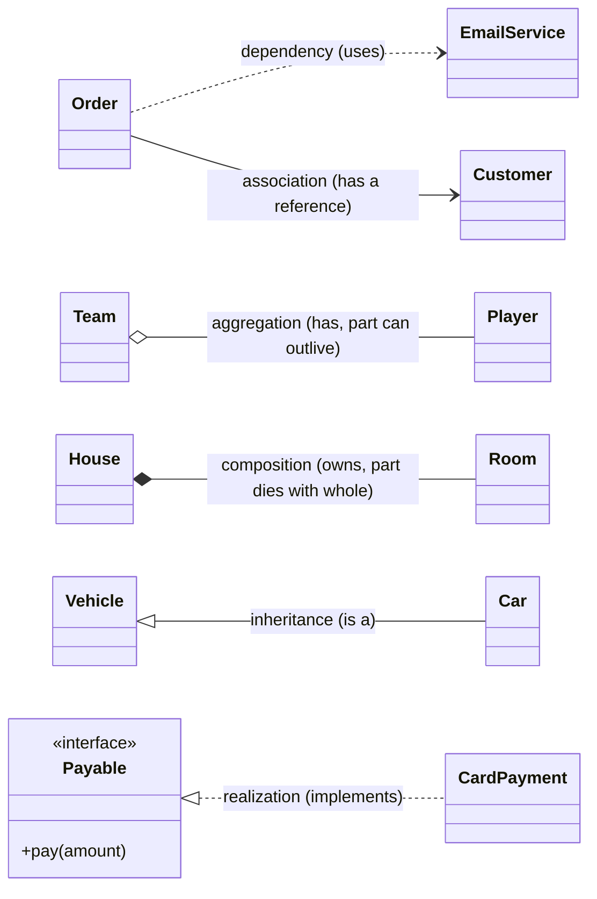
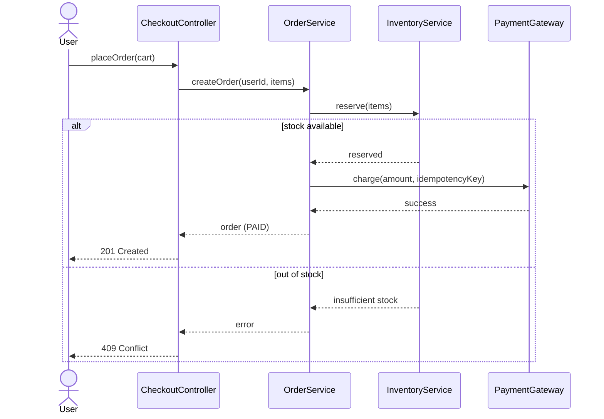
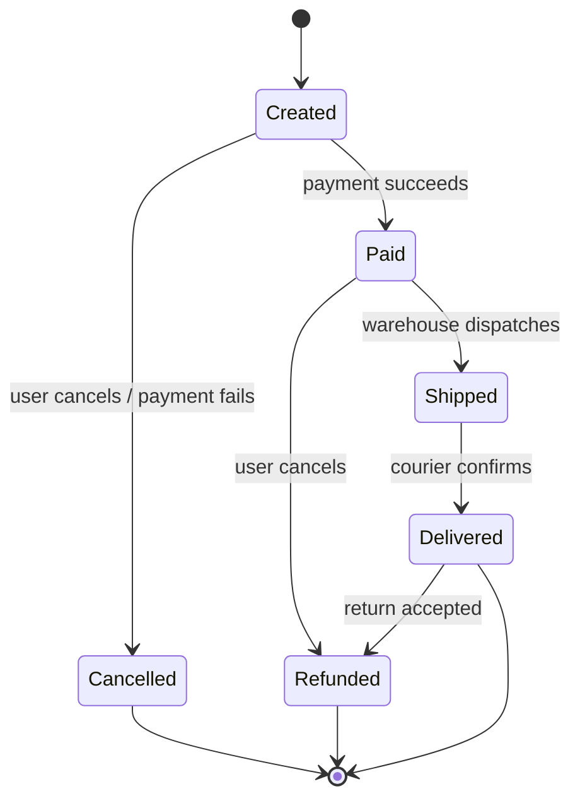

## The problem this solves

In a low-level design round you must communicate a structure of ten or more classes and how they talk, in a few minutes, to someone who will interrupt with "who owns this?" and "what happens when that fails?". Prose is too slow and code is too detailed. A diagram shows structure at a glance, but only if both people read the arrows the same way.

Each diagram answers one question:

| Diagram | Question it answers | Draw it when |
| --- | --- | --- |
| **Use case** | who uses the system and for what goals? | first, to fix scope |
| **Class** | what are the things, what do they know and do, how are they related? | the core of any LLD answer |
| **Sequence** | in what order do objects call each other for one scenario? | to walk through a key flow |
| **State** | what states can one object be in, and what moves it between them? | an entity has a lifecycle (order, booking, elevator) |
| Activity | what is the step-by-step workflow, with branches? | business processes |

Examples in this line are written in JavaScript so their output is real (run on Node during the build). The designs are language-independent; in an interview you would write the same classes in Java or C++. How JavaScript classes work underneath is in [[js-prototypes]], and the OOP principles behind them in [[oop-pillars]].

## The class diagram

A class box has three parts: name, attributes, methods. Visibility markers: `+` public, `-` private, `#` protected.

### The six relationships

This is what interviewers probe. Ordered from weakest to strongest coupling:



| Relationship | Arrow | Meaning | Test question | In code |
| --- | --- | --- | --- | --- |
| Dependency | dashed, open arrow | A uses B briefly | does A just receive or create B inside a method? | a parameter or local variable |
| Association | solid line or arrow | A knows B over time | does A keep a reference to B? | a field holding a reference |
| Aggregation | hollow diamond at the whole | whole-part, part is independent | can the part exist without the whole? yes | field set from outside (passed in) |
| Composition | filled diamond at the whole | whole-part, part is owned | can the part exist without the whole? no | field created inside the constructor |
| Inheritance | solid line, hollow triangle at the parent | A is a kind of B | can A be used wherever B is expected? | `extends` |
| Realization | dashed line, hollow triangle at the interface | A fulfils contract B | does A implement B's methods? | `implements` (or duck typing) |

**Multiplicity** goes at the line ends: `1`, `0..1`, `*` (many), `1..*`. "One customer has many orders" is `Customer "1" --> "*" Order`.

### Example 1: each relationship in code

```js run
class Engine { start() { return 'engine on'; } }
class Driver { constructor(name) { this.name = name; } }
class Logger { static log(msg) { return '[log] ' + msg; } }

class Vehicle {
  constructor(wheels) { this.wheels = wheels; }
  describe() { return `${this.constructor.name} with ${this.wheels} wheels`; }
}
class Car extends Vehicle {                      // inheritance: Car IS A Vehicle
  constructor() {
    super(4);
    this.engine = new Engine();                  // composition: created and owned here
    this.driver = null;                          // aggregation: assigned from outside
  }
  assign(driver) { this.driver = driver; }
  start() { return Logger.log(`${this.driver.name} -> ${this.engine.start()}`); }   // dependency: uses Logger
}

const asha = new Driver('Asha');
let car = new Car();
car.assign(asha);
console.log(car.describe());
console.log(car.start());
car = null;
console.log('car is gone; its engine went with it, but the driver still exists:', asha.name);
```

The engine was built inside the car and nobody else has a reference: composition. The driver was created elsewhere and outlives the car: aggregation.

## The sequence diagram

Objects across the top, time flowing down, an arrow for each message. Solid arrow is a call, dashed is a return.



Use `alt` for branches, `loop` for repetition, `opt` for optional steps. One sequence diagram shows **one scenario**. It is the fastest way to prove your classes actually collaborate to deliver a use case. The collab editor blueprint uses one for its edit flow ([[collab-editor]]).

## The state diagram

For an object whose behaviour depends on where it is in a lifecycle.



### Example 2: the state diagram as code

```js run
const transitions = {
  Created: { pay: 'Paid', cancel: 'Cancelled' },
  Paid: { ship: 'Shipped', cancel: 'Refunded' },
  Shipped: { deliver: 'Delivered' },
  Delivered: { return: 'Refunded' },
};
class Order {
  state = 'Created';
  apply(event) {
    const next = transitions[this.state]?.[event];
    if (!next) throw new Error(`cannot ${event} an order that is ${this.state}`);
    this.state = next;
    return this;
  }
}
const order = new Order();
console.log(order.apply('pay').apply('ship').state);
try { order.apply('cancel'); } catch (e) { console.log('rejected:', e.message); }
```

The diagram is a table of legal moves; anything not in the table is rejected. This prevents the classic bug of a shipped order being cancelled. When each state also needs different *behaviour*, it becomes the State pattern in [[lld-behavioral]].

## The use case diagram

Stick figures (actors) outside a box (the system), ovals (goals) inside, lines connecting who does what. `<<include>>` means one use case always uses another (checkout includes payment); `<<extend>>` means an optional addition (apply coupon extends checkout). A worked one is in the [[collab-editor]] blueprint.

## The rule, stated precisely

A class diagram is static structure: classes, members, and typed relationships with multiplicity. A sequence diagram is one dynamic scenario over that structure. A state diagram is the lifecycle of one class. Every arrow you draw is a claim you must be able to defend in code.

!!! key
- Aggregation vs composition is the most asked distinction: **does the part's lifetime depend on the whole?**
- "Is a" is inheritance, "has a" is association/aggregation/composition, "uses a" is dependency, "can do" is an interface.
- Prefer composition over inheritance for reuse ([[oop-composition]]); use inheritance only for true "is a" with substitutability.
- Draw class diagram first, then validate it with one sequence diagram of the main flow. If a message has nowhere to go, a class or method is missing.
- Keep diagrams at the level of the question: 6 to 12 classes, key attributes and methods only.
!!!

!!! trap
- Arrows pointing the wrong way. Inheritance and realization point **to the parent or interface**. The diamond sits **at the whole**.
- Marking everything as composition.
- A "God class" (`ParkingLotManager` with every method). It signals no real design.
- Listing getters and setters. They add nothing to the discussion.
- Confusing association (a long-lived reference) with dependency (a passing use).
!!!

!!! twist What changes if...
- **...the relationship is many-to-many (students and courses)?** Introduce an association class (`Enrollment` with grade and date) that holds the data belonging to the relationship itself.
- **...two classes need each other?** A bidirectional association is allowed but increases coupling; try to make one side depend on an interface, or route through a mediator.
- **...the interviewer says "now add a new vehicle type / payment method"?** If you drew an interface or abstract class there, you add one box. If not, you are editing existing classes. This is the open/closed principle ([[oop-solid]]) made visible.
!!!

!!! model
Class diagram: the nouns and how tightly they are tied. Sequence diagram: one story told with those nouns. State diagram: the life of one noun.
!!!

## Practice

?? Classify each: (a) Library and Book, (b) Book and Page, (c) Car and Vehicle, (d) ReportGenerator and a Printer passed to `print(printer)`, (e) `ArrayList` and `List`.
(a) Aggregation: books exist without that library. (b) Composition: pages do not exist apart from their book. (c) Inheritance. (d) Dependency: used within a method, not stored. (e) Realization: a class implementing an interface.
??

?? How do you show aggregation vs composition in code?
Composition: the whole creates the part in its constructor, keeps it private and never hands it out; destroying the whole makes the part unreachable. Aggregation: the part is created outside and passed in (constructor or setter); other objects may also hold it and it outlives the whole.
??

?? Draw (describe) the class relationships for an online order: Customer, Order, OrderItem, Product, Payment.
Customer `1` to `*` Order (association). Order `1` composed of `1..*` OrderItem (composition: items do not exist without the order). OrderItem `*` to `1` Product (association: the product exists independently). Order `1` to `0..1` Payment (composition or association depending on whether payments are tracked separately).
??

?? When would you draw a state diagram in an LLD interview?
When an entity has distinct phases and rules about which transitions are legal: order, booking, ticket, elevator, vending machine, traffic light, document workflow. It turns "can a shipped order be cancelled?" into a visible missing arrow.
??

?? What is the difference between an abstract class and an interface, and how does each appear in UML?
An abstract class can hold state and implemented methods and is extended (solid line, hollow triangle; name in italics or marked `<<abstract>>`). An interface is a pure contract with no state and is implemented (dashed line, hollow triangle; marked `<<interface>>`). A class can implement many interfaces but, in most languages, extend one class.
??
