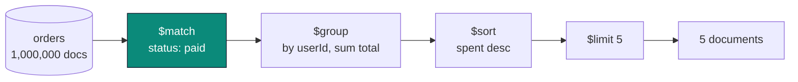

## The problem this solves

"Total revenue per month", "top 5 customers", "average rating per product with the product name". None of these is a list of stored documents. They need grouping, arithmetic and data from other collections. Doing it in application code means pulling every document over the network first. The aggregation pipeline does it **inside the database**.

## Intuition

A pipeline is an array of stages. Documents flow in at the top; each stage transforms the stream and passes it on. It is the same idea as chaining `filter`, `map` and `reduce` in [[js-functional]], run by the database next to the data.



| Stage | Does | SQL equivalent |
| --- | --- | --- |
| `$match` | keep documents that satisfy a condition | `WHERE` (or `HAVING` after a group) |
| `$group` | collapse documents sharing a key, with accumulators | `GROUP BY` |
| `$project` / `$addFields` | choose, rename or compute fields | `SELECT` |
| `$sort`, `$skip`, `$limit` | order and page | `ORDER BY`, `OFFSET`, `LIMIT` |
| `$lookup` | bring in matching documents from another collection | `LEFT JOIN` |
| `$unwind` | one output document per array element | (flatten) |
| `$facet` | run several sub-pipelines on the same input | (several queries in one) |

## Build it step by step

Sample data for all examples:

```js
db.orders.insertMany([
  { _id: 1, userId: 'u1', status: 'paid',      total: 400, items: [{ sku: 'kb', qty: 1 }, { sku: 'ms', qty: 2 }] },
  { _id: 2, userId: 'u2', status: 'paid',      total: 900, items: [{ sku: 'kb', qty: 3 }] },
  { _id: 3, userId: 'u1', status: 'cancelled', total: 150, items: [{ sku: 'ms', qty: 1 }] },
  { _id: 4, userId: 'u1', status: 'paid',      total: 700, items: [{ sku: 'hd', qty: 1 }] }
]);
```

### Example 1: match, group, sort

```js
db.orders.aggregate([
  { $match: { status: 'paid' } },
  { $group: { _id: '$userId', spent: { $sum: '$total' }, orders: { $sum: 1 }, biggest: { $max: '$total' } } },
  { $sort: { spent: -1 } }
]);
```

```output
[ { _id: 'u1', spent: 1100, orders: 2, biggest: 700 },
  { _id: 'u2', spent: 900,  orders: 1, biggest: 900 } ]
```

In `$group`, `_id` is the grouping key. `'$userId'` with a dollar sign means "the value of the field `userId`". `{ $sum: 1 }` counts documents. Other accumulators: `$avg`, `$min`, `$max`, `$push` (collect into an array), `$addToSet` (collect unique values), `$first`.

### Example 2: unwind an array, then group

"How many units of each SKU were sold in paid orders?"

```js
db.orders.aggregate([
  { $match: { status: 'paid' } },
  { $unwind: '$items' },
  { $group: { _id: '$items.sku', units: { $sum: '$items.qty' } } },
  { $sort: { units: -1 } }
]);
```

```output
after $unwind: 4 documents, one per item (order 1 appears twice)
result: [ { _id: 'kb', units: 4 }, { _id: 'ms', units: 2 }, { _id: 'hd', units: 1 } ]
```

`$unwind` turns one document with an array of N elements into N documents, each with a single element in place of the array. After that, the elements can be grouped like ordinary fields.

### Example 3: lookup, the join

```js
db.orders.aggregate([
  { $match: { status: 'paid' } },
  { $group: { _id: '$userId', spent: { $sum: '$total' } } },
  { $lookup: { from: 'users', localField: '_id', foreignField: '_id', as: 'user' } },
  { $unwind: '$user' },
  { $project: { _id: 0, name: '$user.name', spent: 1 } }
]);
```

```output
[ { spent: 1100, name: 'Asha' }, { spent: 900, name: 'Ravi' } ]
```

`$lookup` adds an **array** of matching documents from the other collection (here always one user, so `$unwind` flattens it). It behaves like a left outer join: no match gives an empty array. Note the order: group first, then look up two users, instead of joining a million orders to users and then grouping.

### Example 4: facet, results and total count in one round trip

```js
db.products.aggregate([
  { $match: { category: 'keyboards' } },
  { $facet: {
      items: [{ $sort: { price: 1 } }, { $skip: 20 }, { $limit: 10 }],
      total: [{ $count: 'count' }],
      brands: [{ $group: { _id: '$brand', n: { $sum: 1 } } }]
  } }
]);
```

```output
[ { items: [ ...10 products... ], total: [ { count: 137 } ], brands: [ { _id: 'Keychron', n: 41 }, ... ] } ]
```

One query returns the page of results, the total for the pager and the counts for the filter sidebar. The e-commerce project's catalog page uses this shape.

## The rule, stated precisely

`aggregate([s1, s2, ...])` evaluates stages in order; the output documents of stage *k* are the input of stage *k+1*. Only stages at the **start** of the pipeline (`$match`, `$sort`, and a `$match`/`$sort` combination) can use indexes on the collection; after a `$group`, `$project` or `$unwind`, documents are computed and no stored index applies.

!!! key
- **Filter early**: put `$match` first so it uses an index ([[mongo-indexes]]) and everything downstream processes fewer documents. This is the single most important optimization.
- `$project` early to drop large fields you do not need.
- `$match` before `$group` is `WHERE`; `$match` after `$group` is `HAVING`.
- `$lookup` needs an index on the `foreignField` or it scans the other collection once per input document.
- A blocking stage (`$group`, `$sort` without an index) is limited to 100 MB of memory unless `allowDiskUse` is set.
!!!

!!! trap
- Forgetting the `$` prefix: `{ $sum: 'total' }` sums a string constant (result 0), `{ $sum: '$total' }` sums the field.
- `$unwind` on a missing or empty array drops the document, unless `preserveNullAndEmptyArrays: true`.
- Joining first and filtering later.
- Using aggregation for a simple filter that `find` handles.
- Computing a heavy report on every page view. Cache it ([[node-scaling]]) or precompute it.
!!!

!!! twist What changes if...
- **...the dashboard is slow because the pipeline scans a year of orders?** Maintain a summary collection updated on each order (`$inc` on a per-day document) or refresh it on a schedule with `$merge`. Read the summary instead.
- **...you need rank within a group (leaderboard position)?** `$setWindowFields` with `$rank`, the pipeline's version of SQL window functions ([[dbms-sql]]).
- **...you need buckets (price ranges, hourly histograms)?** `$bucket` / `$bucketAuto`, or `$group` on `$dateTrunc`.
!!!

!!! model
An assembly line for documents. Each station does one thing; put the station that throws the most away at the front.
!!!

## Practice

?? Write a pipeline: average rating and review count per product, only for products with at least 10 reviews, best first.
```js
db.reviews.aggregate([
  { $group: { _id: '$productId', avgRating: { $avg: '$rating' }, count: { $sum: 1 } } },
  { $match: { count: { $gte: 10 } } },
  { $sort: { avgRating: -1 } }
]);
```
The `$match` comes after the group because it filters on a computed value, the equivalent of `HAVING`.
??

?? Monthly revenue for the current year.
```js
db.orders.aggregate([
  { $match: { status: 'paid', createdAt: { $gte: ISODate('2026-01-01') } } },
  { $group: { _id: { $dateTrunc: { date: '$createdAt', unit: 'month' } }, revenue: { $sum: '$total' } } },
  { $sort: { _id: 1 } }
]);
```
An index on `{ status: 1, createdAt: 1 }` serves the first stage.
??

?? Why is the order of stages important for performance? Give an example.
`[$lookup, $match]` joins every order with its user and then discards most of them. `[$match, $lookup]` discards first and joins only the survivors. Same result, a fraction of the work. MongoDB's optimizer reorders some simple cases, but you should write the efficient order yourself.
??

?? `$lookup` vs Mongoose `populate`?
`$lookup` is one server-side operation inside a pipeline and can be followed by further stages (filter or sort on the joined data). `populate` is a second query issued by the driver and merged in application memory; simpler, but it cannot filter the parent by the child's fields.
??

?? How would you compute a per-user leaderboard for a contest with 100,000 submissions?
`$match` on `contestId` and `verdict: 'accepted'`; `$group` by `{ userId, problemId }` taking the earliest accepted time; `$group` by `userId` summing solved count and penalty; `$sort` by solved descending, penalty ascending; `$limit`. Because this is expensive, the online judge caches the result and updates it incrementally on each accepted submission.
??
