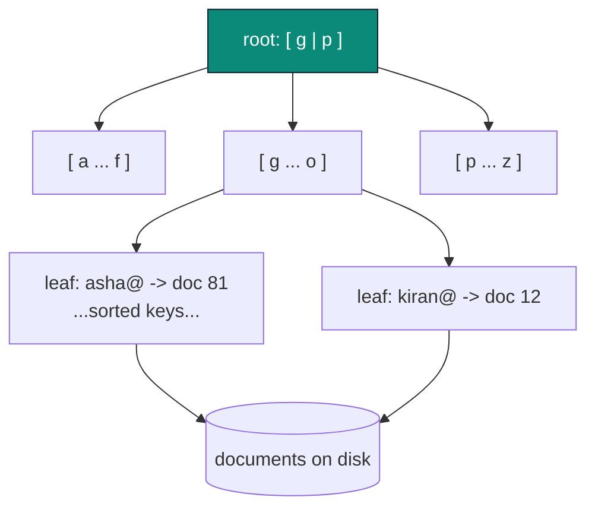

## The problem this solves

`db.users.find({ email: 'asha@example.com' })` on ten million users. With no index MongoDB must open all ten million documents and compare each one. That is a **collection scan** (`COLLSCAN`), and its cost grows linearly with the data. Fine at a thousand documents, a timeout at ten million.

## Intuition

An index is a separate, **sorted** copy of one or more fields, where each entry points back to its document. Sorted data can be searched by repeatedly halving, so finding one key among ten million takes around two dozen comparisons instead of ten million.

MongoDB stores indexes as **B-trees**: a wide, shallow, always-balanced tree where each node holds many sorted keys ([[dbms-indexing]] covers the structure). Lookup, insert and delete are all O(log n), and because leaves are in order, range scans and sorted output come for free.



## Build it step by step

### Example 1: see the difference with explain

```js
db.users.find({ email: 'asha@example.com' }).explain('executionStats');
db.users.createIndex({ email: 1 }, { unique: true });
db.users.find({ email: 'asha@example.com' }).explain('executionStats');
```

```output
before: stage: 'COLLSCAN'   totalDocsExamined: 10000000   nReturned: 1
after : stage: 'IXSCAN'     totalKeysExamined: 1          totalDocsExamined: 1   nReturned: 1
```

`explain('executionStats')` is how you prove an index is used. The number to watch is the ratio of documents examined to documents returned. Close to 1 is ideal.

### Example 2: compound indexes and the prefix rule

```js
db.orders.createIndex({ userId: 1, status: 1, createdAt: -1 });
```

A compound index sorts by the first field, then by the second within equal first values, and so on, like a phone book sorted by last name, then first name. It can serve any query that uses a **leading prefix** of its fields:

| Query filter | Uses this index? | Why |
| --- | --- | --- |
| `{ userId }` | yes | prefix `userId` |
| `{ userId, status }` | yes | prefix `userId, status` |
| `{ userId, status }` sorted by `createdAt` | yes, and the sort is free | full index order |
| `{ status }` | no | skips the first field; entries for one status are scattered |
| `{ userId, createdAt }` | partly | uses `userId`, then must scan that user's entries |

### Example 3: field order, the ESR rule

For a query with several kinds of conditions, order the index fields **Equality, Sort, Range**.

```js
db.orders.find({ userId: u, total: { $gte: 100000 } }).sort({ createdAt: -1 });

db.orders.createIndex({ userId: 1, createdAt: -1, total: 1 });
```

- **Equality** first (`userId`): narrows to one contiguous block of the index.
- **Sort** next (`createdAt`): inside that block the entries are already in the requested order, so no in-memory sort.
- **Range** last (`total`): filters while walking, without breaking the order.

Put the range field before the sort field and the entries come out ordered by `total`, so MongoDB must sort the results in memory, which is slow and capped.

### Example 4: covered queries

```js
db.users.createIndex({ email: 1, name: 1 });
db.users.find({ email: 'asha@example.com' }, { name: 1, _id: 0 });
```

```output
stage: 'PROJECTION_COVERED' over 'IXSCAN'    totalDocsExamined: 0
```

If the index contains every field the query filters on **and** returns, MongoDB answers from the index alone and never opens the document. `_id` must be excluded from the projection unless it is in the index.

### Index types worth knowing

| Type | Created with | Use |
| --- | --- | --- |
| Single field / compound | `{ a: 1 }`, `{ a: 1, b: -1 }` | most queries |
| Unique | `{ unique: true }` | emails, usernames, idempotency keys ([[rest-api]]) |
| Multikey | automatic when the field is an array | `tags: 'node'` matches via one index entry per element |
| TTL | `{ expireAfterSeconds: 3600 }` on a date | sessions, OTPs, expiring tokens ([[auth-jwt]]) |
| Text | `{ title: 'text' }` | basic keyword search |
| Partial | `{ partialFilterExpression: { status: 'active' } }` | index only the documents you query |
| Hashed | `{ userId: 'hashed' }` | even distribution for sharding ([[mongo-transactions]]) |

## The rule, stated precisely

A query can use an index if its conditions constrain a leading prefix of the index key. The index also satisfies a sort when, after the equality-constrained prefix, the remaining key order matches the sort (or its exact reverse).

!!! why
Every index is extra data that must be updated on every insert, and on every update or delete that touches its fields. Reads get faster, writes get slower, memory use grows. Indexing is a trade, not a free win.
!!!

!!! key
- `COLLSCAN` vs `IXSCAN`, and reading `totalDocsExamined` vs `nReturned` in `explain`.
- Prefix rule and ESR. Be able to design the index for a given query out loud.
- Index selectivity: index fields with many distinct values (email). An index on a boolean rarely helps on its own.
- Indexes should fit in RAM. Too many indexes hurt writes.
- Cursor pagination from [[rest-api]] is fast only because the cursor field is indexed.
!!!

!!! trap
- An index per field instead of one compound index. MongoDB usually picks a single index per query; separate indexes on `userId` and `status` do not combine like one on both.
- `skip(100000)` for deep pagination: the server still walks 100,000 index entries.
- Queries that cannot use an index well: a regex not anchored at the start (`/gmail/`), `$ne`, `$nin`, or a function applied to the field.
- Sorting on a field with no index: in-memory sort, limited to 100 MB by default.
- Building an index on a huge collection during peak traffic.
!!!

!!! twist What changes if...
- **...the sort is `{ createdAt: 1 }` but the index has `createdAt: -1`?** Still fine: an index can be walked backwards. For multi-field sorts the directions must match exactly or be exactly reversed.
- **...the field is an array?** A multikey index stores one entry per element. A compound index can include at most one array field.
- **...only 2% of documents are ever queried (active subscriptions)?** A partial index on that 2% is smaller and faster.
- **...the leaderboard needs "top 100 by score per contest"?** Index `{ contestId: 1, score: -1 }`: equality then sort, read the first 100 entries. The online judge uses this.
!!!

!!! model
An index is the book's index: sorted, small, points to pages. It answers "where is X" instantly, only for the things it was sorted by, and someone has to keep it updated.
!!!

## Practice

?? Design the index: `find({ status: 'paid', createdAt: { $gte: lastWeek } }).sort({ total: -1 })`.
`{ status: 1, total: -1, createdAt: 1 }` by ESR: equality on `status`, sort on `total`, range on `createdAt`. If the date range is extremely selective and results are few, `{ status: 1, createdAt: 1 }` with an in-memory sort can be better. Confirm with `explain`.
??

?? You have an index `{ a: 1, b: 1, c: 1 }`. Which of these use it: `{a}`, `{b}`, `{a, c}`, `{b, c}`, `{a, b, c}`?
`{a}` and `{a, b, c}` fully. `{a, c}` uses the `a` prefix only and filters `c` while scanning. `{b}` and `{b, c}` cannot use it efficiently because they lack the leading field.
??

?? Why not index every field?
Each index must be maintained on writes, consumes memory and disk, and gives the query planner more candidates to evaluate. Index the queries you actually run, found from slow-query logs, and drop unused indexes.
??

?? How does a unique index help with race conditions?
Two concurrent requests that both check "does this email exist?" can both see "no" and both insert. A unique index makes the second insert fail with a duplicate-key error (code 11000) at the database, which no application-level check can guarantee. The same trick enforces idempotency keys and "one vote per user".
??

?? What is a covered query and what breaks it?
A query answered entirely from an index. It breaks if the projection includes a field not in the index (including the default `_id`), or if the query touches a multikey index in certain ways.
??

?? A query is slow. Walk through your debugging.
Run `explain('executionStats')`. Check the winning plan's stage (`COLLSCAN`?), keys and documents examined versus returned, and whether there is a `SORT` stage in memory. Then add or reorder a compound index following ESR, re-run `explain`, and confirm the numbers dropped. Also check the projection and whether pagination uses large `skip`.
??
