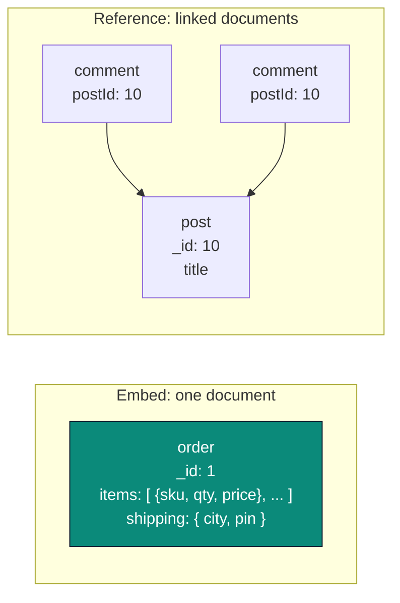

## The problem this solves

A relational database splits data into normalized tables and reassembles it with joins at read time ([[dbms-normalization]]). That is flexible, but a page that shows "an order with its items and shipping address" needs several joins on every view. MongoDB lets you store data **in the shape the application reads it**: one order, one document, one read.

The price is that you must choose that shape up front. Modeling in MongoDB starts from the queries, not from the entities.

## Intuition

| Relational | MongoDB |
| --- | --- |
| database | database |
| table | collection |
| row | document (BSON: JSON plus types such as `ObjectId`, `Date`, `Decimal128`) |
| column | field |
| primary key | `_id` (always indexed, unique) |
| join | embed the data, or `$lookup` at query time |
| fixed schema | flexible; enforce shape in the app (Mongoose) or with schema validation |

Two ways to model a relationship:



## Build it step by step

### Example 1: CRUD basics

```js
db.users.insertOne({ name: 'Asha', email: 'asha@example.com', skills: ['node', 'react'], age: 22 });
db.users.find({ age: { $gte: 21 }, skills: 'react' }, { name: 1, email: 1, _id: 0 }).sort({ name: 1 }).limit(10);
db.users.updateOne({ email: 'asha@example.com' }, { $set: { age: 23 }, $push: { skills: 'mongodb' } });
db.users.deleteOne({ email: 'asha@example.com' });
```

```output
insertOne  -> { acknowledged: true, insertedId: ObjectId('...') }
find       -> [ { name: 'Asha', email: 'asha@example.com' } ]
updateOne  -> { acknowledged: true, matchedCount: 1, modifiedCount: 1 }
deleteOne  -> { acknowledged: true, deletedCount: 1 }
```

A query is a document describing what to match. `skills: 'react'` matches when the array *contains* `'react'`. The second argument to `find` is a **projection**: which fields to return. Update operators (`$set`, `$inc`, `$push`, `$pull`, `$addToSet`) change parts of a document in place and atomically.

### Example 2: embedding, for data that is read together

```js
{
  _id: ObjectId('...'),
  userId: ObjectId('...'),
  status: 'paid',
  items: [
    { productId: ObjectId('...'), name: 'keyboard', price: 250000, qty: 1 },
    { productId: ObjectId('...'), name: 'mouse', price: 69900, qty: 2 }
  ],
  shippingAddress: { line: '12 MG Road', city: 'Jaipur', pin: '302001' },
  total: 389800
}
```

Order items are embedded because an order is always shown with its items, items are never queried on their own, and the list is small and bounded. Notice `name` and `price` are **copied** from the product. That is deliberate: the order must keep the price that was paid even if the product changes later. This is a snapshot, not accidental duplication.

### Example 3: referencing, for data that grows or is shared

```js
// posts collection
{ _id: ObjectId('p1'), title: 'Event loop notes', authorId: ObjectId('u7'), commentCount: 2314 }

// comments collection, the child holds the parent's id
{ _id: ObjectId('c1'), postId: ObjectId('p1'), authorId: ObjectId('u9'), text: 'Great!', createdAt: ISODate('...') }

db.comments.find({ postId: ObjectId('p1') }).sort({ createdAt: -1 }).limit(20);
```

Comments are unbounded, paginated, and sometimes fetched alone (a user's comment history), so they get their own collection with a reference to the post. The reference lives on the **many** side. `commentCount` on the post is a denormalized counter kept up to date with `$inc`, so the list page does not count comments on every view.

### Example 4: the same with Mongoose

```js
const orderSchema = new mongoose.Schema({
  userId: { type: mongoose.Schema.Types.ObjectId, ref: 'User', required: true, index: true },
  status: { type: String, enum: ['pending', 'paid', 'shipped', 'cancelled'], default: 'pending' },
  items: [{ productId: { type: mongoose.Schema.Types.ObjectId, ref: 'Product' }, name: String, price: Number, qty: { type: Number, min: 1 } }],
  total: { type: Number, required: true, min: 0 }
}, { timestamps: true });

const Order = mongoose.model('Order', orderSchema);
const orders = await Order.find({ userId }).populate('userId', 'name email').lean();
```

Mongoose is an ODM (object-document mapper): schemas, validation, defaults and middleware in the application layer. `populate` replaces a referenced id with the document by running **a second query**; it is not a database join. `lean()` returns plain objects instead of full Mongoose documents, which is faster for read-only responses.

## The decision rule

| Ask | Embed | Reference |
| --- | --- | --- |
| Is it read together with the parent almost every time? | yes | no |
| How many children? | few, bounded ("one-to-few") | many or unbounded |
| Is the child queried or updated on its own? | no | yes |
| Is the child shared by several parents (many-to-many)? | no | yes |
| Does it change often and is it copied in many places? | no | yes |

Hard limits that back this up: a document cannot exceed **16 MB**, and an array that grows forever makes every update slower and indexes larger.

!!! why
A single-document read or write is one disk seek and is atomic without a transaction. Embedding turns the most common read into that one operation. Referencing trades that speed for flexibility when the data's size or access pattern does not fit inside the parent.
!!!

!!! key
- "Data that is accessed together should be stored together" is the guiding sentence.
- One-to-few: embed. One-to-many: reference from the child. Many-to-many: array of ids on one or both sides, or a linking collection.
- Operations on a single document are atomic. Many multi-step SQL transactions become one document update when modeled well; when they cannot, see [[mongo-transactions]].
- Schema-flexible does not mean schema-free. Validate with Mongoose or `$jsonSchema`.
- SQL vs NoSQL trade-offs are compared in [[dbms-er-relational]] and [[hld-data]].
!!!

!!! trap
- Unbounded arrays: embedding every comment, log line or follower in the parent.
- Modeling MongoDB like SQL: everything normalized, then `populate` chains three levels deep. That is N+1 queries with extra steps.
- Storing money as a floating-point number. Use integer minor units or `Decimal128` ([[js-values]]).
- Forgetting that duplicated data must be updated everywhere it was copied.
!!!

!!! twist What changes if...
- **...a product has 50,000 reviews but the page shows the latest 5?** Reference all reviews, and also embed the 5 most recent in the product. This is the **subset pattern**.
- **...a list page needs the author's name on each post?** Copy `authorName` into the post (the **extended reference pattern**) and accept updating it on rename, which is rare.
- **...documents of different shapes belong together (card, UPI and wallet payments)?** Store them in one collection with a `type` field. This is the **polymorphic pattern**.
!!!

!!! model
Design the document to be the answer to your most frequent question. Split it only when it grows without limit, is needed alone, or is shared.
!!!

## Practice

?? Model a blog: users, posts, comments, tags. What do you embed and what do you reference?
Users and posts are separate collections; a post holds `authorId` plus a copied `authorName` for list pages. Tags are a small bounded array of strings embedded in the post (and indexed, see [[mongo-indexes]]). Comments are a separate collection with `postId`, because they are unbounded and paginated.
??

?? How do you model "users follow users" at scale?
A `follows` collection of `{ followerId, followeeId, createdAt }` with a unique compound index on the pair and indexes for both directions. Arrays of follower ids inside the user document break at celebrity scale (16 MB, huge updates). Keep `followerCount`/`followingCount` as counters on the user.
??

?? What does `populate` actually do, and when is it a problem?
For the documents returned, it collects the referenced ids and issues one extra `find` with `$in` per populated path, then stitches results in memory. It is fine for one level on a page of results. It becomes slow when nested several levels or applied to large result sets; then embed or duplicate the fields you need, or use an aggregation `$lookup` ([[mongo-aggregation]]).
??

?? When is a relational database the better choice?
When data is highly interconnected and queried in many unpredictable ways, when multi-row integrity constraints (foreign keys, complex transactions) are central, or when reporting needs ad hoc joins. Financial ledgers are the textbook case. MongoDB fits when data is naturally hierarchical, access patterns are known, and schemas vary or evolve.
??

?? What is an `ObjectId`?
A 12-byte id: a 4-byte timestamp, 5 random bytes per process, and a 3-byte counter. It is generated by the client driver without asking the server, is roughly time-ordered, and `getTimestamp()` recovers the creation time.
??
