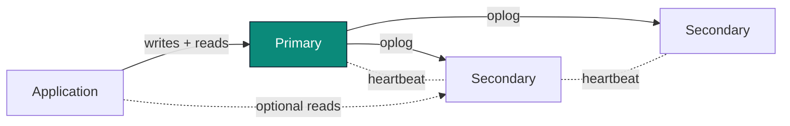
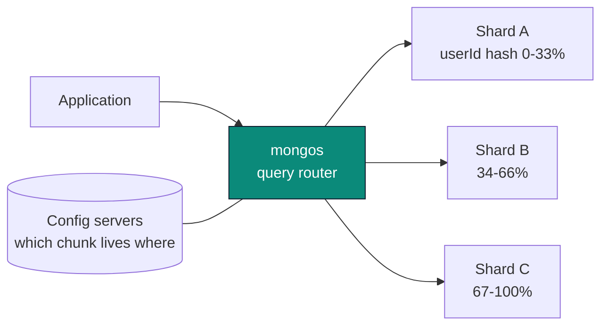

## The problem this solves

Three different failures, three mechanisms.

| Failure | Example | Mechanism |
| --- | --- | --- |
| A multi-step change stops halfway | stock was reduced but the order was never created | **transactions** |
| The database server dies | disk failure at 3 a.m. | **replication** (replica set) |
| Data or write load outgrows one machine | 2 TB of orders | **sharding** |

## Part 1: atomicity, single document first

Every write to **one document** is atomic: it happens completely or not at all, and no reader sees it half done. Much of what needs a transaction in SQL is a single-document update here, if the model is right ([[mongo-modeling]]).

### Example 1: the oversell race, solved without a transaction

Two buyers, one item left. The naive code reads stock, checks it in JavaScript, then writes. Both requests read `stock: 1`, both pass the check, both write, and stock becomes -1.

```js
const result = await Product.updateOne(
  { _id: productId, stock: { $gte: qty } },
  { $inc: { stock: -qty } }
);
if (result.modifiedCount === 0) throw new HttpError(409, 'out of stock');
```

```output
buyer A: { matchedCount: 1, modifiedCount: 1 }   stock 1 -> 0
buyer B: { matchedCount: 0, modifiedCount: 0 }   409 out of stock
```

The check (`stock >= qty`) and the change (`$inc`) are **one atomic operation** inside the database. Whichever request the database applies second no longer matches the filter. This "conditional update" is the most useful concurrency tool in MongoDB.

### Example 2: optimistic concurrency with a version field

```js
const doc = await Doc.findById(id);
const result = await Doc.updateOne(
  { _id: id, version: doc.version },
  { $set: { title: newTitle }, $inc: { version: 1 } }
);
if (result.modifiedCount === 0) throw new HttpError(409, 'document changed, reload and retry');
```

Assume conflicts are rare, do not lock, and detect a conflict at write time by checking that the version you read is still current. The collab editor uses a version number on every document for the same reason.

## Part 2: multi-document transactions

When changes span documents or collections and must all succeed or all fail (create the order **and** reduce stock **and** record the payment), use a transaction.

```js
const session = await mongoose.startSession();
try {
  await session.withTransaction(async () => {
    const updated = await Product.updateOne(
      { _id: productId, stock: { $gte: qty } }, { $inc: { stock: -qty } }, { session });
    if (updated.modifiedCount === 0) throw new HttpError(409, 'out of stock');
    await Order.create([{ userId, items, total, status: 'paid' }], { session });
    await Payment.create([{ orderId, amount: total, idempotencyKey }], { session });
  });
} finally {
  await session.endSession();
}
```

```output
all three writes commit together, or an exception aborts and none of them is visible
```

Every operation must receive the `session`. `withTransaction` commits at the end and automatically retries on transient errors. Transactions require a replica set (or sharded cluster).

ACID, briefly (the full treatment is [[dbms-transactions]]):

| Letter | Meaning | In MongoDB |
| --- | --- | --- |
| Atomicity | all or nothing | single document always; multi-document inside a transaction |
| Consistency | rules hold before and after | schema validation, unique indexes |
| Isolation | concurrent work does not interfere | snapshot isolation inside a transaction |
| Durability | committed data survives a crash | journal + write concern `majority` |

## Part 3: replication

A **replica set** is a group of servers holding the same data: one **primary** takes all writes, the **secondaries** copy them by replaying the primary's operation log (**oplog**).



If the primary stops answering heartbeats, the remaining members hold an **election**, and a secondary with a majority of votes becomes the new primary, usually within seconds. A majority is required so that two halves of a split network cannot both elect a primary. That is why replica sets have an odd number of voting members.

Two settings decide what "saved" means:

| Setting | Options | Trade-off |
| --- | --- | --- |
| **Write concern** | `w: 1` (primary only) vs `w: 'majority'` | `majority` survives a primary failure; `w: 1` is faster but an acknowledged write can be rolled back if the primary dies before replicating |
| **Read preference** | `primary` vs `secondary` / `secondaryPreferred` | secondaries spread read load but may lag, so a user might not see their own latest write |

## Part 4: sharding

Replication copies the same data to more machines. It does not add write capacity or storage. **Sharding** splits the data: each shard (itself a replica set) holds a slice, chosen by a **shard key**.



| Shard key property | Why it matters |
| --- | --- |
| High cardinality | many distinct values, so data can be split finely |
| Even distribution | no single hot shard. A key that only increases (timestamp, ObjectId) sends every insert to the last shard; hash it instead |
| Present in most queries | a query with the shard key goes to one shard; without it, `mongos` asks **every** shard (scatter-gather) |

## The rule, stated precisely

Single-document writes are atomic. Multi-document atomicity requires a session and a transaction. A write is durable against failover only once a majority of replica set members have it. A sharded query is targeted only if it includes the shard key.

!!! key
- First reach for a conditional single-document update; use a transaction when the change truly spans documents.
- Replication is for availability and durability. Sharding is for scale. They are combined, not alternatives.
- With `w: 'majority'` and reads from the primary, MongoDB chooses consistency over availability during a partition (CP in CAP terms, see [[hld-data]]): no majority, no writes.
- Shard only when you must. A good index and a bigger machine go a long way.
!!!

!!! trap
- Read, check in application code, then write: the classic race. Put the condition in the update filter.
- Forgetting `{ session }` on one operation inside a transaction; it silently runs outside the transaction.
- Long transactions: they hold resources and are aborted after 60 seconds by default.
- Reading from secondaries right after a write and showing stale data.
- A monotonically increasing shard key, or one with few distinct values.
!!!

!!! twist What changes if...
- **...the payment provider is an external API?** It cannot join a database transaction. Record the intent, call the provider with an idempotency key ([[rest-api]]), then record the result; reconcile with webhooks. The e-commerce project walks through this.
- **...two transactions touch the same document?** One gets a write conflict and is aborted; `withTransaction` retries it.
- **...you need to react to changes (send a notification when an order is paid)?** **Change streams** read the oplog and push events to your app.
!!!

!!! model
One document: always safe. Several documents: wrap them in a transaction. One server: replicate it. Too big for one server: split it by a key you always query with.
!!!

## Practice

?? Two users book the last seat at the same instant. How do you guarantee only one succeeds?
A conditional update: `updateOne({ _id: seatId, status: 'free' }, { $set: { status: 'booked', userId } })`. The database applies them one after the other; the second finds no document with `status: 'free'` and reports `modifiedCount: 0`. No lock or transaction needed.
??

?? When do you really need a multi-document transaction?
When an invariant spans documents that cannot reasonably be embedded together: transferring balance between two accounts, creating an order while decrementing stock across several products, writing to two collections that must never disagree.
??

?? What happens to a write acknowledged with `w: 1` if the primary crashes one millisecond later?
If it had not yet reached a secondary, the newly elected primary does not have it. When the old primary rejoins, it rolls that write back. With `w: 'majority'` the write is on a majority before acknowledgement, and any new primary must come from that majority.
??

?? Why does a replica set need a majority to elect a primary?
To prevent split brain. If a network partition separates 5 members into groups of 3 and 2, only the group of 3 has a majority and can elect a primary. The group of 2 becomes read-only. Without the majority rule both sides could accept conflicting writes.
??

?? How would you choose a shard key for an `orders` collection?
Queries are almost always "orders for this user", so `userId` targets one shard. Hash it (`{ userId: 'hashed' }`) for even distribution. `createdAt` alone would be a bad key: every new order lands on one shard. A compound key `{ userId: 1, createdAt: 1 }` keeps a user's orders together and ordered.
??

?? Replication lag caused a user to not see the comment they just posted. Fix?
Read your own writes from the primary (at least for a short period after writing), or use causal consistency sessions, or update the UI optimistically ([[react-app-state]]).
??
