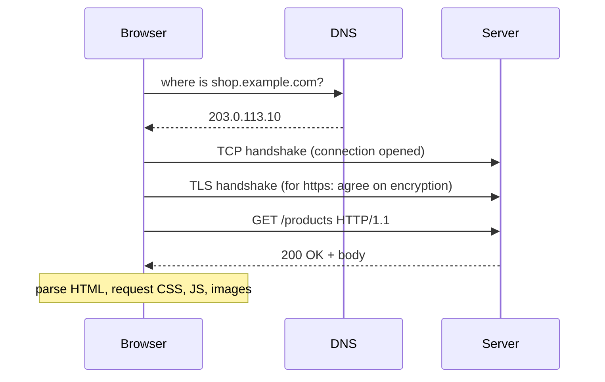

## The problem this solves

Your browser is on your laptop. The data is on a computer somewhere else. They need an agreed way to ask for things and to answer, one that works between any two machines regardless of who built them. That agreement is **HTTP**, the HyperText Transfer Protocol. Every website, mobile app backend and API you will build speaks it.

Two roles:

- A **client** starts the conversation by sending a **request** (a browser, a mobile app, `fetch`, `curl`).
- A **server** waits for requests and sends back a **response**.

The server never speaks first. That one-directional rule is the reason WebSockets exist later ([[websockets]]).

## Step 1: what a request and a response look like

Both are text. Here is a real exchange, printed raw.

```js run
const net = require('net');
const http = require('http');

const server = http.createServer((req, res) => {
  res.writeHead(200, { 'Content-Type': 'application/json' });
  res.end(JSON.stringify({ message: 'hello' }));
});

server.listen(0, () => {
  const socket = net.connect(server.address().port, 'localhost');
  const request = 'GET /greet?name=asha HTTP/1.1\r\nHost: localhost\r\nAccept: application/json\r\nConnection: close\r\n\r\n';
  console.log('--- request sent ---\n' + request.trim());
  let raw = '';
  socket.on('data', chunk => (raw += chunk));
  socket.on('end', () => {
    console.log('\n--- response received ---\n' + raw.replace(/Date: .*\r\n/, 'Date: <now>\r\n').trim());
    server.close();
  });
  socket.write(request);
});
```

This example opens a raw network connection and types the request by hand, to show there is no magic.

| Part | In the request | In the response |
| --- | --- | --- |
| First line | **method**, **path**, version: `GET /greet?name=asha HTTP/1.1` | version, **status code**, reason: `HTTP/1.1 200 OK` |
| Headers | `Name: value` lines describing the request | `Name: value` lines describing the response |
| Blank line | marks the end of the headers | same |
| Body | optional data (for POST, PUT, PATCH) | the content: HTML, JSON, an image |

## Step 2: the URL

```js run
const url = new URL('https://shop.example.com:8443/products/42/reviews?sort=newest&page=2#top');
console.log({
  protocol: url.protocol, hostname: url.hostname, port: url.port,
  pathname: url.pathname, search: url.search, hash: url.hash,
});
console.log(url.searchParams.get('sort'), Number(url.searchParams.get('page')) + 1);
```

| Part | Example | Meaning |
| --- | --- | --- |
| Protocol | `https:` | how to talk (HTTP inside an encrypted connection) |
| Host | `shop.example.com` | which machine; DNS turns the name into an IP address ([[cn-dns-ip]]) |
| Port | `8443` | which program on that machine (default 80 for http, 443 for https) |
| Path | `/products/42/reviews` | which resource |
| Query string | `?sort=newest&page=2` | extra options, as `key=value` pairs |
| Fragment | `#top` | a position in the page; never sent to the server |

Note `page` came back as the string `'2'`. Everything in a URL is text; convert before doing maths ([[js-basics]]).

## Step 3: methods and status codes

The **method** says what the client wants to do.

| Method | Meaning | Has a body? |
| --- | --- | --- |
| GET | read something | no |
| POST | create something / submit data | yes |
| PUT | replace something | yes |
| PATCH | change part of something | yes |
| DELETE | remove something | usually no |

The **status code** is the server's one-number summary of what happened.

| Range | Meaning | Ones to know now |
| --- | --- | --- |
| 2xx | it worked | 200 OK, 201 Created, 204 No Content |
| 3xx | look elsewhere | 301 Moved Permanently, 304 Not Modified |
| 4xx | the **client** made a mistake | 400 Bad Request, 401 Unauthorized, 403 Forbidden, 404 Not Found |
| 5xx | the **server** failed | 500 Internal Server Error, 503 Service Unavailable |

The full conventions for using these well are in [[rest-api]].

## Step 4: a real server with only Node

```js run
const http = require('http');

const notes = [{ id: 1, text: 'learn HTTP' }];

const server = http.createServer((req, res) => {
  const url = new URL(req.url, 'http://localhost');
  const send = (status, data) => {
    res.writeHead(status, { 'Content-Type': 'application/json' });
    res.end(data === undefined ? '' : JSON.stringify(data));
  };

  if (req.method === 'GET' && url.pathname === '/notes') return send(200, notes);

  if (req.method === 'POST' && url.pathname === '/notes') {
    let body = '';
    req.on('data', chunk => (body += chunk));
    req.on('end', () => {
      try {
        const { text } = JSON.parse(body);
        if (!text) return send(400, { error: 'text is required' });
        const note = { id: notes.length + 1, text };
        notes.push(note);
        send(201, note);
      } catch { send(400, { error: 'body must be valid JSON' }); }
    });
    return;
  }
  send(404, { error: `no route for ${req.method} ${url.pathname}` });
});

server.listen(0, async () => {
  const base = `http://localhost:${server.address().port}`;
  const show = async (label, res) => console.log(label.padEnd(22), res.status, await res.text());
  const json = { 'Content-Type': 'application/json' };

  await show('GET /notes', await fetch(base + '/notes'));
  await show('POST valid', await fetch(base + '/notes', { method: 'POST', headers: json, body: JSON.stringify({ text: 'build a server' }) }));
  await show('POST empty object', await fetch(base + '/notes', { method: 'POST', headers: json, body: '{}' }));
  await show('POST broken JSON', await fetch(base + '/notes', { method: 'POST', headers: json, body: '{oops' }));
  await show('GET /notes again', await fetch(base + '/notes'));
  await show('DELETE /unknown', await fetch(base + '/unknown', { method: 'DELETE' }));
  server.close(); server.closeAllConnections();
});
```

**What each piece does.**

- `http.createServer(handler)` calls your function once per request with two objects: `req` (what the client sent) and `res` (what you will send back).
- **Routing** is just `if` statements on `req.method` and the path.
- The request body does not arrive all at once. It arrives in **chunks**, so you collect them on `'data'` events and use the whole thing on `'end'`. The network delivers data in pieces, and Node never blocks waiting for them ([[node-runtime]]).
- `res.writeHead(status, headers)` then `res.end(body)` sends the response. Every code path must end the response exactly once, or the client waits forever.
- `listen(0)` asks the operating system for any free port; a real server uses a fixed one such as 3000.

Every one of these chores (matching routes, collecting and parsing the body, sending JSON) is what Express automates in [[express-first-app]]. Having written them by hand once, you will know what the framework is doing.

## Step 5: headers that matter

```js run
const http = require('http');
const server = http.createServer((req, res) => {
  const wantsJson = (req.headers.accept || '').includes('application/json');
  const lang = (req.headers['accept-language'] || 'en').slice(0, 2);
  const greeting = { en: 'Hello', hi: 'Namaste' }[lang] ?? 'Hello';
  res.writeHead(200, { 'Content-Type': wantsJson ? 'application/json' : 'text/plain; charset=utf-8', 'Cache-Control': 'no-store' });
  res.end(wantsJson ? JSON.stringify({ greeting }) : greeting);
});
server.listen(0, async () => {
  const url = `http://localhost:${server.address().port}`;
  for (const headers of [{}, { Accept: 'application/json' }, { Accept: 'application/json', 'Accept-Language': 'hi-IN' }]) {
    const res = await fetch(url, { headers });
    console.log(JSON.stringify(headers).padEnd(60), '->', res.headers.get('content-type').padEnd(26), await res.text());
  }
  server.close(); server.closeAllConnections();
});
```

Headers are metadata. The same URL returned three different responses because the request headers differed.

| Header | Direction | Says |
| --- | --- | --- |
| `Content-Type` | both | the format of the body: `application/json`, `text/html`, `multipart/form-data` |
| `Accept` | request | which formats the client can handle |
| `Authorization` | request | credentials, such as `Bearer <token>` ([[auth-jwt]]) |
| `Cookie` / `Set-Cookie` | request / response | small values the browser stores and sends back automatically |
| `Cache-Control` | response | whether and how long the response may be reused ([[hld-caching]]) |
| `Location` | response | where to go next (with 201 or a 3xx redirect) |

## Step 6: HTTP is stateless

```js run
const http = require('http');
let requestsSeen = 0;
const server = http.createServer((req, res) => {
  requestsSeen++;
  const name = req.headers['x-name'];
  res.end(name ? `request ${requestsSeen}: hello ${name}` : `request ${requestsSeen}: who are you?`);
});
server.listen(0, async () => {
  const url = `http://localhost:${server.address().port}`;
  console.log(await (await fetch(url, { headers: { 'x-name': 'asha' } })).text());
  console.log(await (await fetch(url)).text());
  server.close(); server.closeAllConnections();
});
```

The server counted both requests but had no idea the second came from the same client. **Each request stands alone**; the protocol remembers nothing between them. So anything the server needs to know (who you are, what is in your cart) must be **sent again with every request**, as a cookie or a token. That single fact is the starting point of authentication ([[auth-jwt]]) and of why servers can be multiplied freely ([[hld-scaling]]).

## What happens before the request: the journey



Name lookup, connection, encryption, then the request you have been studying. Each step is covered in the networks line: [[cn-url-journey]], [[cn-tcp-udp]], [[cn-http]].

!!! key
- Client asks, server answers. Request = method + path + headers + optional body. Response = status + headers + body.
- Know the URL parts by name.
- 2xx success, 3xx redirect, 4xx client's fault, 5xx server's fault.
- HTTP is stateless: identity must travel with each request.
- Bodies arrive in chunks; everything in URLs and headers is text.
- A framework like Express is a convenience over `http.createServer`, not a different thing.
!!!

!!! trap
- Forgetting to end the response in some branch. The client hangs until it times out.
- Sending a response twice (`write after end` errors).
- Returning 200 with `{ error: ... }` in the body. Clients and tools rely on the status code.
- Trusting anything the client sends. Method, path, headers and body are all under the client's control ([[node-validation-security]]).
- Treating `localhost` as reachable by others. It always means "this same machine".
!!!

!!! twist What changes if...
- **...the body is a 2 GB upload?** Collecting chunks into a string would exhaust memory. Pipe the request stream straight to a file or to storage ([[node-runtime]] streams).
- **...the page is on one origin and the API on another?** The browser applies the same-origin policy and the server must opt in with CORS headers ([[node-validation-security]]).
- **...you need the server to push data?** HTTP cannot start a conversation from the server side. Use Server-Sent Events or WebSockets ([[websockets]]).
- **...it is HTTPS?** The same text travels inside an encrypted TLS connection, so nobody in between can read or change it ([[cn-http]]).
!!!

!!! model
A request is a form with four boxes: what you want to do (method), to what (path), with what notes (headers), and what you are handing over (body). The response is the form coming back stamped with a number.
!!!

## Practice

?? What is the difference between a path parameter, a query parameter and a body? When do you use each?
A path parameter identifies *which* resource (`/users/42`). A query parameter adjusts *how* you want it (`?sort=name&page=2`): filters, sorting, pagination. The body carries the *data* for creating or changing something. Rule of thumb: identity in the path, options in the query, content in the body.
??

?? Add a `GET /notes/:id` route to the raw server. What do you return when the id does not exist, and when it is not a number?
Match the path with a pattern, convert the id, then 400 for a malformed id, 404 for a missing note, 200 otherwise.

```js run
const notes = [{ id: 1, text: 'learn HTTP' }];
function route(method, pathname) {
  const match = pathname.match(/^\/notes\/([^/]+)$/);
  if (method !== 'GET' || !match) return [404, { error: 'no such route' }];
  const id = Number(match[1]);
  if (!Number.isInteger(id)) return [400, { error: 'id must be a whole number' }];
  const note = notes.find(n => n.id === id);
  return note ? [200, note] : [404, { error: 'note not found' }];
}
for (const p of ['/notes/1', '/notes/7', '/notes/abc']) console.log(p.padEnd(12), ...route('GET', p).map(x => JSON.stringify(x)));
```
??

?? 401 vs 403 vs 404: a logged-out user requests `/admin`. A logged-in normal user requests `/admin`. A logged-in admin requests `/admin/nothing-here`.
401 (we do not know who you are), 403 (we know who you are and you may not), 404 (you may, but it does not exist).
??

?? Why can't the server simply remember "the last request was from Asha"?
Because requests from many clients interleave on the same server, and the next request from Asha may reach a different server entirely. The protocol carries no link between requests, so the client must present its identity each time.
??

?? What does `Content-Type: application/json` on a request tell the server, and what happens in the raw server if it is missing?
It tells the server how to interpret the body. The raw server above ignores the header and always tries `JSON.parse`, which works by luck. A robust server checks the header and answers `415 Unsupported Media Type` for formats it does not accept. Express's `express.json()` only parses bodies with that content type.
??
