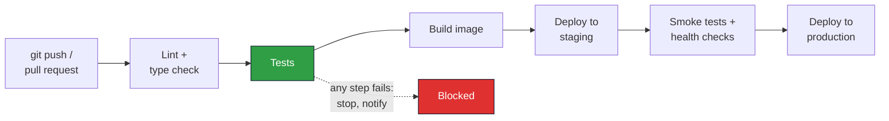

## The problem this solves

On your machine you watch the terminal, restart by hand, and one user (you) is affected by a crash. In production the server runs unattended on someone else's computer, is restarted and replaced by a platform, serves real people, and when it fails at 3 a.m. the only evidence is what it wrote down. Production readiness is a set of habits that answer four questions:

| Question | Answer in this station |
| --- | --- |
| What is it doing, and what went wrong? | structured logging |
| Is it alive and able to serve? | health checks |
| What happens to in-flight requests when it stops? | graceful shutdown |
| How does the same code run identically everywhere, and get there safely? | containers and CI/CD |

## Step 1: structured logs

```js run
function createLogger(base = {}) {
  const write = (level, message, fields = {}) =>
    console.log(JSON.stringify({ time: '<iso timestamp>', level, message, ...base, ...fields }));
  return {
    info: (m, f) => write('info', m, f),
    warn: (m, f) => write('warn', m, f),
    error: (m, f) => write('error', m, f),
    child: extra => createLogger({ ...base, ...extra }),
  };
}

const log = createLogger({ service: 'orders-api' });
log.info('server started', { port: 3000 });

const requestLog = log.child({ requestId: 'req_8f3a', userId: 7 });
requestLog.info('order created', { orderId: 42, totalPaise: 49900 });
requestLog.error('payment failed', { orderId: 42, reason: 'card_declined', provider: 'razorpay' });
```

**Why JSON instead of `console.log('order created ' + id)`.** In production, logs from many servers flow into one searchable system. A JSON line can be filtered by field: "all `error` lines for `requestId` req_8f3a", "payment failures by `provider`". A sentence can only be grepped.

| Practice | Reason |
| --- | --- |
| One JSON object per line, with a level | machines parse it; you filter by severity |
| A **request id** on every line for a request | reconstruct one request's story among thousands; pass the id to other services too |
| Log events and context, not secrets | never passwords, tokens, card numbers or full request bodies |
| Write to stdout | the platform collects it; the app should not manage log files |
| Use a library (`pino`, `winston`) | this hand-made logger is to show the shape |

Levels: `error` (needs attention), `warn` (unexpected but handled), `info` (normal milestones), `debug` (detail, off in production).

## Step 2: health checks

```js run
const express = require('express');
const app = express();

const state = { dbConnected: true, shuttingDown: false };
const db = { ping: async () => { if (!state.dbConnected) throw new Error('db unreachable'); } };

app.get('/healthz', (req, res) => res.json({ status: 'alive' }));
app.get('/readyz', async (req, res) => {
  if (state.shuttingDown) return res.status(503).json({ status: 'shutting down' });
  try { await db.ping(); res.json({ status: 'ready' }); }
  catch { res.status(503).json({ status: 'not ready', reason: 'database' }); }
});

const server = app.listen(0, async () => {
  const check = async label => {
    const base = `http://localhost:${server.address().port}`;
    const [live, ready] = await Promise.all([fetch(base + '/healthz'), fetch(base + '/readyz')]);
    console.log(label.padEnd(22), 'liveness', live.status, '| readiness', ready.status, JSON.stringify(await ready.json()));
  };
  await check('normal');
  state.dbConnected = false; await check('database down');
  state.dbConnected = true; state.shuttingDown = true; await check('shutting down');
  server.close(); server.closeAllConnections();
});
```

| Probe | Asks | If it fails, the platform |
| --- | --- | --- |
| **Liveness** | is the process stuck or dead? | restarts it |
| **Readiness** | can it serve traffic right now? | stops sending it requests, without restarting |

When the database was down, liveness stayed 200: restarting the app would not fix the database. Only readiness failed, so the load balancer routes around this instance ([[hld-scaling]]).

## Step 3: graceful shutdown

Every deploy stops the old version. The platform sends the signal `SIGTERM`, waits some seconds, then kills the process. If you do nothing, requests in progress are cut off mid-response.

```js run
const http = require('http');
const log = (...a) => console.log(...a);

const server = http.createServer((req, res) => {
  setTimeout(() => res.end('finished ' + req.url), 60);
});

async function shutdown(signal) {
  log(`${signal} received: stop accepting new connections`);
  server.close(() => {
    log('all in-flight requests finished');
    log('closing database connections, flushing logs');
    log('exit 0');
  });
  setTimeout(() => { log('timeout: forcing exit'); process.exit(1); }, 5000).unref();
}

server.listen(0, async () => {
  const url = `http://localhost:${server.address().port}`;
  const inFlight = fetch(url + '/slow-order', { headers: { connection: 'close' } }).then(r => r.text());
  await new Promise(r => setTimeout(r, 20));
  shutdown('SIGTERM');
  log('request that was already in progress ->', await inFlight);
  const late = await fetch(url + '/new').then(() => 'accepted', e => 'refused');
  log('request arriving after shutdown began ->', late);
});
```

The sequence: stop accepting new connections, let running requests finish, close resources (database, queue), exit with code 0. A timer forces the exit if something hangs. In a real app this is wired as `process.on('SIGTERM', () => shutdown('SIGTERM'))`. Without it, **every deploy drops requests**.

Workers need the same care: finish or release the current job before exiting ([[hld-messaging]]).

## Step 4: crashes and restarts

```js run
const { spawnSync } = require('child_process');
const script = `
  process.on('uncaughtException', err => { console.log('fatal:', err.message, '-> log it, then exit'); process.exit(1); });
  setTimeout(() => { throw new Error('bug in a timer callback'); }, 10);
  setTimeout(() => console.log('this would run in a corrupted process'), 50);
`;
const r = spawnSync(process.execPath, ['-e', script], { encoding: 'utf8' });
console.log(r.stdout.trim());
console.log('exit code:', r.status, '(the process manager now starts a fresh copy)');
```

After an unexpected error the program's state may be inconsistent, so the safe policy is **log, exit, and let something restart you**: a process manager (PM2, systemd), Docker's restart policy, or the hosting platform. Catching every error and carrying on hides bugs and risks corrupt data ([[js-errors]]). Expected errors (bad input, not found) are different: they are handled per request and never reach this handler.

## Step 5: containers

"It works on my machine" happens because machines differ: Node version, operating system libraries, environment. A **container image** packages your code **with** its runtime and dependencies, so the same image runs identically on a laptop, in CI and in production.

```dockerfile
# --- build stage: install and test with all dependencies ---
FROM node:22-alpine AS build
WORKDIR /app
COPY package.json package-lock.json ./
RUN npm ci
COPY . .
RUN npm test

# --- runtime stage: only what is needed to run ---
FROM node:22-alpine
WORKDIR /app
ENV NODE_ENV=production
COPY package.json package-lock.json ./
RUN npm ci --omit=dev
COPY --from=build /app/src ./src
USER node
EXPOSE 3000
HEALTHCHECK CMD wget -qO- http://localhost:3000/healthz || exit 1
CMD ["node", "src/server.js"]
```

| Line | Why |
| --- | --- |
| `FROM node:22-alpine` | a small base image with a pinned Node version |
| Copy `package*.json` and `npm ci` **before** copying the code | Docker caches each step; dependencies are reinstalled only when the lock file changes, so rebuilds take seconds |
| Two stages | tests and dev dependencies stay in the build stage; the final image is smaller and has less to attack |
| `npm ci --omit=dev` | exact versions, production dependencies only ([[node-essentials]]) |
| `USER node` | do not run as root inside the container |
| `CMD ["node", ...]` | run Node directly so it receives `SIGTERM` (through `npm start`, the signal may not reach your process) |

| Term | Meaning |
| --- | --- |
| Image | the packaged, read-only template |
| Container | a running instance of an image: an isolated process ([[os-processes]]) |
| Registry | where images are stored and pulled from |
| `.dockerignore` | keeps `node_modules`, `.env` and `.git` out of the image |
| Docker Compose | starts several containers together (API, MongoDB, Redis) for local development |

Configuration is **not** baked into the image. The same image is deployed everywhere and receives its settings through environment variables.

## Step 6: CI/CD, from push to production



**Continuous integration (CI)**: every push is automatically installed, linted and tested, so a broken change is caught before it is merged. **Continuous delivery/deployment (CD)**: a change that passes is automatically built and released.

```yaml
name: ci
on: [push, pull_request]
jobs:
  test:
    runs-on: ubuntu-latest
    steps:
      - uses: actions/checkout@v4
      - uses: actions/setup-node@v4
        with: { node-version: 22, cache: npm }
      - run: npm ci
      - run: npm run lint
      - run: npm test
```

That file (a GitHub Actions workflow) is the whole of a basic CI setup. This site uses the simplest form of CD: a push to `main` triggers a deployment on Vercel.

| Release strategy | How | Trade-off |
| --- | --- | --- |
| Rolling | replace instances one at a time | no extra capacity; two versions run together briefly |
| Blue-green | start the full new version beside the old, switch traffic at once | instant rollback; double the resources during the switch |
| Canary | send 5% of traffic to the new version, watch metrics, then increase | limits the blast radius; needs good monitoring |

Because two versions overlap, **database changes must be backward compatible**: add a column or field first, deploy code that uses it, remove the old one later.

## Step 7: knowing it is healthy

| Signal | Examples | Tells you |
| --- | --- | --- |
| **Logs** | the JSON lines from step 1 | what happened in one request |
| **Metrics** | requests per second, error rate, p95 latency, memory, event-loop lag | how the system behaves overall, and trends |
| **Traces** | one request followed across services | where the time went |

The four numbers to watch for any service: **latency, traffic, errors, saturation**. Alert on symptoms users feel (error rate above 1%, p95 above 500 ms), not on every CPU blip. "p95 latency" means 95% of requests were faster than this; averages hide the slow tail.

!!! key
- Structured JSON logs with levels and a request id; never log secrets.
- Liveness vs readiness.
- Graceful shutdown on `SIGTERM`: stop accepting, drain, close, exit.
- On an unexpected exception: log and exit; a supervisor restarts. Do not continue in an unknown state.
- An image bundles code and runtime; config stays outside. Order Dockerfile steps for caching; multi-stage; non-root.
- CI runs lint and tests on every push; CD ships what passes. Know rolling, blue-green and canary.
- The **twelve-factor** ideas in one line: config in the environment, stateless processes, logs to stdout, same build for every environment, fast startup and graceful shutdown.
!!!

!!! trap
- `console.log` of whole objects containing tokens or passwords.
- A health check that calls every dependency: one slow third party makes the platform restart a healthy app in a loop.
- Baking `.env` into the image or committing it.
- `npm install` in the Dockerfile without the lock file, or copying the whole project before installing (cache is busted on every change).
- No resource limits, so one leaking container starves the others ([[js-memory]]).
- Deploying a database migration that the still-running old version cannot handle.
!!!

!!! twist What changes if...
- **...there are many containers on many machines?** An orchestrator such as Kubernetes schedules them, restarts failures, scales on load and performs rolling updates using the probes above.
- **...the app is serverless (functions on Vercel or AWS Lambda)?** The platform runs your handler per request and scales to zero. No server to manage, but: cold starts, no long-lived connections (hard for WebSockets), and database connections must be pooled carefully.
- **...you need zero-downtime with WebSockets?** Long-lived connections are cut when an instance stops; clients must reconnect and catch up ([[websockets]]).
- **...a bad release reaches production?** Roll back to the previous image (keep images tagged by commit) rather than debugging live.
!!!

!!! model
In production nobody is watching, so the service must describe itself (logs, metrics), report its condition (health checks), leave politely (graceful shutdown) and be reproducible (an image built by a pipeline).
!!!

## Practice

?? Walk through what should happen from `SIGTERM` to exit in an Express API with a MongoDB connection and a WebSocket server.
Mark the instance not ready so the load balancer stops routing to it. Call `server.close()` to stop accepting HTTP connections and let in-flight requests finish. Tell WebSocket clients to reconnect and close their sockets. Close the MongoDB connection and flush logs. Exit 0. A timer forces exit if this exceeds the platform's grace period.
??

?? Why copy `package.json` and run `npm ci` before `COPY . .` in a Dockerfile?
Docker caches each instruction and reuses the cache until an input changes. Source code changes on every commit; dependencies rarely do. Installing first means the slow install layer is reused, and only the final copy is redone.
??

?? Liveness passes but readiness fails. What does the platform do, and give a situation where this is the right outcome.
It keeps the process running and removes it from the load balancer's rotation. Right when the app is healthy but cannot serve yet or temporarily: still warming a cache at startup, the database is briefly unreachable, or it is draining during shutdown.
??

?? Your API's average response time is 80 ms but users complain it is slow. What do you look at?
Percentiles. A p95 or p99 of several seconds can hide behind a fine average. Then break it down by route, check event-loop lag for blocking code ([[node-runtime]]), slow database queries ([[mongo-indexes]]) and downstream calls using traces.
??

?? What does a minimal CI pipeline for a Node API do, in order, and why that order?
Check out the code, install with `npm ci`, lint, run unit and integration tests, build the image. Cheapest and fastest checks first so failures are reported early; the image is built only from code that passed.
??
