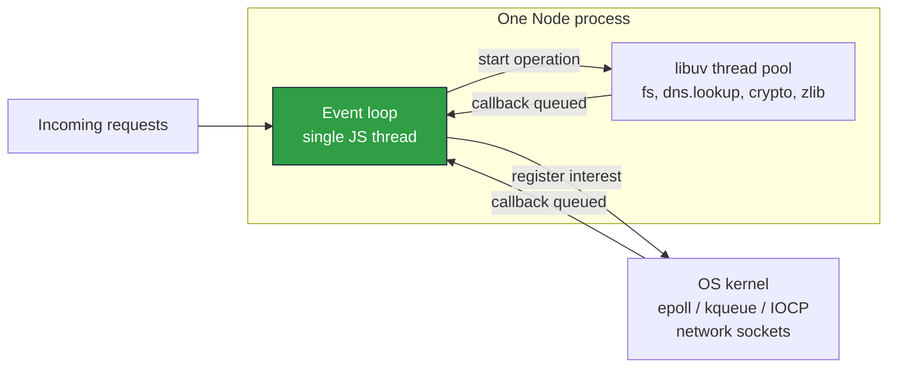
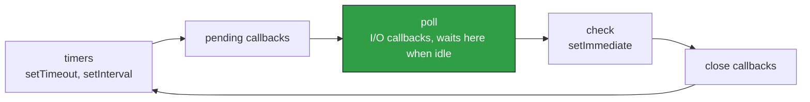

## The problem this solves

A classic server gives each connection its own thread. Ten thousand open connections means ten thousand threads, most of them asleep waiting for a database or a disk, each costing memory and context switches ([[os-processes]]). Web servers spend almost all their time **waiting on I/O**, not computing. Node's design: use one thread for all the JavaScript and never let it wait.

## Intuition

Node has three parts.

| Part | Job |
| --- | --- |
| **V8** | compiles and runs JavaScript, manages the heap and call stack |
| **libuv** | the event loop, plus asynchronous I/O |
| **Node APIs** (`fs`, `http`, `crypto`...) | JavaScript wrappers that hand work to libuv |

libuv gets I/O done in two ways:

- **Network sockets**: asks the operating system to watch them (epoll on Linux, kqueue on macOS, IOCP on Windows). No thread waits per socket.
- **Things the OS cannot do asynchronously**: file system calls, DNS lookup via `dns.lookup`, and CPU-heavy built-ins like `crypto.pbkdf2` and `zlib`. These go to libuv's **thread pool** (4 threads by default, `UV_THREADPOOL_SIZE` to change).



## Build it step by step

### Example 1: non-blocking I/O

```js run
const fs = require('fs');

console.log('1 ask for the file');
fs.readFile(__filename, 'utf8', (err, text) => {
  console.log('3 file arrived,', text.length > 0 ? 'callback runs later' : '');
});
console.log('2 keep going without waiting');
```

`readFile` hands the read to the thread pool and returns at once. The callback is queued when the read completes ([[js-event-loop]]).

### Example 2: the phases of Node's loop

```js run
const fs = require('fs');

fs.readFile(__filename, () => {
  setTimeout(() => console.log('4 timeout    (timers phase, next loop turn)'), 0);
  setImmediate(() => console.log('3 immediate  (check phase, this turn)'));
  Promise.resolve().then(() => console.log('2 promise    (microtask)'));
  process.nextTick(() => console.log('1 nextTick   (before other microtasks)'));
});
```

Each turn of the loop walks through phases, and each phase has its own queue:



Between **every** callback, Node drains the `process.nextTick` queue and then the promise microtask queue. Inside an I/O callback we are in the poll phase, so the check phase (`setImmediate`) comes before the loop wraps around to timers. That is why the order above is fixed.

### Example 3: blocking the loop

```js run
const crypto = require('crypto');
const round = ms => Math.round(ms / 10) * 10;
let ticks = 0;
const heartbeat = setInterval(() => ticks++, 5);

let t = Date.now();
crypto.pbkdf2Sync('secret', 'salt', 300000, 64, 'sha512');
const syncMs = Date.now() - t;
console.log('sync hash: heartbeat ticks while hashing =', ticks);

ticks = 0; t = Date.now();
crypto.pbkdf2('secret', 'salt', 300000, 64, 'sha512', () => {
  console.log('async hash: heartbeat kept running =', ticks > 3);
  clearInterval(heartbeat);
});
```

The synchronous version runs on the main thread, so the heartbeat timer could not fire once. The asynchronous version runs on a pool thread and the loop stays free. In a server, the "heartbeat" is every other user's request.

### Example 4: streams, process data in chunks

```js run
const { Readable, Transform, pipeline } = require('stream');

const source = Readable.from(['id,amount\n', '1,400\n', '2,150\n', '3,900\n']);
let total = 0, chunks = 0;
const sum = new Transform({
  transform(chunk, _enc, done) {
    chunks++;
    for (const line of chunk.toString().split('\n')) { const n = Number(line.split(',')[1]); if (n) total += n; }
    done();
  },
});
pipeline(source, sum, err => console.log(err ? 'failed' : `processed ${chunks} chunks, total = ${total}`));
sum.resume();
```

Reading a 2 GB file with `readFile` needs 2 GB of memory. A stream delivers small chunks, so memory stays flat. `pipeline` connects streams and handles **backpressure**: if the destination is slower than the source, the source is paused instead of buffering without limit.

## The rule, stated precisely

One loop turn: timers, pending callbacks, poll, check, close. After each callback: drain `nextTick` queue, then promise microtasks. Your JavaScript only ever runs on the loop thread; libuv threads never run your callbacks.

!!! why
An idle connection in Node costs a socket and a small object, not a thread with its own stack. That is why one process can hold tens of thousands of open connections, which is what makes it a good fit for [[websockets]].
!!!

!!! key
- "Single-threaded" means your JavaScript. The process has more threads: the libuv pool, V8's garbage collector and compiler threads.
- Good at: I/O-heavy work such as APIs, proxies, real-time. Bad at: CPU-heavy work such as image processing, large JSON parsing or hashing on the main thread.
- Fixes for CPU work: `worker_threads`, a separate service, or a job queue ([[node-scaling]]). The online judge never runs user code in the API process for this reason.
- `require` (CommonJS) is synchronous and cached after the first load; `import` (ES modules) is static and asynchronous.
!!!

!!! trap
- Calling `fs.readFileSync`, `bcrypt.hashSync` or heavy `JSON.parse` inside a request handler.
- Believing the thread pool handles network requests. Sockets use the OS notification mechanism, not the pool.
- A promise rejection nobody handles terminates the process in current Node versions.
- `setTimeout(fn, 0)` vs `setImmediate(fn)` at the top level of a script: the order is not guaranteed. Inside an I/O callback, `setImmediate` is always first.
!!!

!!! twist What changes if...
- **...you have 8 CPU cores?** One Node process uses one for JavaScript. Run one process per core with the `cluster` module or a process manager and put a load balancer in front ([[node-scaling]]).
- **...five file reads are slow together?** The pool has 4 threads; the fifth waits. Raise `UV_THREADPOOL_SIZE` or reduce concurrent disk work.
- **...a recursive `process.nextTick` runs forever?** I/O is starved, just like microtask starvation in [[js-event-loop]].
!!!

!!! model
One fast waiter (the loop) takes every order and never stands at the kitchen door. The kitchen (OS and thread pool) rings a bell when a dish is ready.
!!!

## Practice

?? Why is Node described as single-threaded if it has a thread pool?
All JavaScript executes on one thread, so there is no shared-memory concurrency in your code. The pool only executes native operations (file system, some crypto, compression, `dns.lookup`) and reports back by queuing a callback.
??

?? Predict the order.
```js run
setImmediate(() => console.log('immediate'));
process.nextTick(() => console.log('nextTick'));
Promise.resolve().then(() => console.log('promise'));
console.log('sync');
```

Synchronous code first. Then the `nextTick` queue, then promise microtasks. `setImmediate` waits for the check phase.
??

?? A route computes a report with a loop that takes 3 seconds. What happens to other users and how do you fix it?
Every other request waits 3 seconds, because the loop cannot accept or answer anything while that handler runs. Options: move the work to a worker thread, push a job to a queue and let a separate worker process compute it, cache the result, or chunk the loop and yield with `setImmediate` between chunks.
??

?? What is backpressure?
A fast producer overwhelming a slow consumer. Streams handle it with an internal buffer limit (`highWaterMark`): when `write()` returns `false`, the producer should stop until the `drain` event. `pipe` and `pipeline` do this automatically.
??

?? `process.nextTick` vs `setImmediate`, and why are the names confusing?
`nextTick` runs immediately after the current operation, before the loop continues. `setImmediate` runs in the check phase of the current or next loop turn. So `nextTick` is "more immediate" than `setImmediate`; the names are historically backwards.
??

?? How does Node handle 10,000 simultaneous connections with one thread?
Each connection is a socket registered with the OS. The loop asks the OS "which sockets have data?" and runs a short callback for each ready one. No per-connection thread, no blocking. It works as long as every callback finishes quickly.
??
