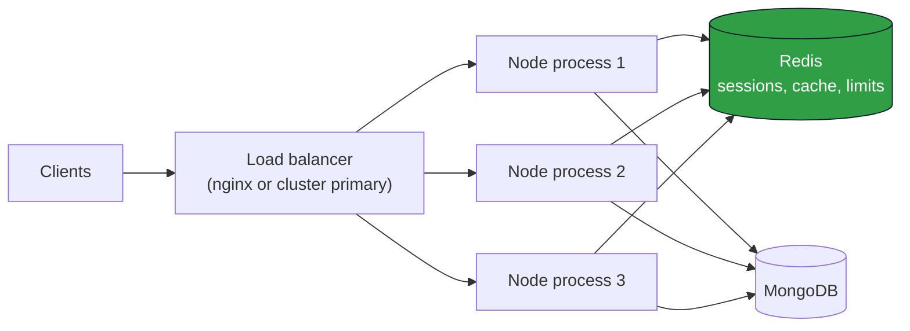
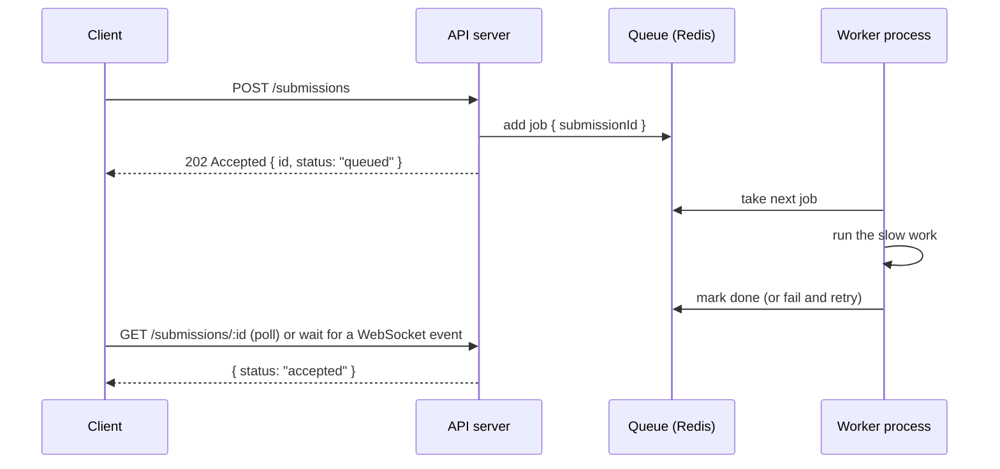

## The problem this solves

From [[node-runtime]]: one event loop, one core, and any slow handler delays everyone. A real service meets four pressures, each with its own tool.

| Pressure | Symptom | Tool |
| --- | --- | --- |
| More requests than one core can serve | CPU at 100% on one core, others idle | more processes: cluster, load balancer |
| Work that takes seconds or minutes | requests time out, loop blocked | background jobs: a queue and workers |
| The same data read again and again | database is the bottleneck | caching |
| One client sending too much | everyone else slows down | rate limiting |

## Tool 1: use every core



The `cluster` module (or a process manager such as PM2, or simply several containers) runs N copies of the app. They share the listening port and connections are distributed between them.

The consequence that matters: **processes do not share memory**. Anything kept in a JavaScript variable (sessions, a cache `Map`, a rate-limit counter, WebSocket rooms) exists separately in each process. Shared state must move out to a store like Redis. This is why "keep the app stateless" ([[rest-api]]) is a scaling rule and not a style preference.

| | `cluster` / multiple processes | `worker_threads` |
| --- | --- | --- |
| Purpose | serve more requests | run CPU-heavy JavaScript off the main thread |
| Memory | separate | separate heaps, can share `SharedArrayBuffer` |
| Use for | scaling an HTTP server across cores | image resize, parsing, hashing, compression |

### Example 1: a worker thread keeps the loop free

```js run
const { Worker, isMainThread, parentPort, workerData } = require('worker_threads');

if (isMainThread) {
  let ticks = 0;
  const heartbeat = setInterval(() => ticks++, 5);
  const worker = new Worker(__filename, { workerData: 40_000_000 });
  worker.on('message', sum => {
    clearInterval(heartbeat);
    console.log('worker result:', sum);
    console.log('main thread stayed responsive:', ticks > 0);
  });
} else {
  let sum = 0;
  for (let i = 0; i < workerData; i++) sum += i % 7;
  parentPort.postMessage(sum);
}
```

## Tool 2: background jobs with a queue

Some work should not happen inside the request at all: sending email, generating a PDF, transcoding video, **running a user's submitted code**. The pattern:



The API answers in milliseconds with `202 Accepted`. Workers are separate processes that can be scaled independently and can crash without taking the API down.

### Example 2: a queue with concurrency and retries

```js run
class JobQueue {
  constructor(handler, { concurrency = 2, attempts = 3 } = {}) {
    Object.assign(this, { handler, concurrency, attempts, waiting: [], active: 0, log: [] });
  }
  add(data) { this.waiting.push({ data, tries: 0 }); this.next(); }
  next() {
    while (this.active < this.concurrency && this.waiting.length) {
      const job = this.waiting.shift();
      this.active++; job.tries++;
      this.handler(job.data)
        .then(() => this.log.push(`${job.data} done on try ${job.tries}`))
        .catch(() => job.tries < this.attempts ? this.waiting.push(job) : this.log.push(`${job.data} moved to dead-letter queue`))
        .finally(() => { this.active--; this.next(); if (!this.active && !this.waiting.length) console.log(this.log.join('\n')); });
    }
  }
}

const failuresLeft = { 'job-B': 1, 'job-C': 99 };
const queue = new JobQueue(async name => {
  await new Promise(r => setTimeout(r, 10));
  if (failuresLeft[name]-- > 0) throw new Error('transient failure');
});
['job-A', 'job-B', 'job-C'].forEach(j => queue.add(j));
```

This is the concurrency-limit pattern from [[js-promises]] plus retries. `job-B` succeeds on its second try. `job-C` always fails, so after 3 attempts it goes to a **dead-letter queue** for a human to inspect instead of retrying forever. A real system uses BullMQ on Redis (or RabbitMQ, SQS, Kafka) so that jobs survive a crash; the ideas are identical and are developed further in [[hld-messaging]].

Because a job may run more than once (a worker can die after doing the work but before acknowledging), handlers must be **idempotent**, the same property as in [[rest-api]].

## Tool 3: caching

Reading from memory takes microseconds; a database query takes milliseconds. If data is read far more often than it changes, keep a copy closer.

### Example 3: cache-aside with expiry

```js run
const cache = new Map();
let dbQueries = 0;
const db = { product: async id => { dbQueries++; await new Promise(r => setTimeout(r, 20)); return { id, name: 'keyboard', price: 250000 }; } };

async function getProduct(id, ttlMs = 50) {
  const hit = cache.get(id);
  if (hit && hit.expires > Date.now()) return { ...hit.value, from: 'cache' };
  const value = await db.product(id);
  cache.set(id, { value, expires: Date.now() + ttlMs });
  return { ...value, from: 'database' };
}
async function updatePrice(id, price) { cache.delete(id); }

(async () => {
  console.log((await getProduct(1)).from);
  console.log((await getProduct(1)).from);
  await updatePrice(1, 199900);
  console.log((await getProduct(1)).from, '(after invalidation)');
  await new Promise(r => setTimeout(r, 60));
  console.log((await getProduct(1)).from, '(after TTL expiry)');
  console.log('database queries:', dbQueries, 'for 4 reads');
})();
```

**Cache-aside**: look in the cache; on a miss read the database and store the result; on a write, update the database and **delete** the cache entry. A TTL (time to live) bounds how long stale data can survive if an invalidation is missed.

| Question | Answer |
| --- | --- |
| Where is the cache? | in Redis, not a process `Map`, so all processes share it |
| What goes wrong: stale data | invalidate on write, keep TTLs short for data that must be fresh |
| What goes wrong: stampede | a hot key expires and 1000 requests all query the database. Fix: one request refills while others wait, or add random jitter to TTLs |
| What should never be cached blindly | per-user data under a shared key; stock and balances at the moment of purchase |

More cache layers (CDN, browser) and eviction policies are in [[hld-caching]].

## Tool 4: rate limiting

### Example 4: a token bucket

```js run
class TokenBucket {
  constructor(capacity, refillPerSec) { Object.assign(this, { capacity, refillPerSec, tokens: capacity, last: Date.now() }); }
  allow(now = Date.now()) {
    this.tokens = Math.min(this.capacity, this.tokens + (now - this.last) / 1000 * this.refillPerSec);
    this.last = now;
    if (this.tokens < 1) return false;
    this.tokens -= 1;
    return true;
  }
}

const bucket = new TokenBucket(5, 2);
const t0 = Date.now();
console.log('burst of 8 at once :', Array.from({ length: 8 }, () => bucket.allow(t0) ? 'ok' : '429').join(' '));
console.log('1 second later     :', Array.from({ length: 3 }, () => bucket.allow(t0 + 1000) ? 'ok' : '429').join(' '));
```

The bucket holds up to 5 tokens and gains 2 per second. Each request spends one. A burst of 5 passes, then the client is held to the refill rate. Rejected requests get `429 Too Many Requests` with `Retry-After`.

| Algorithm | Idea | Trade-off |
| --- | --- | --- |
| Fixed window | count per calendar minute | simple; allows a double burst at the window edge |
| Sliding window | count over the last 60 seconds exactly | accurate; more memory or computation |
| Token bucket | tokens refill at a steady rate, bursts up to capacity | allows short bursts, most common for APIs |
| Leaky bucket | requests drain at a fixed rate | smooths output, bursts wait or drop |

With several processes the counters must be in Redis and updated atomically (`INCR` with expiry, or a Lua script), or each process would grant its own separate allowance.

## The rule, stated precisely

Scale reads with caches and replicas, scale request throughput with stateless processes behind a load balancer, move slow or failure-prone work behind a queue, and protect all of it with limits. Each tool trades simplicity for capacity, and each introduces a consistency question you must be able to answer.

!!! key
- Vertical scaling is a bigger machine. Horizontal scaling is more machines, and requires statelessness.
- The sentence for long tasks: "accept, enqueue, return 202, process in a worker, notify by polling or WebSocket".
- Cache invalidation and "what if the job runs twice" are the follow-up questions. Have answers.
- Graceful shutdown: on `SIGTERM` stop accepting connections, finish in-flight requests, close database connections, then exit. Otherwise every deploy drops requests.
- Database connections are pooled; a request borrows one and returns it. Opening a connection per request does not scale.
!!!

!!! trap
- In-memory sessions, caches or counters in a multi-process deployment.
- Caching without a TTL or an invalidation path.
- Retrying non-idempotent jobs.
- Running user-submitted code, image processing or report generation in the API process.
- Rate limiting by IP alone behind a proxy: every user appears to share the proxy's address unless you read the forwarded header from a trusted proxy.
!!!

!!! twist What changes if...
- **...jobs must run in order per user?** Use one queue partition per key so a key's jobs are processed sequentially while different keys run in parallel.
- **...a worker dies mid-job?** The queue's visibility timeout expires and the job is delivered again. That is "at-least-once" delivery, hence idempotent handlers.
- **...the cache itself goes down?** Fall through to the database with limits in place, or the database is overwhelmed next.
- **...the judge must stop an infinite loop in submitted code?** Run it in a separate sandboxed process or container with CPU time and memory limits, and kill it on timeout ([[os-processes]]).
!!!

!!! model
Keep the request path short and stateless. Everything slow goes to a queue, everything repeated goes to a cache, everything shared goes to a store all processes can reach.
!!!

## Practice

?? Your Node API uses 100% of one core on an 8-core machine. What do you do, in order?
1. Profile to see whether it is real work or a blocking call that should be async. 2. Run one process per core behind a load balancer (cluster, PM2 or containers). 3. Move shared in-memory state to Redis so the processes are interchangeable. 4. If specific endpoints are CPU-heavy, move that work to worker threads or a job queue.
??

?? Design the flow for "export my data as a CSV, it takes 2 minutes".
`POST /exports` creates an export record with status `queued`, enqueues a job and returns 202 with the export id. A worker streams rows from the database to a file in object storage ([[node-runtime]] streams keep memory flat), then sets status `ready` with a download URL. The client polls `GET /exports/:id` or receives a WebSocket or email notification.
??

?? A product page is cached for 10 minutes. The price changes. How do users avoid seeing the old price?
On the write path, update the database and delete (or overwrite) the cache key, so the next read refills it. The TTL is only the safety net. At checkout, never trust the cached price: re-read price and stock from the database inside the order transaction ([[mongo-transactions]]).
??

?? Fixed window vs token bucket: show the fixed-window weakness.
Limit 100 per minute. A client sends 100 requests at 12:00:59 and 100 more at 12:01:00. Both windows allow them, so 200 requests pass in two seconds. A sliding window or token bucket does not allow this.
??

?? Why must job handlers be idempotent, and how do you make "send order confirmation email" idempotent?
Queues deliver at least once: a job can be redelivered after a crash or timeout. Record a marker such as `confirmationSentAt` (or a unique `orderId + type` row) in the same step as sending, check it first, and skip if present.
??

?? cluster vs worker_threads vs child_process?
`cluster`: several copies of the whole server sharing a port, for throughput. `worker_threads`: threads inside one process for CPU-heavy JavaScript, cheap message passing. `child_process`: start any external program (a compiler, `ffmpeg`, a sandbox) as a separate OS process, which is how the online judge runs submissions.
??
