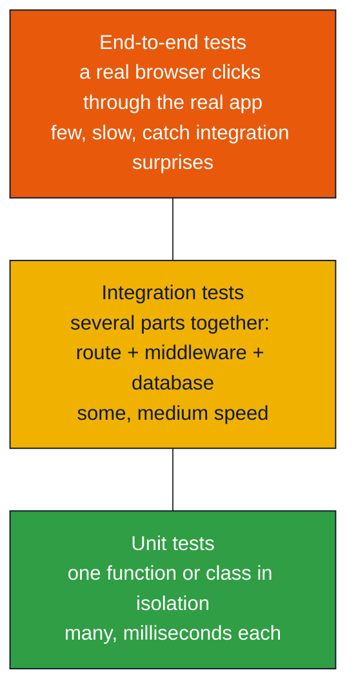

## The problem this solves

You change one line in the discount calculation. Did it break checkout, the cart total, the invoice? Checking by hand means clicking through the app after every change, and you will miss something. A **test** writes that check down once, as code, so it can be repeated by a machine in milliseconds, every time, forever.

Tests give you three things: confidence to change code, a precise description of what the code is supposed to do, and a fast signal when something breaks.

## Step 1: a test is just an assertion

```js run
const assert = require('node:assert/strict');

function applyDiscount(price, percent) {
  if (percent < 0 || percent > 100) throw new RangeError('percent must be between 0 and 100');
  return Math.round(price * (100 - percent) / 100);
}

assert.equal(applyDiscount(1000, 10), 900);
assert.equal(applyDiscount(999, 15), 849);
assert.throws(() => applyDiscount(1000, 150), RangeError);
console.log('3 assertions passed');

try { assert.equal(applyDiscount(1000, 10), 950); }
catch (e) { console.log(e.name + ':', e.message.split('\n').filter(Boolean).slice(0, 3).join(' | ')); }
```

An **assertion** states what must be true and throws if it is not ([[js-errors]]). The last lines show a failing one: the error tells you what was expected and what was received. That is all a test framework is built on.

| Assertion | Checks |
| --- | --- |
| `assert.equal(a, b)` | same value (`===` in strict mode) |
| `assert.deepEqual(a, b)` | same contents, for objects and arrays |
| `assert.ok(value)` | truthy |
| `assert.throws(fn, ErrorType)` | calling `fn` throws |
| `await assert.rejects(promise)` | the promise rejects |

## Step 2: a test runner

A runner finds tests, runs each one separately, and reports which passed. Node has one built in (`node:test`); Jest and Vitest are popular alternatives with the same shape.

```js run
const { describe, it } = require('node:test');
const assert = require('node:assert/strict');

const slugify = text => text.trim().toLowerCase().replace(/[^a-z0-9]+/g, '-').replace(/^-|-$/g, '');

describe('slugify', () => {
  it('lowercases and joins words with hyphens', () => { assert.equal(slugify('Hello World'), 'hello-world'); });
  it('removes punctuation', () => { assert.equal(slugify("What's new, in Node?"), 'what-s-new-in-node'); });
  it('trims hyphens from the ends', () => { assert.equal(slugify('  --Hi--  '), 'hi'); });
  it('returns an empty string for empty input', () => { assert.equal(slugify(''), ''); });
});
```

`describe` groups tests; `it` (or `test`) is one test with a name that reads as a sentence. Run every test file in a project with `node --test`. The numbers after each line are how long it took.

**Structure of a good test: Arrange, Act, Assert.** Set up the inputs, call the thing, check the result. One behaviour per test, named after the behaviour, so a failure message tells you what broke without reading the code.

## Step 3: what to test, the edges

```js run
const { test } = require('node:test');
const assert = require('node:assert/strict');

function paginate(items, page = 1, pageSize = 10) {
  if (!Number.isInteger(page) || page < 1) throw new RangeError('page must be a positive whole number');
  const start = (page - 1) * pageSize;
  return { items: items.slice(start, start + pageSize), page, totalPages: Math.max(1, Math.ceil(items.length / pageSize)) };
}
const list = n => Array.from({ length: n }, (_, i) => i + 1);

test('typical: second page of 25 items', () => assert.deepEqual(paginate(list(25), 2).items, list(20).slice(10)));
test('boundary: last page is partly full', () => assert.deepEqual(paginate(list(25), 3).items, [21, 22, 23, 24, 25]));
test('boundary: exactly one full page', () => assert.equal(paginate(list(10)).totalPages, 1));
test('empty: no items still gives one page', () => assert.deepEqual(paginate([]), { items: [], page: 1, totalPages: 1 }));
test('beyond the end: empty items, no error', () => assert.deepEqual(paginate(list(5), 9).items, []));
test('invalid: page 0 throws', () => assert.throws(() => paginate(list(5), 0), RangeError));
```

One "happy path" test proves little. Bugs live at the edges, so for any function ask:

| Category | Examples |
| --- | --- |
| Typical | a normal input |
| Boundaries | first, last, exactly at a limit, one over |
| Empty | `[]`, `''`, `0`, `null`, missing |
| Invalid | wrong type, negative, too large |
| Error path | what should it throw or return? |

## Step 4: the test pyramid



| | Unit | Integration | End-to-end |
| --- | --- | --- | --- |
| Tests | one function, no I/O | an API route through to a (test) database | the whole product from the user's side |
| Speed | milliseconds | tens to hundreds of ms | seconds |
| When it fails you know | exactly which function | which request | only that something is broken |
| Tools | `node:test`, Jest, Vitest | the same plus `supertest` or `fetch` | Playwright, Cypress |

Many fast unit tests at the base, fewer integration tests, a handful of end-to-end tests for the critical journeys (sign up, checkout).

## Step 5: an integration test of an API

This is why [[express-first-app]] split `app.js` from the file that listens: a test can import the app and start it on a throwaway port.

```js file=tasks-app.js
const express = require('express');

function createApp() {
  const app = express();
  app.use(express.json());
  const tasks = [];
  app.get('/tasks', (req, res) => res.json(tasks));
  app.post('/tasks', (req, res) => {
    const title = req.body?.title?.trim();
    if (!title) return res.status(400).json({ error: 'title is required' });
    const task = { id: tasks.length + 1, title, done: false };
    tasks.push(task);
    res.status(201).json(task);
  });
  return app;
}
module.exports = { createApp };
```

```js run
const { describe, it, beforeEach, afterEach } = require('node:test');
const assert = require('node:assert/strict');
const { createApp } = require('./tasks-app');

describe('tasks API', () => {
  let server, base;
  beforeEach(async () => {
    server = createApp().listen(0);
    await new Promise(resolve => server.once('listening', resolve));
    base = `http://localhost:${server.address().port}`;
  });
  afterEach(() => { server.close(); server.closeAllConnections(); });

  const post = body => fetch(base + '/tasks', { method: 'POST', headers: { 'content-type': 'application/json' }, body: JSON.stringify(body) });

  it('creates a task and returns 201 with the new task', async () => {
    const res = await post({ title: '  write tests  ' });
    assert.equal(res.status, 201);
    assert.deepEqual(await res.json(), { id: 1, title: 'write tests', done: false });
  });
  it('rejects a missing title with 400', async () => {
    const res = await post({});
    assert.equal(res.status, 400);
    assert.match((await res.json()).error, /title/);
  });
  it('lists created tasks', async () => {
    await post({ title: 'one' }); await post({ title: 'two' });
    const tasks = await (await fetch(base + '/tasks')).json();
    assert.deepEqual(tasks.map(t => t.title), ['one', 'two']);
  });
  it('starts empty: tests do not leak into each other', async () => {
    assert.deepEqual(await (await fetch(base + '/tasks')).json(), []);
  });
});
```

Each test makes real HTTP requests and checks status and body, exercising routing, body parsing and the handler together. `beforeEach` builds a **fresh app for every test**, which is why the last test sees an empty list even though earlier tests created tasks. Tests must be independent: any order, any subset, same result. Libraries like `supertest` shorten the request code; the idea is the same.

## Step 6: test doubles, replacing what you do not control

A unit test should not send real email, charge a real card or depend on the clock. Replace those dependencies with stand-ins.

```js run
const { test, mock } = require('node:test');
const assert = require('node:assert/strict');

function createOrderService({ payments, mailer, now = () => new Date() }) {
  return {
    async checkout(user, cart) {
      const total = cart.reduce((sum, item) => sum + item.price * item.qty, 0);
      if (total === 0) throw new Error('cart is empty');
      const receipt = await payments.charge(user.id, total);
      await mailer.send(user.email, `Paid ${total} on ${now().toISOString().slice(0, 10)}`);
      return { total, receiptId: receipt.id };
    },
  };
}

test('checkout charges the total and emails a receipt', async () => {
  const payments = { charge: mock.fn(async () => ({ id: 'rcpt_1' })) };
  const mailer = { send: mock.fn(async () => {}) };
  const service = createOrderService({ payments, mailer, now: () => new Date('2026-01-15T10:00:00Z') });

  const result = await service.checkout({ id: 7, email: 'asha@example.com' }, [{ price: 500, qty: 2 }, { price: 250, qty: 1 }]);

  assert.deepEqual(result, { total: 1250, receiptId: 'rcpt_1' });
  assert.deepEqual(payments.charge.mock.calls[0].arguments, [7, 1250]);
  assert.deepEqual(mailer.send.mock.calls[0].arguments, ['asha@example.com', 'Paid 1250 on 2026-01-15']);
});

test('checkout does not email when payment fails', async () => {
  const payments = { charge: mock.fn(async () => { throw new Error('card declined'); }) };
  const mailer = { send: mock.fn(async () => {}) };
  const service = createOrderService({ payments, mailer });

  await assert.rejects(service.checkout({ id: 7, email: 'a@b.c' }, [{ price: 100, qty: 1 }]), /card declined/);
  assert.equal(mailer.send.mock.callCount(), 0);
});

test('an empty cart is rejected before charging', async () => {
  const payments = { charge: mock.fn() };
  const service = createOrderService({ payments, mailer: { send: mock.fn() } });
  await assert.rejects(service.checkout({ id: 7 }, []), /cart is empty/);
  assert.equal(payments.charge.mock.callCount(), 0);
});
```

| Double | What it is | Use |
| --- | --- | --- |
| **Stub** | returns a fixed answer | "the payment succeeds" |
| **Mock / spy** | records how it was called | "was the email sent, with what?" |
| **Fake** | a simple working implementation | an in-memory repository instead of MongoDB |

**Why this was easy.** `createOrderService` **receives** its dependencies as arguments instead of importing them. That is **dependency injection**, and it is the single habit that makes code testable. The same design principle appears as dependency inversion in [[oop-solid]] and as the reason to avoid hard-coded singletons in [[lld-creational]]. Even the clock is injected (`now`), so the date in the assertion is fixed.

## Step 7: test-driven development in one cycle

**Red, green, refactor**: write a failing test first, write the simplest code that passes, then clean up with the test as a safety net.

```js run
const assert = require('node:assert/strict');
const attempt = (label, fn) => { try { fn(); console.log('PASS', label); } catch (e) { console.log('FAIL', label, '->', e.message.split('\n')[0]); } };

let isStrongPassword = () => false;
const spec = () => {
  assert.equal(isStrongPassword('short1A'), false, 'under 8 characters is weak');
  assert.equal(isStrongPassword('alllowercase1'), false, 'needs an uppercase letter');
  assert.equal(isStrongPassword('NoDigitsHere'), false, 'needs a digit');
  assert.equal(isStrongPassword('Correct1Horse'), true, 'long, mixed case, digit is strong');
};
attempt('red  : test written first, no implementation', spec);

isStrongPassword = p => p.length >= 8 && /[A-Z]/.test(p) && /[a-z]/.test(p) && /\d/.test(p);
attempt('green: simplest implementation', spec);
```

Writing the test first forces you to decide what the function should do before how, and guarantees the test can fail (a test that cannot fail checks nothing).

!!! key
- A test = arrange, act, assert. Name it after the behaviour.
- Unit (isolated, fast), integration (parts together), end-to-end (whole system). Many, some, few.
- Test the edges: boundaries, empty, invalid, error paths.
- Tests must be independent and repeatable: fresh state each time, no reliance on order, time or network.
- Inject dependencies so they can be replaced with stubs, mocks and fakes.
- **Coverage** (the percentage of lines executed by tests) shows what is untested; high coverage does not prove the assertions are good.
- Tests run automatically on every push in CI ([[node-production]]).
!!!

!!! trap
- Testing implementation details (private functions, exact call order) so every refactor breaks tests. Test observable behaviour.
- Over-mocking: a test where everything is fake proves only that the mocks agree with themselves.
- Shared state between tests, giving failures that appear only when tests run together.
- Tests that depend on the real time, random values or an external API: they fail randomly ("flaky").
- Forgetting `await` on an async assertion, so the test passes before the check runs.
- Asserting nothing. A test that only calls the code passes as long as it does not throw.
!!!

!!! twist What changes if...
- **...the code talks to MongoDB?** Unit-test services against an in-memory fake repository; integration-test against a real test database (a local instance or `mongodb-memory-server`), cleaned between tests.
- **...the code uses timers (debounce, retry with delay)?** Use the runner's fake timers (`mock.timers`) to advance time instantly instead of waiting.
- **...you inherit code with no tests?** Before changing a part, write tests that pin down its current behaviour, then change it.
- **...it is the frontend?** Same pyramid: React Testing Library for components, Playwright for end-to-end.
!!!

!!! model
A test is a recorded expectation: "given this, I expect that". The more of your intent is recorded, the more freely you can change the code without fear.
!!!

## Practice

?? Write tests for `function average(numbers)`. Which cases matter?
Typical (`[2, 4, 6]` gives 4), single item, decimals, negative numbers, and the empty array, which forces a decision: return `0`, return `NaN`, or throw? The test documents the decision.

```js run
const assert = require('node:assert/strict');
const average = nums => { if (!nums.length) throw new RangeError('cannot average an empty list'); return nums.reduce((a, b) => a + b, 0) / nums.length; };
assert.equal(average([2, 4, 6]), 4); assert.equal(average([5]), 5); assert.equal(average([-1, 1]), 0);
assert.throws(() => average([]), RangeError);
console.log('all average() cases pass');
```
??

?? What is the difference between a mock and a stub?
A stub supplies a canned answer so the code under test can proceed ("charge returns a receipt"). A mock also records its calls so the test can verify an interaction happened ("send was called once with this address"). Many libraries provide one object that does both.
??

?? Your test passes alone and fails when the whole suite runs. What are the likely causes?
Shared state: a module-level variable, a database or file not reset, a mock not restored, a port or environment variable left changed by another test. Fix with fresh setup in `beforeEach` and cleanup in `afterEach`.
??

?? Why is `function sendWelcome(user) { emailClient.send(...) }` hard to test, and how do you fix it?
It reaches out to a global `emailClient`, so a test would send real email or need to patch the module. Pass the client in (`createWelcomeService({ emailClient })` or as a parameter) and give the test a fake.
??

?? Is 100% code coverage a good goal?
It is a useful signal of what is not exercised, but a poor target. Lines can be executed without any meaningful assertion, and chasing the last few percent produces brittle tests of trivial code. Aim for strong tests of the logic and the critical paths; use coverage to find gaps.
??
