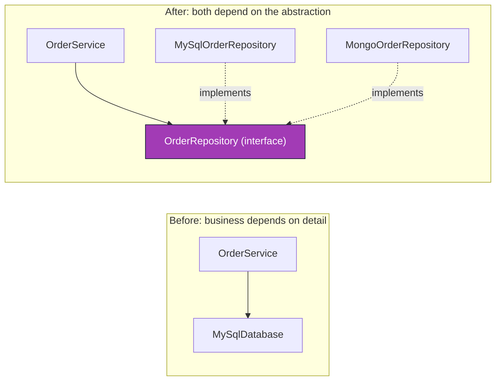

## The problem this solves

Code is written once and changed for years. Most of the cost of software is in the changes: a new payment method, a new report format, a rule that works differently for premium users. Badly structured code makes every change risky, because touching one thing breaks another.

**SOLID** is five principles for structuring classes so that a change stays local. They are the vocabulary interviewers expect when you defend a design in a low-level design round ([[lld-case-studies]]).

| Letter | Principle | One sentence |
| --- | --- | --- |
| **S** | Single responsibility | a class should have one reason to change |
| **O** | Open/closed | add behaviour by adding code, not by editing existing code |
| **L** | Liskov substitution | a subclass must work wherever its parent is expected |
| **I** | Interface segregation | do not force a class to depend on methods it does not use |
| **D** | Dependency inversion | depend on abstractions, not on concrete details |

## S: single responsibility

**A class should have only one reason to change.** A "reason to change" is a kind of requirement, usually coming from one group of people.

```js run
class InvoiceBad {
  constructor(items) { this.items = items; }
  total() { return this.items.reduce((sum, i) => sum + i.price * i.qty, 0); }
  toHtml() { return `<h1>Invoice</h1><p>Total: ${this.total()}</p>`; }
  saveToDatabase(db) { db.push({ items: this.items, total: this.total() }); }
  emailTo(address) { return `sent to ${address}`; }
}
const reasons = ['tax rules change (finance)', 'layout changes (design)', 'database changes (infrastructure)', 'email provider changes (operations)'];
console.log('InvoiceBad must be edited when:', reasons.length, 'different things change');

class Invoice {
  constructor(items) { this.items = items; }
  total() { return this.items.reduce((sum, i) => sum + i.price * i.qty, 0); }
}
class InvoiceHtmlRenderer { render(invoice) { return `<h1>Invoice</h1><p>Total: ${invoice.total()}</p>`; } }
class InvoiceRepository { constructor(db) { this.db = db; } save(invoice) { this.db.push({ items: invoice.items, total: invoice.total() }); } }

const invoice = new Invoice([{ price: 500, qty: 2 }, { price: 250, qty: 1 }]);
const db = [];
new InvoiceRepository(db).save(invoice);
console.log(new InvoiceHtmlRenderer().render(invoice), '| saved rows:', db.length);
```

The first class mixes calculation, presentation, storage and delivery. A change to the HTML risks breaking the tax calculation, because they share a file and a test suite. After the split, each class changes for one reason, and a new output format (PDF) is a new renderer that touches nothing else.

**How to spot a violation.** The class is described with "and" ("calculates totals **and** renders HTML **and** saves"); it has many unrelated imports; names like `Manager`, `Helper`, `Utils`; it is long. This is the same reason backend code is split into controllers, services and repositories ([[express-middleware]]).

**Do not overdo it.** One responsibility does not mean one method. Splitting until every class has a single function scatters logic and makes code harder to follow.

## O: open/closed

**Open for extension, closed for modification.** You should be able to add a new variation without editing code that already works.

```js run
function areaBad(shape) {
  if (shape.type === 'circle') return Math.PI * shape.r ** 2;
  if (shape.type === 'rect') return shape.w * shape.h;
  throw new Error('unknown shape: ' + shape.type);
}
try { areaBad({ type: 'triangle', b: 4, h: 3 }); } catch (e) { console.log('adding a triangle means editing areaBad:', e.message); }

class Circle { constructor(r) { this.r = r; } area() { return Math.PI * this.r ** 2; } }
class Rect { constructor(w, h) { this.w = w; this.h = h; } area() { return this.w * this.h; } }
const totalArea = shapes => shapes.reduce((sum, s) => sum + s.area(), 0);

class Triangle { constructor(b, h) { this.b = b; this.h = h; } area() { return this.b * this.h / 2; } }
console.log('total area:', totalArea([new Circle(1), new Rect(2, 3), new Triangle(4, 3)]).toFixed(2), '<- Triangle added, totalArea untouched');
```

`areaBad` must be opened and edited for every new shape, and so must every other function that switches on `type` (perimeter, draw, export). With polymorphism ([[oop-pillars]]), a new shape is a new class and existing, tested code is not touched.

**The mechanism** is always the same: find what varies, put it behind an interface, and let new variants be new implementations. That is what Strategy, Factory, Decorator and Observer do ([[lld-creational]], [[lld-structural]], [[lld-behavioral]]). Express middleware and plugins are the principle in a framework: you extend the server without editing Express ([[express-middleware]]).

**Apply it where change is likely.** Abstracting everything "in case" produces needless layers. Make a point extensible when you have seen it vary, or the requirements say it will.

## L: Liskov substitution

**Wherever code expects a parent type, any subclass must work without that code knowing the difference.** A subclass may add behaviour; it must not break promises the parent makes.

```js run
class Rectangle {
  constructor(w, h) { this.w = w; this.h = h; }
  setWidth(w) { this.w = w; }
  setHeight(h) { this.h = h; }
  area() { return this.w * this.h; }
}
class Square extends Rectangle {
  setWidth(w) { this.w = w; this.h = w; }
  setHeight(h) { this.w = h; this.h = h; }
}
function stretch(rect) {
  rect.setWidth(5);
  rect.setHeight(4);
  return rect.area();
}
console.log('Rectangle:', stretch(new Rectangle(1, 1)), '(expected 20)');
console.log('Square   :', stretch(new Square(1, 1)), '(expected 20, the caller is now wrong)');
```

In mathematics a square is a rectangle. In code, `Rectangle` promises that width and height can be set independently, and `Square` cannot keep that promise. Code written correctly for `Rectangle` silently gives the wrong answer for a `Square`. "Is a" in the real world is not enough; the question is **"can it be substituted?"**

| A subclass violates Liskov when it... | Example |
| --- | --- |
| throws for an operation the parent supports | `Penguin.fly()` throwing ([[oop-composition]]) |
| ignores or does nothing in an overridden method | `ReadOnlyFile.write()` that silently drops data |
| demands more than the parent (stricter inputs) | parent accepts any number, child rejects negatives |
| delivers less than the parent (weaker results) | parent guarantees a sorted list, child returns unsorted |
| makes callers check its type | `if (shape instanceof Square) ...` |

**The fix** is to change the hierarchy so nobody makes a false promise: make `Square` and `Rectangle` siblings under `Shape` (which only promises `area()`), make them immutable, or use composition.

## I: interface segregation

**Clients should not be forced to depend on methods they do not use.** Prefer several small, focused interfaces to one large one.

```js run
class OfficeMachine {
  print() { throw new Error('not supported'); }
  scan() { throw new Error('not supported'); }
  fax() { throw new Error('not supported'); }
}
class BasicPrinter extends OfficeMachine { print(doc) { return `printed ${doc}`; } }
function digitize(machine, doc) { try { return machine.scan(doc); } catch (e) { return 'CRASH: scan ' + e.message; } }
console.log('fat interface  :', digitize(new BasicPrinter(), 'contract'));

const printer = { print: doc => `printed ${doc}` };
const scanner = { scan: doc => `scanned ${doc}` };
const multiFunction = { ...printer, ...scanner, fax: doc => `faxed ${doc}` };
const canScan = m => typeof m.scan === 'function';
console.log('small interfaces:', [printer, scanner, multiFunction].filter(canScan).map(m => m.scan('contract')));
```

The fat `OfficeMachine` interface forces a basic printer to "implement" scanning and faxing by throwing, which is also a Liskov violation. With small interfaces (`Printable`, `Scannable`, `Faxable`), a class implements only what it can do, and a function that needs scanning asks for a scanner and can never be handed a plain printer.

In Java: `class BasicPrinter implements Printable` and `class MultiFunction implements Printable, Scannable, Faxable`. The same idea appears in API design: a function that takes a giant options object or a whole `user` when it needs only an email is depending on more than it uses.

## D: dependency inversion

**High-level code (business rules) should not depend on low-level code (databases, email, HTTP). Both should depend on an abstraction.**

```js run
class MySqlDatabase { insert(table, row) { return `INSERT INTO ${table}: ${JSON.stringify(row)}`; } }

class OrderServiceBad {
  constructor() { this.db = new MySqlDatabase(); }
  place(order) { return this.db.insert('orders', order); }
}
console.log('hard-wired :', new OrderServiceBad().place({ id: 1 }));

class OrderService {
  constructor(orderRepository, notifier) { this.orders = orderRepository; this.notifier = notifier; }
  place(order) {
    if (order.total <= 0) throw new Error('order total must be positive');
    this.orders.save(order);
    this.notifier.notify(order.customer, `Order ${order.id} placed`);
    return 'placed';
  }
}

const saved = [], sent = [];
const fakeRepository = { save: o => saved.push(o) };
const fakeNotifier = { notify: (to, msg) => sent.push(`${to}: ${msg}`) };
const service = new OrderService(fakeRepository, fakeNotifier);
console.log('inverted   :', service.place({ id: 7, total: 499, customer: 'asha' }), '| saved:', saved.length, '| notified:', sent[0]);

const mongoRepository = { save: o => `db.orders.insertOne(${JSON.stringify(o)})` };
console.log('swap the database without touching OrderService:', typeof new OrderService(mongoRepository, fakeNotifier).place);
```

`OrderServiceBad` creates its own MySQL database. It cannot be tested without MySQL and cannot switch to MongoDB without being edited. The good version declares what it needs, "something with `save`" and "something with `notify`", and receives them.



The "inversion": the arrow from the low-level class now points **up** to an interface owned by the business layer. The important code no longer knows the unimportant details exist.

| Term | Meaning |
| --- | --- |
| Dependency inversion **principle** | depend on abstractions (the design rule) |
| Dependency **injection** | pass dependencies in from outside (the technique that achieves it, [[oop-composition]]) |
| Inversion of control **container** | a framework that creates and wires objects for you (Spring, NestJS) |

This is why the service in [[node-testing]] could be tested with mocks, and why [[mongoose]] models are hidden behind services.

## How the five fit together

| Symptom in code | Principle to apply |
| --- | --- |
| a class that does everything; changes collide | S |
| `if/else` or `switch` on a type, edited for each new case | O |
| a subclass that throws "not supported" or needs `instanceof` checks | L |
| implementing methods you do not need; huge interfaces | I |
| `new ConcreteThing()` inside business logic; untestable code | D |

They reinforce each other. Small classes (S) with small interfaces (I), depended on through abstractions (D), are what make extension without modification (O) possible, and that only works if implementations are truly interchangeable (L).

## A complete before and after

```js run
class ReportBad {
  generate(type, data) {
    let out;
    if (type === 'csv') out = data.map(r => Object.values(r).join(',')).join('\n');
    else if (type === 'json') out = JSON.stringify(data);
    else throw new Error('unsupported format');
    require('fs').writeFileSync(require('os').tmpdir() + '/report-' + process.pid + '.' + type, out);
    return 'written to disk';
  }
}

const csvFormatter = { extension: 'csv', format: rows => rows.map(r => Object.values(r).join(',')).join('\n') };
const jsonFormatter = { extension: 'json', format: rows => JSON.stringify(rows) };
class ReportGenerator {
  constructor(formatter, destination) { this.formatter = formatter; this.destination = destination; }
  generate(data) { return this.destination.write(`report.${this.formatter.extension}`, this.formatter.format(data)); }
}

const memory = { files: {}, write(name, content) { this.files[name] = content; return `stored ${name} (${content.length} chars)`; } };
const data = [{ name: 'Asha', score: 91 }, { name: 'Ravi', score: 84 }];
console.log(new ReportGenerator(csvFormatter, memory).generate(data));
console.log(new ReportGenerator(jsonFormatter, memory).generate(data));

const markdownFormatter = { extension: 'md', format: rows => rows.map(r => `- ${r.name}: ${r.score}`).join('\n') };
console.log(new ReportGenerator(markdownFormatter, memory).generate(data), '<- new format, no existing code edited');
console.log(memory.files['report.md']);
```

`ReportBad` formats and writes (S), must be edited for each format (O), and is welded to the file system (D). The fixed version has a formatter per format, a destination that can be memory, disk or cloud storage, and a generator that only coordinates.

!!! key
- Be able to state each principle in one sentence, show a violation, and fix it.
- S: one reason to change. O: extend by adding. L: subclasses must be substitutable. I: small interfaces. D: depend on abstractions.
- Liskov is about **behaviour**, not about "is a" in the real world: the square and rectangle example.
- Dependency inversion (principle) vs dependency injection (technique).
- SOLID is a means, not a goal: use it where the code changes and where the pain is.
!!!

!!! trap
- Reciting the names without an example.
- Applying all five everywhere, producing dozens of one-method classes and interfaces with a single implementation.
- "Single responsibility" read as "one method per class".
- Fixing an O violation with a factory that contains the same `switch`. Use a registry or polymorphism so adding a type edits nothing ([[lld-creational]]).
- An interface that mirrors one concrete class exactly: that is not an abstraction, it is a copy.
!!!

!!! twist What changes if...
- **...you are asked for other principles?** **DRY** (do not repeat yourself: one source of truth for each piece of knowledge), **KISS** (keep it simple), **YAGNI** (you aren't gonna need it: do not build for imagined requirements), and the **Law of Demeter** (talk only to your direct collaborators; avoid `a.b().c().d()`).
- **...the code is functional, not class-based?** The principles still apply to modules and functions: small focused functions, behaviour passed in as functions, dependencies as parameters ([[js-functional]]).
- **...you are in an LLD interview?** Use the principles as the reason for each choice: "pricing is behind a strategy interface so new rules do not modify the lot (O), and the lot receives it through the constructor (D)" ([[lld-case-studies]]).
!!!

!!! model
Imagine the next change request. Good structure means that request touches one class, usually by adding a new one, and nothing else needs to be re-tested.
!!!

## Practice

?? Which principles does this violate? `class UserService { register(u) { /* validate */ /* hash password */ new MySQL().insert(u); new SmtpClient().send(u.email, 'Welcome'); } }`
Single responsibility (validation, hashing, persistence and email in one method) and dependency inversion (it constructs `MySQL` and `SmtpClient` itself). It is also closed to extension: sending an SMS instead means editing the method. Fix: inject a `UserRepository`, a `PasswordHasher` and a `Notifier`.
??

?? Explain the Liskov substitution principle with an example other than square and rectangle.
A `ReadOnlyList extends List` whose `add()` throws. Any function that accepts a `List` and calls `add` works for every list except this one, so it must check the type first, which defeats the purpose of the common parent. The fix is a hierarchy where `ReadableList` has only read methods and `MutableList` extends it with `add`.
??

?? Refactor so adding a new discount type needs no change to `checkout`.
```js run
const discounts = {
  none: total => total,
  festive: total => total * 0.9,
  student: total => total - 200,
};
const checkout = (total, discount = discounts.none) => Math.max(0, Math.round(discount(total)));
console.log(checkout(1000), checkout(1000, discounts.festive), checkout(1000, discounts.student));
discounts.firstOrder = total => total * 0.5;
console.log(checkout(1000, discounts.firstOrder), '<- added without editing checkout');
```
The discount rule is passed in as a strategy. `checkout` is closed for modification and open for extension.
??

?? What is the difference between dependency injection and dependency inversion?
Dependency inversion is the principle: high-level modules depend on abstractions rather than concrete low-level modules. Dependency injection is one way to realize it: supplying an object's dependencies from outside (usually through the constructor) instead of having it create them.
??

?? When is it reasonable to violate a SOLID principle?
In small or short-lived code where the extra structure costs more than it saves: a script, a prototype, a class that genuinely has one implementation and no foreseeable variation. The principles reduce the cost of change; where no change is expected, simple direct code is better.
??
