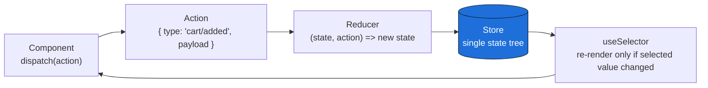

## The problem this solves

`useState` and lifting state up ([[react-state]]) work until the component that owns the data and the component that needs it are many levels apart. Then every component in between must accept and forward props it does not care about: **prop drilling**. Separately, most "state" in a real app is not UI state at all but a copy of data that lives on a server, which brings loading, errors, caching and staleness.

## Intuition: four kinds of state, four homes

| Kind | Examples | Best home |
| --- | --- | --- |
| Local UI state | is this dropdown open, input text | `useState` in the component |
| Shared client state | logged-in user, theme, cart, editor selection | Context, or a store (Redux Toolkit, Zustand) |
| **Server state** | products, orders, submissions | a server-cache library (TanStack Query, RTK Query, SWR) |
| URL state | current page, filters, selected id | the router (path and query string) |

Most "state management problems" come from putting server state in a client store and then hand-writing the caching.

## Build it step by step

### Example 1: Context removes prop drilling

```jsx
const AuthContext = createContext(null);

function AuthProvider({ children }) {
  const [user, setUser] = useState(null);
  const value = useMemo(() => ({
    user,
    login: async (email, password) => setUser(await api.login(email, password)),
    logout: () => setUser(null),
  }), [user]);
  return <AuthContext.Provider value={value}>{children}</AuthContext.Provider>;
}
const useAuth = () => useContext(AuthContext);

function Avatar() {
  const { user } = useAuth();
  return ;
}
```

A provider makes a value available to every component below it; `useContext` reads it at any depth with no props in between. The `useMemo` matters: without it `value` is a new object on every render and **every consumer re-renders** ([[react-performance]]).

Context is a transport mechanism, not a state manager. When the value changes, all consumers re-render, even those using a part that did not change. Good for values that change rarely (user, theme, locale). For frequently changing shared state, split contexts or use a store.

### Example 2: a store with Redux Toolkit

```jsx
const cartSlice = createSlice({
  name: 'cart',
  initialState: { items: [] },
  reducers: {
    added(state, action) {
      const line = state.items.find(i => i.sku === action.payload.sku);
      if (line) line.qty += 1; else state.items.push({ ...action.payload, qty: 1 });
    },
    removed(state, action) { state.items = state.items.filter(i => i.sku !== action.payload); },
  },
});
const store = configureStore({ reducer: { cart: cartSlice.reducer } });

function CartBadge() {
  const count = useSelector(s => s.cart.items.reduce((n, i) => n + i.qty, 0));
  return <span>{count}</span>;
}
function AddButton({ product }) {
  const dispatch = useDispatch();
  return <button onClick={() => dispatch(cartSlice.actions.added(product))}>Add to cart</button>;
}
```



One store, changed only by dispatching actions through pure reducers, so every change is traceable. The reducer above *looks* like it mutates; Redux Toolkit runs it through Immer, which turns those writes into an immutable update. `useSelector` re-renders a component only when its selected slice changes, which is the advantage over Context.

### Example 3: server state with a query library

```jsx
function Orders() {
  const { data, isPending, error } = useQuery({
    queryKey: ['orders', { status: 'paid' }],
    queryFn: () => fetch('/api/orders?status=paid').then(r => r.json()),
    staleTime: 30_000,
  });
  if (isPending) return <Spinner />;
  if (error) return <ErrorMessage error={error} />;
  return <OrderTable rows={data} />;
}
```

Compare with the hand-written fetch effect in [[react-effects]]. The library provides what that code lacked: a **cache** keyed by `queryKey` shared by all components, de-duplication of identical requests, background refetch when data is stale, retries, and cancellation.

```jsx
const queryClient = useQueryClient();
const like = useMutation({
  mutationFn: postId => api.like(postId),
  onMutate: async postId => {
    await queryClient.cancelQueries({ queryKey: ['post', postId] });
    const previous = queryClient.getQueryData(['post', postId]);
    queryClient.setQueryData(['post', postId], p => ({ ...p, liked: true, likes: p.likes + 1 }));
    return { previous };
  },
  onError: (_err, postId, ctx) => queryClient.setQueryData(['post', postId], ctx.previous),
  onSettled: (_d, _e, postId) => queryClient.invalidateQueries({ queryKey: ['post', postId] }),
});
```

```output
click: heart fills instantly (optimistic) -> request in flight
  success: refetch confirms the server's value
  failure: cache rolled back to "previous", heart empties, error shown
```

An **optimistic update** shows the expected result before the server confirms, and keeps a snapshot to roll back. Cache invalidation after a write is the client-side twin of the server cache in [[node-scaling]].

### Example 4: routing and protected routes

```jsx
function RequireAuth({ roles }) {
  const { user, status } = useAuth();
  const location = useLocation();
  if (status === 'loading') return <Spinner />;
  if (!user) return <Navigate to="/login" replace state={{ from: location }} />;
  if (roles && !roles.includes(user.role)) return <Navigate to="/forbidden" replace />;
  return <Outlet />;
}

<Routes>
  <Route path="/login" element={<Login />} />
  <Route element={<RequireAuth />}>
    <Route path="/orders" element={<Orders />} />
    <Route path="/orders/:orderId" element={<OrderDetail />} />
  </Route>
  <Route element={<RequireAuth roles={['admin']} />}>
    <Route path="/admin" element={<AdminPanel />} />
  </Route>
  <Route path="*" element={<NotFound />} />
</Routes>
```

Client-side routing swaps components when the URL changes, without a full page load. `RequireAuth` is a layout route: it renders its children (`Outlet`) only for an allowed user, and otherwise redirects, remembering where the user was headed.

This guard is **user experience, not security**. Anyone can edit JavaScript in their browser. The API must verify the token and role on every request, exactly as built in [[auth-jwt]].

### Example 5: one place for API calls and token refresh

```jsx
async function api(path, options = {}) {
  const send = () => fetch('/api' + path, {
    ...options,
    credentials: 'include',
    headers: { 'content-type': 'application/json', authorization: `Bearer ${tokens.access}`, ...options.headers },
  });
  let res = await send();
  if (res.status === 401 && await refreshAccessToken()) res = await send();
  if (!res.ok) throw new ApiError(res.status, await res.json().catch(() => ({})));
  return res.status === 204 ? null : res.json();
}
```

Every request goes through one function that attaches the access token and, on a 401, uses the refresh token once and retries. Components never touch tokens. This is the client half of the access and refresh token design in [[auth-jwt]].

## The rule, stated precisely

Keep each piece of state in exactly one place, as close as possible to where it is used, and derive everything else. Treat server data as a cache with a key, a freshness window and an invalidation rule, not as application state you own.

!!! key
- Context vs Redux: Context avoids prop drilling but re-renders all consumers on change and has no built-in structure for updates. Redux adds a single store, explicit actions, selector-based subscriptions, middleware and devtools. Zustand offers selector subscriptions with much less ceremony.
- Server state vs client state is the distinction that shows seniority.
- Redux data flow in one line: dispatch an action, reducer returns new state, subscribed selectors re-run, changed components re-render.
- Protected routes are convenience. Authorization lives on the server.
- Forms: controlled inputs for simple cases, a form library (React Hook Form) with schema validation for large ones. Validate on the client for speed and on the server for truth.
!!!

!!! trap
- Putting every API response in Redux and writing loading and error flags by hand.
- A Context value that is a fresh object every render.
- Duplicating server data into local state "to edit it" and never reconciling with refetches.
- Storing filters only in component state, so the page cannot be shared, bookmarked or restored with the back button. Put them in the URL.
- Trusting a role stored in `localStorage` to decide what to show.
!!!

!!! twist What changes if...
- **...the data must be live (a submission's verdict, a collaborator's cursor)?** Push updates over a WebSocket and write them into the query cache with `setQueryData`, or keep them in a store. Both the online judge and the collab editor do this ([[websockets]]).
- **...the page must be fast on first load and indexable by search engines?** Render on the server (Next.js): SSR per request, SSG at build time, or streaming with server components. A client-only React app sends an empty HTML shell.
- **...two tabs must stay in sync after logout?** Listen for the `storage` event or use a `BroadcastChannel`.
!!!

!!! model
Local state in the component, shared UI state in a provider or store, server data in a cache with keys, and whatever should survive a refresh or a shared link in the URL.
!!!

## Practice

?? When would you choose Context, Redux Toolkit, or TanStack Query?
Context for a few rarely changing global values (auth user, theme). TanStack Query (or RTK Query) for anything fetched from the server. Redux Toolkit or Zustand for complex client-side state shared widely and updated often, such as a cart, a multi-step wizard or an editor document. Many apps need only the first two.
??

?? Why does a Context update re-render all consumers, and how do you limit it?
`useContext` subscribes to the whole value; React cannot know which property a consumer reads. Limit it by memoizing the value, splitting state and dispatch into separate contexts, splitting unrelated data into separate providers, or switching to a store with selectors.
??

?? Explain an optimistic update and its failure handling.
Apply the expected change to the client cache immediately, keeping the previous value. Send the request. On success, optionally refetch to confirm. On failure, restore the previous value and tell the user. Use it only for actions that almost always succeed and are easy to reverse, such as likes; not for payments.
??

?? How does the app stay logged in after a page refresh if the access token is only in memory?
On startup the app calls `/auth/refresh`. The browser sends the `HttpOnly` refresh cookie automatically; the server returns a new access token, which goes into memory. Until that call completes, the auth state is `loading`, which is why `RequireAuth` shows a spinner instead of redirecting at once.
??

?? What is the difference between client-side routing and server-side routing?
Server-side: each URL is a request, and the server returns a full HTML page. Client-side: the first load delivers the app; afterwards the router intercepts navigation, changes the URL with the History API and renders the matching components without reloading. The server must return the app shell for any path so deep links work.
??

?? CSR vs SSR vs SSG?
CSR: the browser downloads JavaScript and builds the page; simple hosting, slower first paint, weak SEO. SSR: the server renders HTML per request, then React hydrates it; fast first paint and good SEO at the cost of server work. SSG: HTML is generated at build time and served from a CDN; fastest, suited to content that changes rarely.
??
