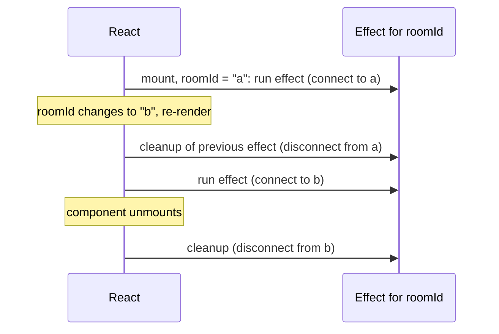

## The problem this solves

[[react-rendering]] said render must be pure: React may call your component at any time, more than once, or throw the result away. So connecting to a chat server or starting a timer *inside* the function body is wrong, since it would repeat on every render. Yet the component must be connected while it is on screen and disconnected when it leaves.

## Intuition

An **effect** is a piece of code that keeps something outside React **in sync** with the current props and state. Think "synchronize", not "lifecycle".

```jsx
useEffect(() => {
  // start synchronizing
  return () => { /* stop synchronizing */ };
}, [dependencies]);
```

- React runs the effect **after** the render is committed to the screen.
- Before running it again, and when the component unmounts, React runs the **cleanup** function returned by the previous run.
- The **dependency array** tells React when re-synchronizing is needed.



## Build it step by step

### Example 1: the three dependency forms

```jsx
useEffect(() => { console.log('A: after every render'); });
useEffect(() => { console.log('B: after the first render only'); }, []);
useEffect(() => { console.log('C: after first render and whenever userId changes'); }, [userId]);
```

```output
mount:                       A B C
re-render, userId unchanged: A
re-render, userId changed:   A C
```

React compares each dependency with its value from the previous render using `Object.is`. If any differ, the effect re-runs.

### Example 2: cleanup, a subscription done right

```jsx
function ChatRoom({ roomId }) {
  const [messages, setMessages] = useState([]);
  useEffect(() => {
    const socket = new WebSocket(`wss://example.com/rooms/${roomId}`);
    socket.onmessage = e => setMessages(prev => [...prev, JSON.parse(e.data)]);
    return () => socket.close();
  }, [roomId]);
  return <MessageList items={messages} />;
}
```

Without the cleanup, switching rooms five times leaves five open sockets all appending to the list. The cleanup makes each effect run undo itself. Note `setMessages(prev => ...)`: the updater form means the effect does not need `messages` as a dependency. The socket itself is the subject of [[websockets]], and this hook shape is what the collab editor's client is built on.

In development, Strict Mode deliberately mounts, unmounts and remounts every component once. If your effect breaks under that, it was missing a cleanup.

### Example 3: fetching data without a race

```jsx
function Profile({ userId }) {
  const [state, setState] = useState({ status: 'loading' });
  useEffect(() => {
    const controller = new AbortController();
    setState({ status: 'loading' });
    fetch(`/api/users/${userId}`, { signal: controller.signal })
      .then(r => r.ok ? r.json() : Promise.reject(new Error('HTTP ' + r.status)))
      .then(user => setState({ status: 'ready', user }))
      .catch(err => { if (err.name !== 'AbortError') setState({ status: 'error', message: err.message }); });
    return () => controller.abort();
  }, [userId]);
  if (state.status === 'loading') return <Spinner />;
  if (state.status === 'error') return <p role="alert">{state.message}</p>;
  return <h1>{state.user.name}</h1>;
}
```

```output
without cleanup: user clicks profile 1 then quickly profile 2.
  request 2 returns first -> shows user 2. request 1 returns later -> overwrites with user 1. Wrong user on screen.
with cleanup: changing userId aborts request 1. Only request 2 can set state.
```

Responses can arrive in any order ([[js-promises]]). The cleanup cancels the outdated request, so only the latest one may update state. Every data-fetching effect needs loading, error and cancellation handling, which is why libraries exist for it ([[react-app-state]]).

The effect callback itself cannot be `async` (it would return a promise where React expects a cleanup function). Define an async function inside and call it, or use `.then` as above.

### Example 4: the stale closure

```jsx
function Timer() {
  const [seconds, setSeconds] = useState(0);
  useEffect(() => {
    const id = setInterval(() => setSeconds(seconds + 1), 1000);
    return () => clearInterval(id);
  }, []);
  return <p>{seconds}</p>;
}
```

```output
shows 0, then 1, then stays at 1 forever
```

The effect ran once, after the first render. Its callback is a closure over that render's `seconds`, which is `0` forever ([[js-closures]], and the snapshot idea from [[react-state]]). Every tick computes `0 + 1`.

| Fix | Code | Why it works |
| --- | --- | --- |
| Updater function (best here) | `setSeconds(s => s + 1)` with `[]` | does not read `seconds` at all |
| Declare the dependency | `[seconds]` | effect re-runs each second with a fresh closure; the interval is torn down and recreated each time |
| Ref for the latest value | `ref.current = value` each render, read `ref.current` in the callback | a ref is one mutable box shared by all renders |

The linter rule `react-hooks/exhaustive-deps` reports every value the effect reads but does not list. Treat its warnings as bugs.

### Example 5: custom hooks, reusing effect logic

```jsx
function useDebouncedValue(value, delay) {
  const [debounced, setDebounced] = useState(value);
  useEffect(() => {
    const id = setTimeout(() => setDebounced(value), delay);
    return () => clearTimeout(id);
  }, [value, delay]);
  return debounced;
}

function Search() {
  const [text, setText] = useState('');
  const query = useDebouncedValue(text, 300);
  const results = useSearchResults(query);
  return <input value={text} onChange={e => setText(e.target.value)} />;
}
```

A custom hook is a function whose name starts with `use` and that calls other hooks. It shares **logic**, not state: each component calling it gets its own state. Here the cleanup *is* the debounce from [[js-functional]]: every keystroke cancels the previous timer.

## The rule, stated precisely

After each commit, for every effect whose dependencies changed (or that has no array): run the previous cleanup with the previous render's values, then run the new effect with the new values. On unmount, run the last cleanup. All values from the component scope that the effect reads must be listed as dependencies.

!!! key
- Effects are for synchronizing with **external systems**: network, sockets, timers, browser APIs, non-React widgets.
- **You might not need an effect.** Deriving data from props or state belongs in render. Reacting to a user action belongs in the event handler. Effects for these cause extra renders and bugs.
- Class lifecycle mapping, if asked: `[]` with cleanup is roughly `componentDidMount` + `componentWillUnmount`; with dependencies it also covers `componentDidUpdate`. The mental model differs: effects describe synchronization, not moments in time.
- `useLayoutEffect` runs synchronously after DOM mutations but before paint; use it only to measure layout and avoid flicker.
!!!

!!! trap
- Missing cleanup: duplicate listeners, intervals that never stop, memory leaks.
- An object, array or function created during render used as a dependency: it is a new reference every render, so the effect runs every time. Move it inside the effect, or memoize it ([[react-performance]]).
- Setting state unconditionally in an effect that depends on that state: an infinite loop.
- Omitting a dependency to "run it once". That hides a stale closure.
- Fetching in an effect with no cancellation.
!!!

!!! twist What changes if...
- **...the effect needs the latest value of something but should not re-run when it changes?** Read it from a ref, or (in newer React) wrap that part with `useEffectEvent`.
- **...two effects do unrelated things?** Keep them separate. One effect per synchronization concern; do not merge by lifecycle moment.
- **...the component unmounts while a request is in flight?** The cleanup aborts it. Setting state on an unmounted component is otherwise wasted work at best.
!!!

!!! model
An effect is a plug: it connects when the listed values appear, and unplugs itself before reconnecting or leaving. If it reads a value it did not list, it is plugged into an old render.
!!!

## Practice

?? Explain the dependency array to someone new.
It is the list of values from the component that the effect uses. React re-runs the effect only when one of them changed since the last render. No array: after every render. Empty array: only after mount. Leaving out a value the effect uses means the effect keeps using an old copy of it.
??

?? When does the cleanup function run?
Before the effect re-runs because a dependency changed (with the *old* values), and once when the component unmounts. In development Strict Mode there is also one extra mount, cleanup, mount cycle to surface missing cleanups.
??

?? Why does this loop forever? `useEffect(() => { setData(transform(data)); }, [data]);`
The effect sets `data` to a new object, which changes the dependency, which re-runs the effect. And it should not be an effect at all: compute `const view = transform(data)` during render (memoized if expensive).
??

?? How do you fetch on mount with async/await?
```jsx
useEffect(() => {
  let ignore = false;
  (async () => {
    const res = await fetch(url);
    const json = await res.json();
    if (!ignore) setData(json);
  })();
  return () => { ignore = true; };
}, [url]);
```
The `ignore` flag (or an `AbortController`) prevents an outdated response from setting state.
??

?? What is a stale closure in React and how do you recognize one?
A callback (in an effect, timer or memoized function) that captured props or state from an older render and keeps using them. Symptoms: a counter stuck at 1, a handler that always sees the initial value, a socket listener that sends outdated data. Fix with correct dependencies, the updater form, or a ref.
??

?? `useEffect` vs `useLayoutEffect`?
`useEffect` runs after the browser has painted, so it does not block the screen. `useLayoutEffect` runs after React updates the DOM but before paint, blocking it. Use the layout version only when you must read layout (size, position) and synchronously adjust before the user sees a frame, such as positioning a tooltip.
??
