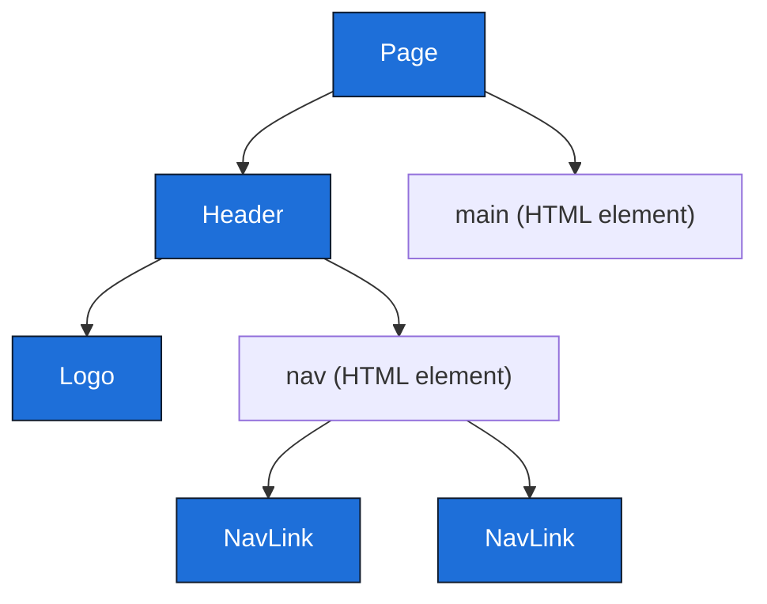

## The problem this solves

A web page is a tree of elements (the **DOM**). To make a page interactive with plain JavaScript you find elements and change them by hand:

```js
const count = document.getElementById('count');
const button = document.getElementById('add');
let value = 0;
button.addEventListener('click', () => {
  value++;
  count.textContent = 'Count: ' + value;
  if (value > 5) count.classList.add('warning');
});
```

That works for one counter. In a real app the same data appears in ten places, and every change means remembering to update all ten. Miss one and the screen lies. This style is called **imperative**: you write the *steps* to change the page.

React's idea is the opposite, **declarative**: you write what the page should look like *for the current data*, and React works out the steps. When the data changes, you describe the page again and React updates only what differs.

## How the examples on this line run

React code needs a browser. The examples in the React line are executed during the site build in a **simulated browser** (a library called jsdom) with the real React. A few helpers appear in them:

| Helper | Does |
| --- | --- |
| `render(<App />)` | puts a component on the page |
| `html()` | returns the page's current HTML, indented |
| `text()` | returns just the visible text |
| `click('button')`, `type('input', 'hi')` | simulate a user clicking or typing |

In your own project you will not use these. You run `npm create vite@latest my-app -- --template react`, then `npm run dev`, and look at the browser.

## Step 1: a component is a function that returns markup

```jsx run
function Welcome() {
  return <h1>Hello, React</h1>;
}

render(<Welcome />);
console.log(html());
```

**What happened.** `Welcome` is an ordinary JavaScript function. It returns something that looks like HTML. `<Welcome />` uses the function as if it were a new HTML tag. React called the function and turned its result into a real `<h1>` element.

Two rules already:

- A component's name **must start with a capital letter**. `<welcome />` would be treated as an unknown HTML tag.
- A component **returns** what should be displayed.

## Step 2: JSX is JavaScript, not HTML

The HTML-like syntax is called **JSX**. A build tool converts it into plain function calls before the browser sees it.

```jsx run
const withJsx = <p className="note">Saved</p>;
const withoutJsx = React.createElement('p', { className: 'note' }, 'Saved');

console.log(JSON.stringify({ type: withJsx.type, props: withJsx.props }));
console.log(JSON.stringify({ type: withoutJsx.type, props: withoutJsx.props }));
```

The two lines are the same thing. JSX produces a plain **object** describing an element: its type and its properties. It is not HTML and nothing is on the page yet; it is a description ([[js-objects-arrays]]). The page is only touched when React renders it. This explains JSX's rules:

| Rule | Reason |
| --- | --- |
| `className`, not `class`; `htmlFor`, not `for` | these become object properties, and `class` and `for` are reserved words in JavaScript |
| Every tag must be closed: ``, `<br />` | it is parsed as code, not forgiving HTML |
| One root element per return | a function returns one value |
| `{ }` to insert JavaScript | everything else is treated as text |

## Step 3: curly braces put JavaScript inside JSX

```jsx run
function Profile() {
  const user = { name: 'Asha', points: 1280, skills: ['React', 'Node'] };
  const avatarSize = 48;
  return (
    <div className="profile">
      <h2>{user.name.toUpperCase()}</h2>
      <p>Points: {user.points + 20}</p>
      <p>Skills: {user.skills.join(', ')}</p>
      
      <p style={{ color: 'teal', fontWeight: 'bold' }}>Level {Math.floor(user.points / 500)}</p>
    </div>
  );
}
render(<Profile />);
console.log(html());
```

Inside `{ }` you can write any JavaScript **expression**: a variable, a calculation, a function call. Braces work in two places: as content between tags, and as an attribute value (`alt={user.name}`).

`style={{ ... }}` is not special syntax. The outer braces mean "JavaScript here"; the inner braces are an ordinary object, with property names in camelCase (`fontWeight`).

**Twist: what can and cannot go in braces.**

```jsx run
function Demo() {
  return (
    <ul>
      <li>number: {42}</li>
      <li>string: {'text'}</li>
      <li>true and false render nothing: [{true}{false}]</li>
      <li>null and undefined render nothing: [{null}{undefined}]</li>
      <li>array items are rendered in order: {['a', 'b', 'c']}</li>
    </ul>
  );
}
render(<Demo />);
console.log(text());
try { render(<p>{{ name: 'Asha' }}</p>); } catch (e) { console.log(e.message.split('.')[0]); }
```

Numbers and strings appear as text. `true`, `false`, `null` and `undefined` render **nothing**, which is what makes conditional rendering work in [[react-props-events]]. A plain object cannot be rendered: pick a property out of it.

## Step 4: one root, and fragments

```jsx run
function Card() {
  return (
    <>
      <h3>Title</h3>
      <p>Body text</p>
    </>
  );
}
render(<div className="list"><Card /><Card /></div>);
console.log(html());
```

A component must return a single thing. Wrapping siblings in a `<div>` adds an extra element to the page that may break your layout. `<>...</>` is a **fragment**: it groups elements for React and produces **no element** in the output, as you can see.

## Step 5: components inside components

```jsx run
function Logo() { return <strong>Interchange</strong>; }
function NavLink() { return <a href="/map">Map</a>; }
function Header() {
  return (
    <header>
      <Logo />
      <nav><NavLink /><NavLink /></nav>
    </header>
  );
}
function Page() {
  return (
    <div>
      <Header />
      <main><p>Content goes here</p></main>
    </div>
  );
}
render(<Page />);
console.log(html());
```

This is the whole idea of React: **an app is a tree of components**. `Page` uses `Header`, which uses `Logo` and `NavLink`. Each is small, has one job and can be reused (`NavLink` appears twice). The two links are identical because nothing is passed in yet; making them differ is the job of **props**, next.



Blue boxes are your components; white boxes are built-in HTML elements. Lowercase tags are HTML; capitalized tags are components.

**How to split a page into components.** Draw boxes on the design. A box becomes a component when it is repeated (a product card), when it is a distinct piece with its own job (a search bar), or when a component has grown too long to read.

## Step 6: a component is called again and again

```jsx run
let calls = 0;
function Clock() {
  calls++;
  return <p>Rendered {calls} time(s)</p>;
}
render(<Clock />);
console.log(text());
render(<Clock />);
render(<Clock />);
console.log(text());
```

Each time React needs to know what the screen should look like, it **calls your function again**. A call is a **render**. This is why a component should only compute and return JSX, with no side effects such as changing outside variables (the `calls++` here is a deliberate bad example to make renders visible). The rules about purity and what triggers a render are in [[react-rendering]]; how a component remembers values between renders is [[react-state]].

## Step 7: how it reaches the page

A real React app has exactly one place that connects React to the HTML file:

```html
<!-- index.html -->
<div id="root"></div>
<script type="module" src="/src/main.jsx"></script>
```

```jsx
// src/main.jsx
import { createRoot } from 'react-dom/client';
import App from './App.jsx';

createRoot(document.getElementById('root')).render(<App />);
```

The HTML file is almost empty. React builds the whole page inside `<div id="root">`. One file usually holds one component, exported and imported with ES modules ([[js-modules]]).

!!! key
- Imperative (write the steps) vs declarative (describe the result). React is declarative.
- A component is a capitalized function that returns JSX.
- JSX compiles to `React.createElement` calls and produces plain objects describing elements.
- `{ }` holds any expression; `className`, closed tags, one root, camelCase styles.
- `true`, `false`, `null`, `undefined` render nothing; objects cannot be rendered.
- Fragments group without adding an element.
- An app is a tree of components; React calls the functions to get the description.
!!!

!!! trap
- Lowercase component names: `<header />` is the HTML tag, `<Header />` is your component.
- Calling a component like a function (`{Header()}`) instead of `<Header />`. It appears to work and then breaks as soon as the component uses hooks.
- `class=` and `for=` in JSX.
- Writing statements in braces: `{ if (x) ... }` is not an expression. Use `&&` or a ternary ([[react-props-events]]).
- Returning two sibling elements without a wrapper or fragment.
- Putting a multi-line `return` on the line after `return` without parentheses: JavaScript inserts a semicolon and returns `undefined`.
!!!

!!! twist What changes if...
- **...you do not want a build step?** You can call `React.createElement` by hand, but nobody does. Vite sets up JSX in one command.
- **...you see `<React.Fragment key={id}>`?** The long form of `<>`, needed when a fragment in a list needs a `key` ([[react-lists-forms]]).
- **...a component needs different content each time?** Pass it in as props or `children`, next station.
!!!

!!! model
A component is a function from data to a description of UI. JSX is the notation for writing that description. React reads the description and makes the page match.
!!!

## Practice

?? What is wrong with each? (a) `function card() { return <div /> }` used as `<card />` (b) `return <h1>Hi</h1><p>there</p>` (c) `<label class="x" for="name">`
(a) Lowercase name: React treats `<card>` as an HTML tag and never calls the function. (b) Two root elements; wrap them in a fragment. (c) `class` and `for` must be `className` and `htmlFor`.
??

?? Convert `<a className="btn" href="/buy">Buy {count} items</a>` to `React.createElement`.
`React.createElement('a', { className: 'btn', href: '/buy' }, 'Buy ', count, ' items')`. First the type, then the props object, then the children in order.
??

?? What does this render? `<p>{0}</p>`, `<p>{false}</p>`, `<p>{''}</p>`, `<p>{[1, 2, 3]}</p>`
`0`, nothing, nothing, `123`. Zero is a number and is rendered, which matters for the `&&` pitfall in the next station.

```jsx run
render(<div><p>{0}</p><p>{false}</p><p>{''}</p><p>{[1, 2, 3]}</p></div>);
console.log(html());
```
??

?? Build a `Receipt` component that shows a shop name, two item lines and a total computed from the prices.
```jsx run
function Receipt() {
  const items = [{ name: 'Keyboard', price: 2499 }, { name: 'Mouse', price: 699 }];
  const total = items[0].price + items[1].price;
  return (
    <section>
      <h2>Chai Point Electronics</h2>
      <p>{items[0].name}: Rs {items[0].price}</p>
      <p>{items[1].name}: Rs {items[1].price}</p>
      <strong>Total: Rs {total}</strong>
    </section>
  );
}
render(<Receipt />);
console.log(html());
```
Writing each item line by hand does not scale; rendering a list from an array is [[react-lists-forms]].
??

?? Why does React use a description (objects) instead of changing the DOM directly as you write?
Creating objects is cheap; changing the real DOM is slow. With descriptions, React can compare the new description to the previous one and apply only the differences, and you never write update code yourself. That comparison is called reconciliation ([[react-rendering]]).
??
