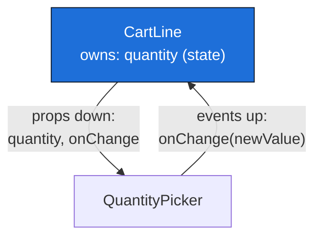

## The problem this solves

In [[react-first-components]] every `<NavLink />` was identical. A component that always shows the same thing is not reusable. We need to **give a component different data each time it is used**, the way you pass arguments to a function. And then we need the page to **respond when the user does something**.

## Step 1: props are a component's arguments

```jsx run
function Greeting(props) {
  return <p>Hello, {props.name}. You have {props.unread} new messages.</p>;
}

render(
  <div>
    <Greeting name="Asha" unread={3} />
    <Greeting name="Ravi" unread={0} />
  </div>
);
console.log(html());
```

**What happened.** The attributes you write on a component tag are collected into one object and passed as the function's first argument. That object is called **props** (properties). `name="Asha"` passes a string; `unread={3}` uses braces to pass a number (or any JavaScript value).

Almost everyone destructures the props in the parameter list ([[js-objects-arrays]]):

```jsx run
function Badge({ label, color = 'gray', count }) {
  return <span style={{ background: color }}>{label}{count !== undefined && ` (${count})`}</span>;
}
render(
  <div>
    <Badge label="Inbox" color="teal" count={12} />
    <Badge label="Drafts" />
  </div>
);
console.log(html());
```

`color = 'gray'` is a default used when the prop is not passed.

### Any value can be a prop

```jsx run
function ProductCard({ product, tags, onSale, formatPrice }) {
  return (
    <article>
      <h3>{product.name}</h3>
      <p>{formatPrice(product.price)}{onSale && ' (on sale)'}</p>
      <small>{tags.join(' / ')}</small>
    </article>
  );
}
const rupees = paise => 'Rs ' + (paise / 100).toFixed(2);
render(<ProductCard product={{ name: 'Keyboard', price: 249900 }} tags={['usb', 'rgb']} onSale formatPrice={rupees} />);
console.log(html());
```

Objects, arrays, booleans and **functions** can all be props. Writing just `onSale` with no value means `onSale={true}`. Passing a function down is how a child will later report events back up.

### Twist: props are read-only

```jsx run
function Price(props) {
  let outcome;
  try { (function () { 'use strict'; props.amount = 0; })(); outcome = 'changed'; }
  catch (e) { outcome = 'refused with a ' + e.constructor.name; }
  return <p>Trying to change a prop: {outcome}. Amount is still {props.amount}.</p>;
}
render(<Price amount={500} />);
console.log(text());
```

React freezes the props object (in development builds). **A component must never change its props.** Data flows one way, from parent to child. If a child could silently change its parent's data, you could no longer tell where a value came from. When a child needs something to change, it asks the parent by calling a function it was given (step 4).

## Step 2: `children`, the content between the tags

```jsx run
function Panel({ title, children }) {
  return (
    <section className="panel">
      <h2>{title}</h2>
      <div className="panel-body">{children}</div>
    </section>
  );
}
render(
  <Panel title="Order summary">
    <p>2 items</p>
    <strong>Total: Rs 3198</strong>
  </Panel>
);
console.log(html());
```

Whatever you put **between** a component's opening and closing tags arrives as the special prop `children`. This lets you build wrappers (cards, modals, layouts) that do not need to know what goes inside them. It is composition: building bigger things by nesting smaller ones.

## Step 3: conditional rendering

There is no special syntax. You use JavaScript.

```jsx run
function Status({ user, cartCount, loading }) {
  if (loading) return <p>Loading...</p>;
  return (
    <div>
      {user ? <p>Welcome back, {user.name}</p> : <p>Please log in</p>}
      {user?.isAdmin && <a href="/admin">Admin panel</a>}
      {cartCount > 0 && <p>{cartCount} items in cart</p>}
    </div>
  );
}
render(<Status loading />);                                              console.log('1:', text());
render(<Status user={null} cartCount={0} />);                            console.log('2:', text());
render(<Status user={{ name: 'Asha', isAdmin: true }} cartCount={2} />); console.log('3:', text());
```

| Tool | Use for | Reads as |
| --- | --- | --- |
| `if (...) return` | a whole different screen (loading, error, empty) | "in this case, show only this" |
| `condition ? <A /> : <B />` | one of two things | "either A or B" |
| `condition && <A />` | something or nothing | "show A only if" |

`&&` works because `false` renders nothing ([[react-first-components]]).

**Twist: the `0` trap.**

```jsx run
function Cart({ count }) {
  return <div>[{count && <span>{count} items</span>}] vs [{count > 0 && <span>{count} items</span>}]</div>;
}
render(<Cart count={0} />);
console.log(text());
```

`0 && ...` evaluates to `0`, and React **renders the number 0**. A stray "0" on screen is one of the most common React bugs. Always make the left side a real boolean: `count > 0 &&`.

## Step 4: events

```jsx run
function LikeButton() {
  function handleClick(event) {
    console.log('clicked a', event.target.tagName, '| event type:', event.type);
  }
  return <button onClick={handleClick}>Like</button>;
}
render(<LikeButton />);
click('button');
click('button');
```

- Event props are camelCase: `onClick`, `onChange`, `onSubmit`, `onKeyDown`.
- You pass **the function itself**, not a call: `onClick={handleClick}`.
- React calls it with an **event object** describing what happened.

**Twist: the most common mistake.**

```jsx run
let calls = 0;
const save = () => { calls++; };

function Wrong() { return <button onClick={save()}>Save</button>; }
function Right() { return <button onClick={save}>Save</button>; }
function WithArgument() { return <button onClick={() => save('draft')}>Save draft</button>; }

render(<Wrong />);        console.log('Wrong : called during render, before any click:', calls);
calls = 0; render(<Right />); console.log('Right : calls after render:', calls);
click('button');          console.log('Right : calls after one click:', calls);
```

`onClick={save()}` **calls** `save` immediately while rendering and passes its return value (`undefined`) as the handler. To pass arguments, wrap the call in an arrow function, as in `WithArgument`.

## Step 5: state, so a click can change the screen

A handler that only logs is not useful. To change what is displayed, a component needs memory.

```jsx run
function Counter() {
  const [count, setCount] = useState(0);
  return (
    <div>
      <p>Count: {count}</p>
      <button onClick={() => setCount(count + 1)}>Add one</button>
    </div>
  );
}
render(<Counter />);
console.log(text());
click('button'); click('button'); click('button');
console.log(text());
```

`useState(0)` gives the component a remembered value, starting at `0`, and a function to change it. Calling `setCount` stores the new value **and makes React call `Counter` again**, so the JSX is recomputed with the new `count`. You never touch the DOM. This is the declarative loop in full: event, set state, re-render, React updates the page.

Why a plain variable would not work, and the rules that follow, are the subject of [[react-state]]. For now: **anything that changes on screen must be state.**

## Step 6: a child tells its parent, by calling a function prop

```jsx run
function QuantityPicker({ quantity, onChange }) {
  return (
    <span>
      <button onClick={() => onChange(quantity - 1)} disabled={quantity <= 1}>-</button>
      <b> {quantity} </b>
      <button onClick={() => onChange(quantity + 1)}>+</button>
    </span>
  );
}
function CartLine() {
  const [quantity, setQuantity] = useState(1);
  const price = 699;
  return (
    <div>
      <QuantityPicker quantity={quantity} onChange={setQuantity} />
      <p>Total: Rs {quantity * price}</p>
    </div>
  );
}
render(<CartLine />);
console.log(text());
click('text=+'); click('text=+');
console.log(text());
```

`QuantityPicker` owns no data. It **receives** the current quantity as a prop and **reports** what the user wants by calling `onChange`. The parent `CartLine` owns the state and decides what to do. The total updates because it is computed from the same state.



**Data flows down, events flow up.** This is called one-way data flow, and it is why React apps stay understandable: every value has exactly one owner.

### Two event details

```jsx run
function Form() {
  const [log, setLog] = useState([]);
  const note = msg => setLog(prev => [...prev, msg]);
  return (
    <div onClick={() => note('div saw the click')}>
      <button onClick={() => note('button clicked')}>Bubbles</button>
      <button onClick={e => { e.stopPropagation(); note('button clicked, stopped'); }}>Stopped</button>
      <form onSubmit={e => { e.preventDefault(); note('submitted without reloading the page'); }}><button type="submit">Send</button></form>
      <p>{log.join(' > ')}</p>
    </div>
  );
}
render(<Form />);
click('text=Bubbles'); console.log(text().replace(/^Bubbles Stopped Send /, ''));
click('text=Stopped'); console.log(text().replace(/^Bubbles Stopped Send /, ''));
submit('form');        console.log(text().replace(/^Bubbles Stopped Send /, ''));
```

- **Bubbling**: an event on a child also reaches the handlers of its ancestors. `e.stopPropagation()` stops that.
- **Default actions**: a browser reloads the page when a form is submitted. `e.preventDefault()` cancels it, which is why every React form handler starts with that line.

!!! key
- Props are the arguments of a component: read-only, passed from parent to child.
- `children` is whatever sits between the tags.
- Conditional rendering is plain JavaScript: early `return`, ternary, `&&`.
- `onClick={fn}`, not `onClick={fn()}`.
- State is a component's memory; setting it triggers a re-render.
- Data down through props, events up through function props.
!!!

!!! trap
- `{count && <X />}` rendering `0`.
- Calling the handler instead of passing it.
- Trying to modify a prop.
- **Prop drilling**: passing a prop through five components that do not use it, to reach one that does. Fine for two levels; beyond that, see [[react-app-state]].
- Passing a new object or function prop every render and wondering why a memoized child re-renders ([[react-performance]]).
!!!

!!! twist What changes if...
- **...you want to pass all of an object's fields as props?** Spread it: `<Card {...product} />`. Use sparingly; it hides what is being passed.
- **...a component should accept any extra HTML attributes?** Collect the rest and forward them: `function Button({ variant, ...rest }) { return <button className={variant} {...rest} />; }`.
- **...you need a prop's type checked?** That is what TypeScript is for: `function Badge({ label, count }: { label: string; count?: number })`.
- **...two siblings need the same state?** Move the state up to their common parent ([[react-state]], lifting state up).
!!!

!!! model
A component is a function: props in, JSX out. The user's actions come back through function props, the owner changes its state, and the functions run again.
!!!

## Practice

?? Build a `Toggle` component: a button that switches between "ON" and "OFF", and calls an `onToggle` prop with the new value.
```jsx run
function Toggle({ onToggle }) {
  const [on, setOn] = useState(false);
  const flip = () => { const next = !on; setOn(next); onToggle?.(next); };
  return <button onClick={flip} aria-pressed={on}>{on ? 'ON' : 'OFF'}</button>;
}
render(<Toggle onToggle={value => console.log('parent heard:', value)} />);
click('button'); console.log(text());
click('button'); console.log(text());
```
??

?? What is rendered by `<p>{items.length && 'Has items'}</p>` when `items` is empty, and how do you fix it?
`0`, because `0 && ...` is `0` and React renders numbers. Write `items.length > 0 && 'Has items'`.
??

?? Why are props read-only?
So that data has a single owner and flows in one direction. If any child could change values it received, a bug in displayed data could come from anywhere below; with read-only props, the only place a value can change is where its state lives.
??

?? What is the difference between `onClick={handleDelete(id)}` and `onClick={() => handleDelete(id)}`?
The first calls `handleDelete` during every render (deleting immediately, and often causing an infinite render loop if it sets state) and uses its return value as the handler. The second passes a function that will call `handleDelete(id)` when the click happens.
??

?? Write an `Alert` component with a `type` prop (`'success'`, `'error'`), children as the message, and an optional `onClose` that shows a close button only when provided.
```jsx run
function Alert({ type = 'success', children, onClose }) {
  return (
    <div role="alert" className={'alert alert-' + type}>
      {children}
      {onClose && <button onClick={onClose}>Close</button>}
    </div>
  );
}
render(<div><Alert>Saved</Alert><Alert type="error" onClose={() => console.log('closed')}>Payment failed</Alert></div>);
console.log(html());
click('button');
```
??
