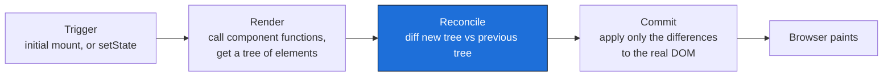

## The problem this solves

With plain DOM code you write the *transitions*: when the user adds an item, create a node, append it, bump the counter, hide the empty-state message. Every new feature multiplies the transitions and one forgotten step leaves the screen out of sync with the data.

React removes the transitions. You write one function from data to UI, and React figures out how to get from the previous screen to the next:

**UI = f(state)**

## Intuition

Three steps happen on every update.



- **Render** means *React calls your component function*. Nothing touches the DOM yet. The function returns **React elements**: plain JavaScript objects describing what should exist.
- **Reconciliation** compares the new element tree with the one from the previous render.
- **Commit** applies the minimal DOM operations.

The tree of element objects is what people call the **virtual DOM**. It is cheap to create and compare; real DOM operations are the expensive part, so React batches and minimizes them.

## Build it step by step

### Example 1: JSX is a function call that returns an object

```jsx
const element = <h1 className="title">Hello, {user.name}</h1>;
```

```output
compiles to:  jsx('h1', { className: 'title', children: ['Hello, ', user.name] })
evaluates to: { type: 'h1', props: { className: 'title', children: ['Hello, ', 'Asha'] }, key: null }
```

JSX is syntax for building these objects. That explains its rules: one root (a function returns one value), `className` not `class` (it is a JavaScript property), and `{}` holds any expression.

### Example 2: what re-renders

```jsx run
function App() {
  const [count, setCount] = useState(0);
  console.log('render App');
  return (
    <>
      <button onClick={() => setCount(count + 1)}>Clicked {count}</button>
      <Header />
      <Total value={count} />
    </>
  );
}
function Header() { console.log('render Header'); return <h1>Shop</h1>; }
function Total({ value }) { console.log('render Total'); return <p>{value}</p>; }

render(<App />);
const h1Before = document.querySelector('h1');
console.log('--- one click ---');
click('button');
console.log('the <h1> is still the same DOM node:', document.querySelector('h1') === h1Before);
```

When a component's state changes, React re-renders **that component and all of its descendants**, whether or not their props changed. `Header` rendered again (its function ran) but produced the same elements, so the commit did nothing for it. Re-rendering is not the same as updating the DOM. Skipping unnecessary renders is [[react-performance]].

### Example 3: how the diff decides

Comparing two arbitrary trees optimally is far too slow, so React uses two rules that make it linear in the number of elements.

| At the same position in the tree | React does |
| --- | --- |
| Same element type (`div` to `div`, `Total` to `Total`) | keeps the DOM node and component state, updates changed props, recurses into children |
| Different type (`div` to `span`, `Login` to `Dashboard`) | destroys the old subtree **including its state**, builds the new one from scratch |

```jsx
{isEditing ? <input value={text} /> : <span>{text}</span>}
```

Toggling `isEditing` swaps the type at that position, so the `input` is created fresh each time.

### Example 4: keys, identity for list items

For a list of children, position alone is not enough. Insert an item at the front and every position shifts.

```jsx run
function List({ items, keyBy }) {
  return <ul>{items.map((item, index) => <li key={keyBy === 'index' ? index : item.id}>{item.text}</li>)}</ul>;
}
const before = [{ id: 'a', text: 'buy milk' }, { id: 'b', text: 'write notes' }];
const after = [{ id: 'c', text: 'call mom' }, ...before];

for (const keyBy of ['index', 'id']) {
  render(<List key={keyBy} items={before} keyBy={keyBy} />);
  const milkNode = [...document.querySelectorAll('li')].find(li => li.textContent === 'buy milk');
  render(<List key={keyBy} items={after} keyBy={keyBy} />);
  console.log(`key = ${keyBy.padEnd(5)}: the DOM node that showed "buy milk" now shows "${milkNode.textContent}"`);
}
```

A new item was inserted at the front. With the **index** as key, React matched old key 0 to new key 0, concluded "same row, new text", and rewrote the node that used to be "buy milk" (and every node after it). Any local state in that row, a ticked checkbox or typed text, would now sit beside the wrong item; [[react-lists-forms]] shows that happening.

With the **id** as key, React recognized "buy milk" as the same item in a new position, kept its node and its state, and created one new node.

A **key** tells React which item is which across renders. It must be **stable** (the same item has the same key every render) and **unique among siblings**.

## The rule, stated precisely

A component re-renders when its own state changes, when its parent re-renders, or when a context it reads changes. During reconciliation, elements are matched by position and type, and among siblings by `key`. A matched element keeps its state; an unmatched one is unmounted or mounted.

!!! why
State belongs to a *position in the tree*, not to the function or the JSX you wrote. Type and key are how React decides whether the thing at a position is still "the same thing". Everything about preserved or lost state follows from that.
!!!

!!! key
- Render is calling the function. Commit is touching the DOM. Many renders produce no DOM change.
- The virtual DOM is not "faster than the DOM". It is what makes declarative code affordable by limiting real DOM work to the differences.
- Keys: stable and unique. Index keys are acceptable only for lists that never reorder, insert or delete.
- Components must be **pure** during render: same props and state give the same output, with no side effects. Side effects go in event handlers or effects ([[react-effects]]).
- **Fiber** is React's internal data structure (one node per component instance) that lets rendering be split into units, paused and prioritized, which is what makes concurrent features possible.
!!!

!!! trap
- `key={Math.random()}`: a new key every render, so every row is destroyed and recreated each time, losing state and focus.
- Defining a component inside another component: it is a new function, hence a new *type*, on every render, so its whole subtree remounts.
- Believing "props did not change, so the child will not re-render". By default it will.
- Mutating state so the reference stays the same; React sees no change at all ([[js-values]], [[react-state]]).
!!!

!!! twist What changes if...
- **...you want to reset a component's state on purpose?** Change its `key`. `<ProfileForm key={userId} />` gives a fresh form whenever the user changes. This is a feature, not a hack.
- **...the same component appears in both branches of a ternary at the same position?** State is preserved across the toggle, which may surprise you. Give them different keys to separate them.
- **...a list has 10,000 rows?** Reconciliation is fine; the DOM is not. Render only the visible rows (windowing or virtualization).
!!!

!!! model
Each render is a new blueprint. React compares it with the last blueprint and sends the builders only the change list. Keys are name tags that let React recognize an item after it moves.
!!!

## Practice

?? What is the virtual DOM and why does React use it?
A lightweight tree of JavaScript objects describing the UI. On each update React builds a new tree, diffs it against the previous one and applies only the differences to the real DOM. It exists so developers can re-describe the whole UI on every change while the browser does a minimal amount of work.
??

?? Why is using the array index as a key a problem? When is it fine?
When items are inserted, removed or reordered, indices point at different items, so React attaches existing state and DOM nodes to the wrong data and updates more nodes than needed. It is fine for a static list that is never reordered or filtered and whose rows hold no state.
??

?? A parent re-renders. Does a child with unchanged props re-render?
Yes, by default. React re-renders the whole subtree. Wrapping the child in `React.memo` makes React skip it when props are shallow-equal ([[react-performance]]).
??

?? Does a re-render always update the DOM?
No. If the returned elements are the same as last time, the commit phase has nothing to do. Re-renders cost JavaScript time; DOM updates happen only for actual differences.
??

?? What happens if you switch `<div><Counter /></div>` to `<section><Counter /></section>`?
The type at the parent position changed from `div` to `section`, so React tears down the whole old subtree and mounts a new one. `Counter` loses its state.
??

?? What are the render phase and the commit phase, and which one can be interrupted?
The render phase calls components and computes the diff; it has no visible effect, so React may pause, restart or discard it (concurrent rendering). The commit phase mutates the DOM and runs layout effects; it is synchronous and cannot be interrupted, so the user never sees a half-updated screen.
??
