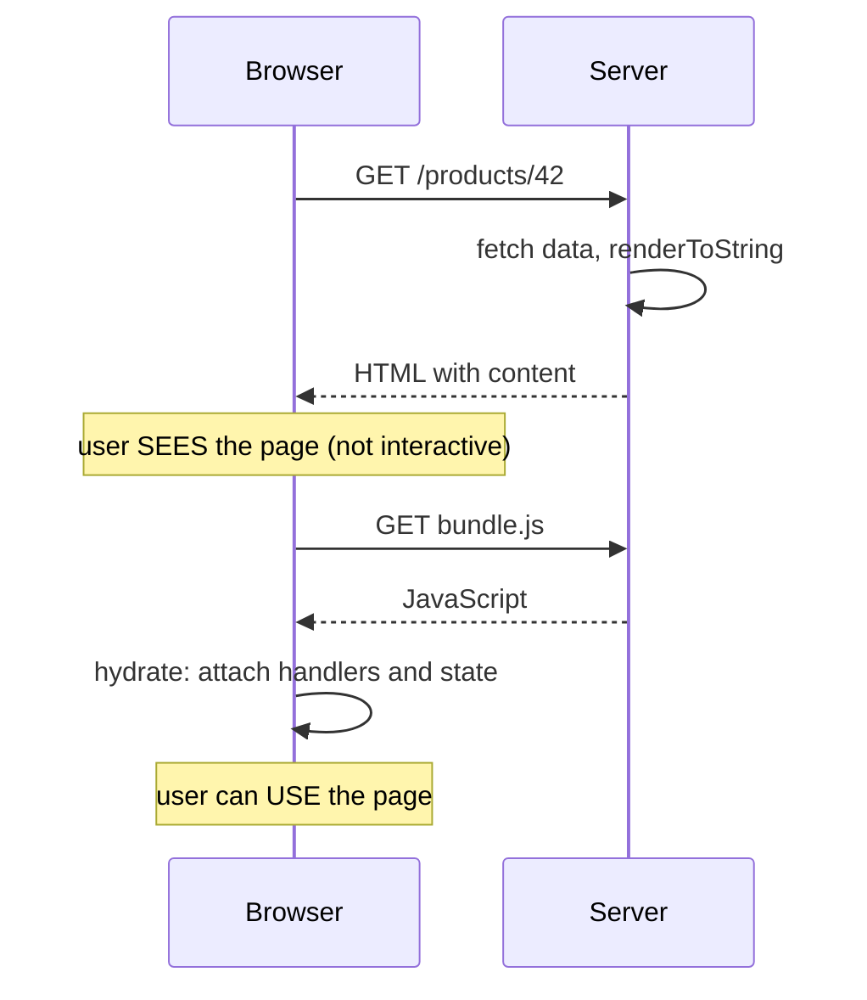

## The problem this solves

A plain React app (as built by Vite) sends the browser an almost empty HTML file and a JavaScript bundle. Nothing appears until the bundle is downloaded, parsed and run, and the data it needs is then fetched. On a slow phone that is seconds of blank screen. A search engine crawler or a link preview that does not run JavaScript sees an empty page.

The fix is to produce real HTML **before** the browser runs your JavaScript. There are several places and moments to do that.

| Strategy | HTML is built | First paint | Server work per request | Fits |
| --- | --- | --- | --- | --- |
| **CSR** client-side rendering | in the browser, after JS loads | slow | none | dashboards and apps behind a login |
| **SSR** server-side rendering | on the server, on every request | fast | high | pages personalized or changing per request |
| **SSG** static site generation | once, at build time | fastest (served from a CDN) | none | blogs, docs, marketing pages |
| **ISR** incremental static regeneration | at build, then re-built in the background every N seconds | fastest | occasional | product pages, listings |

## Step 1: what the browser receives with CSR

```jsx run
function App() {
  const [products, setProducts] = useState(null);
  useEffect(() => { setTimeout(() => setProducts(['Keyboard', 'Mouse']), 30); }, []);
  if (!products) return <p>Loading...</p>;
  return <ul>{products.map(p => <li key={p}>{p}</li>)}</ul>;
}

console.log('1. HTML sent by the server : <div id="root"></div>');
(async () => {
  render(<App />);
  console.log('2. after JavaScript runs   :', html());
  await wait(50);
  console.log('3. after the data arrives  :', html().replace(/\n\s*/g, ''));
})();
```

Three stages, and the user sees content only at the third. A crawler that stops at stage 1 sees nothing.

## Step 2: rendering on the server

React can run on Node and produce an HTML **string** instead of DOM nodes.

```jsx run
const { renderToString } = require('react-dom/server');

function ProductPage({ product }) {
  const [quantity, setQuantity] = useState(1);
  return (
    <main>
      <h1>{product.name}</h1>
      <p>Rs {product.price * quantity}</p>
      <button onClick={() => setQuantity(quantity + 1)}>Quantity: {quantity}</button>
    </main>
  );
}

const product = { name: 'Mechanical Keyboard', price: 2499 };
const markup = renderToString(<ProductPage product={product} />);
console.log(markup);
```

The server already has the data, so the HTML it sends contains the real content. The browser can paint it immediately, and crawlers can read it.

The `<!-- -->` comments are markers React inserts between neighbouring pieces of text (`Rs ` and `2499`) so it can find each piece again later.

Look closely at the `<button>`: there is **no `onClick` in the HTML**. Event handlers are JavaScript functions; they cannot be written into an HTML string. The page is visible but **not interactive yet**.

## Step 3: hydration, making server HTML interactive

```jsx run
const { renderToString } = require('react-dom/server');
const { hydrateRoot } = require('react-dom/client');

function Counter({ start }) {
  const [count, setCount] = useState(start);
  return <button onClick={() => setCount(count + 1)}>Clicked {count} times</button>;
}

const container = document.createElement('div');
document.body.appendChild(container);
container.innerHTML = renderToString(<Counter start={5} />);
const button = container.querySelector('button');

button.dispatchEvent(new window.MouseEvent('click', { bubbles: true }));
console.log('before hydration, after a click:', container.textContent);

act(() => { hydrateRoot(container, <Counter start={5} />); });
console.log('same DOM node reused           :', container.querySelector('button') === button);
click(button);
console.log('after hydration, after a click :', container.textContent);
```

**Hydration** is React running your components in the browser, **matching them to the HTML that is already there**, and attaching event handlers and state, instead of creating new elements. The output shows it: before hydration a click did nothing; hydration reused the very same button element; after it, clicks work.



The gap between "sees" and "can use" is the cost of SSR: the page looks ready before it is.

### Twist: a hydration mismatch

```jsx run
const { renderToString } = require('react-dom/server');
const { hydrateRoot } = require('react-dom/client');

function Greeting({ where }) { return <p>Rendered on the {where}</p>; }

const container = document.createElement('div');
document.body.appendChild(container);
container.innerHTML = renderToString(<Greeting where="server" />);

const errors = [];
act(() => { hydrateRoot(container, <Greeting where="client" />, { onRecoverableError: e => errors.push(e.message.split('.')[0]) }); });
console.log('React reported:', errors[0] ?? '(warning logged to console.error)');
console.log('page now shows:', container.textContent);
```

Hydration assumes the server and the browser render **the same thing**. When they differ, React reports a mismatch and has to throw the server HTML away and render again on the client, losing the benefit.

| Common cause of a mismatch | Fix |
| --- | --- |
| `Date.now()`, `Math.random()`, time zones or locale formatting during render | compute on the server and pass as a prop, or render it in an effect after mount |
| Reading `window`, `localStorage`, screen size during render | these do not exist on the server; read them in `useEffect` ([[react-effects]]) |
| Invalid HTML nesting (`<div>` inside `<p>`) | the browser repairs it, so the DOM no longer matches |
| Browser extensions changing the page | not your bug |

**Effects do not run on the server.** `useEffect` runs only in the browser, after hydration. That is why browser-only code belongs there.

## Step 4: a server that renders React

```jsx run
const express = require('express');
const { renderToString } = require('react-dom/server');

const db = { 42: { name: 'Mechanical Keyboard', price: 2499 } };
function ProductPage({ product }) { return <main><h1>{product.name}</h1><p>Rs {product.price}</p></main>; }

const app = express();
app.get('/products/:id', (req, res) => {
  const product = db[req.params.id];
  if (!product) return res.status(404).send('<h1>Not found</h1>');
  const body = renderToString(<ProductPage product={product} />);
  res.send(`<!doctype html><html><head><title>${product.name}</title></head><body><div id="root">${body}</div>` +
    `<script>window.__DATA__=${JSON.stringify(product).replace(/</g, '\\u003c')}</script><script src="/client.js"></script></body></html>`);
});

const server = app.listen(0, async () => {
  const res = await fetch(`http://localhost:${server.address().port}/products/42`);
  const page = await res.text();
  console.log(res.status, res.headers.get('content-type'));
  console.log(page.replace(/></g, '>\n<').split('\n').filter(l => /title|h1|<p>|__DATA__/.test(l)).join('\n'));
  console.log('missing product ->', (await fetch(`http://localhost:${server.address().port}/products/7`)).status);
  server.close(); server.closeAllConnections();
});
```

This is SSR by hand, on the Express server from [[express-first-app]]:

1. Fetch the data on the server.
2. Render the component to a string and place it in the HTML document, with a real `<title>` (good for SEO) and a real 404 status for a missing product.
3. Embed the same data as JSON so the browser can hydrate with identical props without fetching again. The `<` is escaped so data containing `</script>` cannot break out of the script tag, an XSS defence ([[node-validation-security]]).
4. The client bundle calls `hydrateRoot(document.getElementById('root'), <ProductPage product={window.__DATA__} />)`.

Doing this well (routing, code splitting, data fetching, streaming) is a lot of plumbing. That plumbing is what a framework provides.

## Step 5: Next.js

Next.js is the most used React framework. The essentials of its App Router:

```text
app/
  layout.jsx            wraps every page (html, body, nav)
  page.jsx              route: /
  products/
    page.jsx            route: /products
    [id]/
      page.jsx          route: /products/42  (dynamic segment)
      loading.jsx       shown while this page's data loads
  api/
    health/route.js     an API endpoint: GET /api/health
```

Folders are routes. That is **file-based routing**.

```jsx
// app/products/[id]/page.jsx  — a Server Component (the default)
import { notFound } from 'next/navigation';
import AddToCart from './AddToCart';

export default async function ProductPage({ params }) {
  const { id } = await params;
  const product = await db.products.findById(id);     // runs only on the server
  if (!product) notFound();
  return (
    <main>
      <h1>{product.name}</h1>
      <p>Rs {product.price}</p>
      <AddToCart productId={product.id} />
    </main>
  );
}
```

```jsx
// app/products/[id]/AddToCart.jsx — a Client Component
'use client';
import { useState } from 'react';

export default function AddToCart({ productId }) {
  const [added, setAdded] = useState(false);
  return <button onClick={() => setAdded(true)}>{added ? 'Added' : 'Add to cart'}</button>;
}
```

| | Server Component (default) | Client Component (`'use client'`) |
| --- | --- | --- |
| Runs | only on the server | on the server for the first HTML, then in the browser |
| Can | be `async`, read the database or files directly, use secrets | use state, effects, event handlers, browser APIs |
| Cannot | use `useState`, `useEffect`, `onClick` | access the database or secrets |
| JavaScript sent to the browser | none | its code is in the bundle |

The split is the main idea: **keep data fetching and static markup on the server, and send JavaScript only for the parts that are interactive.** A Server Component can render Client Components and pass them props (which must be serializable); the reverse import is not allowed.

How Next.js maps to the four strategies:

| Want | In Next.js |
| --- | --- |
| SSG | the default when a page uses no request-specific data |
| ISR | `export const revalidate = 60` or `fetch(url, { next: { revalidate: 60 } })` |
| SSR | reading cookies or headers, or `fetch(url, { cache: 'no-store' })` |
| CSR | a Client Component that fetches in an effect or with a query library |

**Streaming.** With `<Suspense>` (or `loading.jsx`) the server sends the page shell immediately and streams slower parts as their data arrives, so one slow query does not hold up the whole page.

## The rule, stated precisely

`renderToString` produces HTML with no behaviour. Hydration attaches behaviour by rendering the same tree in the browser and adopting the existing DOM, which requires the first client render to equal the server render. Server Components never hydrate and ship no JavaScript; only Client Components do.

!!! key
- CSR, SSR, SSG, ISR: when the HTML is built and what each costs.
- SSR improves first paint and SEO, but the page is not interactive until hydration.
- Hydration reuses server HTML; mismatches come from rendering different output on the two sides.
- `useEffect` never runs on the server; `window` does not exist there.
- Next.js: file-based routing, Server Components by default, `'use client'` for interactivity.
- Metrics to name: **TTFB** (time to first byte), **FCP/LCP** (when content appears), **TTI/INP** (when it responds).
!!!

!!! trap
- `window is not defined`: browser-only code ran on the server.
- Using `useState` or `onClick` in a Server Component, or forgetting `'use client'`.
- Marking everything `'use client'` at the top of the tree, which sends all the JavaScript anyway.
- Putting secrets or database calls in a Client Component: that code reaches the browser.
- Rendering the current time or a random id during render.
- Assuming SSR is always better. It adds server cost and complexity; an internal dashboard gains nothing from it.
!!!

!!! twist What changes if...
- **...the page is behind a login and personalized?** SEO does not matter; CSR with a good loading state, or SSR for a faster first view.
- **...content changes every few minutes (prices, stock)?** ISR: static speed with a bounded staleness, the same trade as a cache TTL ([[hld-caching]]).
- **...the user submits a form?** Next.js Server Actions let a form call a server function directly, without you writing an API route.
- **...you are asked "Next.js or a separate Express API"?** Next.js alone suits a web product with one frontend. A separate API suits several clients (web, mobile, partners), heavy background work or WebSockets ([[websockets]], [[node-scaling]]).
!!!

!!! model
The server sends a photograph of the page so the user sees it at once. Hydration is React arriving, recognizing the photograph, and wiring up the buttons. Server Components are the parts that only ever needed to be a photograph.
!!!

## Practice

?? A page shows "Hello" on the server but the client renders "Good evening" based on the user's local time. What happens and how do you fix it?
A hydration mismatch: React reports it and re-renders that part on the client. Fix by rendering a neutral value on both sides and setting the time-based text in `useEffect` after mount, or by computing the greeting on the server from a known time zone and passing it as a prop.
??

?? Which rendering strategy for each: a blog, a stock-price dashboard after login, a product page for 100,000 products, a social feed?
Blog: SSG. Dashboard: CSR (no SEO, live data). Product pages: ISR (static speed, refreshed periodically, generated on demand instead of all at build). Feed: SSR or streaming for the first page, then client-side fetching for more.
??

?? Why can't a Server Component use `useState`?
It runs once on the server to produce output and is never sent to or re-run in the browser, so there is no component instance in the browser to hold state or respond to events. Interactive parts must be Client Components.
??

?? What is the cost of SSR compared with CSR?
Server CPU for every request, a slower time to first byte (the server waits for data), the hydration cost in the browser, and constraints on code that must run in both environments. In exchange: faster first content and crawlable HTML.
??

?? Explain hydration in two sentences.
The server sends fully rendered HTML so content appears immediately. The browser then runs the same React components, matches them to that existing HTML and attaches event handlers and state, making the page interactive without rebuilding the DOM.
??
