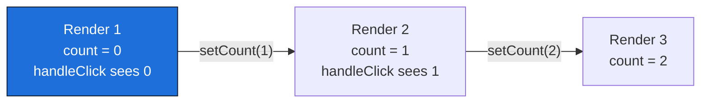

## The problem this solves

A component is a function, and a function's local variables vanish when it returns ([[js-execution-context]]). So where does a counter's value live between renders, and how does React know to call the function again when it changes? A plain `let count` fails on both points: it resets on every call, and changing it tells nobody.

## Intuition

| | Props | State |
| --- | --- | --- |
| Owned by | the parent | the component itself |
| Changed by | the parent re-rendering with new values | calling the setter |
| Inside the component | read-only | read-only for this render; request a new value with the setter |
| Analogy in a function | arguments | memory that persists between calls |

`useState` gives a component memory. React stores the value outside your function, attached to the component's position in the tree ([[react-rendering]]), and hands it back on each render. Calling the setter does two things: stores the new value and **schedules a re-render**.

## Build it step by step

### Example 1: state is a snapshot

```jsx run
function Counter() {
  const [count, setCount] = useState(0);
  function handleClick() {
    setCount(count + 1);
    console.log('inside the handler, right after setCount, count is still', count);
  }
  return <button onClick={handleClick}>{count}</button>;
}
render(<Counter />);
click('button');
console.log('the button now shows', text());
```

`count` is a `const` inside this particular call of `Counter`. In the first render it is `0`, and `handleClick` is a closure over that `0` ([[js-closures]]). `setCount` does not change the variable; it asks React to call `Counter` again, and that *next* call gets `count = 1`. Each render has its own `count`, its own handlers, its own everything.



### Example 2: batching and the updater function

```jsx run
let renders = 0;
function Counter() {
  const [a, setA] = useState(0);
  const [b, setB] = useState(0);
  renders++;
  const plain = () => { setA(a + 1); setA(a + 1); setA(a + 1); };
  const updater = () => { setB(n => n + 1); setB(n => n + 1); setB(n => n + 1); };
  return <div><button onClick={plain}>plain</button><button onClick={updater}>updater</button><p>a = {a}, b = {b}</p></div>;
}
render(<Counter />);
renders = 0; click('text=plain');
console.log('three setA(a + 1) calls    ->', document.querySelector('p').textContent, '| renders caused:', renders);
renders = 0; click('text=updater');
console.log('three setB(n => n + 1) calls ->', document.querySelector('p').textContent, '| renders caused:', renders);
```

Two things are happening. **Batching**: React waits until the event handler finishes and then renders once, not three times ("renders caused: 1"). **Snapshot**: in the plain version `a` is `0` on all three lines, so it is "set to 1" three times. Passing a function (`c => c + 1`) tells React "compute from whatever the latest value is", so updates queue up correctly. Rule: **if the new state depends on the old state, use the updater form.**

### Example 3: never mutate, always replace

```jsx run
function Todos() {
  const [todos, setTodos] = useState(['learn hooks']);
  const addWrong = () => { todos.push('pushed'); setTodos(todos); };
  const addRight = () => setTodos(prev => [...prev, 'copied']);
  const remove = text => setTodos(prev => prev.filter(t => t !== text));
  return (
    <div>
      <button onClick={addWrong}>wrong</button><button onClick={addRight}>right</button><button onClick={() => remove('learn hooks')}>remove first</button>
      <p>{todos.join(', ')}</p>
    </div>
  );
}
render(<Todos />);
const shown = () => document.querySelector('p').textContent;
click('text=wrong');        console.log('after push + setTodos(same array):', shown());
click('text=right');        console.log('after setTodos(new array)        :', shown());
click('text=remove first'); console.log('after filter                     :', shown());
```

The first click changed the array but the screen did not move. The second click rendered, and the item pushed earlier suddenly appeared alongside the new one: the data had been changed behind React's back.

React decides whether state changed with `Object.is(oldValue, newValue)`. A mutated array is still the same reference, so React sees "no change" and skips the render. Create a new array or object every time, using the non-mutating tools from [[js-values]] and [[js-functional]]: spread, `map`, `filter`.

### Example 4: lifting state up and controlled inputs

```jsx
function SearchPage() {
  const [query, setQuery] = useState('');
  return (
    <>
      <SearchBox value={query} onChange={setQuery} />
      <Results query={query} />
    </>
  );
}
function SearchBox({ value, onChange }) {
  return <input value={value} onChange={e => onChange(e.target.value)} />;
}
```

Two siblings need the same data, so the state moves to their closest common parent. Data flows **down** as props; changes flow **up** through callback props. This is one-way data flow. The `input` is **controlled**: its displayed value always comes from React state, so state is the single source of truth.

## The rules of hooks, and why they exist

1. Call hooks only at the top level of a component or custom hook, never inside conditions, loops or nested functions.
2. Call hooks only from React functions.

React does not know your variable names. It identifies each hook **by the order in which it is called**: first `useState` call is slot 0, second is slot 1. If a hook sits inside an `if` that is sometimes skipped, every later hook shifts by one slot and receives another hook's state.

### Other hooks in this family

| Hook | Holds | Changing it re-renders? | Use for |
| --- | --- | --- | --- |
| `useState` | a value | yes | anything shown on screen |
| `useReducer` | a value, updated by `dispatch(action)` through a reducer function | yes | several related values, or complex transitions |
| `useRef` | a mutable `.current` box | **no** | DOM nodes, timer ids, "latest value" escape hatch |

## The rule, stated precisely

`const [s, setS] = useState(init)` returns the state for *this* render. `setS(v)` enqueues a replacement; `setS(fn)` enqueues a function of the previous pending state. After the current event handler completes, React processes the queue, and if the result differs by `Object.is`, re-renders the component with the new value.

!!! key
- State updates are asynchronous from your code's point of view: the variable does not change in the current render.
- Since React 18, batching applies everywhere, including inside promises and timeouts.
- Updater form for anything derived from previous state.
- Immutability is what makes change detection a cheap reference check.
- **Do not store what you can compute.** `fullName` from `first` and `last`, or a filtered list from a list and a query, should be calculated during render. Duplicated state drifts out of sync.
- Initial state is used only on the first render. `useState(expensive())` still calls `expensive` every render; `useState(() => expensive())` calls it once.
!!!

!!! trap
- Reading state right after setting it and expecting the new value.
- Mutating objects or arrays in state.
- Copying props into state (`useState(props.value)`) and wondering why it does not follow the prop. It was only the initial value.
- Calling a setter directly in the component body: render, set, render, set, forever.
- `{count && <Badge />}` renders `0` when `count` is 0. Use `count > 0 &&`.
!!!

!!! twist What changes if...
- **...a child needs to change the parent's state?** The parent passes a callback. The child never modifies props.
- **...the state is deeply nested and updates are painful?** Flatten it, or use `useReducer`, or a library like Immer that lets you write mutations which it converts to immutable updates.
- **...state is needed by components far apart in the tree?** That is the prop-drilling problem, answered in [[react-app-state]].
- **...you need a value in a callback that must always be current, without re-creating the callback?** Keep it in a ref. The stale-closure version of this problem is in [[react-effects]].
!!!

!!! model
Each render is a photograph. Props and state in the photo never change. Setters do not edit the photo; they ask React to take a new one.
!!!

## Practice

?? What prints, and what does the button show after one click?
```jsx
const [n, setN] = useState(1);
const onClick = () => { setN(n + 5); setN(prev => prev * 2); console.log(n); };
```
It logs `1` (the snapshot). The queue is "replace with 6", then "multiply previous by 2", so the button shows `12`.
??

?? Why does React require immutable state updates?
Because it compares old and new state by reference. A new reference means "changed, re-render"; the same reference means "nothing to do". Mutation changes the content behind an unchanged reference, so React, `memo`, and effect dependency checks all miss it. Immutability also keeps previous renders' snapshots intact.
??

?? `useState` vs `useRef`: when do you use each?
`useState` when the value affects what is rendered. `useRef` when you need to remember something across renders without causing a render: a DOM element, an interval id, the previous value, a flag such as "is this request still current".
??

?? `useState` vs `useReducer`?
`useReducer` moves the "how state changes" logic out of event handlers into one pure function `(state, action) => newState`. It pays off when several pieces of state change together, when the next state depends on the previous in several ways, or when you want transitions to be testable without rendering.
??

?? Why can't hooks be called conditionally?
React matches hook calls to stored state by call order. A conditional hook changes the order between renders, so the stored values line up with the wrong hooks. The linter rule exists to prevent exactly this.
??

?? Controlled vs uncontrolled inputs?
Controlled: the value lives in React state and the input shows whatever state says; every keystroke goes through `onChange`. Needed for validation as you type, formatting, or dependent fields. Uncontrolled: the DOM holds the value and you read it when needed through a ref or `FormData`; less code and fewer renders, good for simple forms.
??
