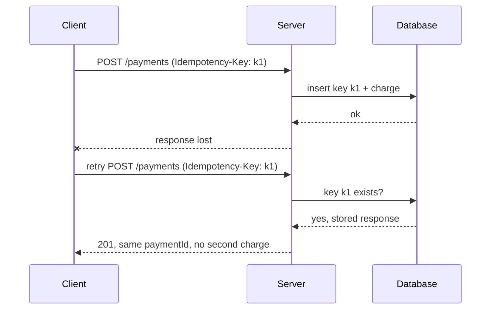

## The problem this solves

A client and a server are written by different people, at different times, and the network between them fails in the middle of requests. Without shared conventions every endpoint is a surprise: is it `/getUser?id=5` or `/user/fetch/5`? Did the request that timed out actually go through? REST conventions answer these once, for every endpoint.

## Intuition

HTTP already has a vocabulary. REST says: use it as intended.

- The **URL** names a thing (a *resource*): `/orders/42`.
- The **method** says what to do to it.
- The **status code** says what happened.
- The server keeps **no memory of the client between requests** (statelessness). Each request carries everything needed, usually a token ([[auth-jwt]]). This is what lets any server behind a load balancer handle any request ([[hld-scaling]]).

## Build it step by step

### Step 1: resources and methods

| Method | Path | Meaning | Success code | Safe | Idempotent |
| --- | --- | --- | --- | --- | --- |
| GET | `/orders` | list orders | 200 | yes | yes |
| GET | `/orders/42` | read one | 200 | yes | yes |
| POST | `/orders` | create a new order | 201 + `Location` header | no | **no** |
| PUT | `/orders/42` | replace the whole order | 200 | no | yes |
| PATCH | `/orders/42` | change some fields | 200 | no | depends on the body |
| DELETE | `/orders/42` | remove | 204 | no | yes |

- **Safe** means it does not change server state.
- **Idempotent** means doing it twice leaves the same state as doing it once. `DELETE /orders/42` twice: the order is gone either way. `POST /orders` twice: two orders.

Naming rules: plural nouns, no verbs in paths, nest only for true ownership (`/users/7/orders`), filter with query strings (`/orders?status=paid`).

### Step 2: status codes you must know

| Code | Name | Use when |
| --- | --- | --- |
| 200 / 201 / 204 | OK / Created / No Content | success; created a resource; success with empty body |
| 301 / 304 | Moved Permanently / Not Modified | redirect; cached copy still valid |
| 400 | Bad Request | malformed or invalid input |
| 401 | Unauthorized | **not authenticated**: missing or invalid credentials |
| 403 | Forbidden | **authenticated but not allowed** |
| 404 | Not Found | no such resource |
| 409 | Conflict | state conflict: duplicate email, version mismatch |
| 422 | Unprocessable Content | well-formed but fails validation rules |
| 429 | Too Many Requests | rate limited ([[node-scaling]]) |
| 500 / 502 / 503 / 504 | Server Error / Bad Gateway / Unavailable / Gateway Timeout | server-side failures |

4xx means the client must change the request. 5xx means retrying later may work.

### Example 1: a small API that follows the rules

```js run
const express = require('express');
const app = express();
app.use(express.json());

const products = new Map([[1, { id: 1, name: 'keyboard', price: 250000 }]]);
let nextId = 2;

app.post('/products', (req, res) => {
  const { name, price } = req.body ?? {};
  const errors = [];
  if (typeof name !== 'string' || !name.trim()) errors.push('name is required');
  if (!Number.isInteger(price) || price < 0) errors.push('price must be a non-negative integer (paise)');
  if (errors.length) return res.status(422).json({ error: 'validation failed', details: errors });
  const product = { id: nextId++, name: name.trim(), price };
  products.set(product.id, product);
  res.status(201).location('/products/' + product.id).json(product);
});
app.put('/products/:id', (req, res) => {
  const id = Number(req.params.id);
  if (!products.has(id)) return res.status(404).json({ error: 'product not found' });
  products.set(id, { id, name: req.body.name, price: req.body.price });
  res.json(products.get(id));
});
app.delete('/products/:id', (req, res) => { products.delete(Number(req.params.id)); res.status(204).end(); });

const server = app.listen(0, async () => {
  const base = `http://localhost:${server.address().port}/products`;
  const send = async (method, path, body) => {
    const r = await fetch(base + path, { method, headers: { 'content-type': 'application/json' }, body: body && JSON.stringify(body) });
    console.log(method.padEnd(6), ('/products' + path).padEnd(12), r.status, r.headers.get('location') ?? '', r.status === 204 ? '' : JSON.stringify(await r.json()));
  };
  await send('POST', '', { name: '', price: -5 });
  await send('POST', '', { name: 'mouse', price: 79900 });
  await send('PUT', '/2', { name: 'mouse', price: 69900 });
  await send('PUT', '/2', { name: 'mouse', price: 69900 });
  await send('DELETE', '/2');
  await send('DELETE', '/2');
  server.close(); server.closeAllConnections();
});
```

The PUT sent twice gives the same result, and so does the DELETE: both are idempotent. Prices are integers in the smallest currency unit, for the floating-point reason in [[js-values]].

### Example 2: pagination, offset vs cursor

```js run
const rows = Array.from({ length: 10 }, (_, i) => ({ id: i + 1, title: 'post ' + (i + 1) }));

const offsetPage = (page, limit) => rows.slice((page - 1) * limit, page * limit).map(r => r.id);
const cursorPage = (after, limit) => {
  const items = rows.filter(r => r.id > after).slice(0, limit);
  return { ids: items.map(r => r.id), nextCursor: items.length === limit ? items.at(-1).id : null };
};

console.log('offset page 2:', offsetPage(2, 3));
rows.unshift({ id: 0, title: 'new post inserted at the top' });
console.log('offset page 3 after an insert:', offsetPage(3, 3), '(6 is shown again)');
console.log('cursor after id 6:', cursorPage(6, 3));
```

| | Offset (`?page=3&limit=20`) | Cursor (`?after=abc&limit=20`) |
| --- | --- | --- |
| How | skip N rows, take the next 20 | "give me 20 rows after this key" |
| Jump to page 50 | yes | no |
| Stable while data changes | no: inserts shift rows, causing duplicates or gaps | yes |
| Cost for deep pages | grows, the database still walks the skipped rows | constant with an index on the cursor field ([[mongo-indexes]]) |
| Use for | admin tables, small data | feeds, infinite scroll, large collections |

### Example 3: idempotency keys make POST safe to retry

The dangerous case: the client sends "create payment", the server processes it, and the response is lost. The client cannot tell failure from success, so it retries, and the customer is charged twice.

```js run
const processed = new Map();
let charges = 0;

function createPayment(idempotencyKey, body) {
  if (processed.has(idempotencyKey)) return { ...processed.get(idempotencyKey), replayed: true };
  charges++;
  const response = { status: 201, paymentId: 'pay_' + charges, amount: body.amount };
  processed.set(idempotencyKey, response);
  return response;
}

console.log(createPayment('key-7f3a', { amount: 49900 }));
console.log(createPayment('key-7f3a', { amount: 49900 }));
console.log('times the card was charged:', charges);
```

The client generates a unique key per *intended* operation and sends it in an `Idempotency-Key` header with every retry. The server stores the first result under that key and replays it. In production the key check and the write must be atomic (a unique index or a transaction, see [[mongo-transactions]]). The e-commerce project's checkout is built on this.



## The rule, stated precisely

A REST API exposes resources at stable URLs, manipulates them only through standard methods with their defined semantics, is stateless between requests, and reports outcomes with standard status codes. Responses to safe requests may be cached.

!!! key
- 401 vs 403. PUT vs PATCH. Safe vs idempotent. These three distinctions come up constantly.
- Statelessness is what makes horizontal scaling simple.
- Validate at the boundary, return a consistent error shape (`{ error, details }`), never return 200 with an error inside.
- Version the API (`/v1/...`) so old clients keep working.
- When REST is the wrong tool: server-pushed updates need [[websockets]]; clients that need many shapes of the same data may suit GraphQL.
!!!

!!! trap
- Verbs in URLs (`/createOrder`), or GET requests that change data. Crawlers and prefetchers will trigger them.
- Returning 404 for an empty list. An empty collection is `200 []`.
- Leaking database ids, password hashes or internal fields by returning the raw document.
- Unbounded lists: every list endpoint needs a `limit` with a maximum.
!!!

!!! twist What changes if...
- **...two users edit the same resource?** Use optimistic concurrency: return a version (or `ETag`), require it on update (`If-Match`), and answer 409/412 if it changed. Field-level real-time merging is a different problem, solved in the collab editor.
- **...an operation is not CRUD, like "cancel order"?** Model it as a state change (`PATCH /orders/42 { status: 'cancelled' }`) or a sub-resource (`POST /orders/42/cancellation`).
- **...the operation takes minutes?** Answer `202 Accepted` with a status URL and process it in a queue. The online judge's submit endpoint does this.
!!!

!!! model
URL is the noun, method is the verb, status code is the outcome, and any request that might be retried must be safe to repeat.
!!!

## Practice

?? PUT vs PATCH vs POST for updating a user's email. Which, and why?
`PATCH /users/7 { email }`: a partial change to an existing resource. PUT would require sending the complete user and would erase omitted fields. POST is for creating subordinate resources or non-idempotent actions.
??

?? Is PATCH idempotent?
It depends on the body. `{ "email": "a@b.c" }` is idempotent (same end state). `{ "op": "increment", "field": "stock" }` is not. The HTTP spec does not require PATCH to be idempotent, unlike PUT and DELETE.
??

?? A user requests `/orders/42`, which belongs to someone else. 403 or 404?
403 is the literal answer (authenticated, not permitted). Many APIs return 404 instead so they do not reveal that order 42 exists. Either is defensible; say which and why.
??

?? Design the endpoints for comments on blog posts.
`GET /posts/:postId/comments?limit=20&after=cursor`, `POST /posts/:postId/comments`, then `GET|PATCH|DELETE /comments/:id`. Creation and listing are nested because a comment needs its parent; once it has an id, it is addressed directly so URLs stay short.
??

?? How would you rate-limit and where does 429 fit?
Count requests per key (user id or IP) in a shared store such as Redis, with a fixed window, sliding window or token bucket. When the budget is used up respond 429 with a `Retry-After` header. Implementation is in [[node-scaling]].
??

?? What makes an API "RESTful" beyond using JSON over HTTP?
Resource-oriented URLs, correct method semantics, statelessness, meaningful status codes and cacheability. JSON is not required by REST at all.
??
