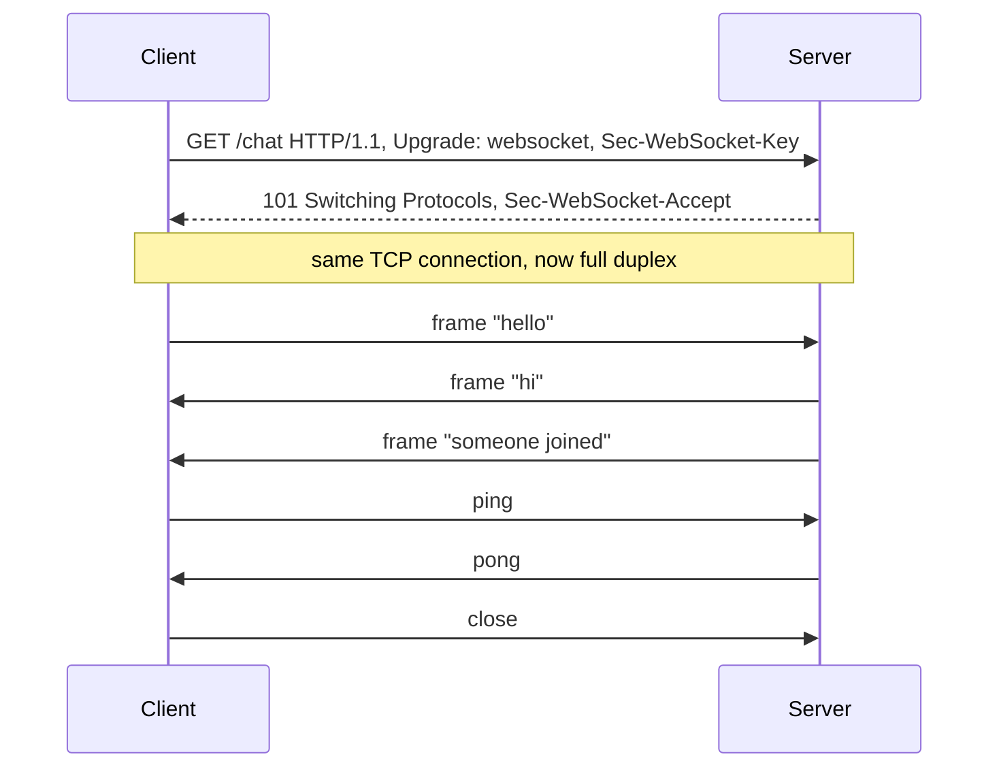
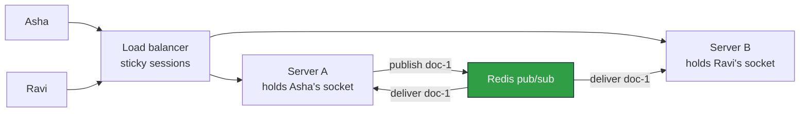

## The problem this solves

In HTTP the client asks and the server answers. The server cannot start a conversation. So how does a chat app show a message the moment someone else sends it?

| Technique | How it works | Cost |
| --- | --- | --- |
| Short polling | client asks "anything new?" every few seconds | mostly empty responses, delay up to the interval |
| Long polling | server holds the request open until there is news, client re-asks at once | one request per message, awkward to scale |
| Server-Sent Events (SSE) | one HTTP response that never ends, server streams events | one direction only (server to client), simple, auto-reconnects |
| **WebSocket** | one TCP connection, both sides send whenever they want | stateful connections to manage |

## Intuition

A WebSocket starts life as a normal HTTP request that asks to **upgrade**. If the server agrees, the same TCP connection ([[cn-tcp-udp]]) stops speaking HTTP and both sides exchange small **frames** freely until one closes.



Because Node keeps connections as cheap event sources instead of threads ([[node-runtime]]), one process can hold many thousands of open sockets.

## Build it step by step

### Example 1: a connection and messages both ways

```js run
const { WebSocketServer, WebSocket } = require('ws');
const wss = new WebSocketServer({ port: 0 });

wss.on('connection', socket => {
  socket.send(JSON.stringify({ type: 'welcome' }));
  socket.on('message', raw => {
    const msg = JSON.parse(raw);
    socket.send(JSON.stringify({ type: 'echo', text: msg.text.toUpperCase() }));
  });
});

wss.on('listening', () => {
  const client = new WebSocket(`ws://localhost:${wss.address().port}`);
  client.on('open', () => client.send(JSON.stringify({ type: 'say', text: 'hello' })));
  client.on('message', raw => {
    const msg = JSON.parse(raw);
    console.log('client received:', msg);
    if (msg.type === 'echo') { client.close(); wss.close(); }
  });
});
```

WebSockets carry text or binary, nothing more. You design the message format yourself; a `type` field plus a payload is the usual convention.

### Example 2: rooms and broadcasting

```js run
const { WebSocketServer, WebSocket } = require('ws');
const wss = new WebSocketServer({ port: 0 });
const rooms = new Map();

wss.on('connection', (socket, req) => {
  const params = new URL(req.url, 'ws://x').searchParams;
  socket.name = params.get('name');
  const room = params.get('room');
  if (!rooms.has(room)) rooms.set(room, new Set());
  rooms.get(room).add(socket);

  socket.on('message', raw => {
    for (const peer of rooms.get(room))
      if (peer !== socket && peer.readyState === WebSocket.OPEN) peer.send(`${socket.name}: ${raw}`);
  });
  socket.on('close', () => rooms.get(room).delete(socket));
});

wss.on('listening', async () => {
  const join = (name, room) => new Promise(res => {
    const ws = new WebSocket(`ws://localhost:${wss.address().port}/?name=${name}&room=${room}`);
    ws.on('message', m => console.log(`[${name} in ${room}] got "${m}"`));
    ws.on('open', () => res(ws));
  });
  const [asha, ravi, meera] = await Promise.all([join('asha', 'doc-1'), join('ravi', 'doc-1'), join('meera', 'doc-2')]);
  asha.send('typing in doc 1');
  setTimeout(() => { [asha, ravi, meera].forEach(s => s.close()); wss.close(); }, 100);
});
```

A **room** is just a set of sockets on the server. Ravi is in the same room and gets the message; Meera is in another room and does not; Asha is skipped because she sent it. Socket.IO's `socket.join(room)` and `io.to(room).emit()` wrap exactly this, and add auto-reconnect, acknowledgements and fallbacks.

### Example 3: authenticate during the handshake

```js run
const http = require('http'), jwt = require('jsonwebtoken');
const { WebSocketServer, WebSocket } = require('ws');
const SECRET = 'demo-secret';

const server = http.createServer();
const wss = new WebSocketServer({ noServer: true });

server.on('upgrade', (req, socket, head) => {
  try {
    const token = new URL(req.url, 'http://x').searchParams.get('token');
    const user = jwt.verify(token, SECRET);
    wss.handleUpgrade(req, socket, head, ws => { ws.user = user; ws.send('welcome ' + user.sub); });
  } catch {
    socket.write('HTTP/1.1 401 Unauthorized\r\n\r\n');
    socket.destroy();
  }
});

server.listen(0, () => {
  const url = 'ws://localhost:' + server.address().port + '/?token=';
  const good = new WebSocket(url + jwt.sign({ sub: 'user_7' }, SECRET));
  good.on('message', m => { console.log('valid token  :', String(m)); good.close(); });
  const bad = new WebSocket(url + 'forged');
  bad.on('error', e => { console.log('forged token :', e.message); setTimeout(() => server.close(), 50); });
});
```

After the upgrade there are no headers and no status codes per message, so identity must be established **once, at the handshake**, using the token from [[auth-jwt]]. Reject before upgrading, then attach the user to the socket. (Tokens in URLs can end up in logs; browsers that cannot set headers on a WebSocket often send the token as the first message or use a cookie instead.)

### Example 4: heartbeats find dead connections

A phone that loses signal never sends a close frame. The server still holds the socket and keeps sending into the void. The fix is a heartbeat:

```js
const interval = setInterval(() => {
  for (const socket of wss.clients) {
    if (!socket.isAlive) { socket.terminate(); continue; }
    socket.isAlive = false;
    socket.ping();
  }
}, 30000);
wss.on('connection', socket => {
  socket.isAlive = true;
  socket.on('pong', () => { socket.isAlive = true; });
});
```

Every 30 seconds: anyone who did not answer the last ping is terminated, everyone else is pinged again. Clients do the mirror image and reconnect with exponential backoff.

## Scaling past one server

The room map lives in one process's memory. With two servers behind a load balancer, Asha may be connected to server A and Ravi to server B. A's loop over its room will never reach Ravi.



Each server **publishes** incoming messages to a shared channel and **subscribes** to it, then forwards what it receives to its own local sockets. This is the Socket.IO Redis adapter, and the general idea is in [[hld-messaging]].

## The rule, stated precisely

A WebSocket is a persistent, full-duplex, message-framed protocol over a single TCP connection, established by an HTTP/1.1 `Upgrade` handshake answered with `101 Switching Protocols`. `ws://` is plain, `wss://` runs over TLS.

!!! key
- Polling vs long polling vs SSE vs WebSocket, with one good use for each. If only the server pushes (notifications, live scores), SSE is simpler.
- WebSocket connections are **stateful**, which breaks the "any server can handle any request" property of REST ([[rest-api]]). Hence sticky sessions and pub/sub.
- Authenticate at the handshake; validate and authorize every message after it. A connected user can send any `type` they like.
- Socket.IO is a library with its own protocol on top of WebSocket. A plain WebSocket client cannot talk to a Socket.IO server.
!!!

!!! trap
- Assuming messages arrive after a reconnect. The server must let clients catch up (send "last seen" id, replay missed events).
- Forgetting cleanup on `close`: sockets left in rooms leak memory.
- Broadcasting on every keystroke or mouse move. Throttle on the client ([[js-functional]]) and batch on the server.
- Blocking work in a message handler stalls every connection on that process.
!!!

!!! twist What changes if...
- **...two users change the same thing at once?** Transport is solved; consistency is not. That needs operational transformation or CRDTs, the heart of the collab editor project.
- **...the load balancer cuts idle connections after 60 seconds?** Heartbeats keep the connection active, and clients must reconnect anyway.
- **...you need delivery guarantees?** Add message ids and acknowledgements; resend what was not acknowledged. WebSocket over TCP guarantees order on one connection, not delivery across reconnects.
!!!

!!! model
HTTP is sending letters and waiting for replies. A WebSocket is a phone call: one setup, then either side talks, and someone has to notice when the line goes dead.
!!!

## Practice

?? Why does the WebSocket handshake use HTTP at all?
So it works through existing infrastructure: same ports (80/443), same proxies, same TLS, cookies and origin checks. The server proves it understood the upgrade by hashing the client's `Sec-WebSocket-Key` into `Sec-WebSocket-Accept`.
??

?? WebSocket vs SSE for a live cricket score page?
SSE. Data flows one way, it runs over plain HTTP, the browser reconnects automatically and resumes with `Last-Event-ID`. WebSocket adds complexity that is only worth it when the client also sends frequently.
??

?? How would you show "Asha is typing..." without flooding the server?
Client sends a `typing` event at most once every couple of seconds while keys are pressed (throttle). The server broadcasts it to the room. Receivers show the indicator and hide it with a timer if no new `typing` event arrives. No "stopped typing" message is needed.
??

?? You have 3 Socket.IO servers. A user in a room does not receive some messages. Why?
Each server only knows its own sockets. Messages emitted on one server reach only that server's members unless a shared adapter (Redis pub/sub) relays them. Also check sticky sessions: Socket.IO's HTTP long-polling fallback needs every request of a session to hit the same server.
??

?? How many WebSocket connections can one Node server hold, and what limits it?
Tens of thousands is routine. Limits are memory per connection, the OS file-descriptor limit, and above all how much work each message causes. Idle connections are cheap; broadcast fan-out is what costs.
??

?? How do you handle a client that was offline for 30 seconds?
On reconnect the client sends the id or version of the last event it processed. The server replays newer events from a log (or sends a fresh snapshot if too far behind). The collab editor uses a document version number for this.
??
