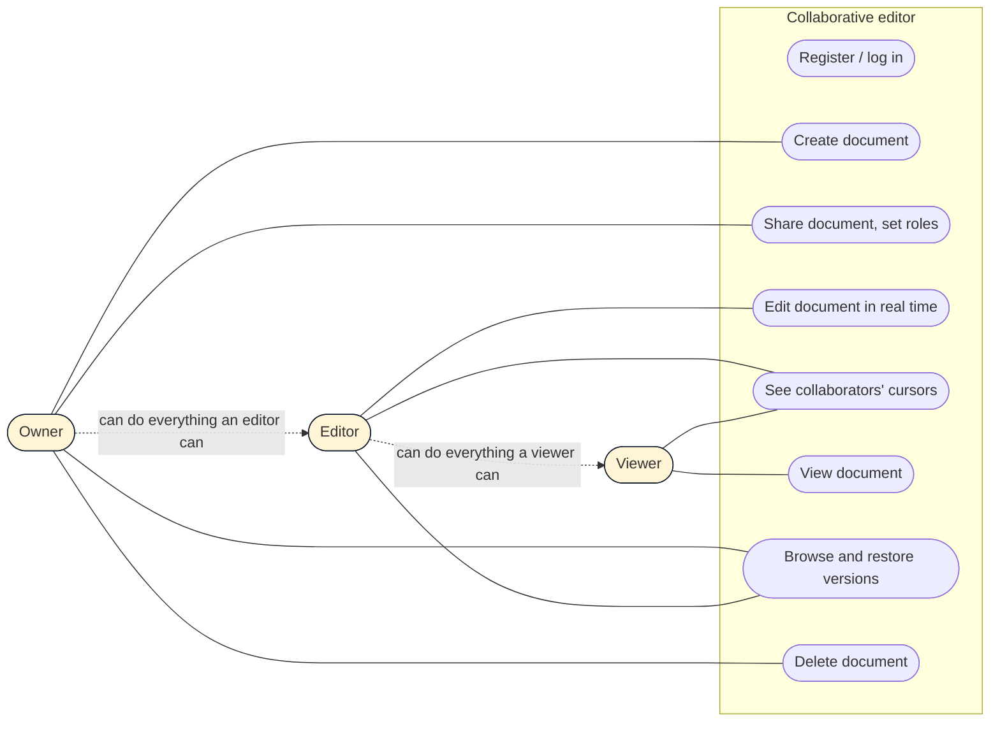
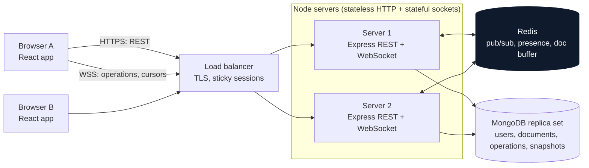
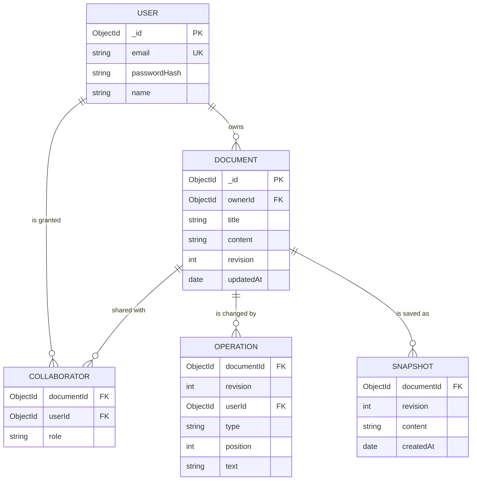
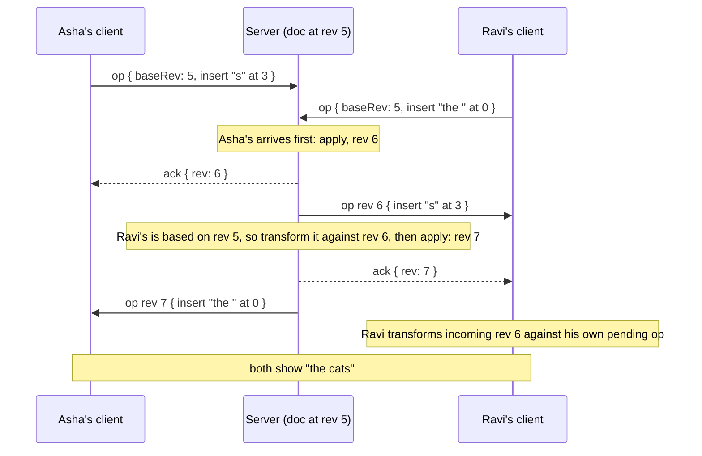
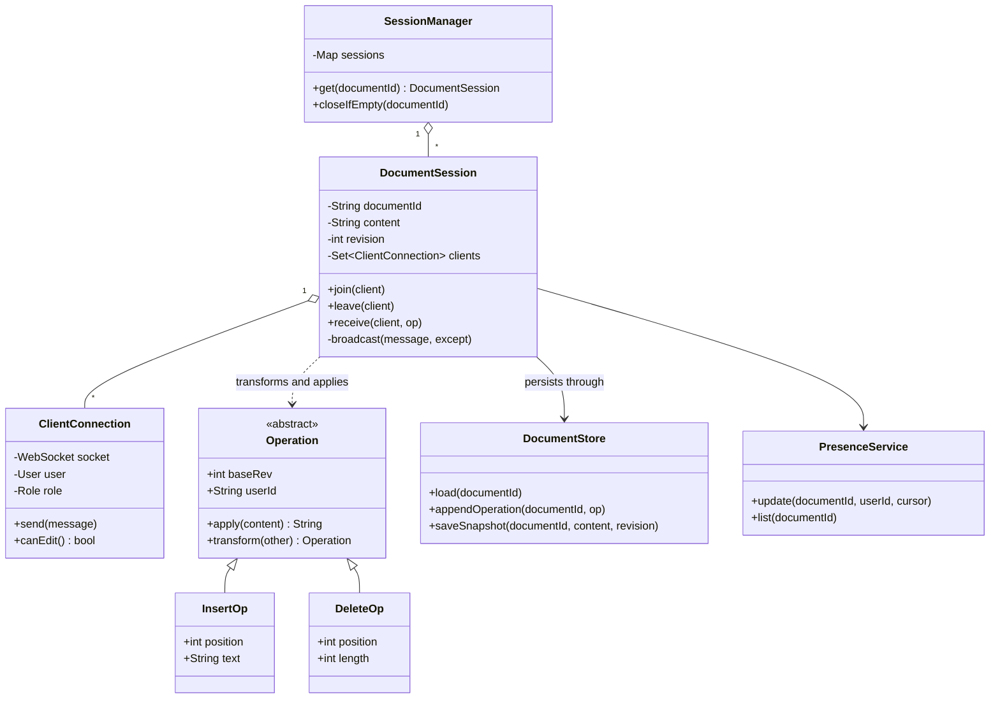

## What you are building

A document editor where several people type in the same document at the same time and everyone converges on the same text. Think of a small Google Docs for plain text or Markdown.

This page is the **blueprint**: scope, every diagram you should be able to draw, the design decisions with their reasons, and the questions interviewers ask. Each part links to the station that teaches the concept underneath it, so read a station when a part feels unfamiliar instead of learning it again here. The step-by-step coding guide comes in the next round of this site.

| Feature | Why it is in scope |
| --- | --- |
| Sign up, log in, stay logged in | every real app has it; shows auth done properly |
| Create, rename, delete, list documents | plain REST CRUD |
| Share with roles: owner, editor, viewer | authorization beyond "is logged in" |
| Live editing by many users with no lost edits | the hard, memorable part |
| Presence: who is here, where their cursor is | cheap to add, impressive in a demo |
| Autosave and version history | persistence design, recovery |

A line for your resume, once built and measured: *"Built a real-time collaborative editor (React, Node, WebSocket, MongoDB, Redis) using operational transformation with server-assigned revisions; N concurrent editors per document with sub-X ms sync, horizontally scaled over Redis pub/sub."* Fill N and X with numbers you actually measure.

## Use case diagram



How to present it: actors on the outside, the system boundary as the box, one oval per goal a user has. Roles inherit: an owner is also an editor, an editor is also a viewer.

## Architecture



Two channels, on purpose:

- **REST over HTTPS** for everything request-shaped: auth, document list, sharing, history. Built with [[express-middleware]] following [[rest-api]].
- **WebSocket** for everything live: edits and cursors. See [[websockets]].

Node suits this because the workload is thousands of mostly idle connections with small messages, which is exactly what the event loop is good at ([[node-runtime]], [[js-event-loop]]).

## Data model



Decisions, using the rules from [[mongo-modeling]]:

- **Collaborators are embedded** in the document as a small array `[{ userId, role }]`: bounded, always read with the document, checked on every access. (Drawn as its own entity above because that is how you would explain the relationship.)
- **Operations are a separate collection**: unbounded and append-only. Unique compound index `{ documentId: 1, revision: 1 }` ([[mongo-indexes]]) both serves "operations after revision N" and makes it impossible to store two operations with the same revision.
- **Snapshots** every few hundred operations, so loading a document is "latest snapshot plus the operations after it" instead of replaying history from zero.
- "My documents" needs a multikey index on `collaborators.userId` plus one on `ownerId`.

## Authentication and authorization

Everything here is built in [[auth-jwt]]; this section only says where it plugs in.

- Passwords hashed with bcrypt. Short-lived access token in memory, refresh token in an `HttpOnly` cookie, client refresh logic from [[react-app-state]].
- REST: `requireAuth` then a `requireDocRole('editor')` middleware factory (a closure, [[js-closures]]) that loads the document and checks the caller's role. 401 for no identity, 403 for wrong role.
- WebSocket: the token is verified **once during the upgrade handshake**; the user is attached to the socket. Every incoming message is then authorized against that user's role for that document. A viewer's socket that sends an edit is rejected by the server no matter what the UI allows.

## Real-time sync: the core problem

Sending keystrokes to everyone is easy. The problem is **concurrent edits**. The document is `"cat"`. At the same moment:

- Asha inserts `"s"` at position 3, wanting `"cats"`.
- Ravi inserts `"the "` at position 0, wanting `"the cat"`.

If each client applies the other's operation as received, Asha ends with `"the cats"` but Ravi, applying "insert `s` at 3" to `"the cat"`, gets `"thes cat"`. The replicas have diverged.

### The fix: transform operations against each other

**Operational transformation (OT)**: before applying a remote operation, adjust it for the concurrent operations it did not know about. An insert that happened earlier in the text shifts later positions to the right.

```js run
const apply = (doc, op) => doc.slice(0, op.pos) + op.text + doc.slice(op.pos);

function transform(op, against) {
  const shifts = against.pos < op.pos || (against.pos === op.pos && against.user < op.user);
  return shifts ? { ...op, pos: op.pos + against.text.length } : op;
}

const base = 'cat';
const asha = { user: 'asha', pos: 3, text: 's' };
const ravi = { user: 'ravi', pos: 0, text: 'the ' };

console.log('naive, at Ravi  :', JSON.stringify(apply(apply(base, ravi), asha)));
console.log('OT, at Asha     :', JSON.stringify(apply(apply(base, asha), transform(ravi, asha))));
console.log('OT, at Ravi     :', JSON.stringify(apply(apply(base, ravi), transform(asha, ravi))));
```

Both replicas now agree. The tie-break on user id handles two inserts at the same position, so both sides order them identically. A full implementation also transforms delete against insert and delete against delete; the principle is the same.

### Who decides the order: the server



- The server keeps one **revision counter** per document and is the single source of truth for order. Because Node runs one message handler at a time per process ([[js-event-loop]]), handling "transform, apply, increment" for a document is naturally sequential within a server.
- Each client op carries the revision it was based on (`baseRev`). The server transforms it against every operation after that revision, applies it, assigns the next revision, acknowledges the sender and broadcasts to the room.
- A client sends **one operation at a time** and buffers further typing until the acknowledgement arrives. This keeps the client's bookkeeping to "one pending op, one buffer".

### OT vs CRDT

| | Operational transformation | CRDT (for example Yjs, Automerge) |
| --- | --- | --- |
| Idea | transform positions against concurrent operations | give every character a unique, ordered id so operations commute |
| Needs a central server | yes, to order operations | no, peers can merge in any order |
| Offline editing | awkward | natural |
| Complexity lives in | transform functions (easy to get subtly wrong) | the data structure (metadata overhead, garbage collection) |
| Used by | Google Docs | Figma-style and local-first apps |

What to say in the interview: "I chose server-ordered OT because this app is always online with a central server, which is the case OT handles simply. If offline editing were a requirement I would use a CRDT library such as Yjs rather than write my own."

## Class diagram



How to defend it: `Operation` is polymorphic, so `DocumentSession.receive` calls `transform` and `apply` without knowing the concrete type, and adding a formatting operation later means adding a class, not editing the session ([[oop-pillars]], [[oop-solid]]). `DocumentSession` depends on `DocumentStore` as an interface, so it can be unit-tested with an in-memory store. Classes in JavaScript are [[js-prototypes]].

## Persistence and autosave

- Every accepted operation is appended to `operations` with its revision. The unique index is the safety net: if two servers ever tried to assign the same revision, one insert fails.
- The document's `content` and `revision` are updated with a **conditional update** on the expected revision, the optimistic-concurrency pattern from [[mongo-transactions]].
- Writing the full content on every keystroke is wasteful. The session holds the content in memory and flushes it on a **debounce** (a few seconds after the last edit) and on a maximum interval, using the technique from [[js-functional]].
- Reconnect: the client sends its last known revision; the server replies with the operations after it, or a fresh snapshot if the gap is large.

## Frontend

| Concern | Approach | Station |
| --- | --- | --- |
| Socket lifetime | one effect per open document: connect on mount, close in cleanup, re-run when `documentId` changes | [[react-effects]] |
| Editor state | local text, one pending op, one buffer, server revision; a reducer fits the transitions | [[react-state]] |
| Callbacks reading the latest state inside socket listeners | refs or updater functions, to avoid stale closures | [[react-effects]] |
| Cursor broadcasts | throttled to a few per second | [[js-functional]] |
| Remote cursors re-rendering the editor | keep presence in a separate component and state so typing does not re-render it | [[react-performance]] |
| Document list, sharing dialog | server state through a query cache | [[react-app-state]] |

## Scaling beyond one server

With two servers, users editing the same document may be connected to different processes. Two workable designs ([[node-scaling]], [[websockets]]):

1. **Route by document**: the load balancer hashes the document id so all sockets for one document land on one server. That server is the only writer for that document. Simple and keeps ordering trivial; rebalancing on server failure needs care.
2. **Shared order in Redis**: any server accepts an operation, but revision assignment happens atomically in Redis (a Lua script or stream), and servers fan out through pub/sub.

Start with design 1 and say why: the ordering argument stays as simple as the single-server case.

## Questions an interviewer will ask

?? Why WebSocket and not polling or SSE?
Edits flow both ways many times per second and latency is the product. Polling adds delay and wasted requests; SSE is one-directional, so edits would need separate HTTP requests with their own ordering problems. One full-duplex connection gives ordered delivery in both directions.
??

?? What happens if two users type at exactly the same position?
Both operations have the same base revision. The server applies whichever arrives first and transforms the second against it. For identical positions, a deterministic tie-break (lower user id goes first) makes every replica place them in the same order.
??

?? How do you guarantee no edit is lost?
The client keeps an operation as pending until the server acknowledges it with a revision. On disconnect it reconnects, catches up from its last revision, transforms the pending operation against what it missed and resends. On the server, an operation is acknowledged only after it is durably appended.
??

?? What if the server crashes with unsaved content in memory?
Content in memory is a cache. The operation log in MongoDB is the source of truth, and every acknowledged operation is in it. On restart, a session is rebuilt from the latest snapshot plus later operations.
??

?? Why MongoDB here? Would SQL work?
Either works. The document plus embedded collaborators is a natural single-document read, and the operation log is an append-only collection with one compound index. Nothing needs multi-table joins. With PostgreSQL the same design is two tables and a unique constraint on `(document_id, revision)`.
??

?? How does a viewer get blocked from editing if they tamper with the client?
The role check runs on the server for every incoming socket message, using the identity established at the handshake. The disabled editor in the UI is only a convenience.
??

?? Where is the bottleneck as a single document gets 500 editors?
Broadcast fan-out: each operation is sent to 499 sockets, and cursor updates multiply that. Mitigations: batch operations per animation frame, throttle and coalesce cursor updates, and cap or sample presence for large rooms.
??

?? How would you add rich text, comments or offline mode?
Rich text: operations over a structured model (as Quill's Delta or ProseMirror steps do), same pipeline. Comments: anchored to positions that are transformed like cursors. Offline: this is where I would switch to a CRDT library, because merging long-divergent histories is what CRDTs are designed for.
??

## Build order

1. REST API: auth, documents CRUD, sharing. Tests for 401 and 403.
2. React shell: login, document list, a plain `textarea` editor that saves over REST.
3. WebSocket channel with handshake auth, rooms and presence.
4. Insert and delete operations, the transform function with unit tests for every pair, server revisions.
5. Client state machine: pending, buffer, acknowledgements, reconnect and catch-up.
6. Operation log, snapshots, version history screen.
7. Redis and a second server instance. Measure latency and document it in the README.
